# Link play in the FliperOS frontend: plan

A plan, not an implementation. It turns the link research (`docs/research/linked-cabinets.md`, wiki page *Linked cabinets*) into screens and a protocol for the frontend (`gui/fliperos-frontend`). The mock-ups are in `docs/research/link-frontend-mockups/`, drawn with the frontend's own font and palette (`tools/link-tests/frontend-mockups.py`). They use the real art scraped on the cabinet and the Arcadeflow icons the frontend already ships (genre, controls, buttons), and the card has the look of the frontend's own play card.

**No description text on these games.** A link or net play game is shown with its art, its title, the year and maker, and the same icons as any other game (genre, players, controls, buttons), plus the globe and the cabinet icons. The state is told by icons, lit or dim, and by numbers. The only words are the title, the name of the selected tile (as the card already does with PLAY) and a state word in the waiting room.

## What was asked

1. A game that links machines, or that has more players than this cabinet has controls, shows a mark. In the list it is a dim green globe to the left of the title. In the other modes (grid, full screen) it is another mark.
2. Selecting such a game adds a second way to play: link play, shown as a globe made of green lines. If nobody is playing the game, this cabinet is the first one. The next one to come is the second, and so on.
3. A cabinet that looks at a game someone is already playing sees the globe lit, with the cabinets already in it, lit, and the free ones dim.
4. The game also offers "join the existing link": this cabinet becomes the next one if there is a free place.
5. All of this updates in real time with the other machines on the network. Cable only.
6. A game with fewer controls here than players it allows gets the same idea with a different icon: net play. The user joins another cabinet's party and picks the player slot (player 2 if the host has one control, player 3 if the game has three or more players), among the free ones.
7. The Super Street Fighter II Tournament Battle and its sets need all four machines before they start. The frontend must keep everyone in a waiting room until all are connected, and then enter together. Do the same for any other game that works like that.
8. A cabinet that has just joined the network shows, first in its lists, the games being played on other machines.
9. If the one who wants to join does not have the game, the master sends the files it needs.
10. One NVRAM per cabinet number, for each game with two or more cabinets.

## What the tests say about how link games behave

These facts decide the design. They come from the tests of 31 October to 1 November 2026.

| Fact | Where it was seen | What it means for the frontend |
| --- | --- | --- |
| Every link game waits for the other machines at start: "Network Checking" (Daytona, Scud Race, Daytona USA 2), "Checking Network" (Dirt Devils), "Terminal Check" (Tournament Battle). It does not start alone | all of them | **Every link game needs a waiting room.** The Tournament Battle is not special |
| The link is fixed when the games start. A machine that restarts does not rejoin, and the other has to restart too. A third machine joining a running game was not seen to work in any emulator | Supermodel, MAME | **No joining after the start.** The lobby closes at the start, and the game shows as "in progress, closed" to the others |
| The role is in the game's NVRAM (master, slave, car number, machine ID), and the cabinet number is part of it | all the Sega games | The launcher puts the NVRAM of the right cabinet in place before it starts the game |
| The order of start matters and differs by emulator | see the table below | The lobby, not the user, starts the machines in the right order |
| The number of cabinets is not set in the game. It is discovered when the link starts. Only the Tournament Battle (4) and Gunbuster (2) have a fixed size | MAME source, tests | A game with a flexible size needs a minimum and a maximum in its profile, and the host decides when to start |
| The machines must run at about the same speed | MAME's notes, tests | The lobby can warn when a cabinet is much slower |
| A link game still plays alone with the right NVRAM (Link ID Single, or the link off) | SM2-Emu, Supermodel | "Play" (solo) keeps working and uses a standalone NVRAM |

### Start order and sizes tested

| Game | Emulator | Order that worked | Sizes tested | Menu allows |
| --- | --- | --- | --- | --- |
| Daytona USA | SM2-Emu | master first, then the slave | 2 | cars 1 to 8 |
| Daytona USA | GroovyMAME | slave first, then the master | 2 | cars 1 to 8 |
| Scud Race | Supermodel | for 2, master first. For 4, the slaves first (last of the ring first), the master last | 2, 4 | cars 1 to 8 |
| Daytona USA 2 | Supermodel | slaves first, master last (for 2: master first also worked) | 2, 4 | cars 1 to 8 |
| Dirt Devils | Supermodel | master first | 2 (4 only formed two of four links) | machine IDs to be checked |
| Club Kart | Flycast | the server first (`ActAsServer`), the client 6 s later | 2 | 2 |
| Tournament Battle | GroovyMAME | the head first (empty remote host), the others in chain order | 4 | 4 |

The reason for the Supermodel order: each machine connects to the next one only after it receives the connection from the previous one. The master starts the chain, so every other machine must already be listening.

## Screens

All drawn at 320x240 and shown here at 3x.

### List: marks and the games being played elsewhere

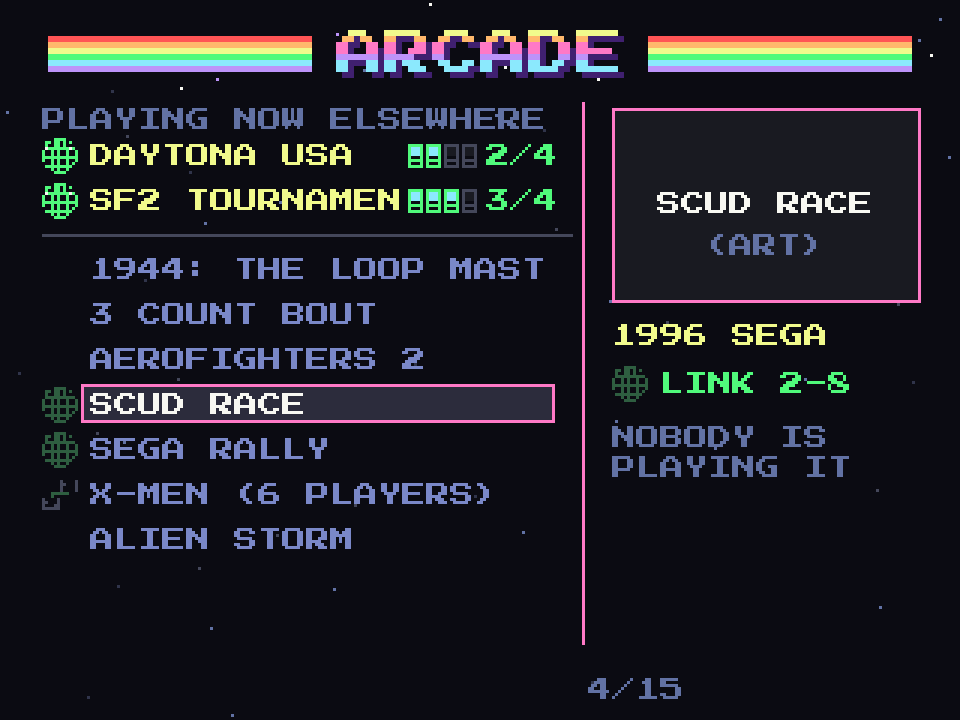

- The globe is to the left of the title. **Dim** when nobody is playing the game on another cabinet, **lit** (with white nodes) when someone is. The two-controller icon marks a game with more players than this cabinet has controls.
- A group at the top, "playing now elsewhere", lists what the other cabinets are playing. For each: the lit globe, the title, and the cabinets in the link as small lit and dim icons. It is empty when nothing is being played, and then it takes no space.
- The right panel is the usual one: art, year and maker, genre, players, controls and buttons icons. A link game adds the globe to the first icon row, dim here (nobody is in it).

When the selected game is being played elsewhere, the globe is lit and the panel shows the cabinets of the link, lit for the ones that are in, with the count:

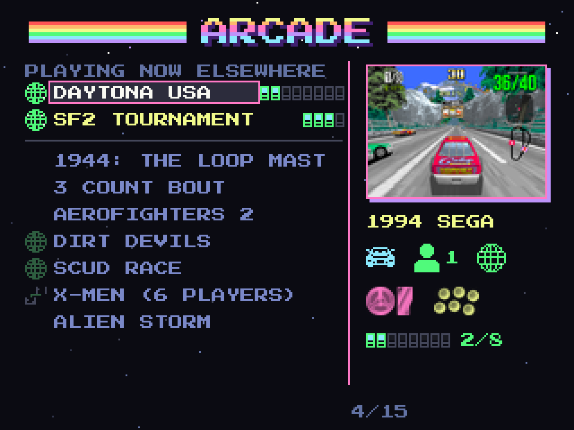

### Grid and full screen: the mark has no title to sit next to

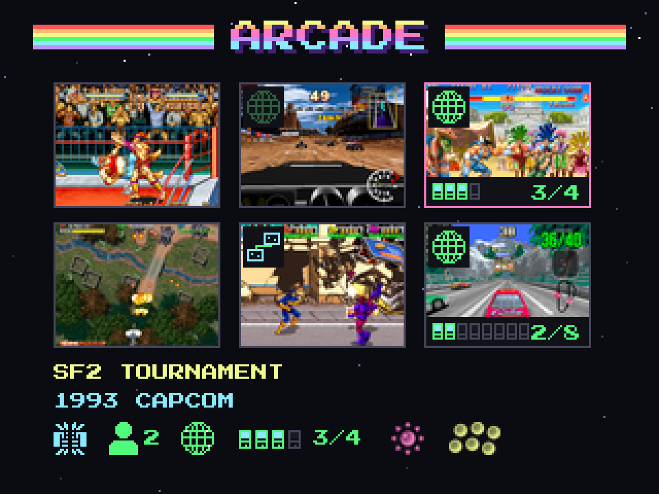

- In the grid the mark is a small badge in the top-left corner of the tile (the globe, or the two controllers for net play). A tile of a game being played also shows the cabinet icons and the count along its bottom edge. The line under the grid is the selected game's: title, year and maker, then icons only.
- In full screen the mark goes in the information line under the title, next to the players, controls and buttons icons, with the same lit and dim states, and the cabinets of the link when someone is playing:

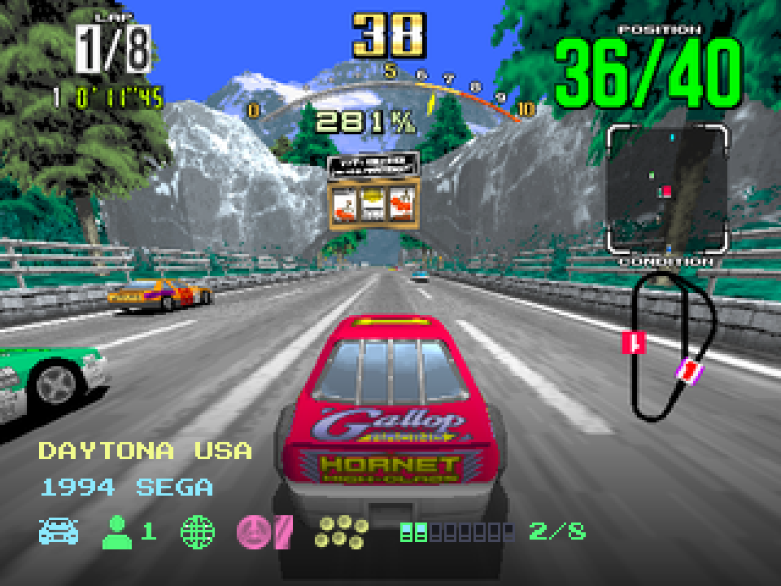

### Choosing how to play

New link, nobody playing it:

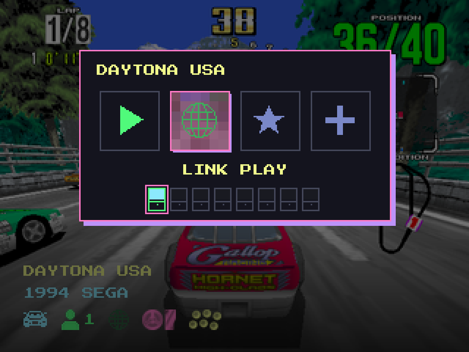

Joining a link that already exists:

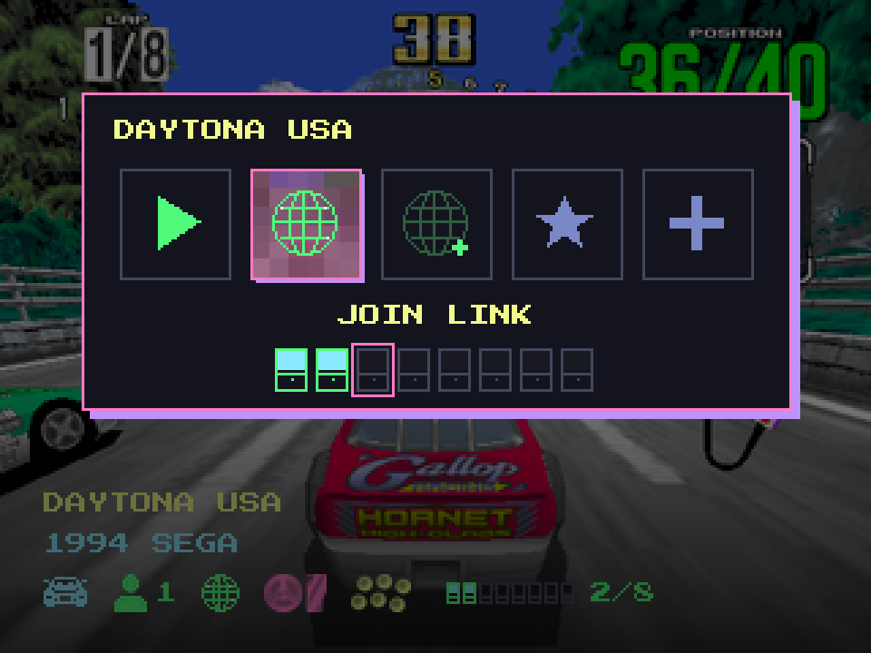

- **This window appears only when the user presses play on one of these games** (a link game, or a game with more players than this cabinet has controls). Every other game starts straight away, as it does today.
- It is the frontend's own card (title, a row of tiles, the name of the selected one under them) over the dimmed full screen, with the game's art and its info icons behind it. The first tile is "play", the green triangle, for solo. The second is the globe: "link play" when nobody is playing (a dim globe; this cabinet becomes #1, the master), "join link" when a party is waiting (a lit globe; this cabinet becomes the next free number). The star and the plus are the card's usual favourite and more tiles.
- Under the name, the cabinet icons show who is in (lit) and which place this cabinet would take (the pink ring). Nothing else is written.
- If a party is already waiting, a third tile, the dim globe with a plus, starts a new link next to it. A game with more than one open party gets one tile per party, in the order they started. If a party is closed or full, its tile is dim with the state, and a new party can still be started.

A game with more players than this cabinet has controls gets the same card with the two-controller icon instead of the globe. Under it, the party's player slots: taken ones lit, free ones dim, and the pink ring on the pair this cabinet would take (it has two controls):

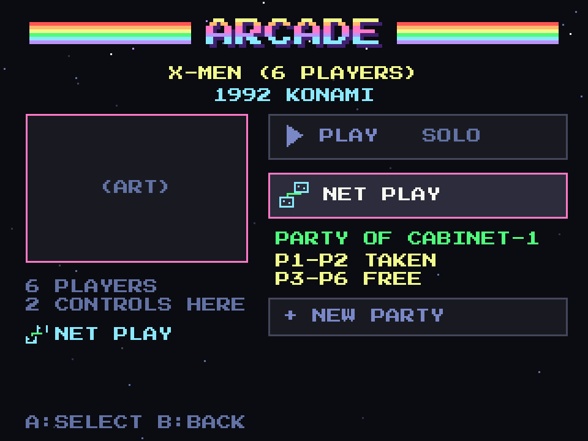

### The waiting room

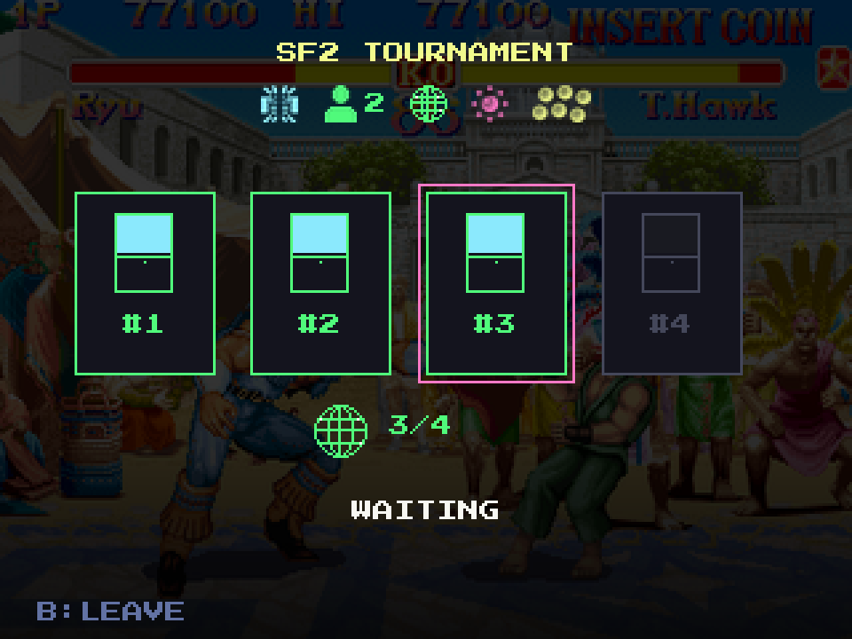

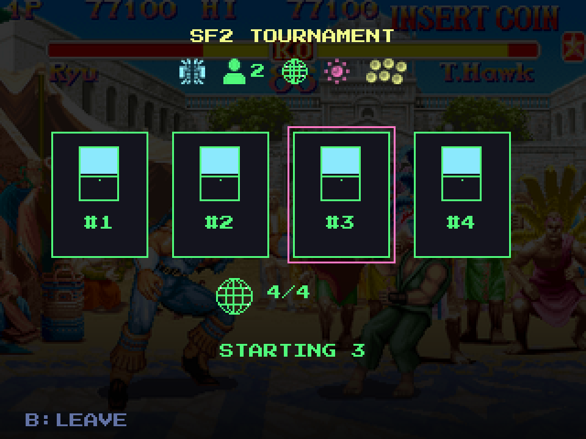

- One screen for every link game, over the dimmed art. The title and the info icons are at the top. The cabinet icons light as machines come in. Each shows its number, and the pink ring marks this one. Below, the globe with the count, and one word: waiting, or starting with the countdown.
- **Fixed size** (Tournament Battle, 4; Gunbuster, 2): the party starts by itself when the last one arrives, after a short countdown.
- **Flexible size** (Daytona, Scud Race and the others, 2 to 8): the host chooses when to start. It starts by itself when the maximum is reached. Until the minimum is there, the start is not offered.
- Everyone enters together: at the start the lobby runs each machine's emulator in the right order and with the right NVRAM, and shows "starting". After that no one can join.
- B leaves the room. If the host leaves, the party closes for everyone and the others go back to the list.

### Net play

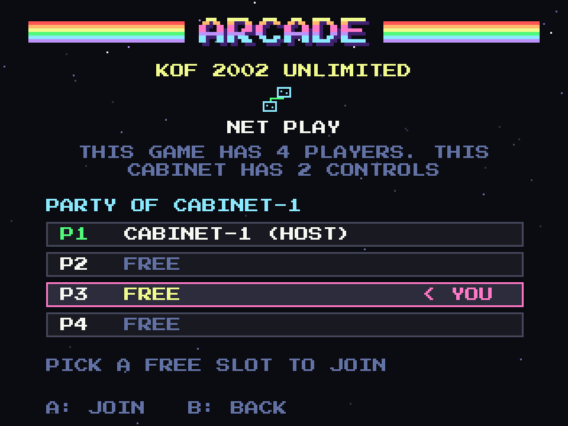

- For a game with more players than this cabinet's controls. The user joins another cabinet's party and takes a free slot (P2, P3 and so on). The host sees the slots fill.
- The example is X-Men (6 Players, Konami 1992), a six-player game. Each cabinet can take as many slots as it has controls, so a cabinet with two controls takes a pair. The header is icons: the players the game has (6), the net play mark, and the controls this cabinet has (2). Each row is a slot with the cabinet that holds it.
- Net play needs an emulator core that supports netplay (RetroArch), so which games get it depends on the cores. It does not link boards: the Tournament Battle's eight-player bracket still needs its four-cabinet link.

#### How net play works, and what has it

This is what the emulators' design says, plus what was tested on 1 November 2026: RetroArch 1.22.2 on the cabinet, a host and a client on the loopback with the null video, audio and input drivers (no screen), 23 seconds each.

| Core | Game | Result |
| --- | --- | --- |
| FBNeo (in the image) | `xmen.zip` | Host and client connected: "joined as player 2 (ping 2 to 6 ms)" |
| MAME, the current libretro core (nightly, 415 MB, **not** in the image) | `xmen.zip` of the 0.289 merged romset | Connected: "joined as player 2 (ping 4 to 8 ms)". No desync report with `netplay_check_frames = 30` |
| MAME 2010 (in the image) | `doapp.zip` | **"Core does not support netplay."** It cannot host or join |

The wired round trip between the Windows PC and the cabinet is under 1 ms (20 pings: minimum, average and maximum 0 ms). Slots: RetroArch lets each side ask for its player slots with `netplay_request_device_pN`. A second headless run on the cabinet (X-Men, FBNeo) had the host answer "joined with input devices 1, 2" and the guest "joined with input devices 3, 4". So **each cabinet takes as many players as it has controls configured**: the frontend counts the players of `/etc/fliperos/buttons.map` (the Button mapping; 2 on the test cabinet, `FLIPEROS_LOCAL_PLAYERS` overrides), the host takes the first ones, each guest the next free ones (or what is left), the party is full when every player of the game has an owner, and each cabinet's config requests exactly its own devices. Not tested: a real game played on two screens and the input delay a person feels.

**What the frontend does.** A game of the MAME folder with more players than this cabinet has controls (2 by default, `FLIPEROS_LOCAL_PLAYERS`), and that FBNeo runs (the set list of `fliperos-fbneo`), gets the net play mark (two controllers instead of the globe) and the menu tiles NET PLAY, JOIN PARTY and NEW PARTY. It uses the same party and waiting room as link play. When it starts, the host opens `retroarch -L fbneo_libretro.so GAME --host` and each guest `--connect HOST`, after its start delay, with a config that turns off the public lobby, the relay and the NAT traversal (`~/.config/fliperos/netplay.cfg`).

- **RetroArch.** One cabinet hosts (`--host`, TCP port 55435), the others connect (`--connect IP`). Only the players' inputs travel, not the picture: every cabinet runs the game itself, so the core must be deterministic and every cabinet must have the same core version and the same game files. The method is rollback: each cabinet runs ahead with a guess of the other's input, and when the real input arrives and differs it loads the last save state and runs the frames again. The core must therefore save and load a state fast, every frame. A small input delay (`netplay_input_latency_frames_min` and `_range`) hides most of the corrections. Spectators can join, and a client takes a free player slot. Whether one cabinet can hold two slots with its two controls, and how to choose the slot from the command line, are to be tested.
- **Cores in the image.** FBNeo (CPS1, CPS2, CPS3, Neo Geo, Konami and the rest of its arcade list) is the arcade core built for netplay. MAME 2003-Plus can work for the games whose driver saves state well. MAME 2010, the other arcade core, is not a netplay candidate (the same state problem). GroovyMAME and MAME have no netplay: their only network is the board link tested for the link games.
- **Flycast.** The Flycast of the image has GGPO options in its binary (`GGPO`, `GGPODelay`, `GGPOAnalogAxes`, `GGPOChat`) next to `ActAsServer` and `EmulateBBA`, so Naomi and Atomiswave games have rollback netplay between two cabinets without anything added. This was **found in the binary only, not run**: the option names in `emu.cfg` and what it takes to start a match by command line are still to be tested. Fightcade's Flycast (Dojo) has delay and rollback too, for Naomi, Atomiswave and Dreamcast; Fightcade 2 itself is Internet matchmaking and is not in the image. The RetroArch Flycast core has none.
- **No netplay:** Supermodel and SM2-Emu (they link boards, see the link games), PCSX2, DuckStation, Hypseus and OpenBOR. Dolphin has its own netplay, without rollback, for the GameCube and Wii only.

**Local and wired only.** Net play and link play both run on the local network, on the cable, and nowhere else. The frontend starts the host on the wired interface's address only, connects only to a cabinet seen on the wired network, and offers neither when the cable is down. A Wi-Fi link and the Internet are never used, so the options of the emulators for relays and public servers stay off.

**Latency.** A frame is 16.7 ms at 60 Hz. On the cable between two cabinets the round trip is under a millisecond, so the remote input arrives in a fraction of a frame: net play needs no input delay, and a rollback is rare. What the user feels is the same as playing alone, plus the CPU cost of saving a state every frame and, when a guess was wrong, running a few frames again in one. The cabinets of one game should use the same video mode: net play runs both at the same speed, so a cabinet whose CRT refresh is a little slower holds the other one back.

Board link is different: there is no rollback, the games talk to each other at their own pace. The tests ran on the wired network and on loopback.

### Missing game files

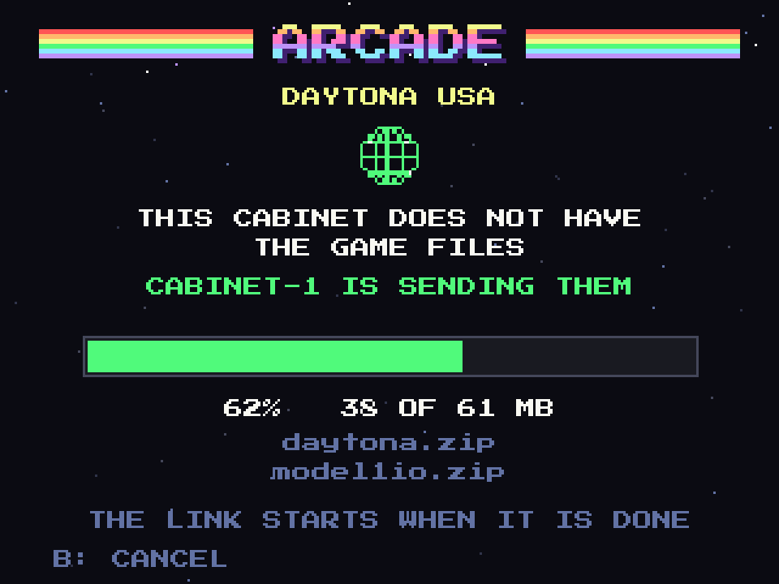

- If this cabinet does not have the game, the host sends the files: the zip, its parent, the BIOS, the device ROMs and the CHDs, only the ones the game needs. The screen shows the host and this cabinet with the arrows between them, the progress, and the file names. The cabinet checks the files and then goes on to the lobby.
- The transfer is between the user's own cabinets on the cable. Nothing leaves the local network.

## How it would work

### Presence on the cable

- Each cabinet announces itself on the wired interface only, by UDP multicast, once a second: an id, the cabinet's name, the game and emulator it has open, the party id, its slot, how many places the party has and how many are used, and the state (waiting room, playing, closed). A cabinet that is silent for four seconds disappears from the others' lists.
- The frontend listens and keeps a table. The lists, the marks and the "playing elsewhere" group are drawn from it, so they change as machines come and go.
- The wireless interface is ignored. It is wired only, as asked.

### The party

- A small TCP exchange between the host and the ones who join: create, join (with the slot offered), leave, ready, start, and the files request.
- The party fixes, at the start, the number of cabinets and each one's number. From the number the launcher derives everything: the role, the car number or machine ID, the ports, and the next machine's address in the ring or chain.

### The launcher

A table of link profiles in a data file, one per game family, with: the emulator, the topology (pair, ring or chain), the minimum and maximum cabinets, the order of start, how to build the command line and the config from a cabinet number, which NVRAM file belongs to which number, and which files the game needs. This is the data the research produced.

Games that are not in the table have no link mark. Adding a game means adding a profile and its NVRAMs.

### NVRAMs

One NVRAM per cabinet number and game (`config/link-nvram`, with a README and a manifest). The launcher copies the right one into the emulator's own NVRAM folder before it starts, and puts the standalone one back for solo play. The NVRAM is named by ROM set, so each region set needs its own.

### Net play and the files

- **Net play:** the host starts RetroArch in host mode, the guest connects and asks for a player slot.
- **Files:** the host serves them over the cable (the web panel's port or a small transfer service), with a check of each file against MAME's game list, a free space check on the guest, and a resume after a drop.

## Phases

1. **Data.** The link profiles (`gui/link-profiles.json`) and the NVRAMs (`config/link-nvram`). Done for the five tested games.
2. **Presence and marks.** Done: the announcements on the wired subnet, the table, the marks in the list, the grid and the full screen, and the "playing elsewhere" rows.
3. **Waiting room and launcher.** Done in the frontend and tested with two cabinets on the real wired network (the cabinet and a Windows PC): join, plan, start order, NVRAM and the emulator command. **Seen on the real hardware (1 November 2026):** the frontend on the cabinet's CRT, driven with virtual pads, hosted a Daytona USA party; the Windows PC joined as cabinet 2; A started it; the cabinet opened SM2-Emu with `--game daytona`, `link_enabled = true`, `link_next_ip` = the PC and the NVRAM of cabinet 1, and 6 seconds later the PC opened its own with cabinet 2's NVRAM. Both screens showed "up to 2 players" in the attract mode (the cabinet's car number 1, the PC's 2). Closing the game on the cabinet put its NVRAM, ini and party back as they were.
4. **Files transfer.** Done: the host serves the game's files over HTTP on the cable, with a check and a resume (25 MB at 10 MB/s between the PC and the cabinet).
5. **Net play.** Done for FBNeo (the same party, waiting room and menu; the RetroArch command and its config), with one player slot per configured control. Headless host and client tested on the cabinet, including a pair of slots each. On the real cabinet the frontend hosted the X-Men party and the PC (the Windows RetroArch nightly; the stable 1.22.2 crashed on connect) joined with slots 3 and 4: X-Men ran on both screens with a 15 ms ping. A second run had the cabinet (players 1 and 2) and two guests on the PC (players 3 and 4, one each): the coins and the character selection of each guest moved only its own player, the same on the three screens. Two people playing a whole credit, and a CRC-checked sync, were not seen.
6. **More games**, after each one is tested in pairs.

Each phase is tested on the real cabinets with two machines, and on four for the games that need them.

## Open questions

- A game with a flexible size: should the host be able to start with fewer than the maximum, or always wait for the maximum? The plan lets the host start from the minimum.
- Two parties for the same game: show both, or only the first? The plan shows both.
- ROM sharing between cabinets: is it fine for the host to send files without asking the owner of the guest cabinet? The plan has the guest ask for them.
- The first cabinet is the master. If the master cabinet is the slowest, should the lobby move the role? Not planned.
- Region sets: the NVRAM depends on the set. Should the lobby refuse to link two different region sets of the same game? It needs the same ROM version on all machines, so it should.
- Dirt Devils in groups of four did not link in the tests. Until that is solved its profile says two.
