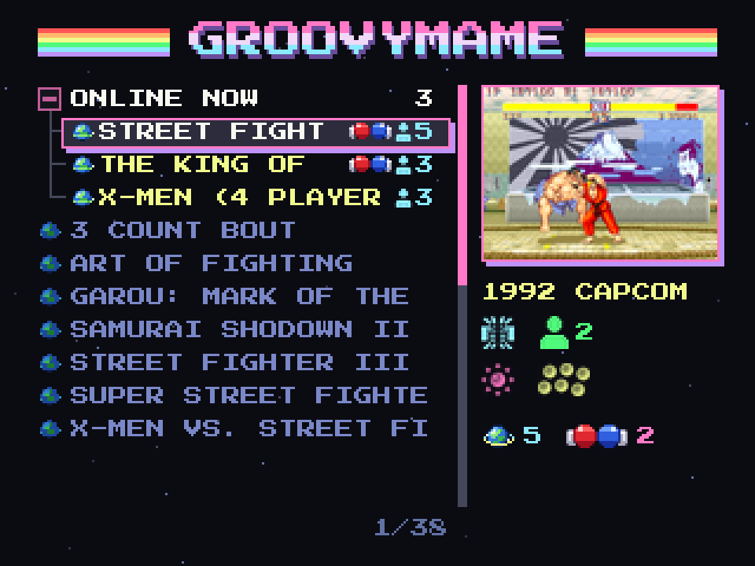
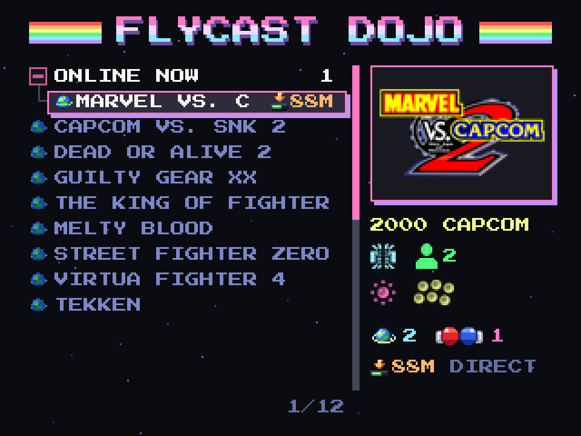
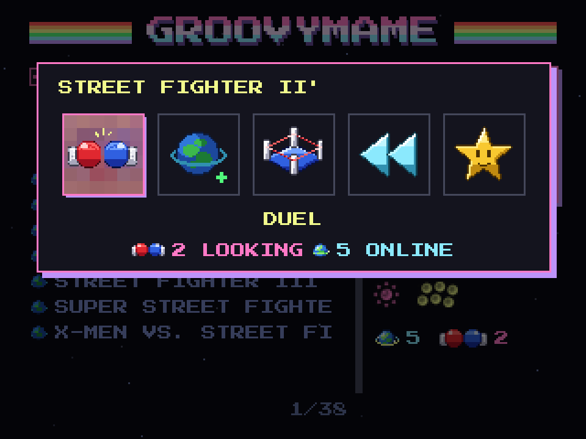
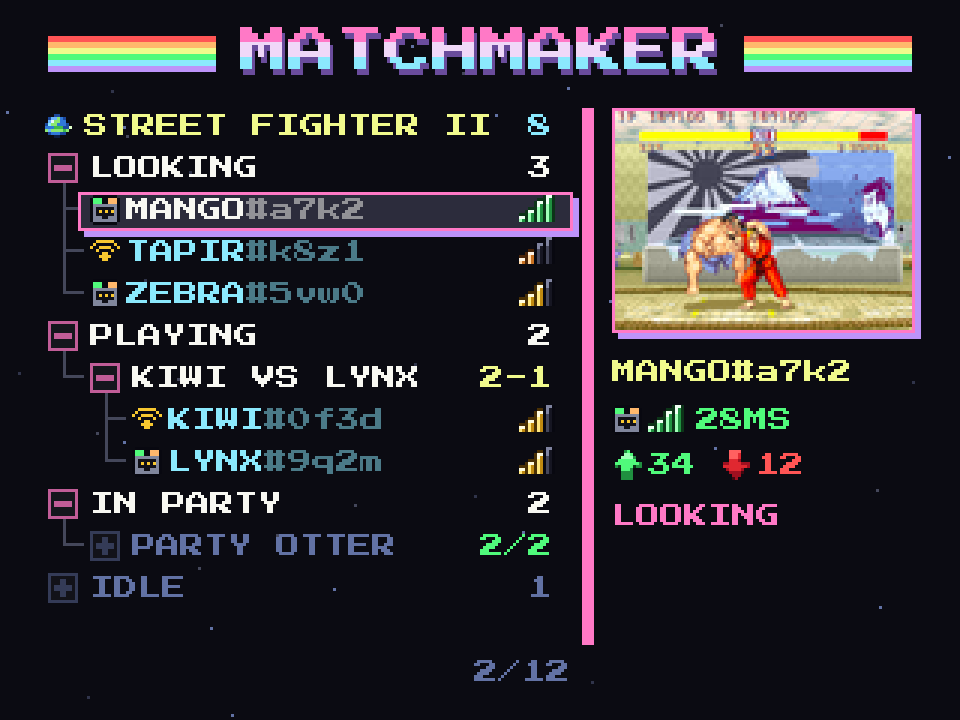
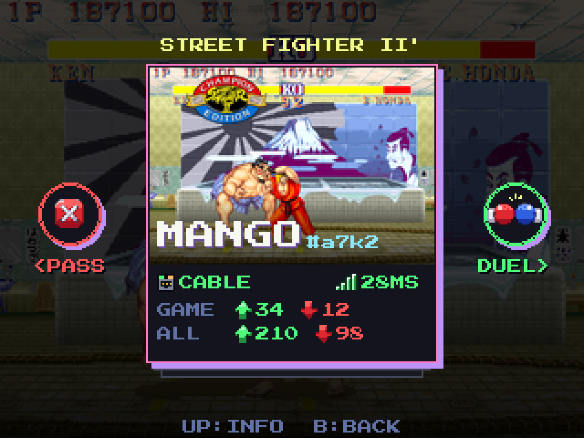
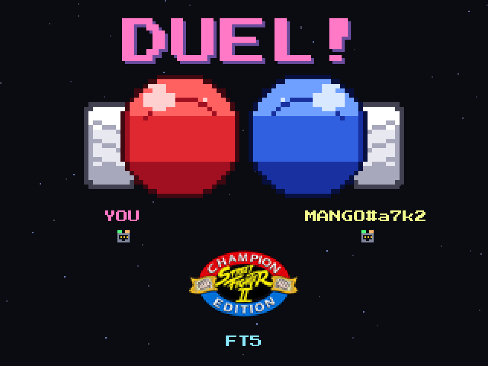

# FliperOS Matchmaker (online play): plan

A plan, not an implementation. The Matchmaker takes the link and party net play of the local network ([link-frontend-plan](link-frontend-plan.md), wiki *Net play*) to the Internet: online duels and parties between FliperOS cabinets. This page is phase 0: the screens, drawn with the frontend's own font, palette and real art, and the decisions behind them. No product code exists yet.

The mock-ups are in [`matchmaker-mockups/`](matchmaker-mockups/) (320x240 shown at 3x; animations as GIF plus a sheet of frames). [`00-overview.png`](matchmaker-mockups/00-overview.png) shows all of them at once. They are made by `tools/matchmaker/mockups.py` (the screens), `fists.py` (the boxing gloves), `icons16.py` and `iconlab.py` (the other icons), run in the `fliperos-tests-pil` image with the art scraped on the cabinet as `ART_DIR` (`snap_<system>_<game>.png`, `logo_<system>_<game>.png`).

## What was asked, and what was decided

| Subject | Decision |
| --- | --- |
| A program of its own | The Matchmaker is **separate from the FliperOS frontend**, which gets nothing online. It is picked as a frontend (Setup > Games > Frontend, like Fightcade 2) or opened from the Setup and the desktop |
| Look | The lobby is the **frontend's list mode**: list on the left, pink divider, panel on the right, the title band and the counter |
| Pages | **One page per emulator or core** (GROOVYMAME, FLYCAST DOJO, FBNEO, GENESIS PLUS GX...), switched with left and right **exactly like the frontend switches systems**. Never groups by console or "arcade" |
| Lists | Groups open and close like the frontend's clone groups (`[+]`/`[-]`, the count at the right end), with narrower rails (14 px in, not 26). Who plays together is one row (a match or a party) with its players inside |
| Picking an opponent | **Tinder-style cards**: left passes, right sends a fist bump. Two fist bumps between the same two players make a duel. The card tilts as it is dragged |
| The "heart" | **Two boxing gloves**, red (you) and blue (the other one), as a 16-bit sprite |
| Duel | **FT5**. P1 is who sent the first fist bump; a rematch swaps sides |
| Party | Open parties too, joined from the lobby |
| No scoreboard, no duel | A game without a win detector (as on Fightcade) is **party only**: no duel, no gloves, no wins and losses |
| Identity | `NICK#xxxx`: the nickname is the cabinet name (upper case), `xxxx` four characters of base36 (digits and lower case), tied to the cabinet's key. The tag is drawn a little faded in the lists |
| Connection | Every player shows **Wi-Fi or cable** (the RX/TX jack) and the ping |
| ROMs | Sent **automatically to whoever plays**, cabinet to cabinet, only over a direct connection (never through the relay). **Spectators never get the ROM**: watching needs it already on the cabinet |
| Server | The project's own server (Coolify, where the site runs). A relay only when a direct connection is impossible (CGNAT on both sides); rollback hides the longer path, it cannot create a route the NAT blocks |
| Notifications | A fist bump received outside the Matchmaker shows on the OSD bar, in the frontend or in a game, with a shortcut to the Matchmaker |
| Wins and losses | Kept **only on the server**, encrypted and fraud-proof (see FairPlay). **No dispute mode**: a match the two cabinets don't agree on simply doesn't count |
| No chat | The Matchmaker has no chat |
| Setup | Setup > Network > ONLINE switches the online service on and off (A, like DEBUG MODE), with an 8-bit icon in the Setup's style. The online settings are in both Setup > Network and the Matchmaker's options |

## The screens

### The pages and the switch

The page of an emulator: ONLINE NOW on top (open, like the frontend's RECENT), with the games that have someone online: the gloves when someone is looking for a duel, a person and the number of players. X-Men has no scoreboard: only the players. Then the emulator's other games, with the dim globe.

A game this cabinet does not have shows the size of the download.

The switch ([GIF](matchmaker-mockups/01c-page-switch.gif), [frames](matchmaker-mockups/01c-page-switch-frames.png)) is the frontend's own, with its numbers: the GAME LIST strip slides on a spring (omega 16), the middle tile grows with a pink border and "N GAMES" under it; the page is picked after 0.6 s, the strip holds 0.8 s and fades in 0.25 s; then the list mode's double door (0.85 s). The real program uses `feview.draw_ribbon`, `leave`, `enter` and `part`, not a copy.

### The game's card

The frontend's card: DUEL (the gloves), ONLINE PARTY, LOBBY (the ring), REPLAYS (rewind), FRIEND (the star). With an open party, JOIN ([02b](matchmaker-mockups/02b-game-menu-party.png)); a game with no scoreboard has no DUEL tile ([02c](matchmaker-mockups/02c-game-menu-party-only.png)).

### The lobby

LOOKING, PLAYING (each match a row with the FT score, its two players inside), IN PARTY (each party with its places), IDLE. The panel is the player: connection and ping, wins (green arrow) and losses (red arrow). No characters and no FairPlay line on the card: FairPlay is required to enter the lobby, so it says nothing. A player's card ([03c](matchmaker-mockups/03c-lobby-card.png)): DUEL, WATCH (the popcorn), JOIN, FRIEND. Watching a game this cabinet does not have is not possible ([03d](matchmaker-mockups/03d-lobby-watch-needs-rom.png)).

### The cards

The card: the art and logo of the game the player wants, `NICK#tag`, the connection and ping, wins and losses in this game and in all. Left PASS, right DUEL, up the details ([08](matchmaker-mockups/08-card-details.png): their online games, the record against you, matches played). A variant inside the list mode: [04b](matchmaker-mockups/04b-cards-in-list.png).

Swiping ([pass](matchmaker-mockups/05-swipe-pass.gif), [duel](matchmaker-mockups/06-swipe-duel.gif)): the card slides, tilts (nearest rotation, crisp on the CRT) and drops a little, the stamp shows, the card under it comes up. After a fist bump, "FIST SENT" and the pending count ([06b](matchmaker-mockups/06b-fist-sent.png)). A fist bump received puts that card first, with a blinking frame and WANTS A DUEL ([07](matchmaker-mockups/07-incoming-fist.gif)).

### Duel, rooms, transfer, result

The gloves come in and bump, the flash, DUEL!, both names, the game's logo and FT5 ([GIF](matchmaker-mockups/09-duel.gif)).

- Waiting room, in list mode: the players and the spectators, the connection (DIRECT or RELAY) and the checks ROM, EMULATOR, FAIRPLAY ([10](matchmaker-mockups/10-duel-wait.png)); the other side downloading ([10b](matchmaker-mockups/10b-duel-wait-download.png)); over the relay with the game missing, the ROM is not sent ([10c](matchmaker-mockups/10c-duel-wait-relay.png)).
- Online party ([11](matchmaker-mockups/11-party-lobby.png)).
- Transfer ([12](matchmaker-mockups/12-transfer.png)), and what the others see while someone downloads ([12b](matchmaker-mockups/12b-lobby-someone-downloading.png)).
- Result: [13](matchmaker-mockups/13-result.png) (REMATCH, REPLAY, BACK); a match that lost sync does not count ([13c](matchmaker-mockups/13c-result-desync.png)).

### Outside the Matchmaker

- The OSD bar over the frontend and over a game ([14a](matchmaker-mockups/14a-osd-over-frontend.png), [14b](matchmaker-mockups/14b-osd-over-game.png)).
- The Matchmaker in Setup > Games > Frontend, with its 8-bit gloves icon ([15a](matchmaker-mockups/15a-setup-frontend.png)), and ONLINE in Setup > Network ([15b](matchmaker-mockups/15b-setup-online.png)).
- The Matchmaker's options ([16](matchmaker-mockups/16-options.png)).

### The icons

All the Matchmaker's icons are 16-bit sprites (a dark outline, a bevel, four tones, a shine), chosen among ten options each: [`icons/00-chosen.png`](matchmaker-mockups/icons/00-chosen.png). The option sheets are in [`icons/`](matchmaker-mockups/icons/); the gloves in [`18-fist-options.png`](matchmaker-mockups/18-fist-options.png) (option 3). Small icons that a shrink blurs (Wi-Fi, the jack) are drawn by hand at 10 px. Icons side by side share one height (10 px in a line of text, 14 px in the panel, 32 px in a tile); two gloves next to another icon are 0.72 of its height, because two solid gloves weigh more. The Setup's icons (the gloves, ONLINE) follow the Setup's own 8-bit style instead ([`icons/14-setup-gloves.png`](matchmaker-mockups/icons/14-setup-gloves.png)).

## How it would work

- **Server** (`server/matchmaker/`, Python asyncio, WebSocket over TLS, SQLite on an encrypted volume), deployed on Coolify: identity, presence, lobbies, parties, fist bumps and duels, results, replays. One UDP port for the rendezvous and the relay.
- **On the cabinet:** a session service (`fliperos-online`) that stays connected, a small root service for the tunnel, and the Matchmaker program (pygame, `mmview.py` for the list-mode look).
- **The match: a WireGuard tunnel per match.** The server introduces the two cabinets; they open their NATs with simultaneous handshakes (LAN address, IPv6, public IPv4); if that fails, the WireGuard packets go through the relay, which reads only the header indices and never decrypts. Inside the tunnel runs the local party code that is already tested on hardware (felink's party and file server, GroovyMAME's lockstep, Flycast's GGPO, RetroArch's net play), with the input delay taken from the ping.
- **ROM check:** the CRC and size of each file inside the zip, `-verifyroms` on both sides for MAME, FBNeo's own CRC list. A different version goes to its own folder; nothing of the user's is overwritten.

## FairPlay

- A locked launch config (no cheats, plugins, scripts, save states, pause or fast-forward during a match); the emulator, core and plugin hashes equal on both sides.
- During the match: a state checksum every 60 frames exchanged and reported, a hash chain of the inputs, who caused the stalls, a long pause is a walkover, who leaves while losing loses.
- **Wins and losses:**
  - only the server counts them; the cabinet shows a server-signed copy;
  - a result counts only when both sides agree (winner and score, the input chain, the final checksum); otherwise it does not count, and there is no dispute;
  - every accepted match is an entry of a hash chain signed with a server key kept outside the database, and the head of the chain is published outside the server, so even the server's admin cannot rewrite the history quietly;
  - limits against boosting: only the first matches of the day between the same two keys count, sibling accounts (the same hardware hash) are marked.
- Reports and bans by key and by hardware hash.

## Phases

0. **The screens and this plan** (done).
1. **Server, identity, presence, the Matchmaker read-only.** First a UDP echo container on Coolify, to know whether the server can take UDP and has IPv6.
2. **The tunnel and the online party** with today's emulators.
3. **Duel by the cards**, OSD notifications, match records.
4. **FairPlay.**
5. **Replays and spectators.**
6. **Flycast Dojo** as an optional package.
7. **Rollback in GroovyMAME and hbgroovymame** (a parallel track: a `synctest` mode on a CPS2-only build first, then pairs, then the cabinet's CPU decides which drivers get it).
