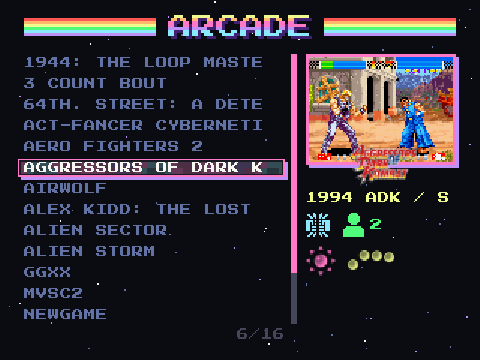
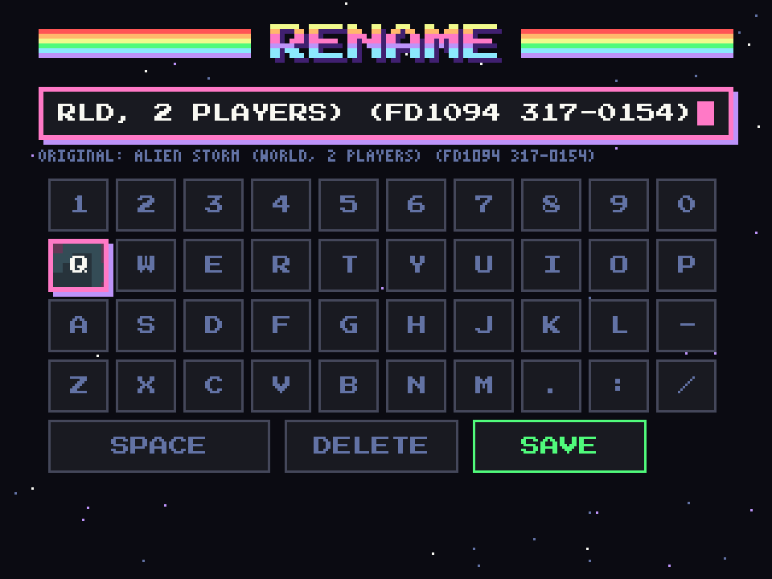
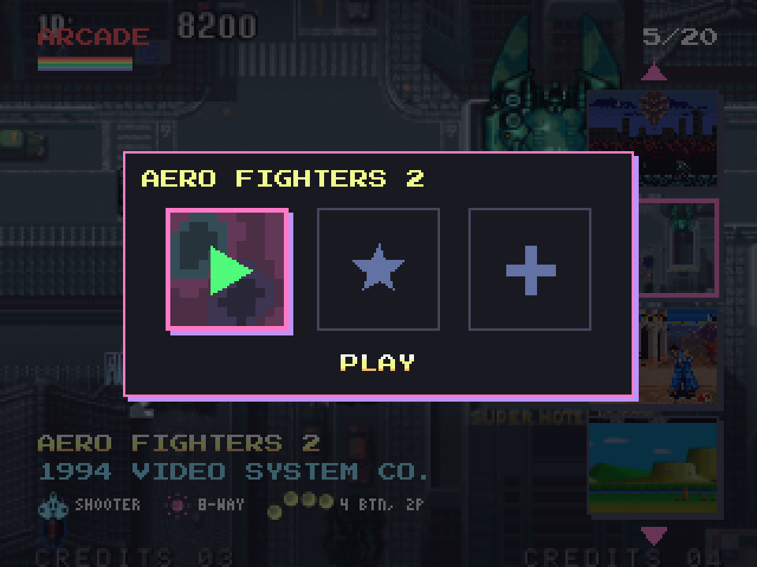

From a games folder on your PC to a game on the tube, step by step, for any frontend. The folders themselves are on [ROMs, BIOS and artwork](ROMs.md).

## 1. Copy the games

Each emulator has its folder in `~/roms`: over the network, `\\fliperos\roms`; from the web panel, **Library > Files**; or a USB disk with **Setup > Games > Folders**. Copy the files as they come: MAME sets stay zipped and are never renamed.

| Games | Folder |
| --- | --- |
| Arcade (MAME sets) | `mame` |
| Naomi, Naomi 2, Atomiswave | `naomi`, `naomi2`, `atomiswave` |
| Model 2, Model 3 | `model2`, `model3` |
| Dreamcast | `dreamcast` |
| PlayStation, PlayStation 2 | `ps1`, `ps2` |
| GameCube and Wii | `dolphin` |
| Anything a RetroArch core opens | `retroarch/<core>` |

The full table, with the extensions: [ROMs, BIOS and artwork](ROMs.md#roms). Other ways to get games:

- a full MAME romset, filtered to what suits your cabinet: [ROM Cleaner](ROM-Cleaner.md);
- a MAME romset by torrent, only the games you want: [Downloader](Downloader.md);
- PC games and programs: [Custom games](Custom-games.md).

**BIOS** don't need to be looked for: [Download BIOS](BIOS.md) brings the ones your games lack, by itself, each time the menu opens.

## 2. Make the frontend see them

| Frontend | What to do |
| --- | --- |
| **FliperOS frontend** | Nothing: the list follows the folder, also while it is open |
| **Attract-Mode Plus** | Nothing: a new folder gets its system the next time it opens |
| **ES-DE**, **Pegasus** | Pick the frontend again in **Setup > Games > Frontend** when a folder gets its first games |

A folder becomes a system when it has at least one game file (the `_info.txt` doesn't count).

## 3. Real names

A list made only from the files shows the file name: `mvsc2u` instead of *Marvel Vs. Capcom 2 New Age of Heroes*.

- **Arcade games** get their real names from MAME's own list, without internet: by themselves in the FliperOS frontend, and with **Setup > Games > AttractPlus ROM List** in Attract-Mode Plus ([Attract-Mode Plus](Attract-Mode-Plus.md#game-lists-and-real-names)). ES-DE shows MAME names from its own list.
- **Console games** get theirs from a site, with **Setup > Games > Scraper > Scrape with a site** ([Scraper](Scraper.md)).
- **One game:** **Tab > RENAME** in the FliperOS frontend.

## 4. Artwork

The FliperOS frontend fetches what a game lacks by itself, and **Setup > Games > Scraper** fetches it all at once ([Scraper](Scraper.md)). You can also copy images and videos yourself (from a MAME artwork pack, for example) into `~/media`, one folder per type, named after the ROM:

| You have | Goes to |
| --- | --- |
| The screenshot of `~/roms/mame/sf2.zip` | `~/media/snap/mame/sf2.png` |
| The video of `~/roms/retroarch/mame2010/tekken3.zip` | `~/media/preview/retroarch/mame2010/tekken3.mp4` |
| A logo | `~/media/logo/<games folder>/<rom>.png` |
| A cover or flyer | `~/media/box/<games folder>/<rom>.png` |
| A marquee | `~/media/marquee/<games folder>/<rom>.png` |
| A description | `~/media/texto/<games folder>/<rom>.txt` |

Each games folder has its own art folder in every type, so two folders with the same game (Daytona USA in `mame` and in `model2`) can each have their own video. In Attract-Mode Plus, the other arcade folders also look in the `mame` art ([Attract-Mode Plus](Attract-Mode-Plus.md#artwork)).

**Coming from the layout by platform.** Before, `~/media/<type>` had one folder per scraper platform (`arcade`, `snes`, `psx`…). FliperOS moves them the next time the launcher opens: `arcade` goes to `mame`, another platform's folder to the first games folder of that platform (`snes` to `retroarch/snes9x`), and the other games folders of the platform get the art of their games as hard links, with no extra disk space.

## 5. Play

Pick the game in the frontend, or in the web panel's **Frontend** area, which opens it on the tube ([Web panel: Frontend](Web-panel-Frontend.md)). To leave a game, hold **coin + Start** ([Frontend controls](Frontend-controls.md#game-shortcuts)).

## Emulator command lines: KMS or X11

Each frontend opens a game with one command, through FliperOS's wrappers: `fliperos-kms-run` for RetroArch and GroovyMAME, `fliperos-x11-run` for the emulators that need a window. What each one does, the video mode of each emulator and how to run any program at 640x240: [KMS and X11](KMS-and-X11.md).

## Custom games

A game or program that is not a ROM (a PC game for Windows or Linux, your own emulator, a script) goes in **Setup > Games > Custom games**, in groups the frontends show as systems. There are three ways:

- **Install a package**: put `<game>.fliperos-customgame.zip` in `~/roms/custom-packages` and install it from **Install games** (the group is asked then), or double-click the zip on the desktop, wherever it is.
- **Create a package** from a game folder, step by step, with the picture, video, text, video mode and controller map.
- **By its command**: a name, a command line and the video mode.

Windows games run in PortProton, downloaded the first time one is added; games that only take the keyboard get **Controller configuration** in the on-screen menu.

Everything is explained, step by step and in detail, on its own page: **[Custom games](Custom-games.md)**.

## Adding a new emulator

An emulator FliperOS doesn't ship, opened from every frontend in four steps: [Adding an emulator](Adding-an-emulator.md).

## Quick checks

- **The system doesn't show up:** the folder must have at least one game file, and ES-DE or Pegasus must be picked again in **Setup > Games > Frontend**.
- **The game doesn't open:** its log is in the web panel's **System > Processes and logs**, or in `/opt/fliperos/logs`; with debug mode on (**Setup > System > Debug mode**) the emulator's output shows on the screen. Try the same command in the console (**Exit to shell** in the FliperOS menu).
- **A BIOS is missing:** **Setup > Games > Downloader > Download BIOS > See the list** says which ([BIOS](BIOS.md)).
- **No artwork:** check the name (exactly the ROM's, without the extension, case included) and the folder (the games folder's name inside the type).

See also: [ROMs, BIOS and artwork](ROMs.md), [Frontends](Frontends.md), [Emulators](Emulators.md).
