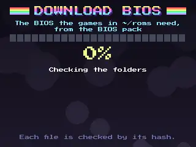

Many systems need the original BIOS to run their games. FliperOS ships none, but you don't have to look for them: **Download BIOS** finds what the games in your folders lack and downloads only those files.

## Using it

It runs **by itself each time the FliperOS menu opens**, in the background, when a folder of `~/roms` or `~/bios` changed since the last check. So a games folder copied over the network gets its BIOS without anyone asking, and a deleted BIOS comes back.

**Setup > Games > Downloader > Download BIOS** has:

| Item | What it does |
| --- | --- |
| **See the list** | The last check, BIOS by BIOS: downloaded, already there, not found, failed |
| **Check again** | Runs the check now |
| **Check when the menu opens** | Turns the automatic check off or on |

While it downloads, or when something couldn't be found, the FliperOS frontend shows a **BIOS DOWNLOAD** box in its Tab menu, and the web panel has the same in **Library > Downloads**.

## What it looks for

It looks at every folder of `~/roms` that has files:

| Games | BIOS it brings |
| --- | --- |
| RetroArch cores (`~/roms/retroarch/<core>`) | The firmware listed in the core's own `.info` file (PCSX ReARMed asks for `scph5501.bin`, FBNeo for `fbneo/neogeo.zip`), at the path the core asks for. The optional ones too: without them a core falls back to an imitation BIOS, or doesn't open part of its games (Sega CD, Famicom Disk System) |
| MAME sets (`~/roms/mame`, `naomi`, `naomi2`, `atomiswave`, the arcade cores) | The BIOS and devices those sets use: `neogeo.zip`, `qsound.zip`… to `~/bios/mame`; Naomi and Atomiswave to `~/bios/dc`; FBNeo's to `~/bios/fbneo`; the other MAME cores' next to their games |
| PCSX2 (`~/roms/ps2`) | Its BIOS in `~/bios/ps2` |
| Flycast (`~/roms/dreamcast`, `naomi`, `naomi2`, `atomiswave`, the Flycast core) | Every BIOS Flycast knows, into `~/bios/dc`: `dc_boot.bin`, `dc_flash.bin`, `naomi.zip`, `naomi2.zip`, `naomigd.zip`, `awbios.zip`, `segasp.zip` and the game boards `airlbios`, `f355bios`, `f355dlx`, `hod2bios` |

A BIOS already in place, also one next to the games, is never downloaded again, and nothing is overwritten. Files over 64 MB (the DSi NAND, the PS3 and Vita updates) are left out.

**Not found?** A BIOS that isn't in either source shows as *not found*: put it in `~/bios` yourself, at the path the list says ([ROMs, BIOS and artwork](ROMs.md#bios)). A newer MAME may want a BIOS file the sources don't have yet.

## Where they come from

1. **[RetroBIOS](https://github.com/Abdess/retrobios)** first: its database says where each BIOS is and its checksum, and each file comes alone from GitHub. A file only stays on the disk if its checksum matches.
2. For what RetroBIOS doesn't have, a reference pack: the [Batocera v36 full BIOS pack](https://archive.org/details/full-pack-bios-batocera-v-36) on the Internet Archive. Its 1.1 GB `.zip` is never downloaded whole: the Internet Archive serves each file inside it on its own, so only the missing BIOS come (on the test cabinet, 13 files and 22.6 MB for PS1, Naomi, Atomiswave and Neo Geo games).

## How it works

- The Setup makes the list of what is missing (`bios_plan` in `lib/downloader.sh`): a "wants" file, one line per BIOS (`TYPE FOLDER NAME DESTINATION [OTHER_PLACES...]`; `fw` for a core's or emulator's firmware, `set` for a MAME set from `fliperos-romclean uses`). `config/fliperos-bios check --wants FILE` downloads them, as root.
- The state is in `/var/lib/fliperos/bios`: `retrobios.json` and `index.json` (the two sources' lists, redone every 30 days or when the source changes), `last.kv` (the summary) and `last.tsv` (each BIOS: present, downloaded, missing, big, failed). The frontend's box reads `running`, written while a check runs (`gui/febios.py`).
- The automatic check is `fliperos-setup --bios-check`, started when the menu opens; without network it tries again 10 minutes later. `bios_auto=off` in `fliperos.conf` turns it off.
- The reference pack's torrent is `/usr/local/share/fliperos/bios-pack` (`config/fliperos-bios-pack`): it is only read, for the archive item and the name of its `.zip`.

See also: [ROMs, BIOS and artwork](ROMs.md), [Downloader](Downloader.md).
