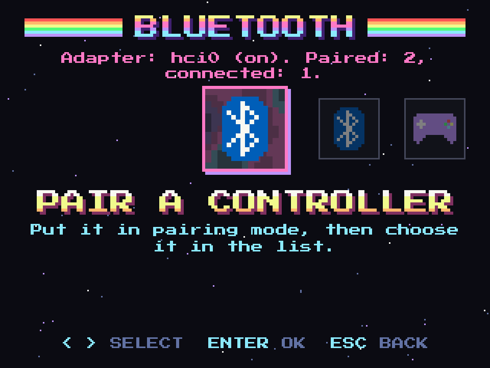

**Setup > Joysticks > Bluetooth** pairs wireless controllers: Xbox, PlayStation, 8BitDo, Switch Pro and the others. It only shows when the cabinet has a Bluetooth adapter (a USB dongle, or one built into the motherboard).

 Joysticks > Bluetooth">

## Pairing a controller

1. Put the controller in pairing mode (usually a long press of its pairing button, or Share + PS, or the 8BitDo's own pairing button).
2. **Pair** lists what is in range; pick the controller. Or **Pair automatically** pairs every controller in pairing mode for 30 seconds.
3. Map it in **Setup > Joysticks > Controllers / Arcade panel > Map controllers**, where it shows with the wireless icon ([Button mapping](Button-mapping.md)).

A failed pairing is tried once more, after forgetting the device. From then on the controller connects by itself when it is turned on.

## The other items

| Item | What it does |
| --- | --- |
| **Paired devices** | Each paired controller: **Connect**, **Disconnect**, **Forget**; and **Forget all** |
| **On / off** | Turns the Bluetooth adapter on or off |

## Players

Wired controllers take the first players; Bluetooth ones take the players left, in the order they connect. A Bluetooth controller remembers its mapping by its own ID, so it gets the same buttons each time. A controller turned on while the frontend is open moves in the list at once.

## How it works

- `config/fliperos-bluetooth` is a front end of `bluetoothctl`: `status`, `power on|off`, `scan S`, `devices`, `pair MAC`, `autopair S`, `connect|disconnect|remove MAC`. The screen is `screens/bluetooth.sh`.
- Bluetooth mappings are kept by the controller's GUID in `/etc/fliperos/buttons-bt.map`.

See also: [Controls](Controls.md), [Controller light](Controller-light.md).
