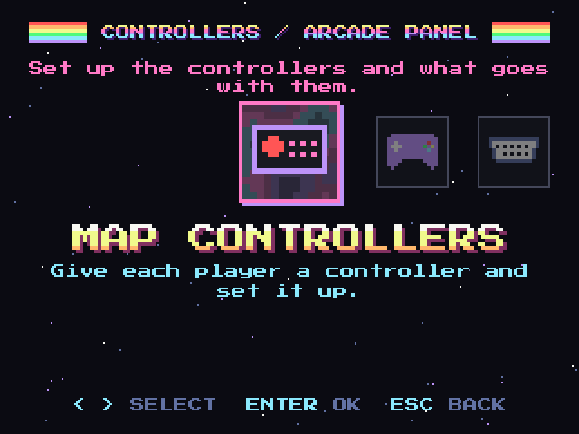
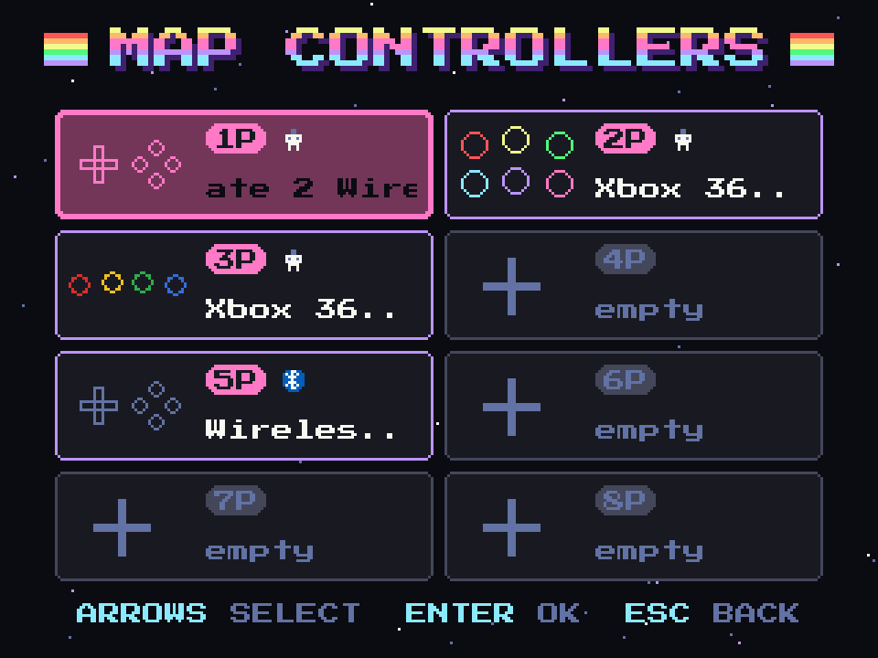
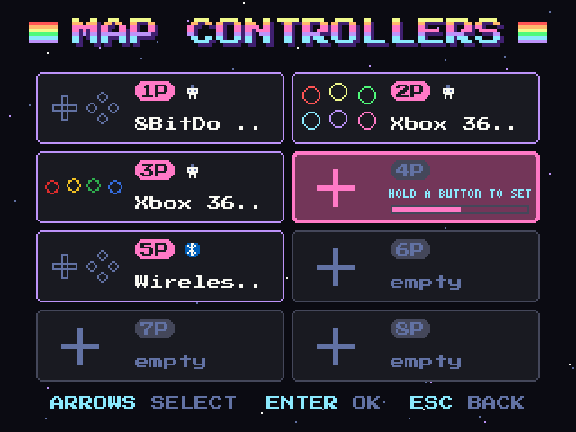
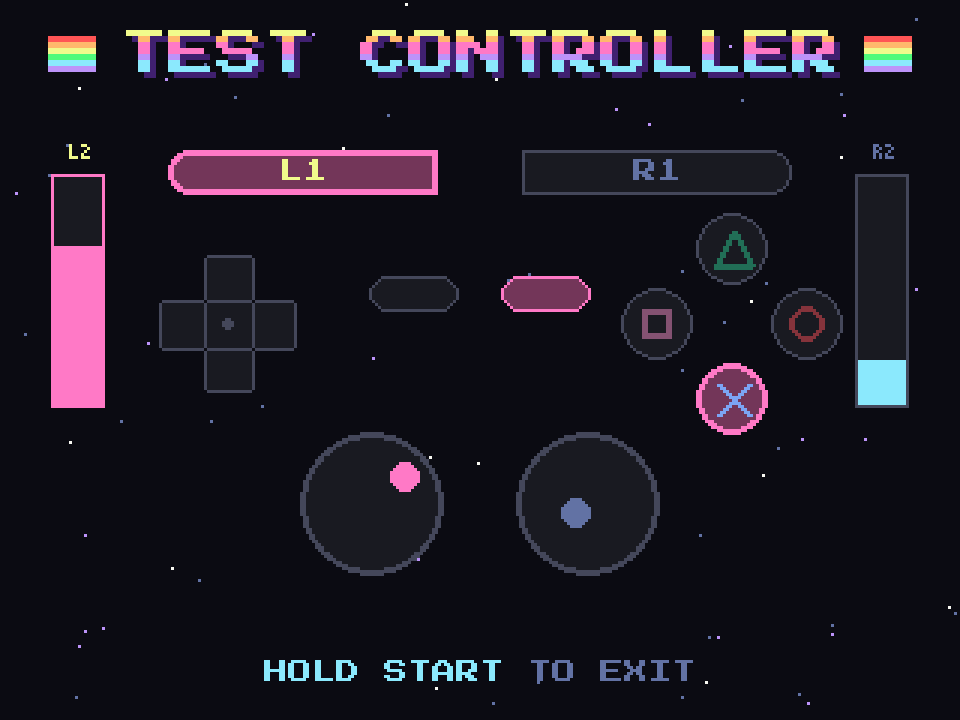
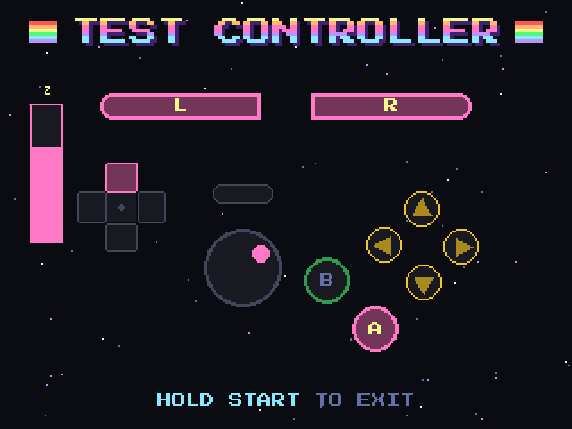
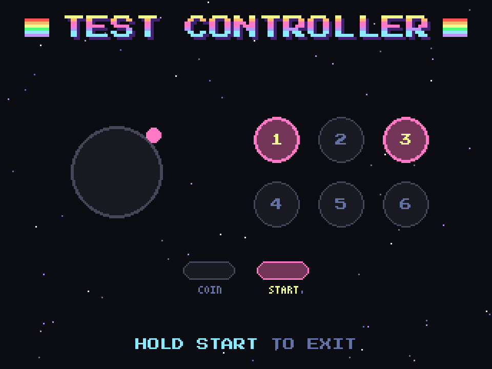
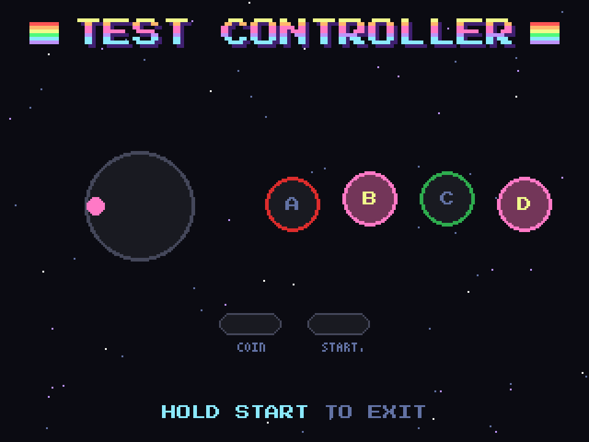
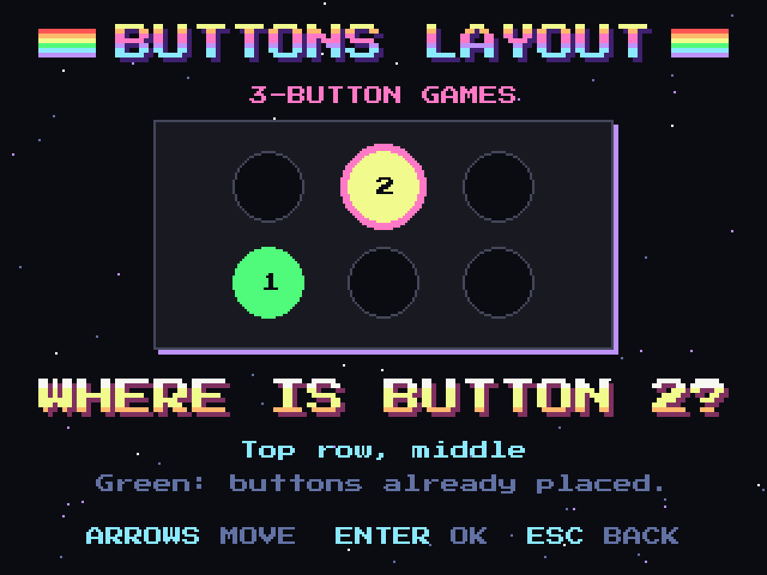
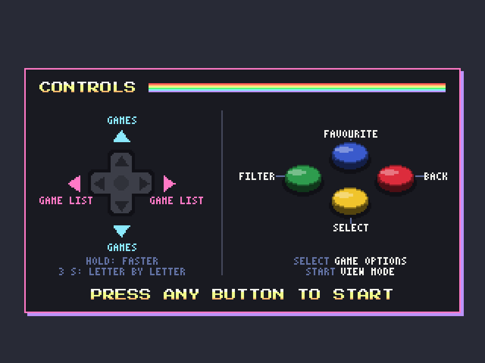

**Setup > Joysticks > Controllers / Arcade panel** tells FliperOS which controller belongs to each player and what each button is. Done once, it counts in every emulator, the frontends and the menus. It is a menu with **Map controllers**, **Keyboard encoder**, **Add LPT joysticks**, **Haptic events** and **Lights**.



## Map controllers

Eight player slots, **Player 1 to 8**, two per line. Each card shows the drawing of its controller (an arcade panel or a joypad), the wired or wireless icon and the name, which scrolls on the selected card. The screen refreshes by itself when a controller is turned on or plugged in.



**Giving a slot a controller:** select an empty card and **hold a button** on the controller that will be that player. The bar fills (about a second) and the card takes the controller; if the slot had another one, the two swap. A controller that is already set up just changes card. One that still needs a mapping or a layout opens its menu to be set up.



**A card with a controller** opens its menu with Enter. Each item is set on its own, in this order:

1. **Player:** which slot it is (or none). If another controller has it, the two swap. A controller with no player keeps its mapping.
2. **Type:** arcade panel or joypad.
3. **Visual layout:** the drawing, which also sets the number of buttons of a panel. The layout of player 1 is the one the frontend's controls guide draws by itself (**AUTO** on the Controls page; setting it to ARCADE PANEL or JOYPAD there locks it).
4. **Mapping:** **Map all buttons** (up, down, left, right, buttons 1 to 8 in panel order, Start, Coin, and then the buttons that accept and go back in the menus), **Change one button**, or **Menu buttons** alone. A joypad FliperOS already knows can keep its own layout with nothing to press, like Batocera.
5. **Buttons layout** (arcade panels): below.
6. **Test controller:** below.

- Holding a button skips that input in the mapping; with nothing pressed for 8 seconds it is skipped too. Esc cancels.
- Each button does one thing: a button already given to another input is refused, and the screen says which input has it.
- On a panel that shows up as one device for two players (a V-USB board), the first input pressed tells which half belongs to the player.

**The number of players follows the controllers that are connected.** Pull a controller out and its player leaves the count; plug it back and the player returns. The frontend uses this count for party play, and says "1 PLAYER" or "2 PLAYERS" when it changes. Bluetooth controllers take the free player in the order they connect unless you gave them one ([Bluetooth](Bluetooth.md)).

## Test controller

Every button, direction, stick and trigger lights up live, by the controller's own mapping. A joypad has the drawing of the console picked in the Visual layout (Xbox, PlayStation, GameCube, Super Nintendo, NES, Dreamcast, Saturn, Mega Drive, Neo Geo CD, Nintendo 64): the triggers are bars that fill with the travel, the sticks are dots that move and glow when pressed. An arcade panel shows the stick and the buttons of its layout, plus Coin and Start. **Hold Start** to leave (or Esc).

 
 

## Games follow your players

Some emulators choose the controller of each player by themselves: **Flycast** (and the Flycast Dojo of Fightcade) give port 1 to the first controller Linux lists, and **Odin** takes the first two that are connected. So that they follow the players you chose, a game opens like this:

- **Order of the controllers:** if the USB controllers are not in the order of the players (usually the first game after turning the cabinet on), they are replugged by software, in player order, for a couple of seconds before the game opens. Bluetooth controllers are not reordered.
- **Odin** also gets the controller of player 1 and 2 in its own settings (`[players.GAME]`) every time it opens.

## Keyboard encoder

**Keyboard encoder**, in the Controllers / Arcade panel menu, is for an encoder that types keys (I-PAC and the like) in MAME's layout. It takes players 1 and 2 (the cards say Keyboard encoder); nothing is pressed, and every emulator gets MAME's default keys:

| Player | Keys |
| --- | --- |
| 1 | Arrows; Left Ctrl, Left Alt, Space, Left Shift, Z, X; 1 Start; 5 Coin |
| 2 | R F D G; A S Q W E; 2 Start; 6 Coin |
| 3 and 4 | The stick and buttons 1 to 3, as in MAME |

RetroArch's own shortcuts on those keys (Space fast-forward, F fullscreen, K frame advance…) are turned off.

## Buttons layout (games of 1 to 5 buttons)



Where a game's buttons go on the panel, by how many buttons it uses. Pick the number (1 to 5) and then, for button 1, button 2 and so on, its place: top or bottom row; left, middle or right. The panel is drawn as you go:

```
3-button games   [1][2][3] / [ ][ ][ ]
4-button games   [1][2][ ] / [3][4][ ]      or      [1][3][ ] / [2][4][ ]
```

Without a layout, the game's button N is the panel's button N; **Default layout** goes back to that. Six-button games always use the whole panel. It needs the Button mapping done first.

It applies where the panel's button N is the game's button N: GroovyMAME, RetroArch's MAME and MAME 2010 cores, Keisho (Model 2 and 3) and PCSX2x6. FBNeo arranges each game's buttons by itself, and the other emulators have one mapping for all games.

## Joypad guides

Mapping a joypad also sets the FliperOS frontend's controls guide to draw it ([Frontend controls](Frontend-controls.md#guide-and-panel-layout)).

 

## How it works

- The map lives in `/etc/fliperos/buttons.map` (Bluetooth controllers by GUID in `/etc/fliperos/buttons-bt.map`), read through SDL by `config/fliperos-buttons`. A system update writes every emulator's files again. `fliperos-buttons players` prints the count (`mapped`, `connected`, `active`, `player1=on|off`); `fliperos-buttons keyboard` writes the encoder's keys.
- **RetroArch:** each player's binds in `/etc/fliperos/retroarch/buttons.cfg`, added by `fliperos-kms-run` (`--appendconfig`) on top of the controller's automatic profile, in the arcade cores' layout (Y X L / B A R, Start, Select on the coin). The D-pad also goes there, so a gamepad RetroArch has no profile for still moves.
- **GroovyMAME:** the ctrlr `~/.mame/ctrlr/fliperos.cfg` (each player's `JOYCODE`s, with MAME's default keys) and `ctrlr fliperos`, `joystickprovider sdljoy` in `mame.ini`: with `sdlgame`, MAME would see the panel through SDL's game controller mapping, which doesn't follow the button order.
- **The other emulators** get the device's **SDL game controller** mapping (GUID), in fight stick layout (X Y RB on top, A B RT below, coin on Back), in `/var/lib/fliperos/gamecontrollerdb-user.txt`, which `fliperos-controllers` puts last in `gamecontrollerdb.txt`: PCSX2 and DuckStation (Pad1/Pad2 on SDL), KOF Final Attack's Ikemen GO (`save/gamecontrollerdb-fliperos.txt`), AntiMicroX.
- **Dolphin:** `GCPad1` to `GCPad4` in `GCPadNew.ini` (4 = A, 1 = B, 5 = X, 2 = Y, 3 = Z, 6 = R, coin on the Triforce Coin), each player's port enabled in `Dolphin.ini`.
- **Flycast:** by device name (Dreamcast through SDL; arcade with the panel's button N on the game's button N and coin on D; a hat D-pad becomes Flycast's hat code, a trigger goes in its `triggers` list), and the same files in Fightcade's Flycast Dojo.
- **Attract-Mode Plus:** the joystick entries of `input_map` in `attract.cfg` (directions, Select on button 1, Back on button 2, and its default shortcuts for player 1), written every time it opens.
- **Hypseus:** the `[KEYBOARD]` of `~/.hypseus/hypinput.ini`. **OpenBOR:** each player's keys in `Saves/default.cfg` and each pak's `.cfg` (1 attack, 2 jump, 3 special, 4 to 6 the other attacks, coin on Esc). **PCSX2x6:** the `[JVS]` section ([PlayStation 2 and Namco 246/256](Namco-246-256.md#the-buttons)).
- **Triggers:** an axis resting at one end (an Xbox controller's LT/RT) can only be pressed one way; the capture ignores the release of a trigger held when it started, and saving fixes the direction from the resting position.
- **Buttons layout** is `/etc/fliperos/buttons.layout` (one line per number of buttons: the position of button 1, of button 2…). The button count of each game comes from GroovyMAME's `-listxml` with the real counts of `controls.xml` on top (`fliperos-romclean buttons` writes `/var/lib/fliperos/game-buttons.txt`); MAME 2010 has its own table, `game-buttons-mame2010.txt`, and a game whose 0.139 entry lists its board's generic block (Tekken 3) counts as that block, so the punches stay on top and the kicks below. Where it goes: a `<system>` per game in GroovyMAME's ctrlr (a clone follows its parent), a `buttons-N.cfg` for RetroArch's MAME cores, a game section in `Supermodel.ini` by the input type of each game in `Games.xml`, and `/var/lib/fliperos/gamecontrollerdb-model2-N.txt` for Keisho, which reads game buttons 1 to 4 from A B X Y and always takes RB as button 4.
- The screens are `screens/joysticks.sh` (the menu, `screen_controllers_map` and the slots, `screen_controller`), on top of `lib/buttons.sh`; the cards are `SlotGrid` in `gui/widgets.py` and the tester is `gui/padtest.py`. `fliperos-buttons set-player|set-visual|set-button|set-keyboard` change one thing each; `reorder` replugs the USB controllers in player order (`fliperos-setup --pad-order`, called by `fliperos-x11-run` and `fliperos-kms-run` before each game); `odin` prints `p1`/`p2` for Odin.

See also: [Controls](Controls.md), [Frontend controls](Frontend-controls.md).
