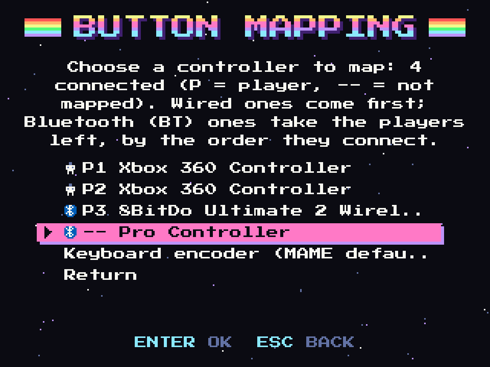
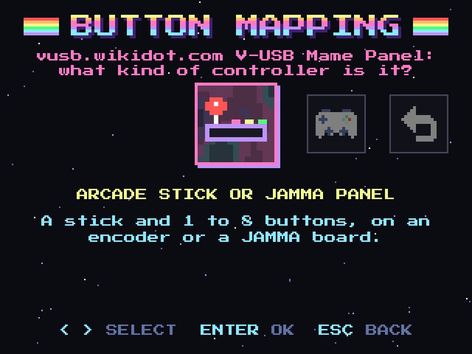
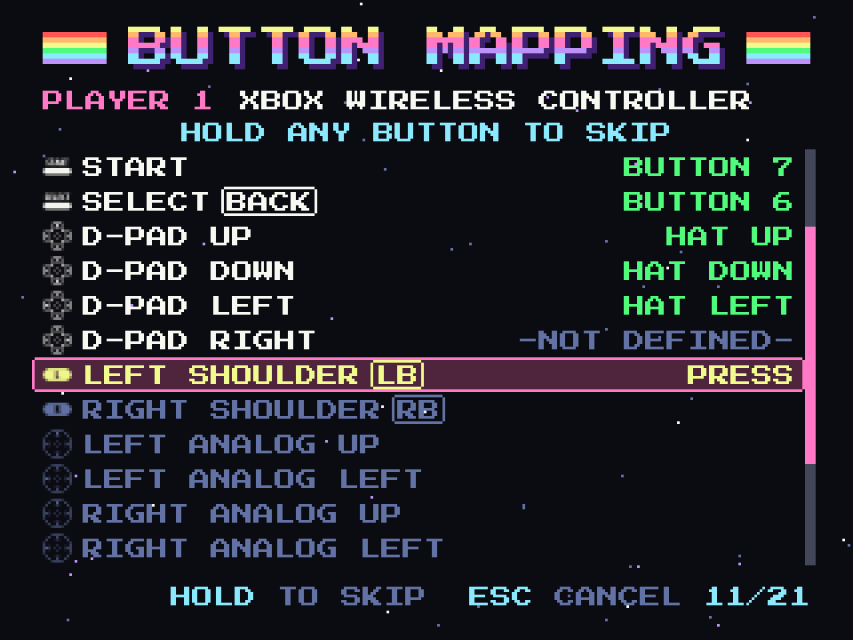
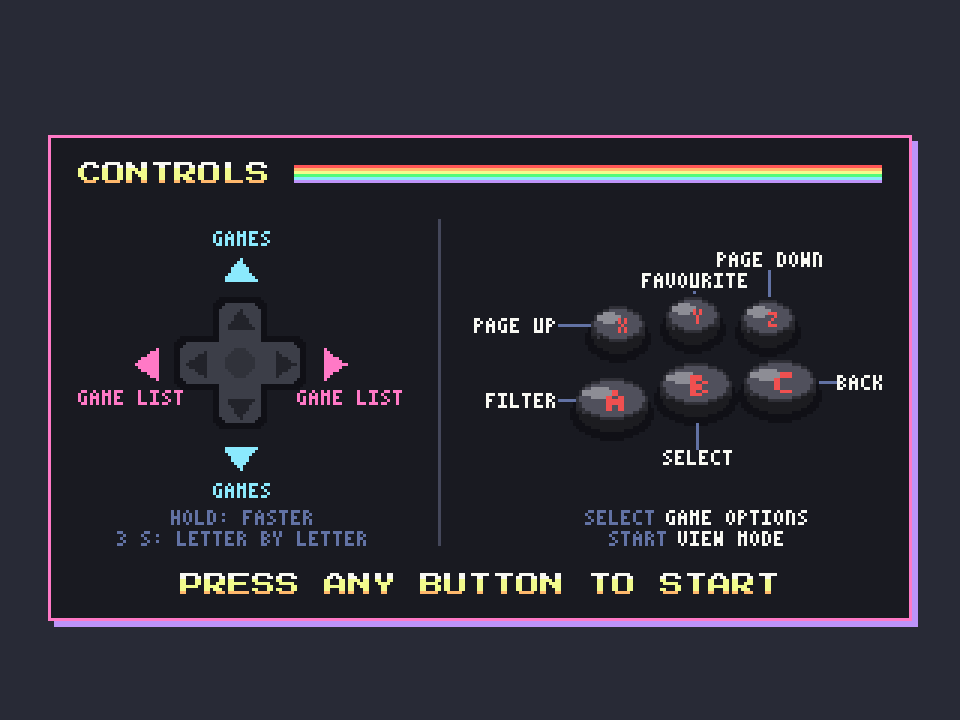

**Setup > Joysticks > Button mapping** tells FliperOS which controller belongs to each player and what each button is. Done once, it counts in every emulator, the frontends and the menus. **Buttons layout** then says where the buttons of 1 to 5-button games go on your panel.



## Mapping a controller

The screen opens on the list of **connected controllers**, each with a wired or wireless icon; it refreshes by itself when a controller is turned on or plugged in. Pick one, then:

1. **The player** it belongs to: P1, P2…
2. **The kind of controller:**
   - **Arcade stick or JAMMA panel:** a stick and 1 to 8 buttons; then how many buttons it has.
   - **Joypad** (Xbox, PlayStation, Nintendo, 8BitDo…). One FliperOS already knows can keep its own layout with nothing to press (**Use its layout**), like Batocera; **Map each button** asks for each one.
3. **Each input:** up, down, left, right, buttons 1 to 6 in panel order (1 2 3 on top, 4 5 6 below), Start and Coin. The panel is drawn as you go: the control being asked blinks, the ones already pressed turn green.
4. **The menu buttons:** the buttons that accept and go back in the menus.

 

- Holding a button skips that input; with nothing pressed for 8 seconds it is skipped too. Esc cancels the whole mapping.
- Each button does one thing: a button already given to another input is refused, and the screen says which input has it.
- On a panel that shows up as one device for two players (a V-USB board), the first input pressed tells which half belongs to the player.

**The order of players:** wired controllers take the first players, in the order of their USB ports; Bluetooth ones take the players left, in the order they connect ([Bluetooth](Bluetooth.md)).

**The number of players follows the controllers that are connected.** The Joysticks screen says "Players now: 2 of 2 mapped (controllers connected: 2)". Pull a controller out and its player leaves the count; plug it back and the player returns. The frontend uses this count for party play, and says "1 PLAYER" or "2 PLAYERS" when it changes.

## Keyboard encoder

**Keyboard encoder (MAME default keys)**, at the end of the list, is for an encoder that types keys (I-PAC and the like) in MAME's layout. Nothing is pressed: it only asks how many players, and every emulator gets MAME's default keys:

| Player | Keys |
| --- | --- |
| 1 | Arrows; Left Ctrl, Left Alt, Space, Left Shift, Z, X; 1 Start; 5 Coin |
| 2 | R F D G; A S Q W E; 2 Start; 6 Coin |
| 3 and 4 | The stick and buttons 1 to 3, as in MAME |

RetroArch's own shortcuts on those keys (Space fast-forward, F fullscreen, K frame advance…) are turned off.

## Buttons layout (games of 1 to 5 buttons)


Where a game's buttons go on the panel, by how many buttons it uses. Pick the number (1 to 5) and then, for button 1, button 2 and so on, its place: top or bottom row; left, middle or right. The panel is drawn as you go:

```
3-button games   [1][2][3] / [ ][ ][ ]
4-button games   [1][2][ ] / [3][4][ ]      or      [1][3][ ] / [2][4][ ]
```

Without a layout, the game's button N is the panel's button N; **Default layout** goes back to that. Six-button games always use the whole panel. It needs the Button mapping done first.

It applies where the panel's button N is the game's button N: GroovyMAME, RetroArch's MAME and MAME 2010 cores, Keisho (Model 2 and 3) and PCSX2x6. FBNeo arranges each game's buttons by itself, and the other emulators have one mapping for all games.

## Joypad guides

Mapping a joypad also sets the FliperOS frontend's controls guide to draw it ([Frontend controls](Frontend-controls.md#guide-and-panel-layout)).

 

## How it works

- The map lives in `/etc/fliperos/buttons.map` (Bluetooth controllers by GUID in `/etc/fliperos/buttons-bt.map`), read through SDL by `config/fliperos-buttons`. A system update writes every emulator's files again. `fliperos-buttons players` prints the count (`mapped`, `connected`, `active`, `player1=on|off`); `fliperos-buttons keyboard` writes the encoder's keys.
- **RetroArch:** each player's binds in `/etc/fliperos/retroarch/buttons.cfg`, added by `fliperos-kms-run` (`--appendconfig`) on top of the controller's automatic profile, in the arcade cores' layout (Y X L / B A R, Start, Select on the coin). The D-pad also goes there, so a gamepad RetroArch has no profile for still moves.
- **GroovyMAME:** the ctrlr `~/.mame/ctrlr/fliperos.cfg` (each player's `JOYCODE`s, with MAME's default keys) and `ctrlr fliperos`, `joystickprovider sdljoy` in `mame.ini`: with `sdlgame`, MAME would see the panel through SDL's game controller mapping, which doesn't follow the button order.
- **The other emulators** get the device's **SDL game controller** mapping (GUID), in fight stick layout (X Y RB on top, A B RT below, coin on Back), in `/var/lib/fliperos/gamecontrollerdb-user.txt`, which `fliperos-controllers` puts last in `gamecontrollerdb.txt`: PCSX2 and DuckStation (Pad1/Pad2 on SDL), KOF Final Attack's Ikemen GO (`save/gamecontrollerdb-fliperos.txt`), AntiMicroX.
- **Dolphin:** `GCPad1` to `GCPad4` in `GCPadNew.ini` (4 = A, 1 = B, 5 = X, 2 = Y, 3 = Z, 6 = R, coin on the Triforce Coin), each player's port enabled in `Dolphin.ini`.
- **Flycast:** by device name (Dreamcast through SDL; arcade with the panel's button N on the game's button N and coin on D; a hat D-pad becomes Flycast's hat code, a trigger goes in its `triggers` list), and the same files in Fightcade's Flycast Dojo.
- **Attract-Mode Plus:** the joystick entries of `input_map` in `attract.cfg` (directions, Select on button 1, Back on button 2, and its default shortcuts for player 1), written every time it opens.
- **Hypseus:** the `[KEYBOARD]` of `~/.hypseus/hypinput.ini`. **OpenBOR:** each player's keys in `Saves/default.cfg` and each pak's `.cfg` (1 attack, 2 jump, 3 special, 4 to 6 the other attacks, coin on Esc). **PCSX2x6:** the `[JVS]` section ([PlayStation 2 and Namco 246/256](Namco-246-256.md#the-buttons)).
- **Triggers:** an axis resting at one end (an Xbox controller's LT/RT) can only be pressed one way; the capture ignores the release of a trigger held when it started, and saving fixes the direction from the resting position.
- **Buttons layout** is `/etc/fliperos/buttons.layout` (one line per number of buttons: the position of button 1, of button 2…). The button count of each game comes from GroovyMAME's `-listxml` with the real counts of `controls.xml` on top (`fliperos-romclean buttons` writes `/var/lib/fliperos/game-buttons.txt`); MAME 2010 has its own table, `game-buttons-mame2010.txt`, and a game whose 0.139 entry lists its board's generic block (Tekken 3) counts as that block, so the punches stay on top and the kicks below. Where it goes: a `<system>` per game in GroovyMAME's ctrlr (a clone follows its parent), a `buttons-N.cfg` for RetroArch's MAME cores, a game section in `Supermodel.ini` by the input type of each game in `Games.xml`, and `/var/lib/fliperos/gamecontrollerdb-model2-N.txt` for Keisho, which reads game buttons 1 to 4 from A B X Y and always takes RB as button 4.
- The screen is `screens/joysticks.sh`, on top of `lib/buttons.sh`.

See also: [Controls](Controls.md), [Frontend controls](Frontend-controls.md).
