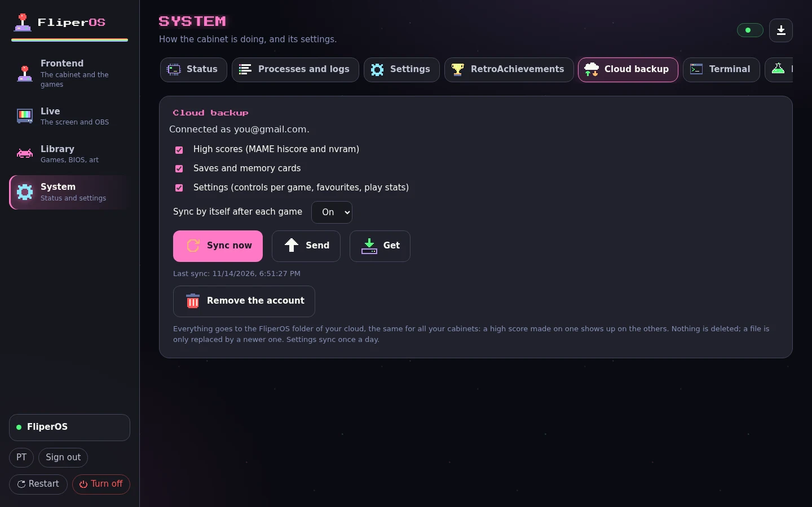

Your high scores, saves and settings in a cloud of your own: Google Drive, Dropbox, WebDAV (Nextcloud, ownCloud), SFTP (a PC or a NAS) or MEGA. Every cabinet you sign in uses the same folder, so a record made on one shows up on the others.

It is in **Setup > Cloud backup** on the cabinet, and in **System > Cloud backup** in the [web panel](Web-panel.md).

## Setting it up

1. Open **Cloud backup**. The first time it installs **rclone**, a small download.
2. Choose where the files go.
3. Sign in (below). The first sync starts by itself, with a **progress bar** (the percentage of files sent, from rclone's own count) on the Setup screen, on the tube and in the graphical menu, and on the web panel's Cloud page.

| Cloud | How you sign in |
| --- | --- |
| **Google Drive** | **Sign in with Google**, like a smart TV: the screen shows a QR code and a code. Open the address on a phone or a computer, type the code and approve. The cabinet waits and finishes by itself |
| **Dropbox** | At Dropbox's site, so only from the web panel, on a phone or a computer |
| **WebDAV** | The folder's address (`https://...`), user and password |
| **SFTP** | The computer's or NAS's name or IP, the SSH port (22), user and password |
| **MEGA** | User and password |

Google only sees the FliperOS folder: the cabinet asks for access to the files it creates itself, nothing else in your Drive.

Passwords are saved hidden, only on this cabinet.

## Using it

| Item | What it does |
| --- | --- |
| **Sync now** | Both ways: each side keeps the newest file |
| **Send** | Only from this cabinet to the cloud |
| **Get** | Only from the cloud to this cabinet |
| **By itself** | Syncs the high scores and saves after each game, and the settings once a day |
| **What to sync** | High scores, saves and settings, each one on or off |
| **Remove the account** | Forgets the account on this cabinet; the files stay in the cloud |

The top of the screen shows the account and the last sync.

**Nothing is ever deleted**, on either side: a file is only replaced by a newer one. Going back to a cabinet, only what is newer than what it has comes in.

## What goes to the cloud

| Group | What it carries |
| --- | --- |
| **High scores** | MAME's hiscore files and the arcade memory (`~/nvram`) |
| **Saves** | Saves and memory cards (`~/save`) |
| **Settings** | What you set and what you leave behind: played games, time played, favourites, the emulators' and frontends' settings, button maps, the on-screen menu's profiles |

The monitor and video settings never come back from the cloud, since another cabinet may have another tube. Art, videos, cores, themes and caches don't go: they are downloaded or made again.

In the cloud everything is in a `FliperOS/` folder, with `hiscores/`, `saves/` and `config/` inside.

## Problems

- **Google Drive is not in the list:** the cabinet couldn't get FliperOS's Google sign-in. Check the internet and open the screen again, or use the web panel.
- **The sync failed:** the log is `cloud` in the web panel's **System > Processes and logs**, or `/opt/fliperos/logs/cloud.log`.

## How it works

- `config/fliperos-cloud` runs as the `fliperos` user, with the rclone remote `fliperos` in `~/.config/rclone/rclone.conf`; its state is `~/.config/fliperos/cloud.conf`. Commands: `status`, `remote KIND` (fields on standard input, never on a command line), `forget`, `auto on|off`, `what LIST`, `sync [push|pull|both]`, `watch PID`, `google start|status|cancel`.
- Each side gets `rclone copy --update`, never `sync`, so nothing is deleted.
- *By itself*: `fliperos-kms-run` and `fliperos-x11-run` start `fliperos-cloud watch PID`, which syncs when the game closes, at most every 2 minutes; the settings once a day.
- **Sign in with Google** is Google's "OAuth 2.0 for TV and Limited-Input Devices", with FliperOS's own client (type "TVs and Limited Input devices", scope `drive.file`) in `/etc/fliperos/google-oauth.conf`. The waiting runs as a detached process, so the Setup and the panel only read its state; a code that expires is renewed by itself, and with nobody looking for 10 minutes it gives up. **Remove the account** revokes the token at Google.
- Dropbox signs in with `rclone authorize` on the cabinet: the panel takes the site's address from it and hands the code back. WebDAV, SFTP and MEGA passwords reach rclone on standard input and are saved obscured (`rclone obscure -`).
- The Setup screen is `screen_cloud` in `screens/setup-menu.sh`, on top of `lib/cloud.sh`.

See also: [Web panel](Web-panel.md), [ROMs, BIOS and artwork](ROMs.md).
