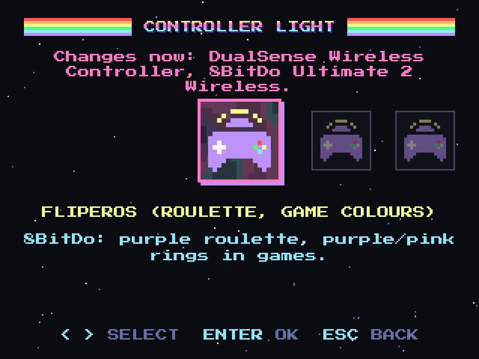

**Setup > Joysticks > Controller light** sets the colour of the controllers that have a light: DualSense, DualShock 4, some 8BitDo, and the ring of the **8BitDo Ultimate 2**.

 Joysticks > Controller light">

| Choice | The light |
| --- | --- |
| **FliperOS** (default) | FliperOS purple; on the Ultimate 2, a roulette (below) |
| A colour of the list | One of 8 colours |
| **Other colour** | Any colour, typed as `RRGGBB` |
| **Off** | The light as the controller sets it |

The screen says which of the connected controllers change.

## 8BitDo Ultimate 2

- In the menus, a purple light runs over pink around its ring, like a roulette.
- While a game is open, the left ring turns purple and the right one pink; the roulette comes back when the game closes.
- The pad only takes settings over its **USB cable or its 2.4G dongle**: over Bluetooth it keeps the colour saved by cable.
- A pad with no profile at all gets profile 1 "FliperOS" with the 8BitDo app's defaults, and its profile button has to be pressed once.

## How it works

- DualSense, DualShock 4 and the other 8BitDo pads go through the kernel's colour LEDs; the Ultimate 2 through its own protocol over hidraw (`config/fliperos-padcolor-8bitdo`; its left ring is LEDs 0 to 11).
- `config/fliperos-padcolor` applies the colour (`apply LED`, `hidraw NAME`, `all`, `list`) and, with `launch PROG…`, switches to the game colours while a game runs. The setting is `padcolor=` in `fliperos.conf`: `fliperos`, `RRGGBB` or `off`.

See also: [Controls](Controls.md), [Bluetooth](Bluetooth.md).
