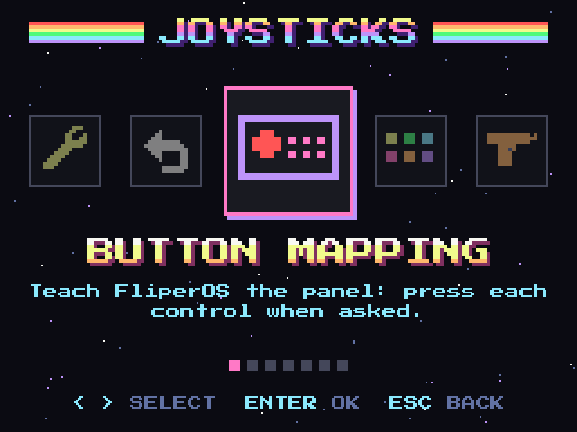

Controllers on FliperOS: arcade panels, joypads, Bluetooth pads, light guns, wheels. Set them once in **Setup > Joysticks**, and every emulator, frontend and menu uses them.

 Joysticks">

| Page | What it covers |
| --- | --- |
| [Button mapping](Button-mapping.md) | Each controller's player and buttons, arcade panel or joypad, the keyboard encoder, Buttons layout for 1 to 5-button games |
| [Bluetooth](Bluetooth.md) | Pairing wireless controllers |
| [Controller light](Controller-light.md) | The colour of DualSense, DualShock 4 and 8BitDo lights, the Ultimate 2 roulette |
| [Light guns](Light-guns.md) | The GunCon 2: driver, calibration, several guns, the screen flash, the gun in each emulator |
| [Wheels, LPT and quirks](Wheels-and-quirks.md) | Calibrating a wheel or pedals, parallel port joysticks, USB quirks, controllers in SDL |
| [Frontend controls](Frontend-controls.md) | The frontend's buttons, and the shortcuts to quit a game or open its menu |

## Setup > Joysticks

| Item | What it does |
| --- | --- |
| **Button mapping** | Controller, player, kind, buttons ([Button mapping](Button-mapping.md)) |
| **Bluetooth** | Only with a Bluetooth adapter ([Bluetooth](Bluetooth.md)) |
| **Buttons layout** | Where the buttons of 1 to 5-button games go ([Button mapping](Button-mapping.md#buttons-layout-games-of-1-to-5-buttons)) |
| **GunCon 2** | Calibrate, screen flash, settings ([Light guns](Light-guns.md)) |
| **Calibrate wheel, pedals or analog stick** | ([Wheels, LPT and quirks](Wheels-and-quirks.md)) |
| **Controller light** | ([Controller light](Controller-light.md)) |
| **LPT joysticks** | ([Wheels, LPT and quirks](Wheels-and-quirks.md#lpt-joysticks)) |

USB fixes are in **Setup > System > Quirks** ([Wheels, LPT and quirks](Wheels-and-quirks.md#quirks-usb-device-fixes)).

## In the games

- **Quit a game:** coin + Start held for a second. **The emulator's menu:** coin + button 1. **The FliperOS on-screen menu:** Start + Down ([Frontend controls](Frontend-controls.md#game-shortcuts)).
- **In the menus**, the controller is the keyboard ([Installed system](Installed-system.md#controller-in-the-menus)); **on the desktop**, it is the mouse ([Desktop and theme](Desktop.md#the-controller-as-a-mouse)).
- **In custom games** that only take the keyboard, the on-screen menu's **Controller configuration** maps buttons to keys ([Custom games](Custom-games.md#the-controller-as-a-keyboard)).

## Where sections moved

This page used to hold every control. Button mapping is now on [Button mapping](Button-mapping.md), the GunCon 2 on [Light guns](Light-guns.md), Quirks and SDL on [Wheels, LPT and quirks](Wheels-and-quirks.md).

See also: [DIY hardware](DIY-hardware.md), [Latency](Latency.md).
