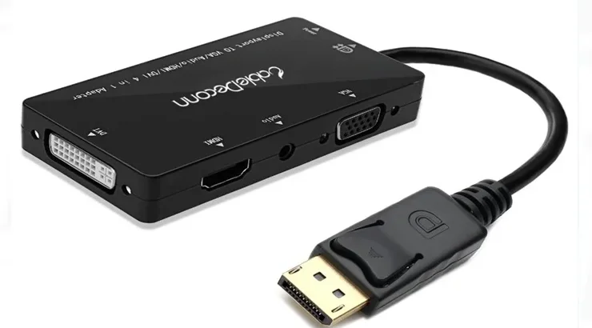

A card with only digital outputs (HDMI, DVI-D, DisplayPort) can drive a CRT through an **active converter**. What works, what to expect, and what FliperOS does on those outputs.

A card with only digital outputs can drive a CRT through an **active converter** with a DAC chip inside. A passive adapter doesn't work on a digital output.

## DisplayPort is the one to use

 GroovyArcade reports no lower limit for its pixel clock, so a card that makes low clocks can often show games at their native resolution. An HDMI or DVI-D link doesn't go under about 25 MHz, so it only gives super resolutions.

## Recommended converters

| Converter | Notes |
| --- | --- |
| **CableDeconn** DisplayPort to VGA ([one sold on AliExpress](https://a.aliexpress.com/_mPCmfYb), with HDMI and DVI outputs too) | Very fragile VGA connector. 5 V on VGA pin 9 |
| **Cable Matters** DisplayPort to VGA (product 102026) | Only 3.2 V on VGA pin 9, which matters if the device after it expects 5 V |

Both use a Realtek RTD2168 chip. The community found no processing of the signal and no measurable lag, apart from the mode switch.

The CableDeconn has also been reported working on a FliperOS cabinet, without a record yet of the card, the driver or the modes.

## What to expect

- **Mode switches are slower** than on a native VGA or DVI-I output.
- **Interlaced modes are hit-or-miss**, mostly misses. So FliperOS' default 15 kHz boot (`640x480iS`) may stay black: use the **EDID progressive** entry of the boot menu, which GroovyArcade calls the most compatible for these outputs, or a progressive mode ([Black screen](Black-screen.md#black-from-the-boot)).
- **Some modes may be refused.** If only some games go black, raise [`dotclock_min`](Black-screen.md#the-menus-work-some-games-go-black).

## Protecting the CableDeconn's connector

 Users fix a VGA gender changer to it with 4-40 hex screws, so the changer takes the wear of plugging and unplugging. Use screws of 10 or 12 mm: **never longer than 12 mm**.

## In the Setup

 the output test skips a digital output that reports nothing connected.

On HDMI, DVI-D or DisplayPort with a CRT preset, the Setup uses super resolutions by itself, even on an AMD card: `1280x480iS` at boot (or the converter's EDID swapped for a super resolution one) and `dotclock_min 25.0`. An LCD on those outputs isn't affected. The **15 kHz** and **25 kHz** entries of the boot menu do the same on those outputs (`1280x480iS`, `800x600iS`); VGA and DVI-I stay native.

**Why DisplayPort too.** A converter has a floor of its own. On one DisplayPort-to-VGA converter (Radeon Pro WX 4100, Sony monitor with a BKM-201SC), numbered test cards showed every mode from 25 MHz up, at 15, 25 and 31 kHz, interlaced or not, either sync polarity, and nothing at 16 MHz or below, though the kernel had set them all. 320x480 at 12.6 MHz and 640x480 at 25.2 MHz make the same analog signal, so only the converter, which gets the digital clock, can tell them apart. On a CRT, super resolutions give the same picture.

**A DisplayPort converter that shows native modes keeps them.** With a 15 kHz monitor on DisplayPort, the output test (and **Setup > Video Setup > Low resolutions**) shows a native grid, from 320x240 (6.5 MHz) up to 640x240 (13 MHz). The first one you see sets the native modes from that clock up, as before; if none shows, the output stays in super resolutions. A cabinet set up before this test is asked once, at the next boot. The result is saved for that output only (`converter_low_dotclock=DP-1` and `converter_low_dotclock_min=` in `fliperos.conf`).

**A converter with its own EDID.** Most converters report an EDID of their own, with 31 kHz modes, so the output test takes them for an LCD ("Found a monitor that could be a LCD panel"). When you then choose a CRT monitor, the Setup replaces the converter's EDID with a 15 kHz one (`generic_15_super_resp.bin`, as in the *EDID progressive* boot entry). Without it the menu came up at 1024x768 and 48 kHz and the tube stayed black, and so did the screen after leaving a game, although the games, which set their own modes, were fine. A `video=1280x480iS` line alone didn't fix it: the console used it, but the frontend opens the first mode of the list, the converter's. Games stay native on a card with low dotclocks.

**Seen with one CableDeconn-type converter** (Ryzen 5 5600GT, `amdgpu`, DisplayPort), with a numbered test card for each mode and the person reading the numbers on the tube: native modes from 224 to 640 pixels wide (4.5 to 13.0 MHz) and from 712 to 2560 wide (14.5 to 52 MHz) showed, `1280x480i` too. Modes between about 13.1 and 14.4 MHz (672 to 704 wide) and below 4 MHz (192 wide and less) gave no signal, though the kernel had set them. So a game of those widths can go black on this converter: raise [`dotclock_min`](Black-screen.md#the-menus-work-some-games-go-black). Other converters and monitors may differ.

For a third monitor on a converter, see [Multiple monitors](Multiple-Monitors.md).

See also: [Video cards](Video-cards.md), [Black screen](Black-screen.md), [Install](Install.md#with-a-displayport-or-hdmi-to-vga-converter).
