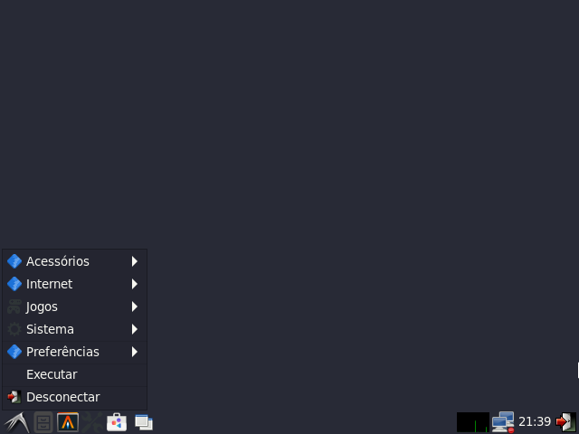

**Start desktop** in the FliperOS menu opens LXDE, the same desktop as GroovyArcade's, for a mouse and a keyboard, or the controller as a mouse. Leaving it goes back to the menu.

## What is on it

The panel at the bottom has the menu, the file manager, the terminal, the tasks, CPU, volume, the tray, the network and the clock. The wallpaper is a pixel-art city at night, and everything is in the Dracula theme (below).

| Program | Where | What it is |
| --- | --- | --- |
| **Alacritty** | Panel, menu | The terminal, in Dracula colours |
| **App Store** | Desktop, panel, System Tools | GNOME Software with Flatpak and Flathub: Ubuntu packages and Flatpak apps. Installing asks for the `fliperos` password |
| **Falkon** | Internet | The web browser |
| **Transmission** | Internet | Torrents |
| **FliperOS Setup** | Panel, System Tools | The Setup in a window |
| **Home** | Desktop | Your folders: roms, bios, media, config |
| **Desktop Resolution** | Desktop, Preferences | Changes the desktop's resolution (below) |
| **AntiMicroX**, **QJoyPad** | Menu | A controller as keyboard and mouse |
| `htop`, `evtest`, `joy2key`, `hwinfo`, `lshw`, `read-edid`, `i2c-tools` | Terminal | GroovyArcade's tools |

The App Store downloads no updates by itself and has no welcome screen: disk and network activity in the middle of a game hurts latency.

### Emulators in the menu

**Games** has RetroArch, GroovyMAME, HBMAME (HBGroovyMAME), Flycast, PCSX2, PCSX2x6, Dolphin, DuckStation, OpenBOR, Odin, Model 2, Model 3, KOF Final Attack and, once downloaded through the Setup, Fightcade 2, with the projects' own icons. PortProton (Windows games) and Hook Of The Reaper (light guns) have their own entries.

HBMAME and Odin are optional packages ([Packages](Packages.md)): they are installed when the first game of their folder opens from a frontend, so open one there first; the desktop entries only run what is already installed.

None of them runs inside the desktop: choosing one closes the desktop (asking first if there are open windows), the emulator opens on the CRT in its own video mode, and when it closes **the desktop comes back**.

Model 2 always shows: the first click downloads and builds it ([Emulators](Emulators.md)). Steam and Heroic (GOG), once installed through **Setup > Games > Extras**, also live in Games, but open inside the desktop itself.

## Disks

Every disk is **mounted by itself**, at boot and when it is plugged in: a second hard disk, a USB stick, a Windows partition. It goes to `/media/fliperos/<label>` and gets a **hard disk icon on the desktop**.

- A disk without a label is named after its model, like `/media/fliperos/TOSHIBA_HDWD110` (its second partition on: `TOSHIBA_HDWD110_2`).
- FAT, exFAT and NTFS disks belong to the user, so you can write to them.
- The icon's menu has **Unmount** and **Eject**. Mounting and ejecting need no password; formatting and partitioning ask for it.

Nothing is mounted on the installation media, where the installer may need to erase a disk.

## The controller as a mouse

On the desktop, the first controller is the mouse:

| Controller | Does |
| --- | --- |
| Stick or D-pad | Moves the pointer |
| Accept button (button 1) | Left click |
| Back button (button 2) | Right click |
| Button 3 | Opens and closes the **on-screen keyboard** |

The on-screen keyboard (Onboard) also opens by itself when a text field gets the focus, and types into it, but **only while you are using the controller**: it turns that on with a button press or the stick (and off again 15 seconds after the last one), so with a real keyboard or mouse in your hand it never pops up. Button 3 opens it at any time. A window in full screen (a game, a video) pauses the controller-mouse.

Every text field of the graphical Setup has an on-screen keyboard too: Enter on the field opens it.

## Desktop Resolution

Changes the desktop's resolution **on the fly**. The list is the resolutions of the monitor chosen in Video Setup, plus **Other resolution...** for any `WIDTHxHEIGHT@HZ`.

Without a confirmation within 15 seconds, the previous resolution comes back. **Use every time the desktop starts** keeps it for the next time.

Only the desktop changes: the console, the Setup and the frontends keep the Video Setup resolution. With an LCD monitor, the list is the modes of its EDID.

### On a 31 kHz monitor

With a 31 kHz preset the desktop opens at **640x480 and 31.5 kHz**, the one mode of that preset, however the boot mode was chosen (also when it comes from an EDID, as with a DisplayPort or HDMI to VGA converter). Before update 100 such a cabinet could open the desktop with the monitor's "out of frequency" message: the X had no mode of its own and picked one from the EDID that the monitor doesn't take. The update rewrites `/etc/X11/xorg.conf.d/10-fliperos.conf` on the cabinets already at 31 kHz.

If the message still shows, send `/etc/fliperos/fliperos.conf` (the `monitor=`, `frequency=`, `boot_resolution=` and `connector=` lines) and `~/.local/share/xorg/Xorg.0.log` to the [Telegram group](https://t.me/fliperos15khz). A mode saved in **Desktop Resolution** that the monitor doesn't take can cause it too: pick another one, or delete `~/.config/fliperos/desktop-mode`.

In an interlaced mode, the desktop gets the flicker filter at the Desktop row's level of **Setup > Video Setup > Interlaced hacks** ([Interlaced, colour and scanlines](Picture-filters.md)).

## Dracula theme

[Dracula](https://draculatheme.com) is the theme of everything FliperOS draws:

| Where | How |
| --- | --- |
| Console and the text Setup | The VT palette (below) and Gum with its indices |
| LXDE windows and programs (GTK 2/3) | The official `dracula/gtk` theme, pinned by commit, with GTK 2's `murrine`/`pixbuf` engines |
| LXDE window borders and menus (Openbox) | `config/openbox-3/themerc` (`dracula/gtk` has no Openbox theme) |
| LXDE panel, background, terminal | The colours in `config/lxde` |
| Terminal (zsh) | **Oh My Zsh** with the official `dracula/zsh` theme, both pinned by commit, without automatic updates. On the Linux console the arrow and git's ✓/✗ become `>`, `ok` and `*` |
| RetroArch | The **Dracula theme built into RGUI** (`rgui_menu_color_theme = 17`) |
| GroovyMAME | UI colours (menus, game list, sliders) in `/etc/fliperos/mame/ui.ini` |

### On the console

The Linux console has 16 colours, and the background takes only the first 8. The palette is reprogrammed with the Dracula tones at boot and again by the Setup, and Gum's styles use the palette **indices**, so the tube and a graphical terminal show the same thing. The console font (Lat15/Uni2) has the rounded borders, the bar blocks and the arrows the screens use.

## How it works

- LXDE is GroovyArcade's: `lxde` components with openbox-lxde, no DPMS or screensaver, Sans 10, and the Video Setup orientation. The `lxde` metapackage depends on `lxterminal`, so the image installs its components one by one, without `lxterminal` and `xterm`: they didn't draw Gum's borders. **Alacritty** works in UTF-8 and draws borders and blocks by itself (`config/lxde/alacritty/alacritty.toml`, DejaVu Sans Mono, a cursor that doesn't blink, since blinking redraws the screen and flickers in interlaced modes). `fliperos-lxde` exports `WINIT_X11_SCALE_FACTOR=1`, because the CRT's EDID would give 50 DPI or less.
- The only compositor is picom, for the flicker filter, run only while the screen is interlaced (`config/fliperos-desktop-deflicker`).
- The App Store: `config/fliperos-software.gschema.override` turns off automatic downloads and the welcome screen; installing asks through lxpolkit. Ubuntu 24.04's App Center depends on snap, which isn't in the image.
- Disks: a udev rule (`config/99-fliperos-disks.rules`) starts `fliperos-automount@<device>.service` for each file system; `config/fliperos-automount` leaves out what is mounted, swap, encrypted, LVM and RAID volumes and system partitions, and udisks2 mounts the rest as the `fliperos` user (NTFS through the kernel's `ntfs3`). The old UUID path of a disk without a label still works, as a hidden link. A polkit rule (`config/50-fliperos-udisks.rules`) lets the user mount, unmount and eject without a password. The icons are PCManFM's (`show_mounts=1`) with `gvfs`.
- Falkon and Transmission: `fliperos-rootfs.sh` copies each package's menu entry to `/usr/local/share/applications`, with the name changed in every language.
- Emulators: the menu entry runs `fliperos-launch`, which saves the request and closes the desktop; `fliperos-session` opens the emulator and then the desktop again. GroovyMAME, Model 2 and Fightcade icons come from `config/icons`; Supermodel gets a FliperOS monogram. An emulator left out of the build (`--skip-*`) doesn't show.
- The controller-mouse is `config/fliperos-deskpad` (log `/opt/fliperos/logs/deskpad.log`); the keyboard is Ubuntu's Onboard, set by `config/fliperos-onboard.gschema.override`.
- Desktop Resolution is `fliperos-resolution`: Switchres computes the mode within `/etc/switchres.ini` (`switchres --calc`, as for the emulators) and `xrandr` applies it. The saved mode is `~/.config/fliperos/desktop-mode`, applied by `fliperos-lxde`.
- The X configuration is written by `xorg_generate` (`lib/xorg.sh`) from `fliperos.conf`; at `frequency=31k` it always has the `640x480S` modeline, with the horizontal range 30-32 kHz. `updates/0100.sh` redoes it on 31 kHz cabinets.
- Logout (the menu item, the panel button and the end of the session) opens a full-screen menu in the Setup's look: back to the FliperOS menu, reboot, power off or cancel (`config/fliperos-logout`).
- The theme is installed by `fliperos-dracula.sh`; Oh My Zsh lives in `/usr/local/share/oh-my-zsh` and `~/.zshrc` is `config/zshrc`. The VT palette is `/etc/vtrgb` (`config/vtrgb-dracula`, applied by Ubuntu's `setvtrgb.service`).

See also: [Installed system](Installed-system.md), [Emulators](Emulators.md).
