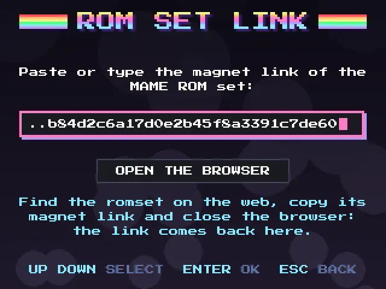
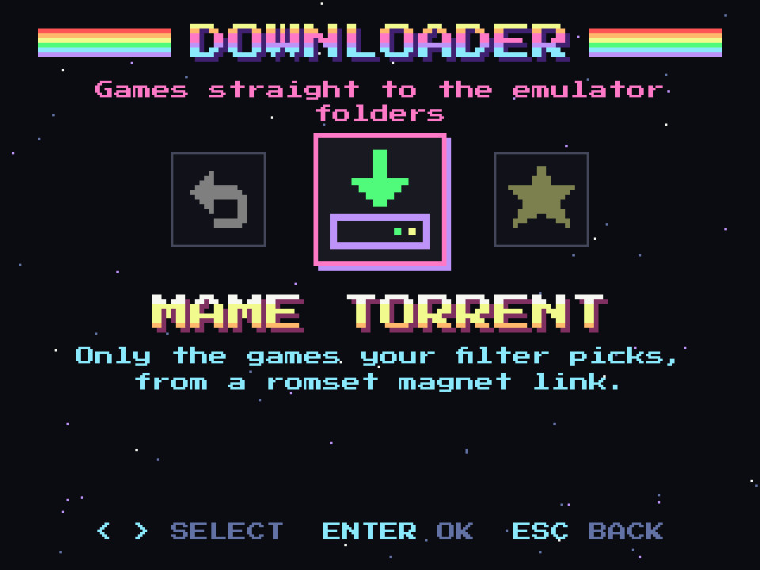

**Setup > Games > Downloader** brings games over the internet: a MAME romset by torrent, but **only the games your filter picks**, and free homebrew games. It also has [Download BIOS](BIOS.md).

## ROM/CHD MAME torrent

### Setting it up

The screen, in order:

1. **Filter:** which games you want, for **GroovyMAME**, **Flycast**, **SM2-Emu**, **Supermodel** or **MAME 2010** (the PlayStation-based arcade games). It is the same parameters screen as the [ROM Cleaner](ROM-Cleaner.md), saved apart, only for the torrent. Until you save one, it is the *Joystick cabinet* preset.
2. **ROM set magnet link** (required) and **CHD set magnet link** (optional). Both come filled in with the links shipped in the image (MAME 0.289 ROMs and MAME 0.288 CHDs, both merged): Enter uses them, or paste another. Under the field, **Web browser** opens a browser to find a magnet link, and **.torrent file** picks a `.torrent` on a USB disk, the network share or the home folder.
3. **Download folder:** by default the emulator's own: `~/roms/mame` with the BIOS in `~/bios/mame`; for Flycast, the folders of `naomi`, `naomi2` and `atomiswave`. Elsewhere, the BIOS go with the games.
4. **Start the download.** It first checks that the whole download fits on the disk; if not, it says how much is needed and how much is free.

It downloads **only what the filter chooses**: the games with their parents, BIOS and devices, and the CHDs of those games. Never the whole set. What is already in the emulator folders isn't downloaded again.

### While it downloads

A progress bar shows the size, the peers, the speed and the time left. Any key returns to the menu, and the download goes on, even with a game open. The web panel shows it too, with **Pause** and **Resume** ([Web panel: Library](Web-panel-Library.md#downloads)).

When a torrent ends, each file goes to the download folder (the BIOS to `~/bios/mame`, the CHDs in `<game>/`), and the torrent leaves without seeding.

A download stopped by a power off goes on by itself at the next boot, or with **Start the download**.

### Changing the filter

With links set up, a new filter (or a new MAME version) shows how many ROMs and CHDs it **adds**, with their size, and how many it **deletes**, with the list, and asks before applying.

- Only what the Downloader brought is ever deleted, never files you put there by hand.
- A parent, BIOS or device that a game still in the folders uses is never deleted: `neogeo.zip` stays while there is a Neo Geo game, even one copied by the ROM Cleaner.
- Removing a link can also delete what it brought.

Afterwards, **Setup > Games > AttractPlus ROM List** updates the game names in Attract-Mode Plus; the FliperOS frontend updates its lists by itself.

## Free games

**Free games** downloads open-source homebrew into the RetroArch core folders, so the frontends don't start empty and you can test video, sound and controls without anyone's ROMs:

- the 240p Test Suites for NES, Game Boy and GBA;
- Thwaite, Nova the Squirrel, Libbet and the Magic Floor, and µCity.

Each comes from the project's own releases page, with a pinned checksum and its license (GPL or zlib); only those for installed cores, and what is already there stays. The image ships nobody's ROMs or BIOS.

## How it works

- **Where the sets are in the torrent** is found from its file list: at its top or in any subfolder (`MAME 0.289/ROMs (merged)/`, next to Software Lists, readmes or extras), the folder with the most `.zip`/`.7z` sets, or, for CHDs, the most `<game>/<disk>.chd` folders. The rest of the torrent is never downloaded, and a torrent without any (the CHD link pasted as the romset) is refused.
- The link is added paused, and as soon as the file list arrives it is stopped with no file marked; the list goes through `fliperos-romclean` (`scan --names`, `chds --names --with`), and only the chosen files are marked. From each CHD folder, only the disks those games use come: in a merged collection the parent's folder also holds every other version's disks.
- **Transmission** does the download: its own `transmission-daemon` (`fliperos-transmission.service`, as the `fliperos` user, at low CPU and disk priority, RPC only on `127.0.0.1:9092`; the stock unit is masked). It never starts at boot: the Setup or the panel starts it when a link is added or a download is started, and it quits when its last torrent ends; `fliperos-downloader-boot.service` resumes one stopped by a power off.
- It is set for speed at each start (`fliperos-downloader config`): up to 150 peers per torrent and 500 in all, a 64 MB write cache, no speed limit, DHT, PEX, local peer discovery, µTP and UPnP on, and a stalled torrent leaves the queue after 5 minutes. The disk priority is the lowest normal one (best-effort 7), since the "idle" class only wrote while nothing else read the disk, and the frontend's videos read it all the time.
- The shipped links are in `/usr/local/share/fliperos/downloader-magnets`. The state is in `/var/lib/fliperos/downloader` (`config/fliperos-downloader`, `lib/downloader.sh`). Whether a set is still used comes from `fliperos-romclean uses`.
- Free games: `config/fliperos-freeroms`, `lib/freeroms.sh`.

See also: [ROM Cleaner](ROM-Cleaner.md), [BIOS](BIOS.md), [ROMs, BIOS and artwork](ROMs.md).
