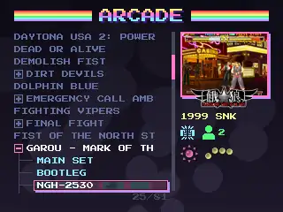

The emulators FliperOS ships or installs, the systems they run and the video mode each opens in. Every one opens from any frontend, from the desktop's **Games** menu, or from the console.

| Page | What it covers |
| --- | --- |
| [KMS and X11](KMS-and-X11.md) | How each emulator reaches the tube, its video mode, running any program at 640x240, cards without low dotclocks |
| [GroovyMAME](GroovyMAME.md) | Arcade at native resolution: the Midway games, missing files, the package and building the newest |
| [RetroArch](RetroArch.md) | The cores, the light gun in every core, the D-pad, video, updating |
| [Flycast](Flycast.md) | Dreamcast, Naomi, Naomi 2 and Atomiswave |
| [Sega Model 2 and 3](Sega-Model-2-and-3.md) | Keisho, for both boards, with Vulkan or OpenGL |
| [PlayStation 2 and Namco 246/256](Namco-246-256.md) | PCSX2, and PCSX2x6 for Tekken 5, Soul Calibur II and the other Namco boards |
| [OpenBOR](OpenBOR.md) | Beat 'em up paks: information from the pak, each pak's own video mode, old paks |
| [Windows games](Windows-games.md) | Wine, Wine Staging, Steam and Heroic |
| [More emulators](More-emulators.md) | Dolphin, DuckStation, Hypseus Singe (laserdisc), KOF Final Attack, Odin (Sega Hikaru) |
| [Fightcade 2](Fightcade-2.md) | Online matches |

## Every emulator

| Emulator | Systems | Comes | Video at 15 kHz |
| --- | --- | --- | --- |
| [GroovyMAME](GroovyMAME.md) | Arcade | In the image | Each game's own mode |
| [HBMAME](GroovyMAME.md#hbmame-hbgroovymame) | Arcade hacks and homebrews (`~/roms/hbmame`) | Downloads itself when you open its first game | Each game's own mode |
| [RetroArch](RetroArch.md) | Consoles and arcade, through its cores | In the image | Each game's own mode |
| [Flycast](Flycast.md) | Dreamcast, Naomi, Naomi 2, Atomiswave | In the image | 640x240 |
| [PCSX2](Namco-246-256.md#pcsx2-playstation-2) | PlayStation 2 | In the image | 640x240 |
| [PCSX2x6](Namco-246-256.md#pcsx2x6-namco-system-246-and-256) | Namco System 246, 256, Super 256 | In the image | 640x240 |
| [Dolphin](More-emulators.md#dolphin-gamecube-wii-triforce) | GameCube, Wii, Triforce | In the image | 640x240 |
| [Keisho](Sega-Model-2-and-3.md) | Sega Model 2 and Model 3 | In the image | 640x240 at 57.524 Hz |
| [OpenBOR](OpenBOR.md) | Beat 'em ups | Downloaded (the AnyBOR core, when the first pak opens) | The mode of RetroArch's CRT engine |
| [Hypseus Singe](More-emulators.md#hypseus-singe-laserdisc) | Laserdisc | In the image | 640x240 |
| [DuckStation](More-emulators.md#duckstation-playstation) | PlayStation | Downloaded | 640x240 |
| [Fightcade 2](Fightcade-2.md) | Online arcade matches | Downloaded | Each game's own mode |
| [Odin](More-emulators.md#odin-sega-hikaru-and-gaelco-3d) | Sega Hikaru and Gaelco 3D arcades (`~/roms/odin`) | Downloads itself when you open its first game | 640x480 (interlaced at 15 kHz) |
| [KOF Final Attack](More-emulators.md#kof-final-attack-ikemen-go-43) | One game, Ikemen GO | Downloaded or from your copy | 320x240 |
| [Wine, Wine Staging](Windows-games.md) | Windows games | From the Extras | The game's video mode |
| [Steam, Heroic](Windows-games.md#steam-and-gog) | PC games | From the Extras | Inside the desktop |

"640x240" is the default for games taller than 240 lines; **Setup > Video Setup > Interlaced hacks** can make each program interlaced instead ([Interlaced, colour and scanlines](Picture-filters.md)). On 25/31 kHz monitors and LCDs they run at 640x480.

## Installing and updating

**Setup > Games > Emulators & Games** lists them all, installed or not, with the version you have and the one the latest update brings. One that is missing installs from there, or by itself the first time one of its games opens. The packaged ones can also **Build the newest**. See [Games Setup](Setup-Games.md#emulators--games).

## In every emulator

Every emulator opens through FliperOS's wrappers, so every game gets the same things:

- your panel's buttons, from **Setup > Joysticks > Button mapping** ([Controls](Controls.md));
- **coin + Start** to quit and **coin + button 1** for the emulator's menu ([Frontend controls](Frontend-controls.md#game-shortcuts));
- **Start + Down** for the FliperOS [on-screen menu](On-screen-menu.md): geometry, colour, the interlaced filter, quitting;
- [RetroAchievements](RetroAchievements.md) in RetroArch, DuckStation, PCSX2, Dolphin and Flycast;
- the marquee on a [Pixelcade or ZeDMD](LED-displays.md), and the [cloud backup](Cloud-backup.md) of saves and high scores;
- a log in `/opt/fliperos/logs/<program>.log`, also in the web panel's **System > Processes and logs**.

## Where sections moved

This page used to hold every emulator. Running a program at 640x240 is now on [KMS and X11](KMS-and-X11.md#running-a-program-at-640x240), interlaced hacks on [Interlaced, colour and scanlines](Picture-filters.md), Emulators & Games on [Games Setup](Setup-Games.md#emulators--games), RetroAchievements on [its page](RetroAchievements.md), and each emulator on the pages above.

See also: [Adding an emulator](Adding-an-emulator.md), [ROMs, BIOS and artwork](ROMs.md).
