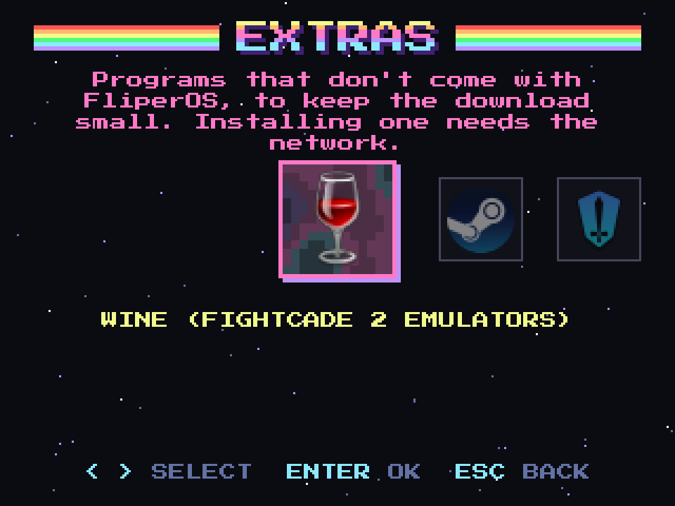

[Fightcade 2](https://www.fightcade.com) is online arcade and console matches, with rollback. It is closed-source freeware with no clear permission to redistribute, so **it isn't in the image**: the Setup downloads it from its site.

 Games > Extras with Wine">

## Installing

**Setup > Games > Emulators & Games > Fightcade 2**, or pick it in **Setup > Games > Frontend**, where it shows as *Fightcade 2 (not installed)*. The Setup downloads the official Linux package (about 160 MB) with a progress bar, and Wine, which its emulators need.

Once installed it can be the boot launcher, and it shows in the desktop's **Games > Fightcade 2**. Choosing it again in Emulators & Games downloads it again on top, which repairs it: the ROMs and settings stay.

## ROMs

The ROMs are Fightcade's own sets, in `~/roms/fightcade`, one folder per emulator:

| Folder | Games |
| --- | --- |
| `fbneo` | FBNeo 0.2.97.44 sets, with `neogeo.zip`; console games in subfolders (`megadrive`, `nes`, `sms`…) |
| `flycast` | Naomi, Atomiswave, Dreamcast |
| `snes9x` | Super Nintendo |
| `fc1` | The Fightcade 1 games, FB Alpha 0.2.96.74 sets |

Fightcade's FBNeo opens `.zip` sets only. A folder of `.7z` sets (as many ROM packs come) leaves the game as *no game loaded*, and the launcher closes the emulator after a few seconds: convert the sets to `.zip` (`7z x`, then `7z a -tzip`), and keep a game's parent set and `neogeo.zip` next to it.

The romsets are the ones each emulator asks for, not those of the current MAME. The frontends don't list them: they are for Fightcade. To play one in RetroArch's FBNeo core, copy it to `~/roms/retroarch/fbneo` ([Versus score](Versus-score.md#fbneo-in-retroarch)).

**Arcade memory:** the package brings the memory of many Naomi and Atomiswave games, kept in `~/nvram/fightcade/flycast`. At installation the system's Flycast gets a copy too, for the games that have none of their own yet.

## On the tube

- **The lobby** is a desktop page that doesn't fit in 240 lines, so it opens interlaced at **512x448**, with the page scaled to the height. *Text > Zoom In/Out* (Ctrl+= and Ctrl+-) adjusts it.
- **FBNeo and FBA matches run in each game's own resolution**, like GroovyMAME: Street Fighter II (CPS) at **384x224 at 59.637 Hz**, Neo Geo at 320x224, and so on. Each pixel of the board is one pixel on the tube, and the screen runs at the game's own rate. Vertical games and games GroovyMAME doesn't know use 320x240.
- **SNES9x** runs at 256x224 at 60.0988 Hz, the console's own mode; **Flycast** at 640x240, stretched, like the system's Flycast.
- **Pure picture:** scanlines, bilinear filtering, shaders, motion blur, hardware gamma and SNES9x's hi-res blending are turned off once, with VSync on; what you change later stays.

On 25/31 kHz monitors and LCDs the matches stay in the lobby's mode.

## Keys

It needs a keyboard and a mouse for the login and the lobby.

| Keys | What they do |
| --- | --- |
| **Ctrl+W** | Closes Fightcade and returns to the menu |
| **Alt+Tab** | Switches between the lobby and the match's emulator |
| **Alt+F4** | Closes the front window |

The power button closes a match's emulator, and the lobby comes back ([Power and volume buttons](Power-and-volume-buttons.md)).

## What was checked

On a virtual screen with package 2.1.45: download, repair, the lobby, FBNeo opening in Wine, Alt+Tab and Ctrl+W, and the mode switches (a game requested through Fightcade's `fcade://` takes the screen to its mode in a second, Flycast to 640x240, and the lobby comes back on close). On the cabinet's 15 kHz tube, a CPS game in FBNeo opened in its native 384x224, pixel for pixel. **Not checked:** an online match, which needs an account.

## How it works

- The package goes to `/opt/fliperos/fightcade`, a user-owned folder, because Fightcade updates itself by writing there. `fliperos-fightcade fetch` downloads it again. In the sessions table its package is `fetch:fliperos-fightcade`. The `ROMs` folders inside Fightcade are links to `~/roms/fightcade` (`config/fliperos-roms`), and `emulator/flycast/data` to `~/nvram/fightcade/flycast` (the `.net` files are the ones used online).
- **The lobby:** `fightcade 512x448@60` in `emulator-modes.conf`, with `--force-device-scale-factor` (0.75 at 448 lines; `FIGHTCADE_SCALE` sets another). Its interlacing gets picom's flicker filter at the Other programs level of **Interlaced hacks**, and a Flycast match the Fightcade Flycast row's.
- **Native modes:** when FBNeo or FBA opens, `fliperos-fightcade` pauses it (before Wine reads its settings), takes the game's size and refresh from GroovyMAME's `-listxml` (cached in `~/.cache/fliperos/fightcade-modes`), adds the mode with Switchres and turns on the emulator's *ArcadeRes* (`bVidArcaderesHor` in `fcadefbneo.ini`, `bVidArcaderes` in FBA's), then lets it go on, and Wine switches the screen. `bForce60Hz 0` keeps each game at its own speed, and only one mode of each size stays on the output, because the emulators ask Wine for a size, not a rate. `FIGHTCADE_NATIVE=0` turns it off.
- **The other emulators:** `fliperos-fightcade` checks every second whether one is open, and `xrandr` switches to its mode from the table (`fightcade-snes9x`, `fightcade-flycast`, `fightcade-fbneo`, `fightcade-fc1`). Each emulator's file gets full screen at that size on each launch and, the first time, the game in full screen and a 4:3 monitor.
- **Wine:** FBNeo, SNES9x and FBA are 32-bit Windows programs, run in Wine with a prefix of their own (`~/.local/share/fliperos/wine-fightcade`, created the first time the lobby opens, about 15 s), without the Mono/Gecko window. 32-bit Wine's Direct3D needs **32-bit OpenGL** (`libgl1:i386`, `libgl1-mesa-dri:i386`, `libglx-mesa0:i386`, installed with Wine), or FBNeo stops at *"Couldn't initialise DirectX9 Alternate video output"*. It also needs **32-bit XRandR** (`libxrandr2:i386`, installed with Wine, and brought to machines that already have Wine by the system update): Wine loads it at run time, and without it a 32-bit game can't change the screen mode, so FBNeo opened a window instead of full screen and showed *"Problem setting '384x224x32bpp (0Hz)' display mode. This is not a standard VGA resolution"* (Wine answers `-2` to the mode change).- **Flycast Dojo** is native but an AppImage: the launcher exports `APPIMAGE_EXTRACT_AND_RUN=1`. Every time the lobby opens, Dojo receives the system Flycast's video and control options (`rend.*`, `pvr.*` except the stretch, and `[input]`) and the controller mapping files.
- **Arcade BIOS:** Dojo reads `naomi.zip`, `naomi2.zip` and `awbios.zip` (and `dc_boot.bin`) from its own `data` folder, and the package doesn't bring them: without `naomi.zip` a Naomi game, *Test game* included, stops at `cannot load BIOS naomi.zip` and closes. Every time the lobby opens, the ones the system already has in `~/bios/dc` are copied there, only the ones missing: what is already in `data` stays.
- The keys are `config/openbox-fightcade.xml`.

See also: [Emulators](Emulators.md), [Linked cabinets](Linked-cabinets.md).
