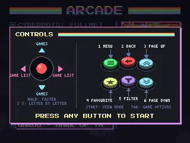
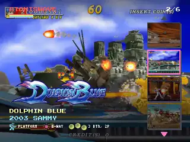
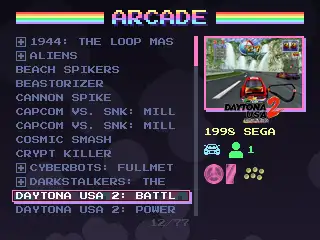
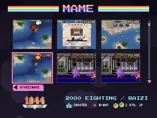
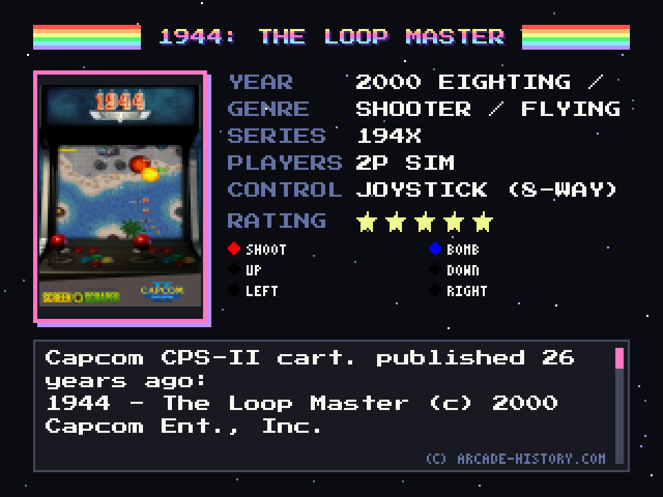
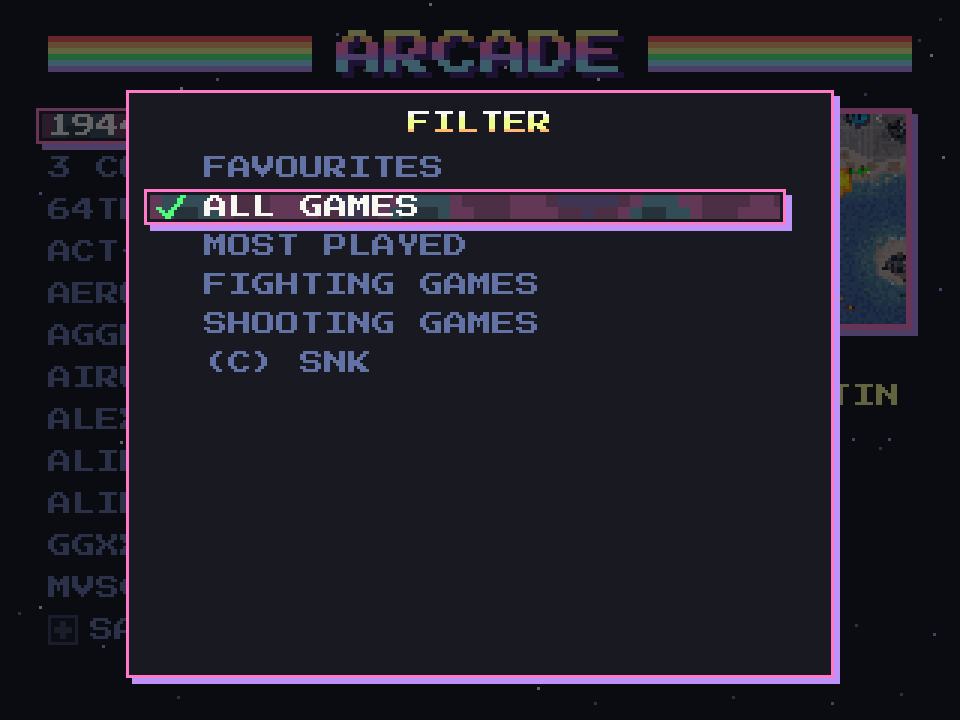
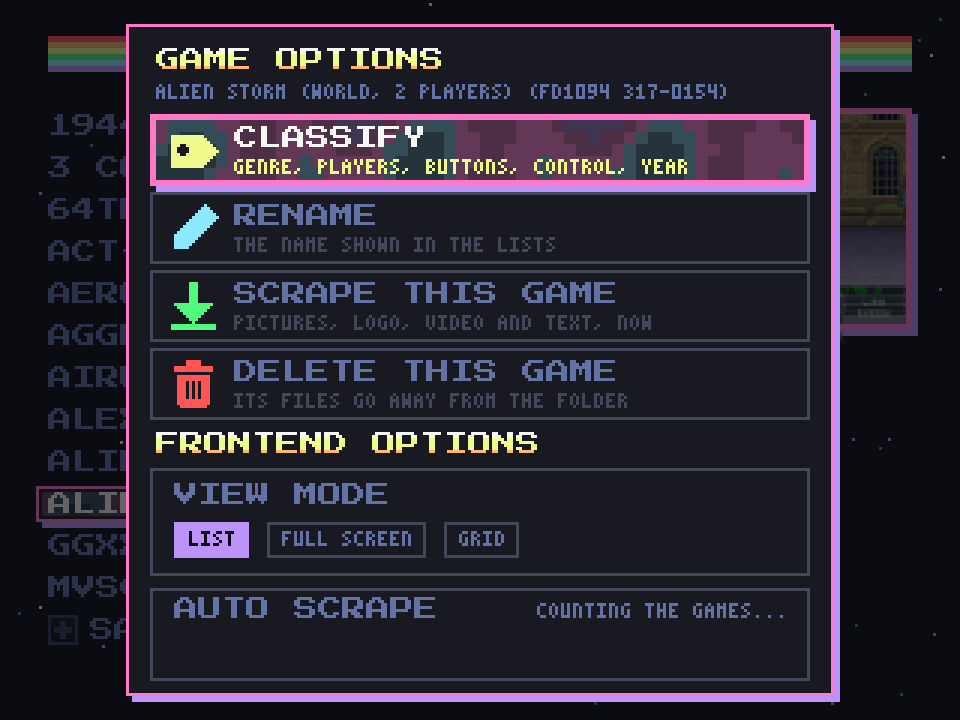
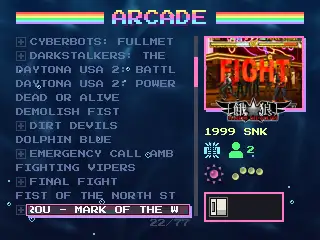

The game list that opens at power on: FliperOS's own frontend, in the look of the Setup menu (Press Start 2P, Dracula colours, the animated background), drawn for the tube at 320x240. It comes in the image, and it is the default launcher.

The buttons and their shortcuts have their own page: [Frontend controls](Frontend-controls.md).

## The system strip

Each games folder is a system, and **Arcade** has all the arcade folders together. The systems are a strip of tiles, each with the system's written logo (NAOMI, ATOMISWAVE, SEGA MODEL 3…) and the emulator's icon on its corner.

- **Left and right** move along the strip. Under the tile you are on, it says how many games that system has.
- **Button 1** opens that system at once. Stopping on a tile also opens it, after a moment.
- **Button 2** cancels and stays on the system you were in.

The new list comes in with an animation (below), and the tiles stay a moment with the number of games, so it can be read; moving in the list closes them.

Each system remembers where the cursor was, also after the frontend closes or the cabinet powers off. With a CD/DVD drive or a cartridge reader connected, **down** from the strip goes to the [physical media](Physical-media.md) row.

## Three views

**Start** switches the view, and so does **Tab > VIEW**.

| View | What it shows |
| --- | --- |
| **List** | The games on the left; the picture, logo and information on the right |
| **Full screen** | The game's video or picture behind, the name and information in front, and the list as four thumbnails on the right |
| **Grid** | Three thumbnails a row, two rows, each playing its video, silent except the chosen one |

 

### Clones

A game with clones has a **+** on its left in the list: button 1 unfolds the clones under it, each with what differs in its name (the region, the set, bootleg). In full screen and in the grid the clones come right after their parent, with a **CLONE** badge; button 2 on a clone goes back to the parent.

**Tab > SHOW CLONES** turns the clones off and on.

### RECENT and FAVOURITES

At the very start of the list (not in the grid or full screen) there are two groups that open and close like a game with clones:

- **RECENT**: the last 10 games played;
- **FAVOURITES**: all of them, with a star.

Each shows its number of games on the right, and a group with no games doesn't show. Button 1 on a group opens it; button 2 on a game inside closes it.

### Switch animations

Each view has five ways for a new list to come in, picked in **Tab > TRANSITION**:

| View | Animations (the first is the default) |
| --- | --- |
| List | double door, slide, cascade, slot drum, blinds |
| Full screen | mosaic, slide, TV, zoom, curtain |
| Grid | pop, slide, card flip, falling cards, explosion |

## A game on screen

- **Video:** the game's video plays with its sound, half a second after the cursor stops on it; without one, its picture shows.
- **Icons:** genre, players, control (a pistol for light-gun games) and buttons, in one row.
- **Synopsis:** under the icons, the start of the game's arcade-history text, scrolling slowly upwards. Console games have no synopsis.
- **Tags:** **PLAYED** and **FAV**, and a yellow trophy with your [RetroAchievements](RetroAchievements.md) (`3/24`) when the game has achievements.

A game missing some art (screenshot, cover, marquee, logo or video) gets it scraped by itself when the cursor stays on it for 2 seconds.

## The game menu

**Button 1** on a game opens its menu:

| Item | What it does |
| --- | --- |
| **PLAY** | Opens the game |
| **LINK PLAY** / **PARTY PLAY** | Plays with other cabinets on the local network, for the games that have it ([Linked cabinets](Linked-cabinets.md)) |
| **FAVOURITE** | Marks or unmarks it (also button 4 in the list) |
| **ACHIEVEMENTS** (a trophy) | The game's achievements, the ones you have first ([RetroAchievements](RetroAchievements.md#in-the-game-list)) |
| **+** | The game's information, in two pages |

The menu moves, at 60 frames a second by the clock. It opens with the card growing and the tiles coming in one after the other. The chosen tile is alive: the **PLAY** triangle breathes from green to light green, the **star** beats, rocks and glints, and the **+** turns a quarter turn every second or so. Pressing a tile plays its own animation before it does its job: **PLAY** lights solid green and the screen switches off like a tube TV (the picture squashes into a bright line, the line shrinks to a dot), and the game starts 0.3 s later, when it is all black, so the cut to the emulator is not seen; **FAVOURITE** bursts into sparks and the menu closes (button 4 bursts the star and keeps the menu open); the **+** spins and dives into its page, which comes in from close up; **button 2** shrinks the menu away. No key counts during those fractions of a second. The screenshots (`--shot`) skip all of it.

The **+** page has the cover, year, genre, players and control, the player 1 buttons drawn on the panel where **Buttons layout** puts them, and the description. A blinking arrow leads to the second page: the pictures, maker, series, screen, status, set, rating and the rest of the arcade-history.com text.

When another cabinet opens a game for link or party play, a notice with a bell says **NAME IS PLAYING**. When other cabinets play the same game in separate parties, its row gets a green **[+]** with how many parties there are: button 1 opens one row per party, and you join the one you want.

A game whose emulator isn't installed yet installs or builds it first, with a progress bar, and then opens. A missing RetroArch core is downloaded the same way.

## Filters

**Button 5** opens the filters. Each system keeps its own.

- **CONTROL**, the first line, picks a control type with left and right: joystick 8-way, 4-way or 2-way, twin joystick, analog stick, trackball, spinner, paddle, positional, pedal, lightgun, keyboard, mahjong. It shows only the types some game of the list has.
- Below: **All Games**, **Most Played** (the 25 most played), the genres, the manufacturers (© Capcom, © SNK…) and the release years.

The menu lists only the filters that leave at least one game, and CONTROL combines with the filter.

## The Tab menu

**Tab** (on a keyboard, or the button you set in Frontend controls) opens the options. One list, the game's options first:

| Item | What it does |
| --- | --- |
| **CLASSIFY** | Genre, players, buttons, control, year, maker, rotation and series of this game; the filters use them |
| **RENAME** | A new name, with an on-screen keyboard |
| **SCRAPE THIS GAME** | Its information, pictures, logo and video, right away |
| **HIDE THIS GAME** | Takes it out of the lists, without deleting the file |
| **DELETE THIS GAME** | After a YES/NO question (NO comes selected), deletes its file; its art stays |

Then the frontend's options:

| Item | What it does |
| --- | --- |
| **VIEW** | List, full screen or grid |
| **TRANSITION** | The switch animation of this view |
| **SHOW CLONES** | Clones on or off |
| **HIDDEN GAMES** | The hidden games; button 1 brings one back |
| **FRONTEND CONTROLS** | What each button does ([Frontend controls](Frontend-controls.md)) |
| **FRONTEND SOUNDS** | The six sounds, the music and the volumes ([below](#sounds-and-music)) |
| **POWER CLOSES GAME** | On (default), the power button closes the open game; off, it does nothing during a game ([Power and volume buttons](Power-and-volume-buttons.md)) |
| **COMMERCIAL MODE** | Play by the time bought with coins (below) |
| **MINUTES PER COIN** | 1 to 60, with commercial mode on |

At the bottom, two boxes show while there is something to say: **BIOS DOWNLOAD** (missing BIOS being downloaded, or some that couldn't be found) and **AUTO SCRAPE** (the art still to fetch, and the torrents' progress).

## Sounds and music

**Tab > FRONTEND SOUNDS** is the same list as [Setup > Audio > Menu sounds](Setup-Audio-and-Network.md#menu-sounds): the six sounds, with their files and volumes, are one set, so a change here is a change in the Setup and the other way round. It adds the music:

| Row | What it does |
| --- | --- |
| **BROWSE, ENTER, BACK, OPEN GAME, CLOSE GAME, ALERT DIALOG** | The sound of each event. Left and right change its volume (steps of 5), button 1 opens the file picker, button 4 plays it and button 5 brings the default back |
| **MUSIC** | The soundtrack: one music file, or a folder whose songs all play at random. DEFAULT is the `music` folder |
| **MUSIC VOLUME** | How loud the music plays |
| **PAUSE MUSIC** | ON or OFF (left, right or button 1). With it on, the music waits while a preview video with sound plays. Off by default: the music and the preview play together, and **PREVIEW VOLUME** balances them |
| **PREVIEW VOLUME** | The sound of the game preview video; 0 mutes it |
The file picker starts in `~/media/fliperos-sounds` and cannot go above it. At its top, **DEFAULT** and **NO SOUND** (or **NO MUSIC**); for the music there is also **USE THIS FOLDER**, which is only offered inside `~/media/fliperos-sounds/music`, so a folder of songs goes in a subfolder of `music`. Button 4 plays the sound under the cursor.

**When a song starts**, a bar with its name slides in at the bottom, like an unlocked achievement in a game: a circle with a note and a comet running around it, the title and a green line that empties in 5 seconds. The bar is only as wide as the name needs, always clear of the screen's edges; a name that does not fit runs, and the bar stays until it gets to the end. The name is the file's ID3 title and artist, or the file name when there is no tag. The music stops when a game opens and goes on with the next song when you are back. It keeps playing under a preview video's sound, unless **PAUSE MUSIC** is on.

**The songs** it was set up with are *Retrowave* by BurtySounds ([Pixabay](https://pixabay.com/music/synthwave-retrowave-181955/)), *Information Flow (Liquid Jungle Breakbeat Drum And Bass)* by Musinova ([Pixabay](https://pixabay.com/music/drum-n-bass-information-flow-liquid-jungle-breakbeat-drum-and-bass-358432/)) and *Looking For A Way Back - 1970s Glam Rock* by kaazoom ([Pixabay](https://pixabay.com/music/rock-looking-for-a-way-back-1970s-glam-rock-355935/)), credited in the README. With **MUSIC** on DEFAULT, *Retrowave* plays first and then the songs of the `music` folder follow at random. FliperOS does not ship them, because the Pixabay licence does not allow handing a song out on its own: download them and save them in `~/media/fliperos-sounds/music` as `BurtySounds - Retrowave.mp3`, `Musinova - Information Flow.mp3` and `Kaazoom - Looking For A Way Back.mp3` (the file name is what the bar shows when there is no ID3 tag). Any other MP3, OGG, FLAC or WAV you put in `music` joins the random order.

The sounds FliperOS comes with are copied to `~/media/fliperos-sounds` the first time, so you can see and replace them.

## Attract mode

After a minute without a button pressed, the cursor jumps to a random game and its video plays; every 30 seconds it jumps to another one. The first press only wakes the frontend, on the game it stopped at.

After 30 seconds idle, a Pixelcade or ZeDMD marquee plays the FliperOS logo animation ([LED displays](Frontends.md#marquee-and-led-displays)).

## Commercial mode

For a cabinet that charges by the time played (**Tab > COMMERCIAL MODE**):

- Without time, the customer can browse the games but not choose one: button 1 shows **INSERT COIN**.
- Each coin (the panel's COIN, also during a game) adds the **minutes per coin** to the time left. The time runs by the clock, also on the menu and with the cabinet off.
- When the time runs out during a game, the game closes and the frontend says **TIME IS UP**.
- The indicator shows a coin going into a slot and INSERT COIN blinking, or a clock with the minutes left (the seconds in red in the last minute).
- It is a kiosk: the controller's button 2 never closes the frontend, the coin can't be part of a game shortcut, and the on-screen menu stays closed. The Esc key of a real keyboard (the operator's) still asks whether to go back to the FliperOS menu.

Turning commercial mode off clears the time left.

## Vertical monitor

With **Setup > Video Setup > Monitor Orientation** on a vertical setting, the frontend is laid out standing up (240x320) and turned to the monitor's side, the same side GroovyMAME turns the games to.

- In the list, the 3:4 picture goes at the top right with the logo over its bottom edge, the information in the column on its left, and ten rows of games below.
- The grid has three rows of 3:4 thumbnails.
- Text that doesn't fit rolls.

## Controllers

The buttons are the panel's own, from **Setup > Joysticks > Button mapping**. Without a mapping, a common pad works, and so does a keyboard encoder in MAME's layout.

A controller connected while the frontend is open moves in the list at once. A Bluetooth controller gets its player from the Button mapping, and one the mapping doesn't have works like an unmapped one.

## How it works

- `fliperos-setup/gui/fliperos-frontend` (Python and pygame), with its modules in the same folder: `feview.py` (drawing, animations, rolling text), `fedata.py` (lists, favourites, stats), `feinput.py` (controls), `femedia.py` (physical media), `fecheevos.py` (achievements), `felink.py` (link and party), `fepads.py` (joypad drawings), `fenamco.py` (Namco 246/256 packs), `febios.py` (the BIOS box), `feharvest.py` (the automatic scrape), `fevideo.py` (videos), `fesound.py` (sounds and music). It is the `fliperos` row of `config/fliperos-sessions.conf`.
- **Lists:** FliperOS's own, in `~/.local/share/fliperos/lists` (Attract-Mode's romlist format; Attract-Mode Plus is optional). Arcade lists carry the name, year, manufacturer, clones and category from MAME's XML (`fliperos-romclean romlist`). When the frontend opens, and whenever a games folder changes, it asks the Setup to redo them in the background (`fliperos-setup --romlists`); the first time, GroovyMAME's `-listxml` is read once (about a minute). The other systems' lists are read in the background, neighbours first, and the game counts are kept in `~/.cache/fliperos/frontend-counts.json`.
- **Favourites** are `~/.config/fliperos/favourites`, the same file as the web panel's; hidden games `~/.config/fliperos/hidden`; play statistics (RECENT, Most Played) `~/.local/share/fliperos/stats`, independent of Attract-Mode. **CLASSIFY** writes `~/media/info/<folder>/<set>.user.json`. Every option is saved at once in `~/.config/fliperos/frontend.json` (the transitions as `transitions`).
- **System logos** are drawn with Arcadeflow's logo font and system table, which ship in the image (`config/syslogo`) with its author's permission, made once and kept in `~/.cache/fliperos/syslogo`. A system the table doesn't know gets a square tile with the emulator's icon and its name.
- **Icons** are Arcadeflow's, shipped in `fliperos-setup/gui/icons/metapics`.
- **Videos** are `~/media/preview/<folder>/<set>.mp4`; the videos of the games around the cursor are opened ahead and held on their first frame, so a new one starts at once. The synopsis is the arcade-history text saved by the scrape in `~/media/info`.
- **Automatic scrape:** while the frontend is open, it fetches in the background, one game at a time, what each game lacks: arcade information, screenshot, flyer, marquee and logo from the Arcade Database; console cover and screenshot from libretro-thumbnails; videos and missing logos from the art packs of [Scraper](Scraper.md), file by file. It pauses during a game, tries a game once every 30 days (`~/.local/share/fliperos/scrape-state.json`), and also runs as the *Auto scrape* service when the frontend is closed.
- **Attract mode:** after a minute without a button the cursor jumps to a random game (and to another every 30 s). The first button you press takes the cursor back to the game you were on and does its job right there: one press is enough. `FLIPEROS_ATTRACT_SECONDS` (0 turns it off) and `FLIPEROS_ATTRACT_STEP` change the two times; `FLIPEROS_IDLE_SECONDS` the marquee's.
- **Sounds and music:** `fesound.py`, shared with the Setup. The six sounds are the Setup's too, in `~/.config/fliperos/sounds.json` (`{"move": {"file": "", "volume": 60}, ...}`; an empty file is the default, `off` is silence); the rest is the `sounds` of `frontend.json` (`{"music": {"source": "", "volume": 40, "pause": false}, "preview": 100}`). The six sounds are loaded into pygame's mixer; **OPEN GAME** is played by a separate `aplay`, because the mixer closes before a game opens. The music is `pygame.mixer.music` (MP3, OGG, FLAC and WAV; a format the mixer cannot read goes through `ffmpeg`). The preview volume is the `volume` filter of the `ffmpeg` that plays the video, so changing it reopens the video once you stop pressing. The preview's sound goes through ALSA's queue, and with Live screen sound (`fliperos_tee`, a 16384-frame buffer) it only starts once the queue is full, so it is about 320 ms behind the picture. When it opens, and after each game, the frontend writes 0.65 s of silence to the `default` PCM and reads `snd_pcm_delay` (`fesound.py alsa-latency` shows the same number), and the picture of a video with sound waits that long (`fevideo.SYNC`) before it is shown, so picture and sound come out together. There is nothing to set.
- **Power button:** the frontend tells `fliperos-powerkey` which process is the game through `FLIPEROS_POWERKEY=games:FILE` (`$XDG_RUNTIME_DIR/fliperos-frontend.game`), since its other children (the video player, the scraper) are not games.
- **A missing emulator** is installed by `fliperos-setup --emulator-ensure`.

See also: [Frontend controls](Frontend-controls.md), [Frontends](Frontends.md), [Web panel](Web-panel.md).
