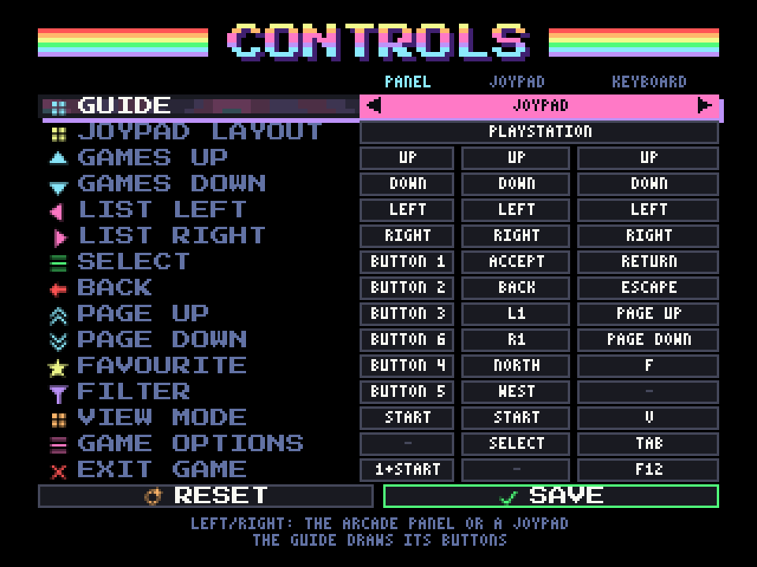
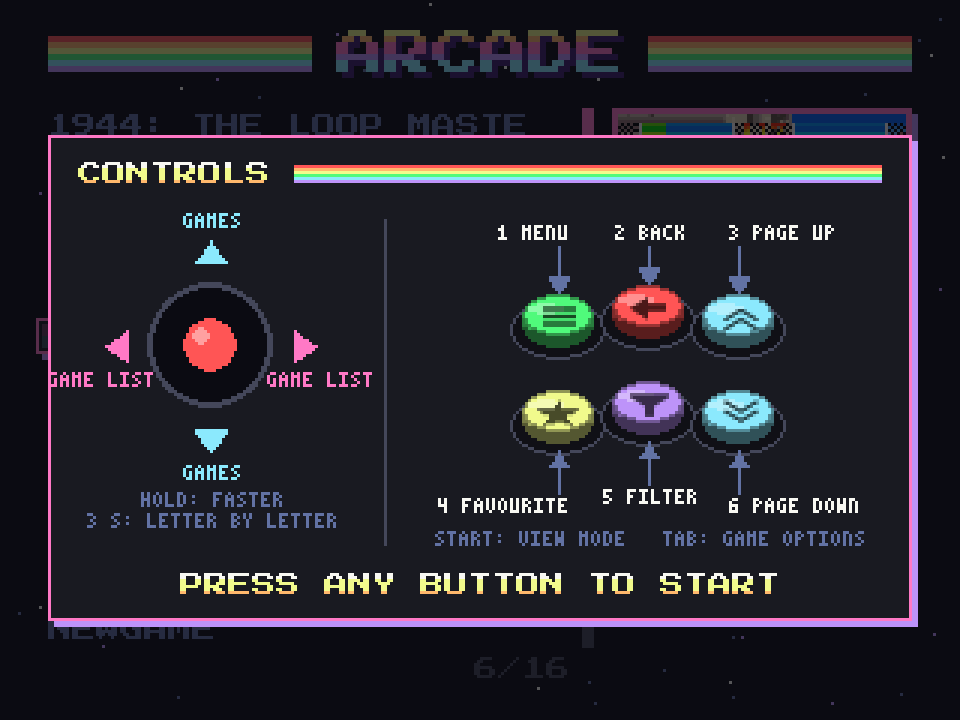
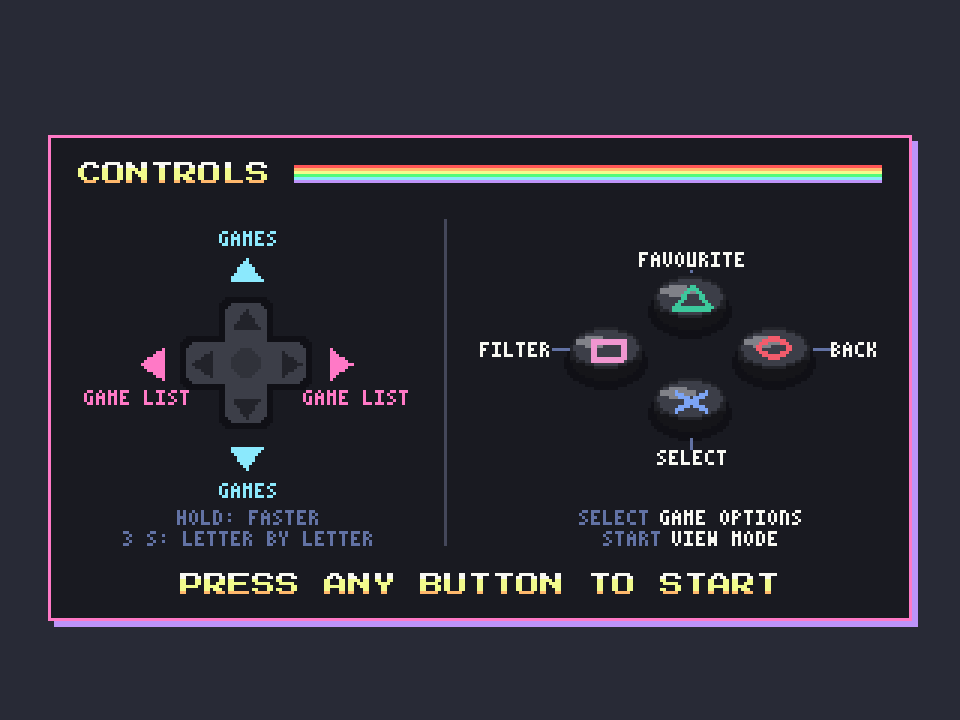
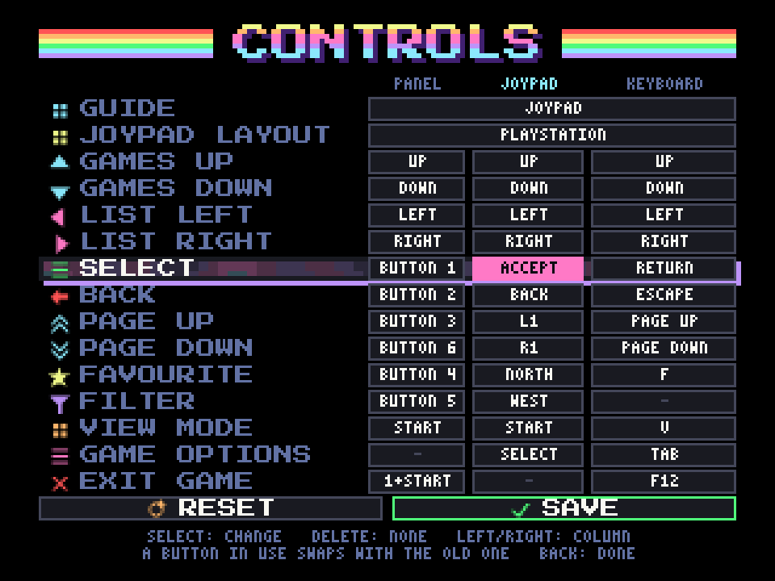
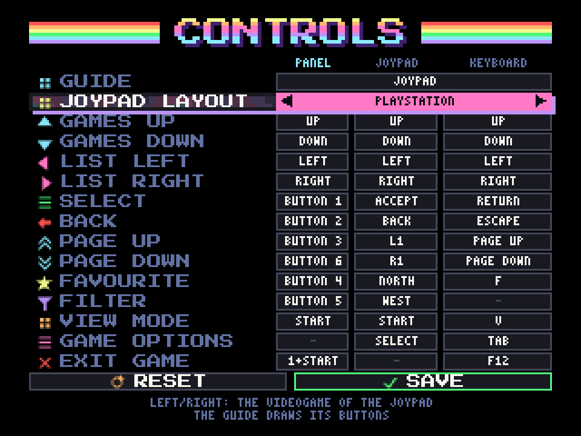

What each button does in the [FliperOS frontend](FliperOS-frontend.md), the shortcuts that close a game or open its menu, and how to change them all in **Tab > FRONTEND CONTROLS**.

## The first time

The first time the frontend opens, it starts in **Frontend controls**, so you can say what each button does; back leaves it. From then on a **guide** shows the controls each time the frontend opens, and any button closes it.

The guide draws the joystick and the panel buttons in the panel's shape, each button in its function's colour. A button with no function is left out, and so is the joystick when no direction has one.

 

## The default buttons

| Control | In the list |
| --- | --- |
| Up / down | Move through the games. Holding speeds up, and after 3 seconds the **letter mode** starts |
| Left / right | Move along the system strip (in the grid, through the thumbnails first) |
| Button 1 | The game's menu: Play, Favourite, Achievements, + |
| Button 2 | Back; from the list, asks whether to return to the FliperOS menu |
| Buttons 3 and 6 | A page up and down |
| Button 4 | Favourite |
| Button 5 | Filters |
| Start | Changes the view |
| Tab (keyboard) | The Tab menu |

Past the last game comes the first again, and before the first the last; holding stops at the end, and the next press goes around.

**Letter mode:** the letter big in the middle of the screen, the cursor jumping from letter to letter. It stays after you let go: each tap of up or down moves one letter. Two seconds without touching anything end it, on the first game of that letter.

## Game shortcuts

Out of the box, like Batocera with Select as the hotkey:

| Shortcut | Held for a second | What it does |
| --- | --- | --- |
| **EXIT GAME** | Coin + Start | Closes the game and goes back to the list |
| **EMULATOR MENU** | Coin + button 1 | Opens the emulator's own menu: RetroArch's Quick Menu, MAME's, Flycast's, the PCSX2 and DuckStation pause menu, the Keisho overlay |
| **OSD MENU** | Start + Down, or the Pause key | Opens the FliperOS [on-screen menu](On-screen-menu.md) |

An emulator with no menu of its own (Supermodel, Dolphin, OpenBOR, Hypseus, KOF, Fightcade) and a custom game get the FliperOS on-screen menu instead of an emulator menu.

The OSD MENU shortcut is the system's, so it also counts in the other frontends. The media keys of a wireless remote (Play/Pause, Pause, Play) always open the on-screen menu.

## Changing the controls

**Tab > FRONTEND CONTROLS** lists the frontend's functions: games up and down, list left and right, select, back, page up and down, favourite, filter, view mode and game options, then the shortcuts. Each has a **Panel** (or **Joypad**) column and a **Keyboard** column; left and right switch between them.

1. Pick a function and press select.
2. Press the new panel control (a button, a direction or Start) or the key, within 8 seconds.
3. A button or key that another function had swaps: that function gets the old one. The same one again, or **Delete**, leaves the function with none.
4. **Save** (on the last line) saves and leaves; **Reset** brings back the defaults. Each change works at once.

For a shortcut, select asks for **two or more buttons held together** for a second. They can come from one player, and then any player's same buttons work, or from different players (**P1 START+P2 START**: only those two together).

Rules that keep the panel usable:

- A key the panel itself sends (a keyboard encoder) can't be a keyboard key, since each button does one thing.
- In commercial mode the coin can't be part of a shortcut, and turning commercial mode on drops a shortcut that has it.
- Leaving with select or back off the panel shows a warning: without them the menus only open from a keyboard.
- Nothing pressed for 8 seconds keeps the function as it was; Esc cancels.

### Guide and panel layout

The first two rows set the drawing of the guide:

- **GUIDE: ARCADE or JOYPAD.** With a joypad, the guide draws that controller instead of the arcade panel: PlayStation, Xbox, GameCube, Super Nintendo, NES, Dreamcast, Saturn, Mega Drive, Neo Geo CD or Nintendo 64.
- **PANEL LAYOUT** (or JOYPAD LAYOUT): the shape of the panel: **6 buttons** in two rows (where Buttons layout puts them), **4 in line** like a Neo Geo MVS, **3 in line**, **2 in line** or **2 stacked**. A button the shape doesn't have shows dimmed, and its function works only from the keyboard.

## How it works

- The buttons come from **Setup > Joysticks > Button mapping** (`/etc/fliperos/buttons.map`, [Controls](Controls.md)). The frontend's choices are saved in `~/.config/fliperos/frontend.json` (`controls`).
- The shortcuts are read alongside the game by `fliperos-buttons hotkey`, without taking anything from it. **EXIT GAME** closes the game and what runs under it (the X server, the emulator) with SIGTERM, and SIGKILL after 4 seconds.
- For **EMULATOR MENU**, `fliperos-buttons hotkey` creates a virtual keyboard (uinput, `FliperOS emulator keys`) before the game opens and presses the emulator's menu key on it: F1 in RetroArch, Tab in GroovyMAME and Flycast, Esc in PCSX2, PCSX2x6 and DuckStation, Keisho's `key_overlay` (F10), or the on-screen menu's media key for the others (`fliperos-buttons menu-key PROGRAM` prints it). RetroArch opened this way loses its own Start + Select menu combo, which would open its menu a second before the shortcut closed it.
- **OSD MENU** is `osd_combo` and `osd_key` in `fliperos.conf`, written through `fliperos-setup --setting`.
- A game opened from the frontend gets the screen, the sound and the controls, and counts in the play statistics.

See also: [FliperOS frontend](FliperOS-frontend.md), [Controls](Controls.md), [On-screen menu](On-screen-menu.md).
