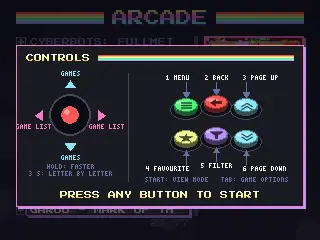

A frontend is the game list: it shows your games with their art and opens each one in the right emulator. FliperOS has its own, made for the tube, and installs the well-known ones if you prefer them.

| Page | What it covers |
| --- | --- |
| [FliperOS frontend](FliperOS-frontend.md) | The default: the system strip, the views, clones, RECENT and FAVOURITES, switch animations, the game menu, filters, the Tab menu, attract and commercial modes, the vertical monitor |
| [Frontend controls](Frontend-controls.md) | The buttons, the controls guide, the shortcuts that close a game or open its menu, changing them, joypad guides |
| [Physical media](Physical-media.md) | CDs, DVDs and cartridges (OSCR) in the frontend: play, pick the emulator, rip to the folder, boot from media |
| [Attract-Mode Plus](Attract-Mode-Plus.md) | The Arcadeflow theme, real game names, the romlists, the art lines, an emulator by hand |
| [ES-DE and Pegasus](ES-DE-and-Pegasus.md) | Built on the cabinet, the 240p themes, the systems file, a system by hand |
| [LED displays](LED-displays.md) | The Pixelcade and ZeDMD marquees that follow the frontend and the game |

## Which frontend

| Frontend | Comes | Made for 240p | Notes |
| --- | --- | --- | --- |
| **FliperOS frontend** | In the image, the default | Yes | Achievements badge, link and party play, physical media, commercial mode, the system logos, the vertical monitor |
| **Attract-Mode Plus** | From the repository inside the image | With FliperOS's tweaks | Arcadeflow is downloaded when you pick it |
| **ES-DE** | Built on the cabinet | FliperOS 240p theme | Needs OpenGL 3.3 |
| **Pegasus** | Built on the cabinet | FliperOS 240p theme | No event hooks for the marquee |
| **Fightcade 2** | Downloaded from its site | — | Online matches ([Fightcade 2](Fightcade-2.md)) |

## Choosing the boot frontend

**Setup > Games > Frontend** picks what opens at power on: a frontend, a single game, the disc in a drive, RetroArch's or GroovyMAME's own menu, Fightcade, the desktop, or a frontend of your own by its command. Each choice: [Games Setup](Setup-Games.md#frontend).

Picking a frontend also puts every games folder into it. Your favourites, play statistics and hidden games are FliperOS's own, so they are the same in the FliperOS frontend and in the web panel, whichever frontend opens at boot.

## Marquee and LED displays

**Pixelcade marquee:** the Pixelcade LED or LCD marquee follows the game you pick and open: [Pixelcade](Pixelcade.md).

**ZeDMD firmware version:** the ZeDMD needs firmware 5.1.0 or newer: [how to check and update it](ZeDMD.md#firmware-version).

What both displays show, and the versus score of fighting games: [LED displays](LED-displays.md), [Versus score](Versus-score.md).

## How it works

- `config/fliperos-sessions.conf` is the table of launchers: for each one, whether it runs in KMS or X (from GroovyArcade's galauncher `videodata.conf`) and which package it comes from. Custom frontends are saved next to it.
- Every frontend opens games through `fliperos-kms-run` or `fliperos-x11-run`, so the video mode, the controls, the marquee, the achievements and the cloud backup work the same way from any of them ([Emulators](Emulators.md)).
- FliperOS's own data (lists, favourites, statistics) lives in `~/.local/share/fliperos` and `~/.config/fliperos`, never in a frontend's files.

See also: [Games Setup](Setup-Games.md), [Adding games](Adding-games.md).
