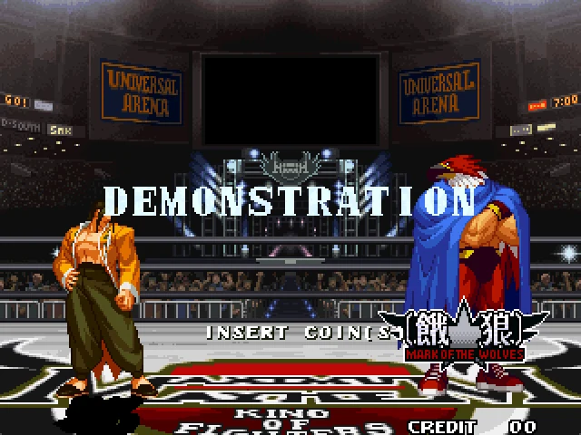

[GroovyMAME](https://github.com/antonioginer/GroovyMAME) is MAME with Switchres inside: every arcade game opens in its own original video mode, on the tube. It is the arcade emulator of FliperOS, as on GroovyArcade. Its games go in `~/roms/mame`.

## Native resolution

GroovyMAME runs in KMS, without Xorg, like GroovyArcade. Switchres makes each game's exact mode and SDL switches to it. On the cabinet: Street Fighter II at `384x224@59.64` (99.9% speed), The King of Fighters '98 at `320x224@59.19`.

**Midway 2D games** (Mortal Kombat 1 to 3, NBA Jam, Smash TV, NARC and the others on the Y, T, W and X-unit boards) are 400x254 at 54.7 Hz. Switchres makes that mode, but the tube shows it stretched up and down, so FliperOS runs them in **320x240p at 59 Hz**, the height of the other games; the game itself still runs at 54.7 Hz.

Interlaced games (more than 240 lines) follow **Setup > Video Setup > Interlaced hacks**: interlaced with the flicker filter by default, or 640x240 ([Interlaced, colour and scanlines](Picture-filters.md)).

## Playing

- **Leaving a game:** **coin + Start** held for a second, or Esc on a keyboard.
- **MAME's menu:** **coin + button 1** held for a second, or Tab ([Frontend controls](Frontend-controls.md#game-shortcuts)).
- **The power button** closes the game at once, and MAME saves the high scores, NVRAM and settings, as with Esc.
- **High scores** are saved by the `hiscore` plugin in `~/.mame/hiscore`, and shown on a Pixelcade or ZeDMD ([LED displays](LED-displays.md)).
- **Multi-screen games** (Darius, The Ninja Warriors, Punch-Out!!) open each screen on its own monitor ([Multiple monitors](Multiple-Monitors.md)).
- **Party play:** every GroovyMAME game for two or more players can be played across 2 to 4 cabinets ([Linked cabinets](Linked-cabinets.md)).

## A game that doesn't open

When a game stops at "System media audit failed", files are missing: BIOS and device ROMs come in zips separate from the game.

- The reason is in `/opt/fliperos/logs/groovymame.log` (or the web panel's **System > Processes and logs**).
- `groovymame -verifyroms GAME` lists the missing files.
- A missing BIOS is brought by [Download BIOS](BIOS.md). By hand, everything goes in `~/roms/mame` (BIOS can also go in `~/bios/mame`), from the same MAME version, 0.289.

## Updating it

The FliperOS package is GroovyMAME `gm0289sr222f` (MAME 0.289 with Switchres 2.22f), built with FliperOS's party patch. FliperOS updates bring new packages.

**Setup > Games > Emulators & Games > GroovyMAME > Build the newest** compiles the newest GroovyMAME right on the cabinet, with the same patches. It takes many hours, often a whole night, with 20 GB free; each MAME version changes the romset. **Back to the FliperOS package** returns to the tested one ([Games Setup](Setup-Games.md#the-newest-version-of-a-packaged-emulator)).

## GroovyMAME in X

The `groovymame` command opens in an Xorg of its own instead of KMS:

- when multi-screen games are on with more than one monitor (in KMS only the main monitor stays on);
- with `groovymame_video=x11` in `/etc/fliperos/fliperos.conf`;
- on an installation without the package's SDL.

There Switchres switches each game's mode through XRandR. Frontend lines saved as `fliperos-x11-run groovymame` follow the same choice.

## How it works

- **The package:** `fliperos-groovymame` compiles GroovyMAME from the release's tag (commit `953db38`) with FliperOS's lockstep patch. The build takes hours, so it happens once, when the package is made; the image and the updates install the same `.deb`. The binary goes to `/usr/local/libexec/groovymame`, without the Qt debugger and the tools. Like GroovyArcade's package, it puts the tag's source files in `/usr/local/share/groovymame`: `plugins` (`hiscore`), `uismall.bdf`, `bgfx`, `artwork`, `language`, `ctrlr`, `keymaps` and `hash`. A build of the newest uses one compiler process per 1.5 GB of free memory; if a patch no longer fits the new code, the package stays.
- **The command:** `groovymame` is `config/fliperos-groovymame`. It opens through `fliperos-kms-run` and passes `-inipath /etc/fliperos/mame` (the release's default is relative to the folder it is opened from): `/etc/fliperos/mame/mame.ini`, which the Setup writes, is the one that applies. Commands without a screen (`-listxml`, `-verifyroms`, `-version`…) run directly.
- **KMS mode switching** needs the SDL2 of the `fliperos-sdl2-kms` package (`/usr/local/lib/fliperos/sdl2-kms`, loaded only by GroovyMAME): Ubuntu's SDL2 with GroovyArcade's two KMS patches (`packaging/patches/sdl2`), so SDL re-reads the connector's modes on every query and puts the original mode back when the window closes. Switchres attaches each mode to the connector (`ATTACHMODE`, kernel patch 06). `SDL_KMSDRM_REQUIRE_DRM_MASTER=0` must not be set: with it, SDL undoes Switchres's switch on its next frame.
- **Midway:** `config/mame-midway.ini`, installed as `/etc/fliperos/mame/source/<driver>.ini`, read after `mame.ini` only for those drivers.
- **Sound:** it preloads `libfliperos-sdl-audio.so` (`config/fliperos-sdl-audio.c`), which reports ALSA's `default` as SDL's default device. SDL 2.30 lists only the `hw:` devices, and MAME 0.289 saves the chosen one in each game's cfg (`sound_map`), so it took the card's raw device: no sharing with other programs, not the card picked in the Setup, no sound on the live screen. The old `sound_map` entries are removed once (`.fliperos-sound-default`).
- **`mame.ini`** is made like GroovyArcade's: GroovyMAME's own `-createconfig`, with `config/mame.ini` on top (`config/fliperos-mame-ini`): `plugin hiscore`, `skip_gameinfo 1`, `video opengl`, `switchres_ini 1`, `sound sdl`, `aspect 4:3`, `modesetting 1`, and the Setup's latency (`lowlatency`, `autoframedelay`, `framedelay`). The UI font stays MAME's own, because GroovyArcade's `uismall.bdf` was too small on the cabinet.
- **`aspect 4:3`:** with `aspect auto`, booting at 640x240 gave 8:3, and Switchres doubled the width of every game. The Setup goes back to `auto` only for an LCD.
- **`ui.ini`** gets `infos_text_size 1.00`, `font_rows 20` (MAME only accepts 20 to 40) and the Dracula colours.
- **Folders:** `~/.mame` (cfg, hiscore), `~/nvram/mame`, `~/save/mame`. An update only adds the keys `mame.ini` and `ui.ini` don't have yet.
- **In X:** `fliperos-x11-client` starts openbox, which fits the full-screen window on each XRandR mode switch. Opened without a game (its UI), `groovymame` passes `-noautosync -waitvsync`: the game chosen in the UI runs in the same process, and GroovyMAME's emusync in X used a DRM descriptor the UI had closed.
- **Geometry:** `switchres_ini 1` makes GroovyMAME read `/etc/switchres.ini`, where **Setup > Video Setup > Geometry** saves a `crt_range0` ([Video Setup](Setup-Video.md#geometry)).

See also: [Emulators](Emulators.md), [KMS and X11](KMS-and-X11.md), [ROM Cleaner](ROM-Cleaner.md).
