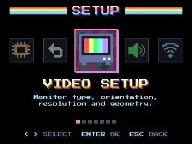
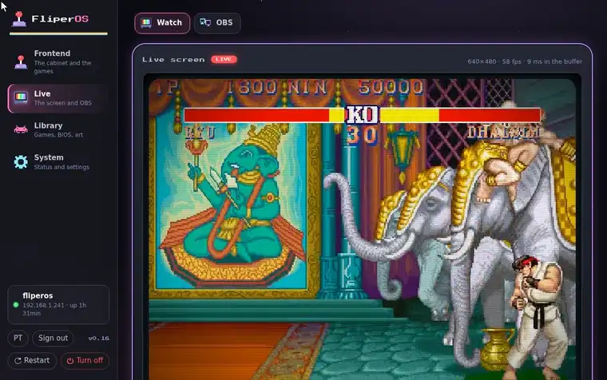

**FliperOS** is Ubuntu 24.04 (amd64) for arcade cabinets with a CRT monitor, in the style of GroovyArcade: a **15 kHz kernel** (kernel.org 6.18 LTS with the D0023R patches, the same as GroovyArcade's `linux-15khz`), Switchres, emulators and frontends ready to play, the **GunCon 2 light gun** working out of the box, and menus made for the tube's screen.

The media is **installation-only** and follows the GroovyArcade flow: a boot menu with the frequency range, a spoken test of the video outputs, *Testing Results*, the **FliperOS Setup** and the installation to the HD/SSD. On the installed system the same Setup opens when the frontend closes.

The Setup is **`fliperos-setup`**, written in Bash: a graphical carousel on the cabinet, and a text menu made with [Gum](https://github.com/charmbracelet/gum) over SSH, both in the **Dracula** theme and drawn for the tube.

> In development: 0.24 is tested in a VM (QEMU) and on a cabinet with a 15 kHz CRT, and updates keep coming between versions.

 Questions, photos of your cabinet and help from other users. Each release is posted there with pictures and how the new features work.

## Start here

| Page | What it covers |
| --- | --- |
| [Video cards](Video-cards.md) | Which AMD, NVIDIA and Intel cards work, native resolution or super resolution, converters, ATOM-15 |
| [Monitors](Monitors.md) | Which preset for your tube, centring the picture, what goes between the card and the monitor |
| [Install](Install.md) | Writing the media, the boot menu, the video output test, installing to the HD/SSD, Recovery Mode |
| [Black screen](Black-screen.md) | What to try when the tube shows nothing or some games go black, getting in without a picture |

## The installed system

| Page | What it covers |
| --- | --- |
| [Installed system](Installed-system.md) | The boot, the first boot, the FliperOS menu, the map of the Setup, graphical and text menus |
| [Video Setup](Setup-Video.md) | Monitor type, orientation, resolution, geometry, extra monitors, the video driver, card firmware |
| [Audio and Network Setup](Setup-Audio-and-Network.md) | Sound card, volume, MAME audio latency, menu sounds, Wi-Fi, the internet check |
| [Games Setup](Setup-Games.md) | Installing and updating emulators, the boot frontend, a game at boot, the Extras |
| [System Setup](Setup-System.md) | Services, password, cabinet name, debug mode, the cartridge reader's firmware, the boot splash |
| [On-screen menu](On-screen-menu.md) | Start and Down over a game: profiles, geometry, colour, scanlines, the emulator menu, Quit |
| [Interlaced, colour and scanlines](Picture-filters.md) | 640x240 or interlaced per program, the flicker filter, colour calibration, scanlines for 31 kHz |
| [Updates and versions](Updates-and-versions.md) | Updates without a new ISO, installing at power off, going back to an earlier update, What's new |
| [RetroAchievements](RetroAchievements.md) | Signing in, hardcore mode, the bar over the game, the trophy badge in the game list |
| [Cloud backup](Cloud-backup.md) | High scores, saves and settings in Google Drive, Dropbox, WebDAV, SFTP or MEGA |
| [Power and volume buttons](Power-and-volume-buttons.md) | What the power button does on each screen, the volume keys, shutting down |
| [Desktop and theme](Desktop.md) | LXDE, the programs in the menu, disks, the controller as a mouse, the Dracula theme |
| [Remote access](Remote-access.md) | SSH and SFTP, the network share, AI assistants, lab mode |

## Frontends

| Page | What it covers |
| --- | --- |
| [Frontends](Frontends.md) | The FliperOS frontend, physical media, choosing the boot frontend, the Pixelcade and ZeDMD marquees, the 240p themes for EmulationStation and Pegasus |

## Games

| Page | What it covers |
| --- | --- |
| [ROMs, BIOS and artwork](ROMs.md) | The folders in `~` (`roms`, `bios`, `media`, `nvram`, `save`, `config`), the MAME ROM Cleaner, the CHD Cleaner, the Downloader, Download BIOS, the free games |
| [Scraper](Scraper.md) | Covers, screenshots, logos, videos and descriptions of the games, for every frontend |
| [Adding games](Adding-games.md) | Step by step: games, real names and artwork in Attract-Mode Plus and ES-DE, emulator command lines in KMS or X11, adding a new emulator |
| [Custom games](Custom-games.md) | PC games (Windows and Linux) and programs that are not a ROM: packages (`.fliperos-customgame.zip`), adding your game from the cabinet, PortProton, the controller as a keyboard, squashfs, the command for other frontends |

## Emulators

| Page | What it covers |
| --- | --- |
| [Emulators](Emulators.md) | Each emulator and the video mode it opens in, GroovyMAME, RetroArch, running a program at 640x240, laserdisc, OpenBOR, Model 2, Steam, GOG and Wine, Namco System 246/256 |
| [Fightcade 2](Fightcade-2.md) | Online matches: download through the Setup, ROMs, the lobby, matches in each game's native resolution, keys |

## Controls

| Page | What it covers |
| --- | --- |
| [Controls](Controls.md) | Each player's buttons, Bluetooth, the controller light, the GunCon 2 light gun (driver and calibration), wheel and pedals, parallel port, USB quirks, how SDL sees each controller |

## Cabinet hardware

| Page | What it covers |
| --- | --- |
| [Scoreboard games](Scoreboard-games.md) | The fighting games whose match-up score shows on the ZeDMD or Pixelcade display, in GroovyMAME and in RetroArch |
| [Multiple monitors](Multiple-Monitors.md) | Two or three arcade monitors on one card: the Setup, the multi-screen games in GroovyMAME (Darius, Punch-Out!!) and Flycast (F355 Challenge), how it works |
| [DIY hardware](DIY-hardware.md) | Open-source projects to build with an Arduino, a Raspberry Pi Pico or an ESP32: control panel encoders, spinner, light gun, LED display, button lights, the cartridge reader |
| [Latency](Latency.md) | The Standard and Low latency modes, what each tweak does, recommended hardware, how to measure |

## Network

| Page | What it covers |
| --- | --- |
| [Web panel](Web-panel.md) | The cabinet from a phone or PC at http://fliperos.local: games to play, the live screen and OBS, settings while you play, files, the ROM filter, downloads, the system status, a terminal |
| [Controller on the stream](Controller-overlay.md) | Your stick and buttons lighting up on the live stream, as a page for OBS, restyled in the panel with a live CSS editor |
| [Linked cabinets](Linked-cabinets.md) | The games that link several machines (Daytona, the Tournament Battle, Scud Race and more), and party and net play: more players than one cabinet's controls |

## Hacking on it

| Page | What it covers |
| --- | --- |
| [15 kHz kernel](Kernel-15-kHz.md) | The kernel and the patches |
| [Build and tests](Build-and-tests.md) | Building the ISO in Docker, the build options, the ISO audit, publishing the release, the tests, updating a cabinet over the network |
| [Architecture](Architecture.md) | How `fliperos-setup` is organized, the other components (splash, network, diagnostics) and what each file in the repository is |
| [Sources](Sources.md) | Where each part came from: GroovyArcade, Switchres and the other projects consulted |

The pages of this wiki are kept in the repository, in [`docs/wiki`](https://github.com/juniorterin/fliperOS/tree/main/docs/wiki), and published here by `tools/wiki-publish.sh`: to fix a page, change the file there.
