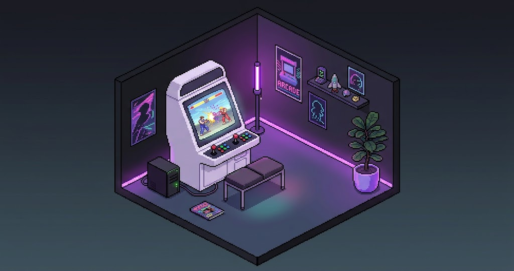
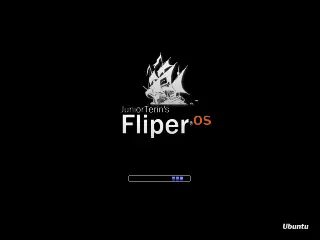

**FliperOS** is Ubuntu 24.04 (amd64) for arcade cabinets with a CRT monitor, in the style of GroovyArcade: a **15 kHz kernel** (kernel.org 6.18 LTS with the D0023R patches, the same as GroovyArcade's `linux-15khz`), Switchres, emulators and frontends ready to play, the **GunCon 2 light gun** working out of the box, and menus made for the tube's screen.

The media is **installation-only** and follows the GroovyArcade flow: a boot menu with the frequency range, a spoken test of the video outputs, *Testing Results*, the **FliperOS Setup** and the installation to the HD/SSD. On the installed system the same Setup opens when the frontend closes.

The Setup is **`fliperos-setup`**, written in Bash: a graphical carousel on the cabinet, and a text menu made with [Gum](https://github.com/charmbracelet/gum) over SSH, both in the **Dracula** theme and drawn for the tube.

> In development: 0.27 is tested in a VM (QEMU) and on a cabinet with a 15 kHz CRT, and updates keep coming between versions.

 Questions, photos of your cabinet and help from other users. Each release is posted there with pictures and how the new features work.

## Start here

| Page | What it covers |
| --- | --- |
| [Video cards](Video-cards.md) | Which cards work, native resolution or super resolution, changing the card |
| [AMD cards](Video-cards-AMD.md) | The Radeons, the drivers and Vulkan, GCN 2 and 3 with DVI-I, APUs, the cards GroovyArcade reports |
| [NVIDIA cards](Video-cards-NVIDIA.md) | nouveau and the low resolution test, NVIDIA's own driver |
| [Intel graphics](Video-cards-Intel.md) | Super resolution, the 240p mode, the limits of the Intel HD |
| [Converters](Converters.md) | DisplayPort or HDMI to VGA: which ones, what to expect |
| [ATOM-15](ATOM-15.md) | 15 kHz from power on, in the card's BIOS, at your own risk |
| [Monitors](Monitors.md) | Which preset for your tube, centring the picture, what goes between the card and the monitor |
| [Install](Install.md) | Writing the media, the boot menu, the video output test, installing to the HD/SSD, Recovery Mode |
| [Black screen](Black-screen.md) | What to try when the tube shows nothing or some games go black, getting in without a picture |

## The installed system

| Page | What it covers |
| --- | --- |
| [Installed system](Installed-system.md) | The boot, the first boot, the FliperOS menu, the map of the Setup, graphical and text menus |
| [Video Setup](Setup-Video.md) | Monitor type, orientation, resolution, geometry, extra monitors, the video driver, card firmware |
| [Audio and Network Setup](Setup-Audio-and-Network.md) | Sound card, volume, MAME audio latency, menu sounds, Wi-Fi, the internet check |
| [Games Setup](Setup-Games.md) | Installing and updating emulators, the boot frontend, a game at boot, the Extras |
| [System Setup](Setup-System.md) | Services, password, cabinet name, debug mode, the cartridge reader's firmware, the boot splash |
| [On-screen menu](On-screen-menu.md) | Start and Down over a game: profiles, geometry, colour, scanlines, the emulator menu, Quit |
| [Interlaced, colour and scanlines](Picture-filters.md) | 640x240 or interlaced per program, the flicker filter, colour calibration, scanlines for 31 kHz |
| [Updates and versions](Updates-and-versions.md) | Updates without a new ISO, installing at power off, going back to an earlier update, What's new |
| [RetroAchievements](RetroAchievements.md) | Signing in, hardcore mode, the bar over the game, the trophy badge in the game list |
| [Cloud backup](Cloud-backup.md) | High scores, saves and settings in Google Drive, Dropbox, WebDAV, SFTP or MEGA |
| [Power and volume buttons](Power-and-volume-buttons.md) | What the power button does on each screen, the volume keys, shutting down |
| [Desktop and theme](Desktop.md) | LXDE, the programs in the menu, disks, the controller as a mouse, the Dracula theme |
| [Remote access](Remote-access.md) | SSH and SFTP, the network share, AI assistants, lab mode |

## Frontends

| Page | What it covers |
| --- | --- |
| [Frontends](Frontends.md) | Which frontend, choosing the one that opens at boot, where FliperOS keeps your lists and favourites |
| [FliperOS frontend](FliperOS-frontend.md) | The default game list: the system strip, three views, clones, RECENT and FAVOURITES, switch animations, the game menu, filters, the Tab menu, attract and commercial modes, the vertical monitor |
| [Frontend controls](Frontend-controls.md) | The buttons, the controls guide, coin + Start to quit, coin + button 1 for the emulator menu, changing them, joypad guides |
| [Physical media](Physical-media.md) | CDs, DVDs and cartridges (OSCR) in the frontend: play, rip to the folder, boot from media, the reader's firmware |
| [Attract-Mode Plus](Attract-Mode-Plus.md) | The Arcadeflow theme, real game names, the romlists and their cleanup, the art lines, an emulator by hand |
| [ES-DE and Pegasus](ES-DE-and-Pegasus.md) | Built on the cabinet, the 240p themes, the systems file, a system by hand |

## Games

| Page | What it covers |
| --- | --- |
| [ROMs, BIOS and artwork](ROMs.md) | The folders in `~` (`roms`, `bios`, `media`, `nvram`, `save`, `config`), unlocked arcade memory, custom folders on another disk |
| [External storage](External-storage.md) | Folder shortcuts, a second disk with the FliperOS folders, a Batocera filesystem with a core for each console, formatting a disk |
| [Downloader](Downloader.md) | MAME ROM and CHD sets by torrent, only the games your filter picks, and the free homebrew games |
| [BIOS](BIOS.md) | Download BIOS: what it looks for, RetroBIOS and the reference pack, the check at each menu opening |
| [ROM Cleaner](ROM-Cleaner.md) | The MAME ROM Cleaner (every parameter and preset) and the CHD Cleaner |
| [Scraper](Scraper.md) | Covers, screenshots, logos, videos and descriptions of the games, for every frontend |
| [Adding games](Adding-games.md) | Step by step: copy the games, make the frontend see them, real names, artwork, play; KMS or X11 command lines |
| [Custom games](Custom-games.md) | PC games (Windows and Linux) and programs that are not a ROM: packages (`.fliperos-customgame.zip`), adding your game from the cabinet, PortProton, the controller as a keyboard, squashfs, the command for other frontends |
| [Adding an emulator](Adding-an-emulator.md) | An emulator FliperOS doesn't ship, opened from every frontend in four steps |

## Emulators

| Page | What it covers |
| --- | --- |
| [Emulators](Emulators.md) | Every emulator, what it runs, how it comes and its video mode; what every game gets |
| [KMS and X11](KMS-and-X11.md) | How each emulator reaches the tube, running any program at 640x240, cards without low dotclocks |
| [GroovyMAME](GroovyMAME.md) | Arcade at native resolution, the Midway games, missing files, the package, GroovyMAME in X |
| [RetroArch](RetroArch.md) | The cores, the light gun in every core, the D-pad, video, updating |
| [Flycast](Flycast.md) | Dreamcast, Naomi, Naomi 2 and Atomiswave: folders, BIOS, picture, updating |
| [Sega Model 2 and 3](Sega-Model-2-and-3.md) | Keisho for both boards: Vulkan or OpenGL, outputs, speed, coming from Supermodel |
| [PlayStation 2 and Namco 246/256](Namco-246-256.md) | PCSX2, and PCSX2x6 for the Namco boards: the files of a game, packed games, what was tested |
| [OpenBOR](OpenBOR.md) | Paks in the frontends, information from the pak, each pak's video mode, old paks |
| [Windows games](Windows-games.md) | Wine, Wine Staging, Steam and Heroic |
| [More emulators](More-emulators.md) | Dolphin, DuckStation, Hypseus Singe (laserdisc), KOF Final Attack |
| [Fightcade 2](Fightcade-2.md) | Online matches: download through the Setup, ROMs, the lobby, matches in each game's native resolution, keys |

## Controls

| Page | What it covers |
| --- | --- |
| [Controls](Controls.md) | Setup > Joysticks item by item, the shortcuts in games, where each control is set |
| [Button mapping](Button-mapping.md) | Each controller's player and buttons, arcade panel or joypad, keyboard encoder, Buttons layout |
| [Bluetooth](Bluetooth.md) | Pairing wireless controllers, players, forgetting |
| [Controller light](Controller-light.md) | DualSense, DualShock 4 and 8BitDo lights, the Ultimate 2 roulette |
| [Haptic events](Haptic-events.md) | Controller vibration in the menu, the frontends and when a game opens or closes: about 40 presets per event |
| [Light guns](Light-guns.md) | The GunCon 2: calibration, several guns, the screen flash, the gun in each emulator and RetroArch core |
| [Wheels, LPT and quirks](Wheels-and-quirks.md) | Wheel and pedal calibration, parallel port joysticks, USB quirks, controllers in SDL |

## Cabinet hardware

| Page | What it covers |
| --- | --- |
| [LED displays](LED-displays.md) | The marquee that follows the frontend and the game: what it shows, art for the display, the menu animations |
| [Pixelcade](Pixelcade.md) | The Pixelcade LED or LCD marquee: installing it, the paid art pack, each frontend, DOFLinx effects |
| [ZeDMD](ZeDMD.md) | The open-source LED display: installing it, the startup animation, the firmware version and how to update it |
| [Versus score](Versus-score.md) | The match score of fighting games on the display, in GroovyMAME, RetroArch with FBNeo and Model 2 |
| [Scoreboard games](Scoreboard-games.md) | The list of games with the versus score and the high scores, and which emulator has each |
| [Multiple monitors](Multiple-Monitors.md) | Two or three arcade monitors on one card: the Setup, the multi-screen games in GroovyMAME (Darius, Punch-Out!!) and Flycast (F355 Challenge), how it works |
| [DIY hardware](DIY-hardware.md) | Open-source projects to build with an Arduino, a Raspberry Pi Pico or an ESP32: control panel encoders, spinner, light gun, LED display, button lights, the cartridge reader |
| [Latency](Latency.md) | The Standard and Low latency modes, what each tweak does, recommended hardware, how to measure |
| [CPU and speed](CPU-and-speed.md) | Why one fast core sets the speed, where a Model 3 frame goes, Turbo Boost in the BIOS and how to tell it is on, reading the CPU use of a game |

## Network

| Page | What it covers |
| --- | --- |
| [Web panel](Web-panel.md) | The cabinet from a phone or PC at http://fliperos.local: signing in, more than one cabinet, the four areas, the tasks drawer, the JSON API |
| [Web panel: Frontend](Web-panel-Frontend.md) | The cabinet drawing, now playing, the LED marquee preview, picking a game and playing it, the game sheet |
| [Web panel: Live](Web-panel-Live.md) | The screen live with sound, quality, and the OBS pages: live screen, marquee, controller, the delay for OBS |
| [Web panel: Library](Web-panel-Library.md) | Installing emulators, the Downloader and Download BIOS, the ROM filter, the art, files |
| [Web panel: System](Web-panel-System.md) | Status and logs, every Setup setting while you play, RetroAchievements, cloud backup, terminal, lab mode |
| [Controller on the stream](Controller-overlay.md) | Your stick and buttons lighting up on the live stream, as a page for OBS, restyled in the panel with a live CSS editor |
| [Linked cabinets](Linked-cabinets.md) | The games that link several machines (Daytona, the Tournament Battle, Scud Race and more): cabinets, players, screens, master and slave, each emulator |
| [Party and net play](Net-play.md) | More players than one cabinet's controls: RetroArch net play, Flycast GGPO, GroovyMAME lockstep, Dolphin |

## For developers

| Page | What it covers |
| --- | --- |
| [Development](Development.md) | Where to start: what to read to change something, build the ISO, package a program, publish an update or make a release |
| [Development environment](Development-environment.md) | What runs where on Windows, the rules that protect the build and Docker, working in a shared repository |
| [Making a change](Making-a-change.md) | Where the code lives, the tests, trying a change on a cabinet, the docs and the commit |
| [Packages](Packages.md) | The `.deb` recipes, building, versions and publishing them to GitHub |
| [Making a release](Making-a-release.md) | The whole release in order: packages, update, changelog, version, tag, build and posts |
| [Variables](Variables.md) | The build options, environment variables, recipe fields, secrets and state files |
| [15 kHz kernel](Kernel-15-kHz.md) | The kernel and the patches |
| [Build and tests](Build-and-tests.md) | Building the ISO in Docker, the build options, the ISO audit, publishing the release, the tests, updating a cabinet over the network |
| [Publishing updates](Publishing-updates.md) | Making and publishing a FliperOS update, and lining it up with a new ISO |
| [Commands](Commands.md) | The `fliperos-*` commands for a terminal: launching, updates, games, controls, cloud, logs |
| [Architecture](Architecture.md) | How `fliperos-setup` is organized, the other components (splash, network, diagnostics) and what each file in the repository is |
| [Sources](Sources.md) | Where each part came from: GroovyArcade, Switchres and the other projects consulted |

The pages of this wiki are kept in the repository, in [`docs/wiki`](https://github.com/juniorterin/fliperOS/tree/main/docs/wiki), and published here by `tools/wiki-publish.sh`: to fix a page, change the file there.
