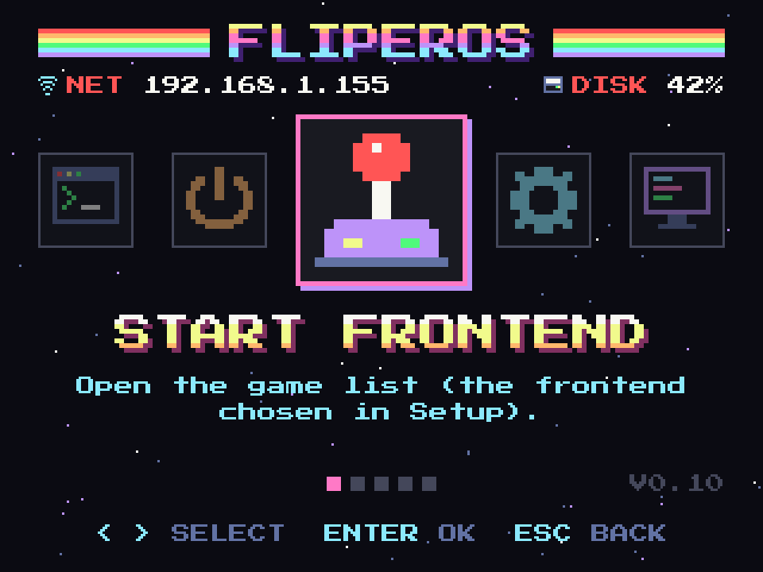
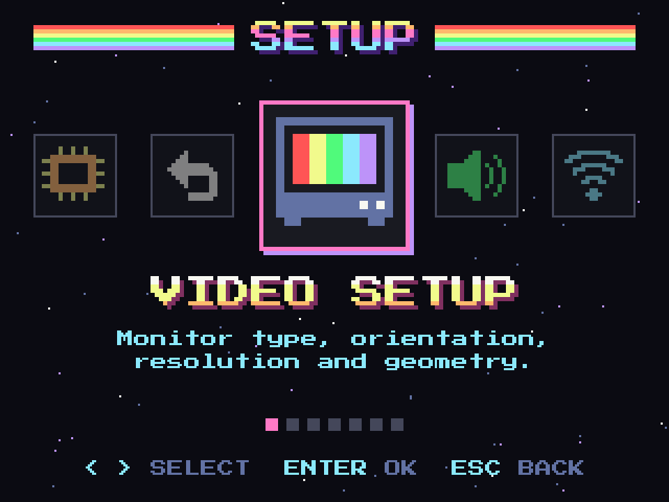
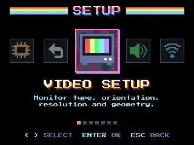

What an installed FliperOS does from power on: the boot, the first boot, the FliperOS menu and the Setup. Each part of the Setup has a page of its own.

| Page | What it covers |
| --- | --- |
| [Video Setup](Setup-Video.md) | Monitor type, orientation, resolution, geometry, extra monitors, the video driver, card firmware |
| [Audio and Network Setup](Setup-Audio-and-Network.md) | Sound card, volume, MAME audio latency, menu sounds, Wi-Fi, the internet check |
| [Games Setup](Setup-Games.md) | Frontend, Emulators & Games, Extras, Folders and the other game items |
| [System Setup](Setup-System.md) | Latency, services, USB quirks, password, cabinet name, debug mode, splash screen |
| [On-screen menu](On-screen-menu.md) | The menu over a running game: settings, profiles, geometry, colour, quitting |
| [Interlaced, colour and scanlines](Picture-filters.md) | 640x240 or interlaced per program, the flicker filter, colour calibration, scanlines |
| [Updates and versions](Updates-and-versions.md) | FliperOS updates without a new ISO, going back to an earlier one, What's new |
| [RetroAchievements](RetroAchievements.md) | The account, hardcore mode, the bar over the game, the badge in the frontend |
| [Cloud backup](Cloud-backup.md) | High scores, saves and settings in Google Drive, Dropbox, WebDAV, SFTP or MEGA |
| [Power and volume buttons](Power-and-volume-buttons.md) | What the power button does on each screen, the volume keys, shutting down |
| [Desktop and theme](Desktop.md) | LXDE, the programs in the menu, the controller as a mouse, the Dracula theme |
| [Remote access](Remote-access.md) | SSH and SFTP, the network share, AI assistants, lab mode |

## From power on to the game list

The cabinet boots without text: from Limine straight to the splash screen, which stays until the frontend or the menu opens. There is no login to type.

Then it opens the **default launcher**: the FliperOS frontend, unless you chose another in **Setup > Games > Frontend** ([Games Setup](Setup-Games.md#frontend)). When the launcher closes, the **FliperOS menu** opens.

The menu is a loop. **Start frontend** and **Start desktop** open the launcher or the desktop, and when it closes you are back in the menu.

If the X server fails to start, its errors stay on screen until Enter. A copy goes to `/opt/fliperos/logs/Xorg-failed.log`.

## First boot

The first boot has nothing to choose about what opens at power on: it is the FliperOS frontend. A short wizard gets the cabinet ready:

1. **Wi-Fi**, only when the network cable brings no internet and there is a Wi-Fi adapter. It asks again after a failed connection, until you say no. Later: **Setup > Network Setup**.
2. **Updates** published after the ISO are applied as soon as there is internet. If one needs a restart, the cabinet restarts and the wizard goes on.
3. **Controls**: the Button mapping of **Setup > Joysticks**, which every emulator and the frontend use. It draws the panel: the control being asked blinks, the ones already pressed turn green. See [Controls](Button-mapping.md).
4. **Live screen**: the web panel's live screen is installed and turned on. If it can't download, it stays in **Setup > Games > Extras > Live screen**.

## The FliperOS menu

The title shows the cabinet's name and IP address, the network use and how full the disk is.

| Item | What it does |
| --- | --- |
| **Start frontend** | Opens the game list. With a game set to open at boot, it reads **Start** and the game's name |
| **Start desktop** | The LXDE desktop, for a mouse and a keyboard ([Desktop and theme](Desktop.md)) |
| **RetroAchievements** | Sign in to earn achievements in RetroArch and other emulators ([RetroAchievements](RetroAchievements.md)) |
| **Setup** | Everything below |
| **Exit to shell** | The command line. Type `fliperos-menu` to come back |
| **Shutdown / Reboot** | Power off or restart |

The first time after an update or a new version, the menu opens on a **What's new** screen ([Updates and versions](Updates-and-versions.md#whats-new)).

## The Setup menu

The items come in the order you set up a cabinet. A balloon under the list says what the item under the cursor is for.

- **Video Setup**: [Video Setup](Setup-Video.md)
  - Monitor Type, Monitor Orientation, Resolution, Geometry, Reset Geometry
  - Multiple Monitors ([Multiple monitors](Multiple-Monitors.md))
  - Interlaced hacks, Colour calibration, Scanlines ([Interlaced, colour and scanlines](Picture-filters.md))
  - Test the video outputs, Video driver, Low resolutions, Card firmware
- **Audio Setup**: [Audio and Network Setup](Setup-Audio-and-Network.md#audio-setup)
- **Network Setup**: [Audio and Network Setup](Setup-Audio-and-Network.md#network-setup)
- **Games**: [Games Setup](Setup-Games.md)
  - Emulators & Games, Frontend, Extras ([Games Setup](Setup-Games.md))
  - Custom games ([Custom games](Custom-games.md))
  - Folders: Folder shortcuts and External storage (a second disk, a Batocera filesystem, formatting) ([External storage](External-storage.md))
  - Downloader and Download BIOS ([ROMs, BIOS and artwork](ROMs.md))
  - Cleaner, Scraper, AttractPlus ROM List ([ROMs, BIOS and artwork](ROMs.md), [Scraper](Scraper.md))
- **Joysticks**: [Controls](Controls.md)
  - Button mapping, Bluetooth, Buttons layout, GunCon 2, Calibrate wheel, Controller light, LPT joysticks
- **System**: [System Setup](Setup-System.md)
  - Latency ([Latency](Latency.md)), Services, Quirks, Password, Cabinet name
  - System Update, FliperOS version, What's new ([Updates and versions](Updates-and-versions.md))
  - Debug mode, Lab mode ([Remote access](Remote-access.md#lab-mode)), Cartridge reader, Splash screen
- **Cloud backup**: [Cloud backup](Cloud-backup.md)

### Graphical and text menus

On the cabinet the menus are **graphical**: a carousel of tiles with icons, drawn for the tube. The same screens also exist as a **text menu** (Bash with [Gum](https://github.com/charmbracelet/gum), in the Dracula theme), which is what you get:

- over SSH, with `sudo fliperos-setup` or `fliperos-menu` typed in the session;
- on the installation media before the output test;
- when the graphical menu can't open, or crashes. The Setup carries on in text, with the keyboard and the controller working.

`ui=text` in `/etc/fliperos/fliperos.conf` keeps the text menu on the cabinet too, and `ui=gui` forces the graphical one.

Every text field of the graphical menu has an **on-screen keyboard** for the controller: the arrows pick a key, button 1 types it, SHIFT gives capitals and symbols, and SHOW shows a password.

### Controller in the menus

With a menu on screen, the controller acts as the keyboard:

| Controller | Key |
| --- | --- |
| D-pad, hat or analog stick | Arrows (they repeat while held) |
| Button 1, A or Start | Enter |
| Button 2, B or Select | Esc |
| Button 3, X or Y | Space (toggles a mark in a checklist) |
| L / R | Page Up / Page Down |

It works with arcade encoders, gamepads and USB joysticks. Light guns are left out, because aiming would move through the menu.

## On-screen menu

Holding **Start and Down** for a second over a game opens a menu with its settings and Quit. It has its own page: [On-screen menu](On-screen-menu.md).

## Web panel

The cabinet in a browser on the same network, a phone too: **http://fliperos.local**. It has its own page: [Web panel](Web-panel.md).

## How it works

- tty1 logs in by itself and follows the flow of GroovyArcade's `.bash_profile`: `config/fliperos-tty1`, called by `~/.zprofile`, opens the launcher and then the menu. The user's shell is zsh with Oh My Zsh; `~/.bash_profile` calls the same flow for whoever goes back to bash.
- The menu runs as root inside `sudo`'s pseudo-terminal. **Start frontend** and **Start desktop** make the Setup exit, and `fliperos-tty1` opens the launcher on tty1 itself, as at boot: X opened from the Setup couldn't switch VT.
- The quiet boot: the Limine menu is hidden (`quiet: yes`; a key during its 3 seconds shows it, with the diagnostics entry), the kernel line has `quiet loglevel=3 rd.udev.log_level=3 udev.log_level=3 vt.global_cursor_default=0`, the automatic login writes nothing (`agetty --skip-login --noissue`, `~/.hushlogin`), and `kernel.printk = 3 4 1 3` in `/etc/sysctl.d/99-fliperos-console.conf` keeps kernel messages off the screen after boot.
- `fliperos-tty1` takes the splash down right before the launcher, the menu, the first boot or the update notice. Ubuntu's `plymouth-quit` only takes it down after 90 seconds, as a safety net.
- The graphical menu is `fliperos-setup/gui/fliperos-gui` (pygame) in `--serve` mode. The Setup's screens send each screen to it instead of calling Gum, so both menus share the same code (`lib/ui.sh`). It draws a 320x240 screen stretched to 640x240, in KMS on the console, or in a window from the desktop's *FliperOS Setup* shortcut. Choosing an item or going back plays a 0.3 s zoom between the two screens (`gui/navfx.py`), 60 frames a second by the clock, over the live background. Every pygame program of the Setup and the frontend asks SDL for vsync before opening the video (`theme.request_vsync()`, which sets `SDL_RENDER_VSYNC=1`): without it SDL's KMS driver flips the picture in the middle of the scan and the screen tears.
- The controller-as-keyboard is the `fliperos-padkeys` service (Python, the kernel's `uinput`). It only translates while `/run/fliperos/padkeys` exists, which the Setup creates when it opens and deletes when it exits, so frontends, emulators and the desktop read the controller by themselves.
- The first boot is `screens/first-boot.sh`; `/etc/fliperos/firstboot` marks it as pending.

See also: [Install](Install.md), [Architecture](Architecture.md).
