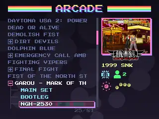

How FliperOS puts each emulator on the tube in the right video mode, and how to run any program at 640x240.



## What KMS and X11 are

Linux has two ways to put a program on the screen, and FliperOS uses both.

| Path | What it is | Who uses it | Wrapper |
| --- | --- | --- | --- |
| **KMS** | The program draws **directly on the video card**, without a window system. The lightest path, with the least input lag, and the program changes the video mode itself | RetroArch, GroovyMAME, the frontends | `fliperos-kms-run` |
| **X11** | Xorg, the classic window system, for programs that only know how to open a window | Flycast, PCSX2, PCSX2x6, DuckStation, Dolphin, Supermodel, Keisho, Hypseus, OpenBOR, Wine games | `fliperos-x11-run` |

`fliperos-x11-run` starts an Xorg just for that program, has **Switchres** make the video mode for the monitor chosen in Video Setup, opens the program full screen and closes Xorg when the program exits. Nothing else runs in that X: no desktop, no panel.

Both wrappers are started from the console, as the frontends do. Inside the LXDE desktop (which already is an X session), run the emulator directly, or from the desktop's **Games** menu, which leaves the desktop for it.

```bash
# KMS: RetroArch with a core
/opt/fliperos/bin/fliperos-kms-run retroarch -L /opt/fliperos/retroarch/cores/fbneo_libretro.so "/home/fliperos/roms/retroarch/fbneo/sf2.zip"

# X11: the mode comes from /etc/fliperos/emulator-modes.conf
/opt/fliperos/bin/fliperos-x11-run flycast "/home/fliperos/roms/naomi/mvsc2.zip"

# X11 with a mode chosen on the spot (width x height @ Hz)
/opt/fliperos/bin/fliperos-x11-run --mode 640x240@60 pcsx2 "/home/fliperos/roms/ps2/game.iso"

# GroovyMAME opens a game by its set name (it runs in KMS; the command picks)
/opt/fliperos/bin/fliperos-x11-run groovymame sf2
```

## What each one opens in

| Emulator | Path | Video mode at 15 kHz | On 25/31 kHz and LCD |
| --- | --- | --- | --- |
| GroovyMAME | KMS | Each game's own mode (Switchres) | The same |
| RetroArch | KMS | Each game's own mode (CRT SwitchRes) | The same |
| Flycast, PCSX2, PCSX2x6, DuckStation, Dolphin, Hypseus | X11 | 640x240 | 640x480 |
| Supermodel, Keisho | X11 | 640x240 at 57.524 Hz | 496x384 |
| OpenBOR | X11 | Each pak's own mode ([OpenBOR](OpenBOR.md)) | The same |
| Fightcade 2 | X11 | The lobby at 512x448, each match in its game's mode ([Fightcade 2](Fightcade-2.md)) | |
| KOF Final Attack | X11 | 320x240 | |

Whether a program's taller games run at 640x240 or interlaced is chosen per program in **Setup > Video Setup > Interlaced hacks** ([Interlaced, colour and scanlines](Picture-filters.md)).

## Running a program at 640x240

On a 15 kHz monitor, 480 lines only exist interlaced (480i), and interlacing flickers. At **640x240 progressive** the program draws its 480 lines in 240: it loses half the vertical resolution, but the picture is stable. That is how FliperOS runs Dreamcast, PS2, GameCube/Wii and laserdisc at 15 kHz by default.

Three ways, from the one-off to the permanent:

1. **On the spot, in the console** (**Exit to shell**, on the cabinet):

   ```sh
   /opt/fliperos/bin/fliperos-x11-run --mode 640x240@60 program [arguments]
   ```

   Any mode works: `WIDTHxHEIGHT@HZ`, like `320x240@60`, `640x240@59.94`, `384x224@59.64`.

2. **In the desktop menu:** a shortcut in `~/.local/share/applications/my-program.desktop`. `fliperos-launch --mode` leaves the desktop, opens the program in that mode and comes back when it closes:

   ```ini
   [Desktop Entry]
   Type=Application
   Name=My program
   Exec=/opt/fliperos/bin/fliperos-launch --mode 640x240@60 /path/to/the/program
   Categories=Game;
   ```

3. **Always for that program:** a line in `/etc/fliperos/emulator-modes.conf` (the command's name, the mode at 15 kHz, the mode on the other monitors). From then on every path through `fliperos-x11-run` uses it:

   ```
   myemulator          640x240@60      640x480@60
   ```

In a frontend, the emulator's command becomes `/opt/fliperos/bin/fliperos-x11-run --mode 640x240@60 emulator "[romfilename]"`, or the same without `--mode` with the line in the table.

### The picture has to be stretched

640x240 is an 8:3 screen in pixels, which the tube shows as 4:3. A program that "keeps the 4:3 aspect ratio" would use only half the width and come out squashed in the middle. So set it to **stretch** or **fill the screen**. For a mode of another size, stretch by `300 × width ÷ (4 × height)` percent.

`fliperos-x11-run` already does it for the emulators FliperOS ships:

| Emulator | Setting |
| --- | --- |
| Flycast | `rend.ScreenStretching=200` |
| PCSX2 | `AspectRatio = Stretch` |
| DuckStation | `AspectRatio = Stretch To Fill` |
| Dolphin | `AspectRatio=3` |
| Supermodel | `-fullscreen -res=640,240 -stretch` |
| Hypseus | `-x 640 -y 240 -ignore_aspect_ratio` |
| Keisho | `aspect_mode = stretch` |

## Cards without low dotclocks

Intel cards, and NVIDIA cards that didn't pass the low resolution test, can't make the ~12 MHz pixel clock of a 640x240 mode at 15 kHz ([Video cards](Video-cards.md)). They get **super resolutions**: the same lines and frequencies, with the pixels thinner. `fliperos-x11-run` then asks for 2560 pixels across (Flycast `rend.ScreenStretching=800`, Supermodel `-res=2560,240`, Hypseus `-x 2560`), and RetroArch draws at 2560 too. On the tube the picture is the same.

## Nothing on screen but the game

The output of X, Switchres and the emulator goes to `/opt/fliperos/logs/<program>.log` (the last run of each), so the screen stays clean between the frontend and the game. **Setup > System > Debug mode** shows everything ([System Setup](Setup-System.md#debug-mode)).

The mouse cursor only appears in emulators with a mouse UI (PCSX2, Dolphin, Flycast, Fightcade), which hide it themselves during full-screen play; the others open with Xorg's `-nocursor`.

## How it works

- `fliperos-kms-run PROGRAM [ARGS]` runs the program on the console. For RetroArch it adds the FliperOS settings (`--appendconfig` with `/etc/fliperos/retroarch/*.cfg`) on top of the user's.
- `fliperos-x11-run [--mode WxH@HZ] [--app NAME] [--wine] PROGRAM [ARGS]` reads the mode by the program's name in `emulator-modes.conf` (`config/fliperos-emulator-modes.conf`; a program not there gets 320x240@60), starts Xorg with the Switchres modeline, and runs the program through `fliperos-x11-client`, which applies the colour, starts openbox (it fits the full-screen window on each mode switch, as in GroovyArcade's `galauncher.xinitrc`) and loads the flicker filter layers. On a card without low dotclocks, `/etc/switchres.ini` has `dotclock_min 25.0` and the width becomes `super_width` (2560).
- Both wrappers also start what every game gets: the marquee events, the achievements watcher, the cloud backup watcher, the controller light, the power key game file and the play statistics.
- `fliperos-launch NAME` is what the desktop's Games menu runs: it saves the request, closes the desktop, and `fliperos-session` opens the emulator, then the desktop again.
- More on the wrappers: [Architecture](Architecture.md#launch-commands-and-wrappers).

See also: [Emulators](Emulators.md), [Adding an emulator](Adding-an-emulator.md).
