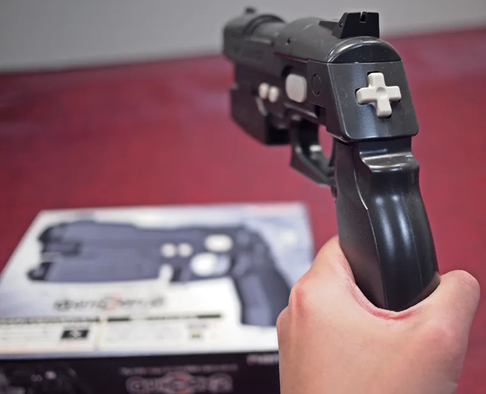
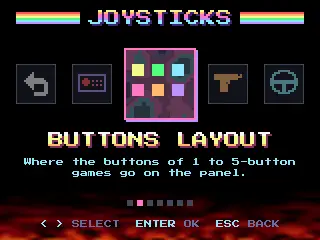

FliperOS plays light gun games on the tube with Namco's **GunCon 2** (the PlayStation 2 gun, USB `0b9a:016a`), with nothing to install: the driver, the calibration for your tube and a screen flash for dark scenes come with the system. The gun reads the beam of the CRT, so it only aims on a CRT.

## Getting started

1. Plug the gun into USB. It shows up as a gun at once.
2. **Setup > Joysticks > GunCon 2 > Calibrate**, once (below).
3. Play: the gun games of MAME, Flycast, Keisho and the RetroArch cores take it by themselves.

To keep the gun games when you clean a romset, mark **Light gun** among the controls in the [ROM Cleaner](ROM-Cleaner.md). The FliperOS frontend shows a pistol icon on gun games, and its CONTROL filter can list only them.

## Calibrate

The screen turns white (the gun needs light where it aims) with a target in each corner. Shoot each one three times; a shot off the screen is rejected. A shot at the centre checks the result before saving.

The calibration is reapplied every time the gun is plugged in. A bad calibration doesn't lock you out: calibrating again always works.

**Two or more guns.** With more than one GunCon 2 connected, Calibrate asks how many players have a gun and goes through them one at a time: each player pulls the trigger of their gun, then the targets appear. Each gun's range is saved by its USB port, so keep each gun on its port.

## Screen flash

A CRT gun only finds its aim where the screen is lit. Over a dark part of the picture it sees nothing: Area 51 reloaded while shooting at its dark floor. So, like RePlayOS's `GCON2 FLASH`, the screen lights up on a shot:

| Screen flash | What it does |
| --- | --- |
| **Pulse** (default) | Two light frames on each shot |
| **Hold** | Light while the trigger is held |
| **Off** | No flash |

With it, a shot over a dark part hits where the gun points, and only a shot off the screen reloads.

## Settings

**Setup > Joysticks > GunCon 2** has the gun's state and its values on top. Everything but the calibration is also in the web panel's **GunCon 2** settings and in the [on-screen menu](On-screen-menu.md#guncon-2), where you can adjust it while shooting at the game, and counts at once.

| Setting | Default | What it does |
| --- | --- | --- |
| Flash brightness | 100 % | How light the flash is (10 to 100). Too low and the gun misses it |
| Flash wait | 100 ms | How long a shot without light waits for the flash |
| Dark hold | 150 ms | How long the aim stays put when the gun stops seeing light |
| Edge band | 12 % | Losing light this close to an edge is off the screen at once |
| Off-screen reload | On | Off the screen, the trigger also presses the reload button of Flycast, RetroArch and Keisho |

**Back to the defaults** puts these back; the calibration stays.

## In each emulator

| Emulator | Gun games |
| --- | --- |
| GroovyMAME | Every MAME gun game |
| RetroArch | Every core that has a gun: FBNeo, PlayStation, SNES, Mega Drive, Master System, NES (Nestopia and Mesen's Zapper too). The gun is set up for the games that use it, and the other players stay on their pads |
| Flycast | Naomi and Atomiswave gun games (The House of the Dead 2, Confidential Mission…) |
| Keisho | The Model 2 gun games (The House of the Dead, Virtua Cop), read straight from the gun |
| PC games (custom games) | The gun is an absolute mouse (trigger = left click, Start = `1`, Select = `5`). A game that locks the pointer and aims by mouse movement needs its light gun mod ([Custom games](Custom-games.md#windows-games-portproton)) |

Gun outputs (recoil, ammunition) can drive hardware with Hook Of The Reaper or QMamehook ([DIY hardware](DIY-hardware.md#game-outputs-lamps-recoil-motors-and-button-lights)).

## How it works

- **The driver:** GunCon 2 has no driver in the mainline kernel. The build compiles [beardypig/guncon2](https://github.com/beardypig/guncon2) through DKMS for the system's kernel and loads it at boot (`/etc/modules-load.d/fliperos-guncon2.conf`).
- **The driver's FliperOS patches** (`config/guncon2-patches`). The gun sends the same report for a dark part of the picture and for an aim off the screen (x 0 or 1, y 5), so the driver tells them apart by context: a miss keeps the last aim for up to `hold_ms`; a miss right after an aim within `edge_pct` of an edge is off the screen at once; off the screen both axes go out of the calibrated range, so every emulator reads it as off the screen; off the screen the trigger also presses the right button (`offscreen_reload`); a stalled USB endpoint is cleared, where the original driver stopped reading the gun for good. The parameters change live in `/sys/module/guncon2/parameters/`.
- **The calibration:** GunCon 2 is linear, so two known points give the edges. It is saved in `/etc/fliperos/guncon2.conf` (and `guncon2-<port>.conf` per gun), and the udev rule `99-fliperos-input.rules` reapplies it (`fliperos-guncon2-calibrate`) on every connection, since evdev forgets the range. The driver judges an aim by the saved range, and the calibrator opens that range up first, so a bad calibration can always be redone.
- **Marked as a gun:** the same rule tags it `ID_INPUT_GUN=1`, so Keisho reads the gun itself instead of the mouse pointer; Keisho keeps the last position that saw the screen for up to 150 ms (`config/sm2-emu-patches/0001`).
- **The flash:** the OpenGL and Vulkan layers (`config/fliperos-deflicker.c`, `config/fliperos-vkfps.c`) read the triggers of the devices tagged `ID_INPUT_GUN` without grabbing them, and paint the whole frame. They flash on the raw trigger, which the driver sends at once as `MSC_RAW` (patch 0006), and the driver waits up to the flash wait for a report that sees the lit screen before sending a trigger pulled without light. Some games the layers can't reach: PortProton's container drops them from every Windows game it runs (Vulkan and OpenGL alike), and a few games draw through X with neither. For those, `config/fliperos-osd-x11`, the on-screen menu's helper in each game's X, does the flash. It maps a window over the whole screen, with the same settings, and leaves the flash to the layer when one is alive.
- **Settings:** `gun_flash` (pulse, hold, off), `gun_flash_level`, `gun_flash_ms`, `gun_hold_ms`, `gun_edge_pct` and `gun_offscreen_reload` in `fliperos.conf`; `fliperos-guncon2-calibrate --params` writes them to the driver the moment they change.
- **RetroArch:** `config/lightgun-games.tsv` lists the gun games of each core, and the core's port devices are set for them; the gun's own joystick is remapped so it doesn't take player 1's pad.
- **The menus:** the controller-as-keyboard of the Setup leaves guns out, so aiming doesn't move through the menu.

See also: [Controls](Controls.md), [DIY hardware](DIY-hardware.md#light-gun).
