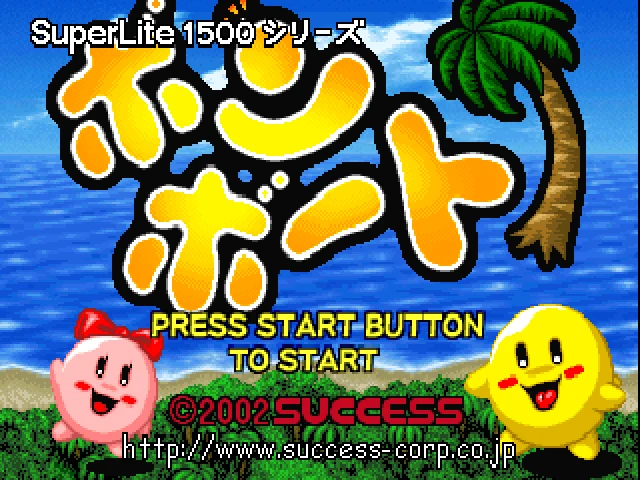

The other emulators: Dolphin, DuckStation, Hypseus Singe (laserdisc) and KOF Final Attack on Ikemen GO.

## Dolphin (GameCube, Wii, Triforce)

Its games go in `~/roms/dolphin` (`.iso`, `.rvz`, `.wbfs`). It is compiled from Dolphin's stable version, as a FliperOS package updated with FliperOS (the official Linux build is a Flatpak, which would bring about 1 GB of runtime); **Build the newest** in **Setup > Games > Emulators & Games** compiles the newest ([Games Setup](Setup-Games.md#the-newest-version-of-a-packaged-emulator)).

- It opens in its own Xorg at **640x240** on a 15 kHz tube, stretched to fill it (`AspectRatio=3`), or interlaced with **Interlaced hacks**.
- On amdgpu it runs in **Vulkan**.
- **Wii games are 4:3.** Dolphin starts the Wii with a 16:9 TV (`IPL.AR` in the Wii's `SYSCONF`), and the picture, stretched to the whole 640x240 window of the tube, would come out squeezed. Each time Dolphin opens, FliperOS sets the Wii's TV to 4:3 (`fliperos-wii-sysconf`). The `SYSCONF` is created the first time a Wii game opens, so a brand-new cabinet shows that first game as Dolphin makes it; from the second on it is 4:3. `wii_aspect=16:9` in `fliperos.conf` leaves the Wii as it is for a widescreen monitor.
- An **NKit** image (`.nkit.iso`) opens without Dolphin's "NKit Warning" window (it would wait for a click the panel can't give): FliperOS sets `SkipNKitWarning` each time. Savestates and input recordings are still not shared between an NKit image and a normal one.
- It has no menu of its own for the panel, so **coin + button 1** opens the FliperOS [on-screen menu](On-screen-menu.md).
- **Net play** between cabinets, with FliperOS's patch ([Linked cabinets](Net-play.md#dolphin-net-play)), and [RetroAchievements](RetroAchievements.md).

## DuckStation (PlayStation)



Its license (CC BY-NC-ND 4.0) doesn't allow it in the image: **Setup > Games > Emulators & Games > DuckStation** downloads the official AppImage from its GitHub, and choosing it again updates it. A PlayStation game opened before it is installed installs it first.

- Its games go in `~/roms/ps1` (it is there from the install, so games can be copied before it), and it also lists the ones in `~/roms/retroarch/pcsx_rearmed`. The BIOS is the one in `~/bios`, the same as RetroArch's.
- Each launch sets full screen, *Stretch To Fill* and the BIOS folder; the first one also skips its setup wizard and puts both panels on SDL (Cross/Circle/Square/Triangle on A/B/X/Y, as in PCSX2).
- **PAL games** run at 50 Hz on the tube, 240p games without field flicker, and the picture is cropped so one game line is one tube line.
- The renderer stays on Automatic: **Vulkan** where there is one (amdgpu, Intel), OpenGL on radeon. A renderer you choose in DuckStation stays.
- **Esc** or **Select + Start** opens its menu, and **coin + button 1** too. Opened from a frontend it closes with the game; from the desktop menu it opens in Big Picture.
- Its log is in the web panel's **System > Processes and logs**. Not seen on the CRT yet.

## Hypseus Singe (laserdisc)

Dragon's Lair, Space Ace and the other laserdisc games, plus Singe games. They live in `/opt/fliperos/roms/hypseus`, which is `~/.hypseus` (over the network: `\\fliperos\FliperOS\roms\hypseus`):

| What | Where |
| --- | --- |
| The game's ROM | `roms/<game>.zip` |
| The laserdisc video | `vldp/<game>/`, with the framefile `<game>.txt` |
| Singe games | `singe/<game>/` |

To open one on the tube (640x240 at 15 kHz, full screen), in the console or as a frontend command:

```sh
/opt/fliperos/bin/fliperos-x11-run hypseus lair     # Dragon's Lair
/opt/fliperos/bin/fliperos-x11-run singe timegal    # a Singe game
```

Hypseus has no menu of its own (it needs the game's name), so it has no shortcut in the desktop's Games menu. It is Hypseus Singe v2.12.1: the 3.x series needs SDL3, which Ubuntu 24.04 doesn't have.

## KOF Final Attack (Ikemen GO, 4:3)

*The King of Fighters: Final Attack* is a MUGEN game in 16:9. The [4:3 patch](https://github.com/juniorterin/KOF-Final-Attack-4-3-patch) converts it to [Ikemen GO](https://github.com/ikemen-engine/Ikemen-GO) in 4:3 at 320x240, with one sprite pixel per screen pixel, for the CRT.

**Setup > Games > Emulators & Games > KOF Final Attack** offers two ways to get the game:

- **Download from itch.io:** the free game from [its page](https://united-by-games.itch.io/the-king-of-fighters-final-attack) (United By Games, a 1.4 GB zip) is downloaded, unpacked, patched and deleted by itself. It needs 7 GB free.
- **Use a folder I have:** the folder of the original game (the one with `Final Attack.exe`) on a USB disk, the network share or the home folder.

The converted copy goes to `~/roms/ikemen/kof-final-attack` (about 2 GB). The original folder is not changed. **Update** downloads the newest game, patch and Ikemen GO and converts again.

It opens from the desktop menu (**Games > KOF Final Attack**) or with `fliperos-kof`, in its own Xorg at 320x240@60. It is not in the frontends' game lists.

## How it works

- **DuckStation** is unpacked in `/opt/duckstation` (`config/fliperos-duckstation`); a `~/roms/duckstation` or `~/roms/psx` from before moves to `~/roms/ps1`, with its art. Its settings are `[Cheevos]`, `AspectRatio` and the BIOS path in its `settings.ini`, written at each launch by `fliperos-x11-run`; `-batch` closes it with the game.
- **Hypseus** is installed as the project's README says: `hypseus` and `singe` are its scripts, `hypseus.bin` the program. `fliperos-x11-run` passes `-x 640 -y 240 -ignore_aspect_ratio` at the end of the line (Hypseus reads the game and the player first). Its memory is in `~/nvram/hypseus`.
- **KOF:** the installer (`config/fliperos-kof`) downloads the patch, which downloads Ikemen GO and a portable PowerShell (the conversion scripts are PowerShell). The patch works from a `Patch 4x3` folder inside the original, removed at the end; a folder that can't be written to is copied to the disk first. Installing again replaces the copy only after the new one is ready. `fliperos-kof` is in `emulator-modes.conf` at 320x240@60.

See also: [Emulators](Emulators.md), [KMS and X11](KMS-and-X11.md).
