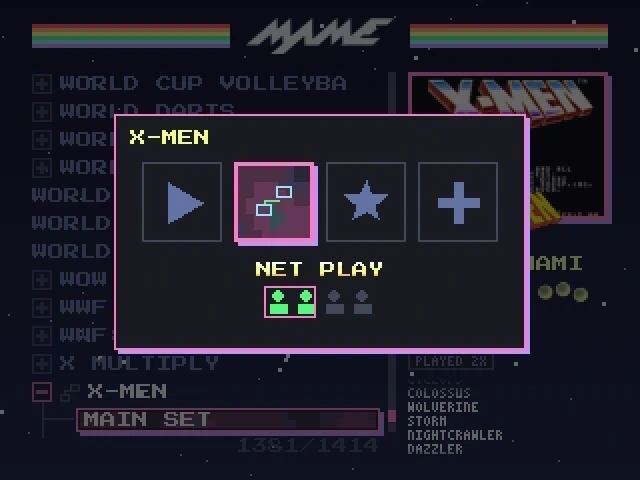
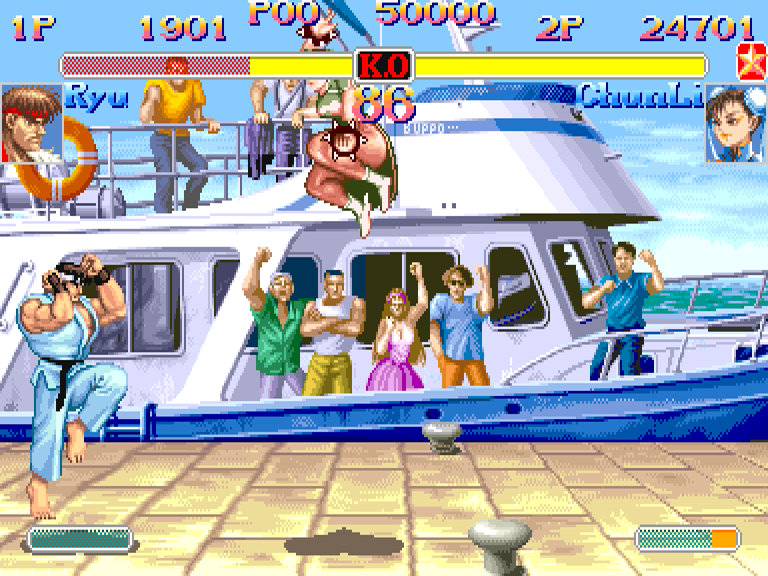
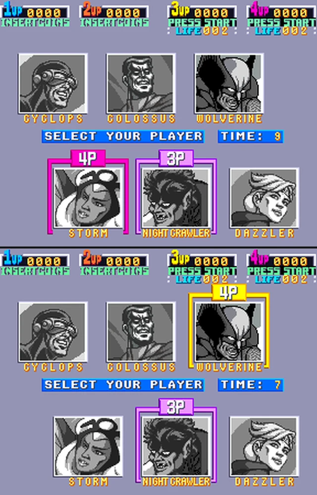

More players than one cabinet has controls: a **party** joins 2 to 4 cabinets on the local network to play one game together, each cabinet with its own controllers. It works for the games of RetroArch's net play cores, Flycast's NAOMI and Atomiswave games, every MAME game of GroovyMAME, and Dolphin.

Some games have more players than a cabinet has controls: X-Men has four players, and FBNeo runs it. For these, a party lets cabinets on the local network share one game, through RetroArch's net play. There is no emulator link and no NVRAM per cabinet: every machine runs the same game, and the inputs travel over the network.

**Which games get it:**

- **Every RetroArch core that does net play**, in its own folder (`~/roms/retroarch/<core>`), for a game with more players than this cabinet has controls. A core does net play when its `.info` file says `savestate_features = "deterministic"`, which is what RetroArch itself asks for: in the image that is FBNeo, Snes9x, Genesis Plus GX, FCEUmm, mGBA and PCSX ReARMed. A core installed later counts too. The game needs its number of players in the list (the MAME ones come with it; a console game gets it from the scraper, or from Classify in the frontend).
- **FBNeo uses its own folder only**: `~/roms/retroarch/fbneo`, with FBNeo's own romset, and only the sets FBNeo knows. The MAME romset in `~/roms/mame` is not used for it, even for a game that has the same name in both: FBNeo checks each file by its CRC, and some sets of MAME 0.289 have dumps that FBNeo does not take.
- **NAOMI, NAOMI 2 and Atomiswave games in Flycast**, through Flycast's GGPO, for any game of two or more players: up to four players (the four controller ports) on two to four cabinets, each cabinet with as many players as it has controls. Guilty Gear Isuka's four players can be 2+2, 2+1+1 or 1+1+1+1. See Flycast GGPO below.
- **GameCube and Wii games in Dolphin** (`~/roms/dolphin`), for any game of two or more players: two to four cabinets, one player each. See Dolphin net play below.
- **MAME games in GroovyMAME** (`~/roms/mame`, and `~/roms/hbmame` in [HBMAME](GroovyMAME.md#hbmame-hbgroovymame), with the same patch), for any game of two or more players: every player of the game (up to MAME's ten), on two cabinets or more, up to one per player, each cabinet with as many players as it has controls, all of them on the same frame like an arcade link. Super Street Fighter II Turbo is one player on each of two cabinets. See GroovyMAME lockstep below.

Every cabinet of the party needs the same game file.

In the frontend such a game has a **PARTY PLAY** tile in its menu, with a row of player icons. The lit ones are the players this cabinet takes. The other cabinets see **JOIN PARTY**, with the name of the cabinet that opened it.

**Each cabinet takes as many players as it has controls configured** (see [Controls](Controls.md)), so two cabinets with two controls fill the four players of X-Men. To give fewer (two controls, but only one person playing), press down on the PARTY PLAY or JOIN PARTY tile: blinking arrows appear beside the player icons, and left or right picks how many this cabinet gives. Up goes back to the tiles.

**In a RetroArch party nobody waits.** The cabinet that opens it goes into the game after the three-second count, alone, and the others join the game while it runs: JOIN PARTY copies the game if it is missing and opens it at once, connected to the first cabinet, on the first free players. A cabinet that closes its game frees its players for the next one. The party ends when the first cabinet closes the game. Flycast's GGPO, GroovyMAME and Dolphin need every cabinet at the start, so their parties still wait in the room: GGPO and GroovyMAME start when every player has an owner or the first cabinet presses START, Dolphin the same way.

Only the network cable is used. The public lobby, the relay and the NAT traversal of RetroArch are off, and so are the UPnP of Flycast and Dolphin and Dolphin's traversal server. The party's own ports are UDP 55436 (who plays what), TCP 55437 (the party) and TCP 55438 (the game's files). RetroArch's net play is on TCP 55435, Flycast's GGPO on UDP 19713, Dolphin's net play on TCP 2626, GroovyMAME's lockstep on UDP 55441 to 55444 (55440 plus the cabinet's number).

**Run the same release on every cabinet.** RetroArch warns when two machines run different versions. When the builds of the core differ, it turns the desync check off, so a real desync would not be reported.

Tested on 1 November 2026: the frontend of the cabinet hosted X-Men with players 1 and 2, and a Windows PC joined with two RetroArch windows, one player each (players 3 and 4), with a ping of 13 to 18 ms. The coin, start and character selection of each player showed on that player, the same on the cabinet and on both windows. RetroArch 1.22.2 for Windows (the stable build) crashed when it connected; the nightly build worked. Not tested: two people playing a whole credit, and any core other than FBNeo.

## Flycast GGPO

The frontend opens Flycast with `network:GGPO=yes`, `network:GGPODelay=0` and `network:EnableUPnP=no`. The cabinet that opened the party has `network:ActAsServer=yes` and is player 1. **Both have `network:server` set to the other cabinet's IP**: Flycast sends only to that address and takes packets only from it, so an empty one (the loopback) never links. Two Flycast of the cabinet's own build linked this way (see the Flycast section). A party started from the frontend has not been tried yet.

**More than two players.** Flycast's own GGPO has two players, one on each machine, and reads only the first controller of each. The GGPO library under it takes up to four players but only one local player per machine. So FliperOS patches Flycast (`packaging/patches/flycast/0002-ggpo-party-of-up-to-four.patch`) to make **each cabinet one GGPO player that sends all its controllers in one input**. The frontend adds three options:

- `network:GGPOPeers`: the IPs of the cabinets of the party, in order, separated by `;`;
- `network:GGPOPlayerNum`: this cabinet's place in that list;
- `network:GGPOSlots`: how many controllers each cabinet plays, in the same order.

The controller ports go to the cabinets in that order: with `2;1;1`, ports 1 and 2 are the first cabinet's two controllers, port 3 the second cabinet's and port 4 the third's. Each cabinet's own controllers stay its controllers 1, 2... A party says it is protocol 3 in GGPO's check, so a Flycast without the patch refuses it instead of losing the sync. Without `GGPOPeers` Flycast runs its own two-player session, unchanged. The frontend offers the bigger party only when the installed Flycast has the patch (it looks for `GGPOPeers` in the binary); an older one gets the party of two, one player each.

**The network every millisecond.** Flycast gave GGPO the network only once a frame, and sent each frame's input a frame late. On the cable, where a round trip takes under 1 ms, GGPO measured 20 to 110 ms of ping (median 22 ms in a 16-minute session between the cabinet and a PC). That ping decides how far ahead each side may run, so the cabinet ran about 3 frames ahead of the PC, predicted 4 to 7 frames of the PC's input (GGPO stalls at 8), paused 161 times to wait for it, and had a frame of 34 ms or more in 83% of the seconds. The third patch (`0003-ggpo-network-every-millisecond.patch`) adds a thread that reads and sends GGPO's packets every millisecond, apart from the frames; rollbacks stay in the frame. With it, two Flycast on one PC measured 1 to 3 ms of ping.

**Within a frame of each other.** With the right ping the cabinet still ran 4 to 5 frames ahead of the PC: its clock (the CRT mode Switchres makes, a little over 60 Hz) runs faster than the PC monitor's, and GGPO only corrected a gap of 3 frames or more, checking every 4 seconds, with Flycast waiting one frame per correction. So the cabinet saw the PC player's moves about 80 ms late. The fourth patch (`0004-ggpo-keep-machines-within-a-frame.patch`) corrects from one frame and checks every second: the machines stay 0 to 1 frame apart. Each correction is still a one-frame wait on the machine ahead, and there are as many as before (that is the real difference of the two clocks); between two cabinets in the same CRT mode they are rare.

**Lockstep, like an arcade link.** Real link boards never let a machine run ahead. On Daytona's Model 2 link (MAME `m2comm`) the master sends its data and a VSYNC token around a ring every frame, and every board waits for that token. Supermodel's net board and Flycast's own Naomi link do the same: each machine sends once a frame and blocks until the others' data arrives. Flycast Dojo's delay mode works this way too, with one frame of delay on a LAN by its own formula. GGPO does the opposite: it lets the faster machine predict up to 8 frames and pulls it back now and then. The **lockstep patch** (`0005-lockstep-patch.patch`) adds `network:GGPOMaxPrediction`. At that limit the faster machine waits, in 1 ms steps, for the others' input, and GGPO's whole-frame wait is skipped. The party uses one frame of input delay and a limit of two. The limit has to be above the delay: with 1 and 1 both machines refused their own input until they had the other's, and nothing was ever sent.

Six automatic sessions of 3 minutes, cabinet and PC, on 7 November 2026, with scripted players on both coining, starting, picking characters and fighting (numbers after the BIOS boot; PC / cabinet):

| | Rollback, delay 0 | Delay 1 | Delay 1, prediction ≤ 2 (lockstep) |
|---|---|---|---|
| Frames apart, p95 | 3 / 3 | 4 / 4 | **1 / 2** |
| Frames predicted, p95 | 4 / 3 | 4 / 0 | **1 / 0** |
| Frames redone | 1797 / 290 | 1976 / 1 | **658 / 0**, one frame each |
| One-frame waits | 107 / 11 | 129 / 0 | **0 / 0** |
| Seconds with a frame of 50 ms or more | 26 / 10 | 43 / 8 | **19 / 7** |

Vsync off on both, so both ran by the audio clock as Flycast Dojo does, changed little. Writing the statistics every 10 s instead of every second changed nothing either. Both sides still have one frame of 34 ms or more in most seconds, in every configuration: it comes from how Flycast's emulation loop runs its frames, not from the network. The session logs and the scripts that ran them are in the owner's PC folder `Downloads\flycast-fliperos-party\testes`.

There is no faster network protocol to switch to: GGPO already sends each input in one UDP packet, and on the cable a round trip takes under 1 ms. What made the party slow was inside the emulator (the network read once a frame, the drift corrected late), not the cable. The price of lockstep is one frame (about 17 ms) of input delay for every player, as on a real link board.

Like the rest of the party, it is for a wired local network: no relay, no UPnP. The patch makes the GGPO input bigger (32 bytes per player instead of 9) and the input packets bigger (up to 1 KB, under the network cable's MTU).

Tested on 7 November 2026 with three patched Flycast on one PC, each one a cabinet on its own port of the loopback, playing Guilty Gear Isuka (Atomiswave) in a 2+1+1 party: all three ran the game in one GGPO session. A Lua script coined on each one's own controllers (the first cabinet on its second controller, the second once, the third twice), and all three screens showed the credits 0, 1, 1 and 2: each controller reached its port on every machine.

Then, on 6 November 2026, between the owner's cabinet and a PC: the cabinet's frontend hosted the party and the PC joined it with the frontend's own protocol, running the patched Flycast in Docker (software video, through a UDP bridge on Windows so the cabinet always saw the PC's port 19713). The session ran for minutes on both, with about 60 packets a second each way and no disconnection. In one party the cabinet gave 2 players and in the other 1, and the PC's scripted coins, starts and moves landed on ports 3-4 and then 2-3, as each plan said; the person at the cabinet played player 1 against them. The cabinet showed short, light stutters. The likely cause is the PC side, not the patch: a Flycast drawing on the CPU in Docker, behind a bridge in PowerShell, with a ping of 19 to 41 ms, makes GGPO roll back several frames and slow the faster machine down to wait for it. Not tried yet between two cabinets on the cable.

## GroovyMAME lockstep

MAME has no net play of its own. FliperOS builds GroovyMAME from the source of the release's tag with its **lockstep patch** (`packaging/patches/groovymame/0001-lockstep-patch.patch`), so any MAME game of two or more players can be a party, the way a link board keeps arcade machines together:

- Every cabinet runs the same game from the same start: MAME's random seed is fixed, the party has an empty NVRAM folder (the game's factory memory) and a cfg folder of its own (the game's factory settings), the hiscore plugin and the autosave are off, and the clock of the game (`-rtc`) is the first cabinet's time on all of them. The mapping of the panel stays: it is the ctrlr file, not the cfg.
- Every emulated frame, right after MAME reads the controls, each cabinet sends its players' bits (UDP, with the last 8 frames again in every packet) and waits for the other cabinets' bits of that frame. Then every cabinet puts every player's bits in the input ports, on the same frame. The faster machine waits, without spinning the CPU; nothing is predicted and nothing is redone.
- No input delay: on the cable the other cabinets' controls arrive within the same frame, so the game answers as fast as when it is played alone.

**Every player of the game.** The party takes as many players as the game has, up to MAME's ten player ports, and from two cabinets up to one cabinet per player: each cabinet sends only its own players' bits, so the patch has no limit of its own. An eight-player game can be eight cabinets of one player, or four of two. With more than eight cabinets the waiting room shows smaller boxes, with each cabinet's players and name.

The frontend writes `fliperos-lockstep.ini` in the party's cfg folder (`~/.cache/fliperos/party-mame`): this cabinet's number, every cabinet's IP in order, its players, the delay and a log. A cabinet that leaves tells the others, and their games close too; a cabinet that goes quiet for 10 seconds ends the party.

Setup > Emulators & Games can build the newest GroovyMAME on the cabinet with the same patches, so the party keeps working with it; it compiles the whole MAME and takes hours. A GroovyMAME without the patch (one put there by hand) gets no party: the frontend looks for the patch in the binary.

Tested on 7 November 2026 with Super Street Fighter II Turbo between the owner's cabinet and a Windows PC on the cable, with a script on each machine that coined, started, picked a character and fought with random moves (each machine knew the other's moves only from the network). In 9 runs of 2 to 8 minutes, a checksum of the game's main RAM every second was the same on both machines every time (more than 1,700 compared), and screenshots taken on the same frames were identical byte for byte. The round trip on the cable was 0.46 ms. On the cabinet, with no input delay, 0.01% of the frames took more than 20 ms (the worst 28 ms) with the patched build running natively on the PC. A plugin in Lua (MAME's own TCP sockets) kept the sync too, but stuttered more on the cabinet (0.35% of the frames), because Lua cannot sleep while it waits. The logs are in the owner's PC folder `Downloads\gm-lockstep\run`.

## Dolphin net play

Dolphin opens net play only from its windows, so FliperOS builds it with a patch (`config/dolphin-patches`) that adds two command-line options: `--netplay host` or `--netplay join`, and `--netplay_players N`. The cabinet that opened the party hosts and starts the game by itself when the N cabinets of the party have it. The others connect to it, and retry for 20 seconds while it opens.

The address, port and nickname go in with `-C Dolphin.NetPlay.*`: direct connection (no traversal server), no UPnP, TCP port 2626, buffer 2. Dolphin is opened with `-b`, so it closes when the game ends or the connection drops, and the frontend comes back.

Each cabinet plays with its controller 1, in the order the cabinets joined: the host is player 1. The frontend offers it only when the installed Dolphin has the patch (the ISO build applies it); an older Dolphin gets no PARTY PLAY tile.

## Latency of net play

**Your own controls are as fast as playing alone**, except in Dolphin (below). RetroArch's net play and Flycast's GGPO are both rollback: each cabinet runs the game at once with its own controls and guesses the others' (it repeats their last input). When the real input arrives and differs, it loads the state of a few frames back and runs those frames again, in one frame.

FliperOS sets no input delay (`netplay_input_latency_frames_min` and `_range` are 0 in RetroArch, `GGPODelay` is 0 in Flycast). On the cable the other cabinet's input arrives in a fraction of a frame, so a rollback is rare and is one frame long at most. You see the other players' moves within a frame. The ping that RetroArch shows (13 to 18 ms in the test) counts its own handling, not just the cable, where the round trip is under 1 ms.

**Dolphin has no rollback.** Every cabinet waits for everyone's input of the same frame, with a buffer that holds a few inputs ahead. FliperOS sets the buffer to 2 (Dolphin's default is 5): about one frame of delay on your own controls too, the same for everyone. If the game stutters, the buffer is too small for that network.

**Run-ahead is off during net play.** RetroArch does not run run-ahead or preemptive frames while net play is on. A latency mode that uses them loses that gain in a party.

**Every cabinet runs at the speed of the slowest.** Use the same video mode on all of them: a CRT whose refresh is a little slower holds the others back.

## Cores and emulators with net play

**The frontend offers net play with every RetroArch core marked "deterministic", with Flycast's GGPO, with Dolphin and with GroovyMAME's lockstep.** A RetroArch core needs a state that it saves and loads quickly and always the same way. A core that cannot do that refuses net play, or loses the sync. FBNeo and GroovyMAME have been played between two machines so far; the others are in the frontend but not yet tested on FliperOS.

| Core or emulator | Systems | Net play | Checked |
| --- | --- | --- | --- |
| FBNeo (RetroArch) | Arcade: CPS1, CPS2, CPS3, Neo Geo, Konami, Toaplan and the rest of its list | **Yes, in the frontend** | **Tested**: X-Men, cabinet and PC |
| Snes9x (RetroArch) | Super Nintendo | **Yes, in the frontend** | Its .info; not tested |
| Genesis Plus GX (RetroArch) | Mega Drive, Master System, Game Gear, Sega CD | **Yes, in the frontend** | Its .info; not tested |
| FCEUmm (RetroArch) | NES, Famicom Disk System | **Yes, in the frontend** | Its .info; not tested |
| mGBA (RetroArch) | Game Boy Advance | **Yes, in the frontend** (one screen shared, not the link cable) | Its .info; not tested |
| PCSX ReARMed (RetroArch) | PlayStation | **Yes, in the frontend**, but heavier and loses the sync more easily | Its .info; not tested |
| MAME 2010 (RetroArch) | Arcade (MAME 0.139) | **No**: "Core does not support netplay" | **Tested** |
| MAME, current core (RetroArch) | Arcade (MAME 0.289) | Yes, but many drivers do not save their state well. Not in the image (415 MB) | Connected once (X-Men) |
| Flycast | NAOMI, NAOMI 2, Atomiswave | **Yes, in the frontend**: GGPO rollback, up to four players on two to four cabinets (FliperOS patch) | Two Flycast linked on the cabinet by hand, game screen not seen |
| Dolphin | GameCube, Wii | **Yes, in the frontend** (FliperOS patch): two to four cabinets, one player each; input delay, no rollback | Patched build compiled; not played between two machines |
| GroovyMAME | Arcade (MAME 0.289) | **Yes, in the frontend**: lockstep, every player of the game (up to 10) on as many cabinets, no input delay (FliperOS patch) | **Tested**: SSF2 Turbo, cabinet and PC, in sync |
| Keisho | Model 2, Model 3 | **No net play.** Their network is the board link of the link games above | Source |
| PCSX2, DuckStation, Hypseus Singe, OpenBOR | PS2, PS1, Laserdisc, beat 'em ups | **No** | Source |

Fightcade 2 has its own rollback (FBNeo, Flycast and others), but over the Internet with its own matchmaking: it is not part of the cabinets' link or net play.

See also: [Linked cabinets](Linked-cabinets.md), [FliperOS frontend](FliperOS-frontend.md#the-game-menu).
