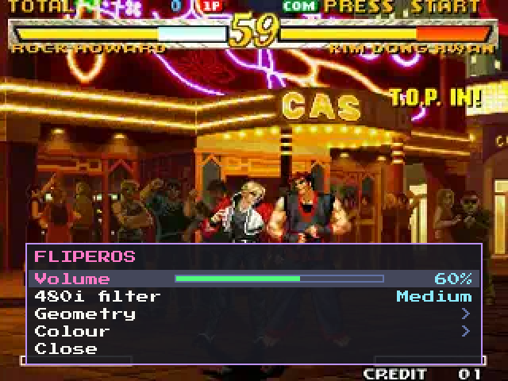
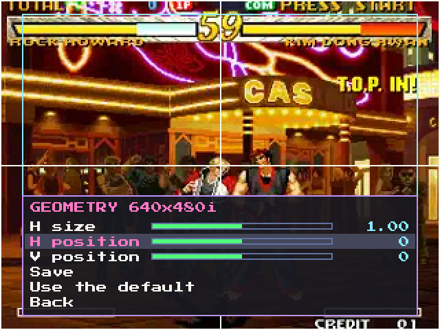
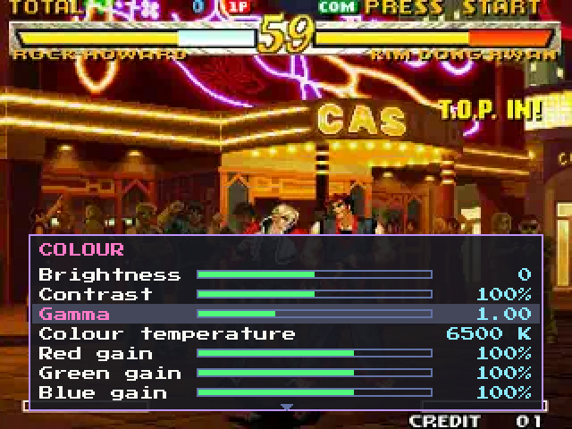

A menu over the running game or the frontend: the picture settings, saved per game if you want, the emulator's own menu and Quit. The game keeps running underneath.

## Opening it

- Hold **Start and Down** for a second, with the controls of the Button mapping.
- Or press **Pause** on a keyboard, or **Play/Pause** on a wireless remote.

The game stops seeing the controls until the menu closes. It closes by itself after 20 seconds without a press, or when the game closes.

The arrows move and change, button 1 opens and button 2 goes back, as in the Setup's menus.

Under the title, on every page, a small line shows the resolution, the two frequencies and the game's FPS, for example `640x480i 15.69kHz 60.00Hz  59.9 FPS`. It is read again every second, so a game that changes resolution shows it at once.

## The first page

| Item | What it does |
| --- | --- |
| **Configuration** | The picture settings below, and the profile they are saved to |
| **Emulator menu** | Closes this menu and opens the emulator's own: RetroArch's Quick Menu, MAME's, Flycast's, the PCSX2 and DuckStation pause menu, the Keisho overlay. Only in an emulator that has one |
| **Controller configuration** | In a custom game, in place of Emulator menu: which controller button sends which key, for PC games that only take the keyboard ([Custom games](Custom-games.md#the-controller-as-a-keyboard)). A custom game with no key map yet opens the menu by itself on this page |
| **Close** | Closes this menu, putting back what wasn't saved |
| **Quit** | Closes the game, like the frontend's Exit game shortcut |

Over a frontend there is no Emulator menu nor Quit.

## Configuration

| Item | When it shows | What it does |
| --- | --- | --- |
| **Save profile as** | Always | Where **Save** writes the changes (below) |
| **Delete profile** | Always | Erases the chosen profile |
| **Interlaced filter** | In an interlaced mode (480i, 448i, 576i…) | Off, light, medium or strong for this program; it counts on the next frame |
| **Scanlines** | With a 31 kHz monitor | Opens the Scanlines page |
| **Geometry** | Not on an LCD | Opens the Geometry page |
| **Colour** | Always | Opens the Colour page |
| **GunCon 2** | While a GunCon 2 is connected | Opens the GunCon 2 page |

**Save** and **Back** are at the bottom. Leaving without saving puts everything back.

### Profiles

**Save profile as** says how far the changes go:

| Profile | The changes count for |
| --- | --- |
| **Default** | Every game |
| **This resolution** | Every game in this mode, for example 640x480i |
| **This emulator** | Every game of this emulator |
| **This core** | Every game of this RetroArch core |
| **This game** | Only this game |

When a game opens, the most specific profile wins: the game over the core, the core over the emulator, the emulator over the resolution, and that over the default. The menu opens on the most specific profile that already has settings.

**Delete profile** erases the chosen one, and the game goes back to what the profiles below it say.

The volume is not in the profiles: it changes with the volume keys ([Power and volume buttons](Power-and-volume-buttons.md#volume-keys)) and in the [web panel](Web-panel.md).

### Geometry

Horizontal size (0.80 to 1.20), horizontal position and vertical position, with a frame and a cross over the picture. Each change is on the tube at once.

**Each resolution has its own geometry**, so the title says which one is being adjusted: `GEOMETRY 640x480i`, `GEOMETRY 320x240p`.

- **Save** keeps it for that resolution, in every game that uses it.
- **Use the default** takes the resolution back to the geometry of the others: the one from **Setup > Video Setup > Geometry**, or the monitor's preset.

Switchres stops at what the monitor accepts, and the value on screen goes back to that limit. When a game opens in a mode with a saved geometry, it goes on the tube within a second.

Another monitor type, or **Reset Geometry** in the Setup, erases every saved resolution.

### Colour

The fifteen settings of the colour calibration and the RGB range, live over the game, and **Back to the defaults**. What each one does: [Colour calibration](Picture-filters.md#colour-calibration).

### Scanlines

On or off, **Darkness**, **Thickness**, **Line height** and **Brightness boost**, live over the game, and the defaults. Only with a 31 kHz monitor. See [Scanlines](Picture-filters.md#scanlines).

### GunCon 2

The light gun's screen flash and its timing: **Screen flash**, flash brightness, flash wait, dark hold, edge band, off-screen reload and the defaults. Adjust them while you shoot at the game itself. See [Light guns](Light-guns.md).

## Bars that don't take the controls

Two bars show over the game for a few seconds, without opening the menu:

- **Volume**, for 2 seconds, when a volume key is pressed.
- **Achievements**, for 5 seconds, when you unlock a [RetroAchievements](RetroAchievements.md) achievement: the trophy with a ring that draws itself, the title (it scrolls when it doesn't fit) and a green line that empties.

Both follow the game's frame, so they fit any resolution and a vertical monitor. Below 200 pixels wide or tall, the achievements bar gets lower, with a smaller trophy.

## Where it opens

Only over programs drawn through FliperOS's OpenGL or Vulkan layer: the emulators, the frontends and Wine games (once Wine is installed from the Extras, which also builds the 32-bit layer). Nothing opens on the LXDE desktop, in the Setup or in Fightcade, and the controls stay with the program.

If the layer can't draw (a card below OpenGL 3), the controls come back at once.

## Settings in fliperos.conf

| Key | What it does |
| --- | --- |
| `osd=off` | Turns the menu and the bars off. Also in the web panel's Video settings; the menu stays closed in the frontend's commercial mode |
| `osd_combo=start+down` | The shortcut, with the controls of the Button mapping. `1:start+2:start` takes them from different players. The frontend changes it in **Frontend controls > OSD MENU** |
| `osd_hold=1.0` | How many seconds to hold it |
| `osd_key=119,164,201,207` | The keys, as evdev codes: Pause, and a remote's Play/Pause, Pause and Play. `0` is no key |
| `geometry_640x480i=1.050:3:-2` | The geometry of one resolution: H size, H position, V position |

## How it works

- `fliperos-osd` runs as a service. It reads the shortcut with `fliperos-buttons hotkey`, and grabs the controls (`EVIOCGRAB`) only after the shortcut is released, or the game would keep those buttons held.
- It writes a 320x240 picture to `/run/fliperos-osd/screen`, which exists only while something is on screen. The layers of the frame swap draw it before the flicker filter, so its letters don't flicker: `config/fliperos-deflicker.c` in OpenGL and `config/fliperos-vkfps.c` in Vulkan.
- Emulator menu presses the emulator's key on a virtual keyboard that the service creates when it starts, so every game's X server and SDL already know it.
- Settings go through the Setup's functions (`--setting`, `--volume`, `--geometry`), one at a time. Geometry uses Switchres's numbers (`switchres -c -g`): in a game on X it changes the mode through `xrandr`, because Xorg undoes a change made directly on the card; in KMS it uses `fliperos-color timing`.
- Profiles are in `/etc/fliperos/osd-profiles.conf`, one line per setting: `scope<TAB>key<TAB>value`, with the scopes `default`, `res:640x480i`, `emu:retroarch`, `core:fbneo` and `game:fbneo/NAME`.
- Achievements: `fliperos-cheevos watch` leaves one file per achievement in `/run/user/<uid>/fliperos-osd-achievements`. The service shows them in order; the volume bar pauses them and the menu puts them back in the queue. It takes only regular files owned by the user, and drops an achievement that waits more than a minute.
- To drive the menu without a controller, write `open`, `close`, `up`, `down`, `left`, `right`, `enter` or `esc` to `/run/fliperos-osd/control` as root.

See also: [Interlaced, colour and scanlines](Picture-filters.md), [Frontends](Frontends.md).
