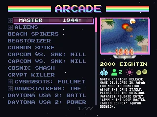
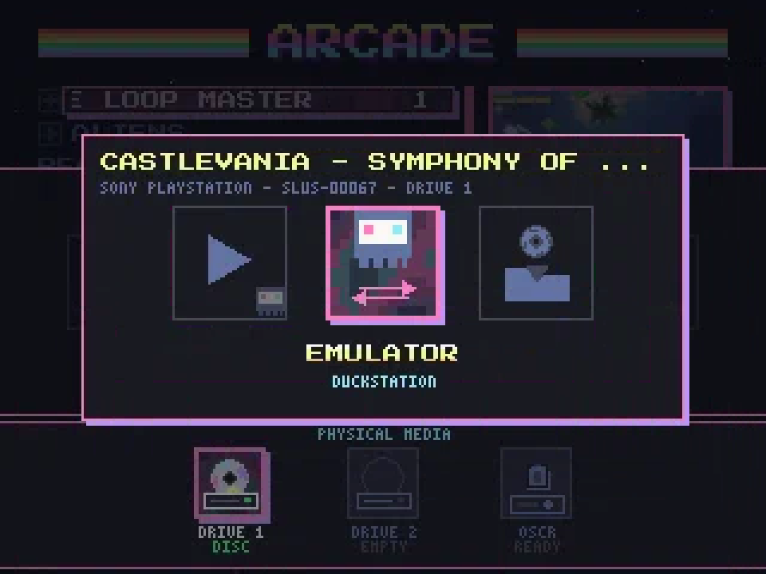
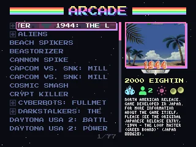
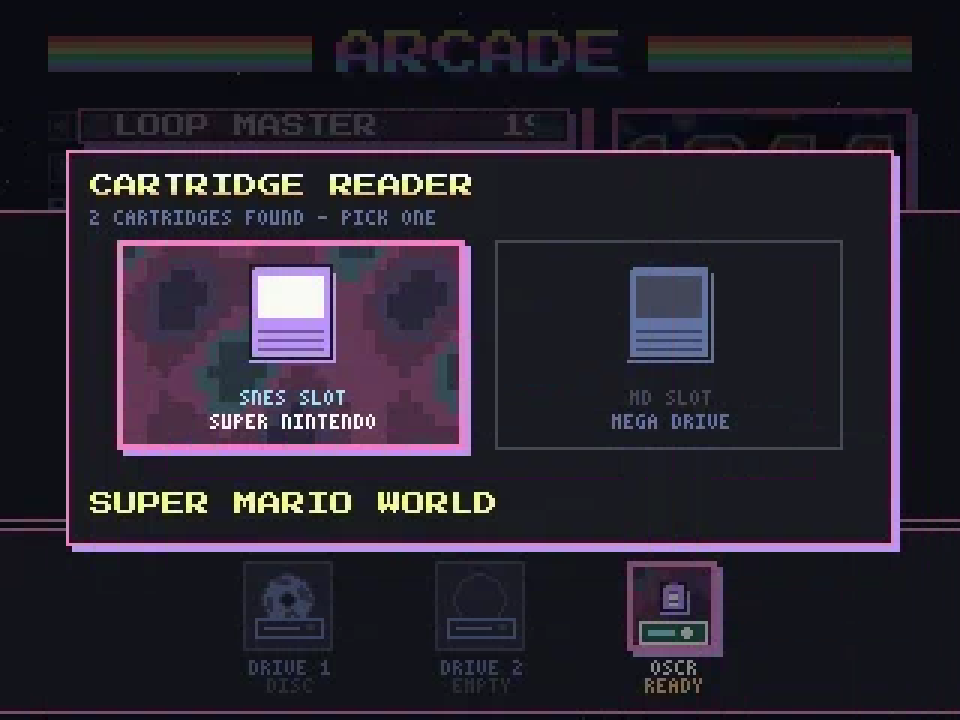
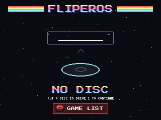
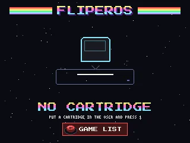

Play your own discs and cartridges: a CD or DVD drive and the [Open Source Cartridge Reader](https://github.com/sanni/cartreader) (OSCR) show up in the [FliperOS frontend](FliperOS-frontend.md). A game opens straight from the disc, or is copied into its folder. The cabinet can also boot straight into the disc.

## The physical media row

With a drive or the reader connected (USB drives too), the system strip shows a pink arrow pointing down. **Down** goes to the **PHYSICAL MEDIA** row under the strip:

- one tile per drive, saying whether it has a disc: **DISC**, **EMPTY** or **OPEN**;
- an **OSCR** tile when the cartridge reader is plugged in.

Left and right move between them, up goes back to the systems, and button 2 closes the strip.

## Discs

**Button 1** on a drive reads the disc. **READING** stays on screen while the disc spins, and the frontend finds the console from the disc itself.

| Console | Plays from the disc |
| --- | --- |
| PlayStation | DuckStation, or RetroArch (Beetle PSX HW, Beetle PSX, PCSX ReARMed) |
| PlayStation 2 | PCSX2 |
| Saturn | RetroArch (Beetle Saturn) |
| Sega CD | RetroArch (Genesis Plus GX) |
| PC Engine CD | RetroArch (Beetle PCE Fast, Beetle PCE) |
| PC-FX | RetroArch (Beetle PC-FX) |
| 3DO | RetroArch (Opera) |
| Neo Geo CD | RetroArch (NeoCD) |

Dreamcast and GameCube discs are left out: a PC drive can't read a GD-ROM or a GameCube disc.

The disc's card has three tiles:

| Tile | What it does |
| --- | --- |
| **PLAY** | Opens the game straight from the drive with the console's emulator. A RetroArch core that isn't installed yet is downloaded first. When the game closes, the card comes back |
| **EMULATOR** | Picks the emulator: the standalone ones that are installed, and **RETROARCH**, which lists the console's cores that read a disc. The choice is kept for each console |
| **RIP TO FOLDER** | Copies the disc into the chosen emulator's folder, so the game shows up in its list. A CD becomes one `.chd` (audio tracks too), a DVD an `.iso`, named after the game's title and serial. Button 2 cancels and removes the partial files |

## Cartridges (OSCR)

The OSCR HW5 shows up in the same row as soon as its USB cable is in. It needs **FliperOS's firmware** first: **Setup > System > Cartridge reader (OSCR)** installs it (below).

**Button 1** on the OSCR tile: **LOOKING AT EACH SLOT**. One cartridge goes straight to its card; two or more show a choice, one tile per slot with the system and the game's name.

If no cartridge answers, the screen asks **WHICH SYSTEM?**: Super Nintendo, Mega Drive, Nintendo 64, Game Boy or Game Boy Advance. The reader then sets that system's voltage, as its own menu does.

The cartridge's card works like a disc's:

| Tile | What it does |
| --- | --- |
| **PLAY** | Reads the cartridge into a temporary copy, with a progress bar, and opens it in the RetroArch core. The reader can't serve the game live |
| **EMULATOR** | The console's cores: Snes9x, bsnes, Mesen-S; Genesis Plus GX, PicoDrive; Mupen64Plus-Next, ParaLLEl N64; Gambatte, SameBoy, mGBA; mGBA, VBA Next |
| **RIP TO FOLDER** | Saves the ROM in the core's folder with the game's name, and the save next to it as `.srm` |

The scan never raises the voltage to 5V, so a 3.3V cartridge in an adapter is never put at risk; a 5V cartridge that doesn't answer at 3.3V is left out of the scan, and picked by WHICH SYSTEM?.

### Installing the firmware

The stock OSCR writes its dumps to its own SD card, and its USB only serves the firmware tool. FliperOS's firmware adds commands on that USB line, so the frontend can ask for the cartridges.

1. Plug the reader in and open **Setup > System > Cartridge reader (OSCR) > Install the FliperOS firmware**.
2. Pick the board: **HW5 with the voltage switch** or **HW5 with the VSELECT module**.
3. Remove any cartridge, set the switch to 5V (as the OSCR Tool asks) and keep the cable in.
4. It saves the firmware the reader has into `~/oscr/oscr-backup-DATE.hex`, writes the FliperOS one and checks that the reader answers.

**Restore the backup** writes the old firmware back.

## Boot from media

**Setup > Games > Frontend > Boot from media** makes the cabinet start on a drive or the cartridge reader, like a console:

 

- **A drive:** with no disc, the screen shows the drive and a disc floating below the slot, with **NO DISC**. When a disc goes in, it slides into the slot, the slot turns green and the disc is read. The card then waits for PLAY.
- **The cartridge reader:** the screen shows the reader with a cartridge floating over the slot and **NO CARTRIDGE**. The reader can't tell when a cartridge goes in, so button 1 says it is there.

Button 2 leaves for the game list, also from the card. A disc that can't be played (unknown, Dreamcast) shows **UNKNOWN DISC** until it comes out.

## How it works

- `fliperos-setup/gui/femedia.py` reads each disc: PlayStation and PlayStation 2 from `SYSTEM.CNF` (`BOOT` or `BOOT2`) and the serial; Saturn, Sega CD, PC-FX and 3DO from their header in the first sector; PC Engine CD from the second sector of the data track; Neo Geo CD from `IPL.TXT`.
- PLAY: DuckStation opens `/dev/srN`, PCSX2 `-disc /dev/srN`, RetroArch `cdrom://driveN.cue` (N is the drive's `/dev/sgN`); only cores built with physical CD support can do it. The emulator choice is `media_emulators` in `~/.config/fliperos/frontend.json`.
- RIP: a CD is read raw by `cdrdao` and joined into a `.chd` by `chdman` (without `chdman` the `.bin`/`.cue` stay). The folder is the emulator's (`~/roms/ps1`, or `~/roms/retroarch/<core>`); the log is `~/.cache/fliperos/rip.log`.
- The drives belong to the `cdrom` group, which the cabinet's user is in.
- The OSCR is seen through its USB serial converter (the HW5's CH340, or an Arduino Mega). FliperOS's firmware (`patches/oscr`) adds `SCAN` (the header of the cartridge in each slot), `INFO` (one system's cartridge), `DUMP` (the ROM and save to the SD card, as the OSCR's own menu does) and `GET` (a file at 1 Mbaud with a CRC32 that FliperOS checks). While a command runs, the OSCR's menus don't wait for its button. The PLAY copy goes to `~/.cache/fliperos/oscr`.
- The firmware: the two `.hex` files come with the image and the updates (`config/oscr`, installed in `/usr/local/share/fliperos/oscr`), built by `tools/oscr-firmware.sh` (arduino-cli in Docker, sanni/cartreader at `060d8ae` plus `patches/oscr`). They are written with `avrdude` through the Mega's bootloader (`lib/oscr.sh`).
- Boot from media is the `physical` launcher: the frontend starts with `--media` on the chosen drive (`boot_media` in `fliperos.conf`).

See also: [FliperOS frontend](FliperOS-frontend.md), [DIY hardware](DIY-hardware.md#cartridge-reader-open-source-cartridge-reader).
