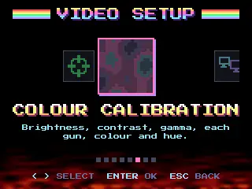

Three things in **Setup > Video Setup** shape the picture of every game: how games taller than 240 lines are shown, the colour, and the scanlines of a 31 kHz monitor. All three also change over a running game, in the [on-screen menu](On-screen-menu.md), and in the web panel's settings.

## 640x240 or interlaced

A 15 kHz tube shows 240 lines progressive, or 480 lines interlaced. Many games are taller than 240 lines: PlayStation 2, Dreamcast, GameCube, Model 3, some arcade boards. Each program can show them in one of three ways:

| Way | What you see |
| --- | --- |
| **640x240** | Progressive, half the lines. No flicker |
| **Interlaced filter** | All the lines, interlaced, with the flicker filter at that program's level |
| **Interlaced pure** | All the lines, interlaced, without the filter. Sharpest, with the flicker |

How 640x240 works for programs that ask for a bigger window: [Emulators](KMS-and-X11.md#running-a-program-at-640x240).

### Interlaced hacks

**Setup > Video Setup > Interlaced hacks** is a table with one row per program and the three ways as columns, one mark per row.

| Row | Default |
| --- | --- |
| Flycast, PCSX2, DuckStation, Dolphin, Hypseus Singe | 640x240 |
| Supermodel, SM2-Emu (384 lines) | 640x240 |
| GroovyMAME | Interlaced filter |
| RetroArch PS1, SNES, Mega Drive, FBNeo | Interlaced filter |
| RetroArch MAME 2010 | 640x240 |
| Fightcade Flycast | 640x240 |
| Desktop | Interlaced filter |
| Other programs (custom games and anything else in an interlaced mode) | Interlaced filter |

The default of each row is what that program already did. Changes are saved as you make them, with no Save step, and count from the next game.

Marking **Interlaced filter** on a row asks for that program's level and offers **Preview on the screen**: a test screen at 640x480i made to flicker, with one-pixel stripes, a checkerboard, small text, a grid and a scrolling marquee. The arrows change the level while you look at the tube, and Enter keeps it.

To choose another level for a row already on the filter, mark pure and then the filter again.

### The flicker filter

In an interlaced mode, a line one pixel tall exists in only one of the two fields, so it is drawn 30 times a second and flickers. The filter blends each line with its neighbour before the frame goes out, so every detail is in both fields: the flicker goes away and the picture gets a little softer.

| Level | What it does |
| --- | --- |
| **Light** | 15/70/15: keeps more detail |
| **Medium** (default) | Each line averaged with the next one, like RePlayOS's "Interlaced Flicker Reduction" |
| **Strong** | A third each from the line above, the line and the line below: hides the most |
| **Off** | Sharp, with the flicker |

It works in any interlaced mode, whatever its size (480i, 448i, 576i, the 496-line one Switchres makes for Model 3), and does nothing in a progressive one. It works below the emulators, so none of them needs a shader of its own: OpenGL and Vulkan games, Wine games, the frontends, the Setup's menu and the desktop all get it.

## Colour calibration

**Setup > Video Setup > Colour calibration** sets the picture's colour: everything the card can do, plus saturation and hue by software when the card can't.

| Setting | Range |
| --- | --- |
| Brightness | −50 to +50 |
| Contrast | 50 to 150 % |
| Gamma | 0.50 to 2.00 |
| Colour temperature | 4000 to 10000 K (6500 neutral, 9300 the bluish white of many arcade monitors) |
| Red / green / blue gain (drive) | 0 to 150 % |
| Red / green / blue black level (cutoff) | −50 to +50 |
| Red / green / blue gamma | 0.50 to 2.00 |
| Saturation | 0 to 200 % |
| Hue | −180 to +180° |
| RGB range | Card default, full (0-255) or limited (16-235, for a TV that expects it); only on cards that have it |

The screen has three items:

- **Calibrate on the screen** opens test patterns on the tube: colour bars, 16 grey steps over a ramp, black level bars (1, 2, 4 and 8 %) for brightness, white level boxes (90, 95 and 98 %) for contrast, red, green, blue and grey ramps, and the 24 ColorChecker patches. Up and down pick a setting, left and right change it, Space hides the bar, Enter keeps the settings and Esc goes back to the previous ones.
- **Settings in numbers** changes each setting by its number. It works over SSH too.
- **Back to the defaults** clears them all, the RGB range included: the picture exactly as the card sends it.

A change counts everywhere at once, even in a game that is open.

## Scanlines

Only with a 31 kHz monitor (**Setup > Video Setup > Scanlines**). A 31 kHz tube shows a 240-line game with every line doubled, so it has none of the dark gaps between lines of a 15 kHz tube. Turned on, the last screen line of each game line gets darker, in every OpenGL and Vulkan game.

| Setting | Range (default) | What it does |
| --- | --- | --- |
| Darkness | 5 to 100 % (50) | How dark the gaps are |
| Thickness | 10 to 90 % (50) | How much of each game line is dark; counts only with 3 or more screen lines per game line |
| Line height | Automatic, or 2 to 8 | Screen lines per game line. Automatic goes by the picture's height: 2 at 480 lines, none at 240 |
| Brightness boost | 100 to 200 % (115) | Makes up for the light the gaps take away |

**Adjust on the screen** opens a game-like test picture (320x240 doubled) in the monitor's mode. Up and down pick a setting, left and right change it, Space turns the scanlines off and on to compare, Enter keeps the settings and turns them on, and Esc leaves them as they were. **Settings in numbers** works over SSH too.

A change counts at once, even with a game open. The scanlines turn off by themselves if the monitor type changes to 15 kHz. A native 480-line game (PS2, Dreamcast in VGA mode) also gets them, since only the screen's height counts. The desktop and Fightcade have none.

## How it works

### 640x240 and interlaced

The choices are saved in `fliperos.conf`:

- `mode480_PROGRAM=240p|filter|pure`, which `fliperos-x11-run` and `fliperos-fightcade` read;
- `deflicker_PROGRAM=light|medium|strong|off`, which the filter reads;
- `deflicker=` for the Other programs row.

PROGRAM is the command name in `emulator-modes.conf`, or the RetroArch core without `_libretro.so`.

| Row | 640x240 is | Interlaced is |
| --- | --- | --- |
| Flycast, PCSX2, DuckStation, Dolphin, Hypseus | the 640x240 line of `emulator-modes.conf` | its 640x480 line, which Switchres makes interlaced |
| Supermodel, SM2-Emu | 640x240 at 57.524 Hz | 496x384 at 57.524 Hz, interlaced |
| GroovyMAME | `interlace 0` in `mame.ini` | `interlace 1`: each game's own interlaced mode |
| RetroArch cores | `interlace 0` in the core's `switchres.ini` | `interlace 1` |
| Desktop, Fightcade | — | picom, with or without the filter |

The core files are `~/.config/retroarch/config/<Core>/<Core>.switchres.ini`, written without the `# FliperOS` header so updates leave them alone.

### The filter

The level comes from the first of these that is set:

1. a file named by `FLIPEROS_DEFLICKER_FILE`, re-read every 30 frames (the preview);
2. `FLIPEROS_DEFLICKER`;
3. the open RetroArch core: `deflicker_pcsx_rearmed=` (the loaded libraries are listed every 30 frames; `dlopen` is not wrapped);
4. the program: `deflicker_flycast=`, from `FLIPEROS_DEFLICKER_APP` or the process name;
5. `deflicker=`.

- **OpenGL:** `libfliperos-deflicker.so` (`config/fliperos-deflicker.c`, in `/usr/local/lib/fliperos`) is loaded through `LD_PRELOAD` by `fliperos-kms-run` and `fliperos-x11-client`, never into Xorg or Switchres. It catches the frame swap (`glXSwapBuffers`, `eglSwapBuffers`, also through `dlsym` and `GetProcAddress`), copies the frame, draws it back through a three-tap vertical filter and restores the GL state. Every 30 frames it checks the CRTC mode of every card (`/dev/dri/card0` to `card7`): in a progressive mode it does nothing.
- **Vulkan** (PCSX2, Dolphin, DuckStation and Flycast on amdgpu): the implicit layer `config/fliperos-vkfps.c`, on with `FLIPEROS_VK_FPS=1`, does the same before each present. It allocates nothing until the first filtered frame. Tested on lavapipe with the Khronos validation layers (`tools/vkfps-test.sh`) and on the R7 240 with RADV.
- **Desktop:** LXDE draws without OpenGL, so it gets the same weights from **picom** with a window shader (`config/fliperos-desktop-deflicker --watch`, at `deflicker_desktop=`). It checks the mode every 2 seconds and runs only while the screen is interlaced. Ubuntu's own picom autostart is hidden by a `picom.desktop` with `Hidden=true` in `/etc/fliperos/xdg`.
- **Wine:** most Windows programs are 32-bit. Installing Wine from the Extras also builds both layers for 32 bits (`/usr/local/lib/fliperos/i386/`), and `fliperos-x11-client` puts both in `LD_PRELOAD` for a `wine` or `.exe` command; the loader skips the one of the wrong kind. Programs that still can't take a layer (the Fightcade lobby, which is Electron, or Wine without the 32-bit layer) get picom over their whole Xorg, without the on-screen menu.

For testing: `FLIPEROS_DEFLICKER=off|light|medium|strong` overrides the level, `FLIPEROS_DEFLICKER_FORCE=1` filters in any mode, `FLIPEROS_DEFLICKER_DEBUG=1` prints what it picked, and `tools/deflicker-test.sh` checks the result on a software Xvfb.

### Colour

The settings are `color_NAME=` in `fliperos.conf`.

| Setting | How it is done |
| --- | --- |
| Brightness, contrast, gamma, temperature, each gun | The card's gamma table (LUT); the temperature gives red, green and blue gains from the black-body white |
| Saturation, hue | The card's colour matrix (CTM); without one (`color_ctm=sw`), by software in the layers above, and through picom on the desktop |
| RGB range | The connector's `output_csc` (radeon) or `Broadcast RGB` (Intel) |

`config/fliperos-color.c` (`/usr/local/bin/fliperos-color`) applies them: `caps` says what the card has, `apply` writes the LUT, CTM and range through DRM, `x11` writes the LUT to every CRTC in X, `lut N` prints the table.

They are applied at boot as the splash leaves, before each program in `fliperos-kms-run` and `fliperos-x11-run`, in X (`fliperos-x11-client`, `fliperos-lxde`), and when saved. A change with a game open goes through the screen owner's own descriptor: `fliperos-color`, as root, takes a copy of it with `pidfd_getfd`, since a card refuses the table from anyone but the program that owns the screen.

The Radeon R7 240 has only the 256-point LUT and no CTM, on radeon and amdgpu, so it uses software saturation and hue.

### Scanlines

`scanlines=on` and `scanlines_NAME=` in `fliperos.conf`. The layers read them only with `frequency=31k`, and draw them in the same pass as the flicker filter.

See also: [Video Setup](Setup-Video.md), [On-screen menu](On-screen-menu.md), [Emulators](Emulators.md).
