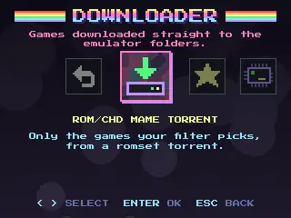

Have a full MAME romset? **Setup > Games > Cleaner** keeps only the games that work and suit your cabinet (horizontal or vertical, the controls you have, how many players) and copies them into the right emulator's folder, with everything they need. The **CHD Cleaner** then brings the disks of the games that stayed.

It works like [ROMLister](https://www.waste.org/~winkles/ROMLister/). The web panel has the same filter, easier with a mouse: [Web panel: Library](Web-panel-Library.md#rom-filter).

## MAME ROM Cleaner

### 1. Where the romset is

- **A folder on this machine:** a disk or a USB stick, in the folder browser (Enter opens, `..` goes back, **Use this folder** chooses).
- **A network shared folder:** Windows or a NAS. The Setup asks for the computer, the user and the password, and lists its shared folders. The password is only kept if you ask.

That way the whole romset stays on the home computer, and the cabinet takes only what it uses.

### 2. For which emulator

| Emulator | Takes from the romset | Goes to |
| --- | --- | --- |
| **GroovyMAME** | Every game | `~/roms/mame`; BIOS and devices to `~/bios/mame`, so they don't show as games |
| **Flycast** | Only Naomi, Naomi 2 and Atomiswave, each in its folder | `~/roms/naomi`, `naomi2`, `atomiswave`; BIOS to `~/bios/dc` |
| **Keisho** | Only Sega Model 2 (Model 2/2A/2B/2C) | `~/roms/model2`, with the I/O boards Daytona USA, Desert Tank and Virtua Cop need |
| **Keisho (Model 3)** | Only Sega Model 3 | `~/roms/model3` |
| **MAME 2010** (MAME 3D) | MAME 0.139, the version of RetroArch's `mame2010` core, which runs the PlayStation-based arcade games well (Tekken 3, Soul Calibur, Street Fighter EX) | `~/roms/retroarch/mame2010`, games and BIOS |
| **Another version** | An XML from `mame -listxml` | The folder you pick |

A folder with `model2`, `model3`, `supermodel`, `keisho`, `2010` or `MAME 3D` in its name already suggests its emulator.

### 3. The filter

The parameters screen shows each parameter with its current choice. Enter opens its options: pick one, or check several (Space or button 3 toggles, `a` checks all, Enter confirms).

| Parameter | What it filters |
| --- | --- |
| **Games** | Coin-op machines only, or everything |
| **Emulation** | Working, with imperfect, or everything |
| **Categories** | The genres of `catver.ini`, with how many sets each has. Slot machines, pinball, computers, consoles and Mahjong start unchecked |
| **Adult games** | `* Mature *` in `catver.ini` |
| **Players** | How many |
| **Play mode** | Single player, alternating, simultaneous (from `nplayers.ini`) |
| **Buttons** | How many the game really uses (Metal Slug has 4 in MAME and uses 3) |
| **Panel controls** | 8, 4 and 2-way joystick, two joysticks per player, trackball, spinner, paddle, rotary, analog, pedals, light gun, keyboard, mahjong. A buttons-only game always passes |
| **Screen** | Horizontal or vertical; the presets start with your monitor's orientation |
| **Resolution** | Low (up to 288 lines, the only progressive one on a 15 kHz tube), medium, high |
| **Clones** | The best version of each game, parents only, or all |
| **Region** | The preferred one |
| **Bootlegs**, **prototypes** | In or out |
| **Decades** | Which ones |
| **Vector games** | In or out |
| **CHD** | Keep, remove, or only games with a disk |
| **Board** | Neo-Geo, CPS-1, CPS-2, CPS-3, the PlayStation-based ones (ZN-1/ZN-2, Namco System 10/11/12, Konami GV/GQ/573/Twinkle, Taito G-NET), the Midway Mortal Kombat boards, Sega Model 2, Model 3, Naomi, Naomi 2, Atomiswave |

With no board checked, every board goes, except Naomi, Naomi 2 and Atomiswave, which run better in Flycast and only go to GroovyMAME when checked.

**Presets:**

| Preset | What it keeps |
| --- | --- |
| **Joystick cabinet** | Arcade only, up to 2 players and 6 buttons, joysticks, one version of each game, no bootlegs, prototypes or adult games |
| **Everything that works** | Every working game |
| **PlayStation-based hardware** | The MAME 3D games (the default for MAME 2010) |
| **Everything** | The whole set |

### 4. Copy or move

Before touching anything you get the summary: how many games go and their size, the free space, how many aren't in the XML, which are left alone, and the list.

- **Copy** shows its progress. Repeating it resumes where it stopped: what is already at the destination with the same size stays.
- **Move** (only from a folder that can be written) takes the files out of the romset, then asks whether to delete what's left.

What the chosen games use goes along: the parent (in a merged romset the clone is inside its zip), the BIOS and the devices with ROMs, also those of games already at the destination.

## MAME CHD Cleaner

CHDs (the hard disks and CDs of some arcade games) usually come in a separate, huge collection. The CHD Cleaner looks at the games **already in the emulator's folder**, checks which ones use a disk, and copies only theirs from the CHD folder (on this machine or the network) into `<folder>/<game>/<disk>.chd`, where MAME and Flycast look for them.

The screen shows how many games use CHDs, how many folders were found and their size, the free space and the list of what **wasn't found**. You can include the clones inside the zips (a merged romset) and change the ROM folder. The copy resumes where it stopped; from a writable folder you can also move.

## How it works

- It joins the XML of the romset's MAME version with `catver.ini` (categories and adult games), `nplayers.ini` (how two people play) and Controls.dat's `controls.xml` (the buttons and controls the game really uses). For Naomi, Naomi 2 and Atomiswave the controls and buttons come from Flycast's own game table: MAME's XML gives nearly all of them a generic 8-way joystick and 6 buttons, wheel and gun games included.
- **The data files ship in the image**, in `/usr/local/share/fliperos/romclean` (`config/romclean`): `catver.ini` 0.289 from [progetto-SNAPS](https://www.progettosnaps.net/catver/), `nplayers.ini` 0.278 from [NPlayers](http://nplayers.arcadebelgium.be) (CC BY-SA 3.0) and `controls.xml` 0.141.1 from Controls.dat. To use newer ones, put them **with the romset**: the Setup looks first in its folder, the one above and the `folders` subfolder, and only then in the system folder. The screen says which ones it found (*Data files*); without one, its parameters don't show.
- The XML: GroovyMAME's is `groovymame -listxml`; MAME 2010's ships at `/usr/local/share/fliperos/mame2010.xml.xz`, pinned by commit and checksum. What was read stays in `/var/cache/fliperos` (a minute with GroovyMAME's, a second after).
- A set's system (Flycast) is that of the first BIOS in its `romof` chain. MAME's emulation status doesn't filter Flycast and Keisho. Resolution comes from the XML's `pixclock`/`htotal`, or from the lines. Controls cover both the 0.139 types (`joy8way`, `vjoy2way`, `doublejoy8way`) and the current ones (`joy`, `doublejoy` with `ways`).
- Copying: each file arrives as `.part` and only then gets its name, and what arrives belongs to the owner of the emulator's folder. Moving: Flycast's sets never enter the delete list, so the same romset can be cleaned for Flycast afterwards, except in a MAME 2010 romset, which Flycast can't read.
- The network folder is mounted read-only at `/mnt/network` with `cifs-utils`; the password goes in a file only root can read, never on the command line, and is kept in `/etc/fliperos/netshare.cred` only if you ask (`lib/netshare.sh`).
- CHD Cleaner: a clone's disk that is the same as the parent's comes from the parent's folder; a disk without a dump doesn't count.
- Programs: `config/fliperos-romclean` (`scan`, `chds`, `apply`, `options`, `romlist`, `uses`, `buttons`) and `lib/romclean.sh`.

See also: [Downloader](Downloader.md), [ROMs, BIOS and artwork](ROMs.md).
