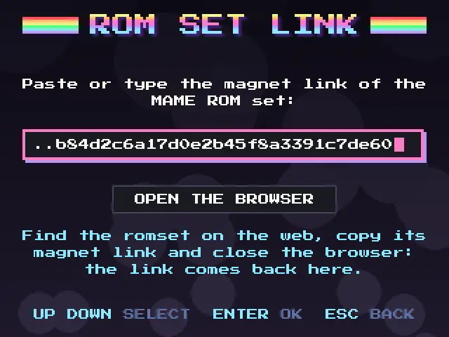

Where your games, BIOS, art, memory and saves live on the cabinet, and how to put them there.

| Page | What it covers |
| --- | --- |
| [Downloader](Downloader.md) | MAME ROM and CHD sets by torrent, only the games your filter picks, and the free homebrew games |
| [BIOS](BIOS.md) | Download BIOS: the BIOS your games lack, found and downloaded by themselves |
| [ROM Cleaner](ROM-Cleaner.md) | The MAME ROM Cleaner and the CHD Cleaner: only the games that suit your cabinet, from a full romset |
| [Scraper](Scraper.md) | Covers, screenshots, logos, videos and descriptions of the games |
| [Adding games](Adding-games.md) | Step by step: copy the games, make the frontends see them, names and art |
| [Custom games](Custom-games.md) | PC games and programs that are not a ROM, packages, PortProton |

## The folders in `~`

Everything is in the home folder, `/home/fliperos`, and each folder is also a network share (`\\fliperos\roms` and so on):

| Folder | What it holds |
| --- | --- |
| `~/roms` | The games, one folder per emulator and per RetroArch core |
| `~/bios` | The BIOS and firmware |
| `~/media` | The art and text the frontends show |
| `~/nvram` | What arcade games remember without power: settings, credits, scores, unlocks |
| `~/save` | What you save while playing: saves, save states, memory cards |
| `~/config` | Links to each emulator's and frontend's settings |
| `~/splashscreen` | The boot screen themes |

Each folder has an `_info.txt` that says what goes in it. Missing folders are created at every login, so a new RetroArch core from its Online Updater gets its folder.

### `~/roms`

One folder per emulator, and one per **RetroArch core** in `~/roms/retroarch/<core>` (every core RetroArch knows, about 330), each with an `_info.txt` naming the system and the extensions.

| Folder | What goes in it | Opens in |
| --- | --- | --- |
| `mame` | MAME sets (`.zip`, `.7z`) and their CHD folders | GroovyMAME |
| `naomi`, `naomi2`, `atomiswave` | MAME sets of these systems, one system per folder | Flycast |
| `model2` | MAME sets of Model 2 | Keisho |
| `model3` | MAME sets of Model 3 | Supermodel |
| `dreamcast` | `.gdi`, `.cdi`, `.chd` | Flycast |
| `ps1` | `.cue`, `.chd`, `.pbp`, `.m3u` (they open once DuckStation is installed) | DuckStation |
| `ps2` | `.iso`, `.chd`, `.cso` | PCSX2 |
| `namco2x6` | Namco System 246/256 games | PCSX2x6 ([Emulators](Namco-246-256.md)) |
| `dolphin` | GameCube and Wii (`.iso`, `.rvz`, `.wbfs`) | Dolphin |
| `openbor/Paks` | OpenBOR games (`.pak`) | OpenBOR |
| `hypseus` | Laserdisc games | Hypseus Singe |
| `custom` | The groups of [Custom games](Custom-games.md), one folder each (made by the Setup) | Its own program |
| `custom-packages` | Custom game packages to install (`.fliperos-customgame.zip`, [Custom games](Custom-games.md)) | Install games |
| `retroarch/<core>` | What that core opens (its `_info.txt` lists the extensions) | RetroArch |

MAME sets stay zipped and are never renamed: frontends and MAME find a game by its set name (`sf2ce.zip`).

### `~/bios`

RetroArch's *system* folder: the loose files in it and the subfolders the cores look for. FliperOS ships no BIOS, but you don't have to look for them: [Download BIOS](BIOS.md) brings the ones your games need.

| Subfolder | For |
| --- | --- |
| `~/bios` itself | The RetroArch cores (`scph5501.bin`…) |
| `~/bios/dc` | Flycast and its core: `dc_boot.bin`, `dc_flash.bin`, `naomi.zip`, `awbios.zip`… |
| `~/bios/ps2` | PCSX2 |
| `~/bios/mame` | GroovyMAME's BIOS and devices: `neogeo.zip`, `qsound.zip`… (they also work from `~/roms/mame`) |

A BIOS left in a games folder shows up as a game in the frontend, so keep them here.

### `~/media`

The frontends' art and text: one folder per type and, inside each, the same folders as `~/roms` (`mame`, `model2`, `naomi`, `ps2`, `retroarch/snes9x`…). The file is named after the ROM: the screenshot of `~/roms/mame/sf2.zip` is `~/media/snap/mame/sf2.png`.

| Folder | What it holds |
| --- | --- |
| `snap` | Screenshots (`.png`) |
| `preview` | Videos (`.mp4`) |
| `logo` | Logos, wheel art |
| `box` | Covers and flyers |
| `marquee` | Cabinet marquees |
| `texto` | Each game's description (`.txt`) |
| `dmd` | Art made for a 128x32 LED display ([LED displays](LED-displays.md#art-for-the-display)) |
| `info` | Game information saved by the scrape and the web panel (Arcade Database answers, your CLASSIFY choices) |

The [Scraper](Scraper.md) fills these folders, and the frontends read from them; art you place by hand with the ROM name shows too. Each games folder has its own art folder, so two folders with the same game can each have their own video, and each art folder can be on another disk (**Folders**, below).

### `~/nvram`

What the arcade games remember without power: dip settings, credits, the scores a game saves, what it has unlocked. One folder per emulator:

| Folder | What it holds |
| --- | --- |
| `mame` | GroovyMAME, one folder per set. To start a game from zero, delete its folder |
| `flycast` | Naomi and Atomiswave memory of each game, and the Dreamcast memory cards |
| `model2` | Keisho, with its save states in `states` |
| `model3` | Supermodel |
| `hypseus` | Hypseus Singe |
| `fightcade/flycast` | Fightcade 2's Flycast, separate from the system's ([Fightcade 2](Fightcade-2.md)) |
| `retroarch/<core>` | `mame2010`, `fbneo`, and the other MAME-family cores after their first game |

**Unlocked arcade memory.** FliperOS comes with the memory of several games with their hidden content already unlocked:

- in GroovyMAME: Tekken 3, Tekken Tag, Soul Edge, Dead or Alive++, Street Fighter EX and EX2, Rival Schools, Star Gladiator 2, Tech Romancer, Ultimate MK3 and MK II;
- in Flycast: the Naomi and Atomiswave games Fightcade 2 brings (KOF XI, Marvel vs. Capcom 2, Power Stone 2, NeoGeo Battle Coliseum…), plus Cannon Spike and Faster than Speed.

Each one is copied only once, and only if the game has no memory of its own yet: what you have played stays, and a game you reset by deleting its folder does not come back. To use an unlock file of your own, close the game and put it in the emulator's folder with the name that emulator writes: `~/nvram/mame/tekken3/at28c16`, `~/nvram/flycast/kofxi.zip.nvmem`.

### `~/save`

What you save while playing, one folder per emulator: `retroarch` (game saves, `.srm`, and save states), `mame` (save states) and `ps2` (PCSX2's memory cards). The [cloud backup](Cloud-backup.md) can keep it in your cloud.

### `~/config`

Links to the configuration of each installed emulator and frontend: `retroarch`, `groovymame` (`mame.ini` and `ui.ini`), `flycast`, `pcsx2`, `dolphin`, `supermodel`, `openbor`, `hypseus`, `model2`, `attractmode`, `es-de`, `pegasus` and `skyscraper`. Each link appears once the program has created its configuration, usually after it was opened once.

### `~/splashscreen`

The boot splash themes, one folder per theme with its `.plymouth` file. The bundled ones are copied there and follow new versions while you leave them untouched; to change one, copy its folder with a new name. See [System Setup](Setup-System.md#splash-screen).

## Custom folders

**Setup > Games > Folders** shows the whole structure: the folders above and, inside them, each emulator's, each RetroArch core's, each Fightcade emulator's, each BIOS subfolder and each type of art.

Any of them can have its own **custom folder**: another folder used in its place, for when the ROMs, the art or the BIOS are on another disk (a USB disk, a second drive, mounted by themselves in `/media/fliperos/<label>`). So the MAME 2010 sets can be on one disk and the Model 2 videos on another.

- **Link this to another folder:** the folder becomes a link to the chosen one, and the folder used until then is renamed next to it with `old-` in the name (`~/roms/old-mame`), with everything in it. Nothing is copied or deleted.
- **Change the custom folder** swaps the link of a folder that already has one.
- **Unlink the custom folder:** the link goes away and the `old-` folder gets its name back. Nothing is deleted from the custom folder.

Each line says whether the folder has a custom folder, or how many folders inside it have one. Everything that looks in the folder (emulators, frontends, the Scraper, the network shares) goes through the link. A disk that isn't connected shows as *not found*, and that folder is left alone.

## Free games

**Setup > Games > Downloader > Free games** brings open-source homebrew, so the frontends don't start empty and you can test video, sound and controls: see [Downloader](Downloader.md#free-games).

## How it works

- `config/fliperos-roms` runs at every login and creates what is missing, only what is missing. `/opt/fliperos/roms` and `/opt/fliperos/bios` are links to `~/roms` and `~/bios`, so old paths still work.
- RetroArch opens its file browser in `~/roms`; GroovyMAME looks in `~/roms/mame` (with `~/bios/mame` in its `rompath`), Flycast in `~/roms/dreamcast`, `naomi`, `naomi2` and `atomiswave` (`Dreamcast.ContentPath`), PCSX2 in `~/roms/ps2`.
- BIOS paths: `~/bios` is RetroArch's `system_directory`; `Dreamcast.BiosPath` in Flycast's `emu.cfg` and `FLYCAST_BIOS_PATH` in `fliperos-x11-run` point to `~/bios/dc`; PCSX2's own `~/.config/PCSX2/bios` is a link to `~/bios/ps2`.
- Art paths: Attract-Mode reads `~/media` through each emulator's `artwork` lines, ES-DE through `MediaDirectory` and links in `~/media/.es-de`, Pegasus through `metadata.pegasus.txt`, GroovyMAME's game list through `mame.ini` (`snapshot_directory`) and `ui.ini` (`covers_directory`, `flyers_directory`, `marquees_directory`, `logos_directory`). An installation from before this layout, with one folder per scraper platform (`snap/arcade`, `snap/snes`), is moved by itself the next time the launcher opens.
- Memory and saves: each emulator still writes to its usual path (`~/.mame/nvram`, `~/.mame/sta`, `/opt/fliperos/saves/retroarch`, `~/.config/PCSX2/memcards`…), which becomes a link to its folder here. The unlocked memories are in `config/nvram`, with their sources in `config/nvram/SOURCES.md`.
- Splash themes: a hidden `.bundled` file keeps each bundled copy's checksum, so an edited theme is never overwritten.
- Custom folders: nothing is saved in a file; the state is what is on the disk, so a link made or removed by hand counts the same. A folder with files is never removed to make room: with an `old-mame` already there, the current one becomes `old2-mame`. A link deleted by hand brings the `old-` folder back at the next login.
- `~/roms/model2` is a plain folder; on an installation from the old Wine Model 2 Emulator, where it was a link, the games moved into it.

See also: [Adding games](Adding-games.md), [Remote access](Remote-access.md#the-network-share).
