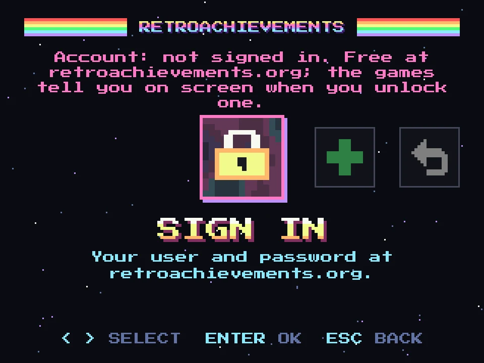
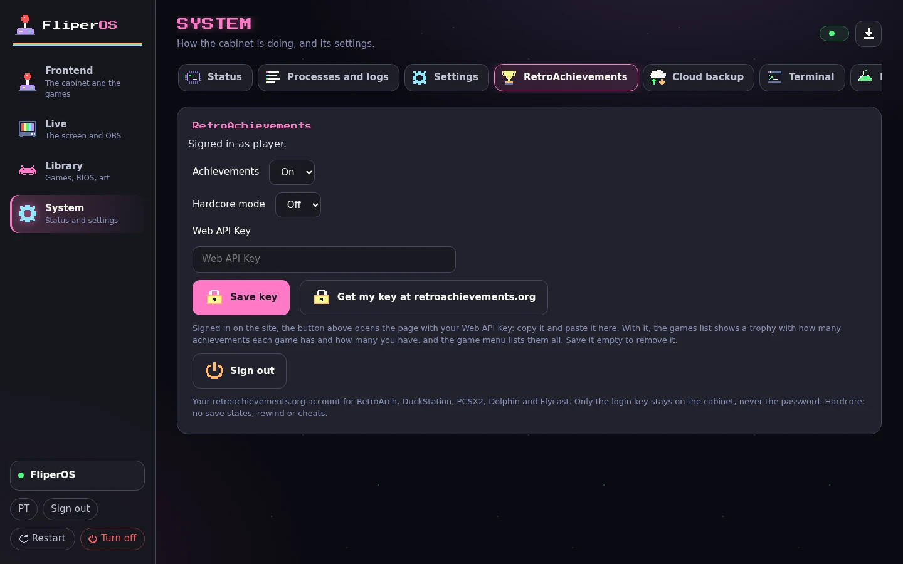

[RetroAchievements](https://retroachievements.org) gives achievements to classic games: beat a boss, find a secret, finish without continuing. FliperOS signs in once for every emulator that has them, shows each unlock over the game and counts them in the game list.

## Signing in

**RetroAchievements** in the FliperOS menu, right after Start desktop. The web panel has the same in **System > RetroAchievements**.

1. **Create an account** if you don't have one: it is free, at retroachievements.org. On the cabinet it opens the site in the cabinet's browser, and the Setup comes back when it closes; in the web panel it opens a new tab.
2. **Sign in** with your RetroAchievements user and password. The password is not saved: only the account's login key is.
3. From the next game on, RetroArch, DuckStation, PCSX2, Dolphin and Flycast use the account.

Signed in, the screen has:

| Item | What it does |
| --- | --- |
| **Achievements: on/off** | Turns the achievements on or off in every emulator |
| **Hardcore mode: on/off** | No save states, rewind or cheats: the strict way to play |
| **Web API key** | For the badge in the game list (below) |
| **Change account** | Signs in with another account |
| **Sign out** | Forgets the account on this cabinet |

An account made inside an emulator's own menu keeps working while you don't sign in here.

## While you play

Each unlock shows over the game for 5 seconds, in a bar that doesn't take the controls:

- the trophy, with a ring that draws itself and a comet spinning around it;
- the achievement's title, which scrolls when it doesn't fit;
- a green line that empties.

The bar follows the game's frame, so it fits any resolution and a vertical monitor. The emulators' own notifications stay off, so only this bar shows. The Pixelcade or ZeDMD marquee shows the achievement too ([LED displays](LED-displays.md)).

## In the game list

With the account's **Web API Key**, the FliperOS frontend shows a yellow trophy next to each game that has achievements, with how many you have and how many the game has: `3/24`. In hardcore mode it counts the hardcore ones, and with all of them the numbers turn yellow.

The key is long, so it is easiest to paste it in the web panel, **System > RetroAchievements**, which links to the page where you copy it (retroachievements.org, *Settings > Keys*). Typing it on the cabinet works too, with a keyboard.

In the game menu (button 1 on a game) such a game also has a trophy before the **+**. It opens the list of its achievements, fetched from the site right then: the ones you have first, each with a yellow trophy, then the ones still to get, with title, description and points. Button 1 plays and button 2 goes back.

## Which games have achievements

| Emulator | Systems |
| --- | --- |
| RetroArch | The cartridge consoles the site knows (NES, SNES, Game Boy, GBA, Mega Drive, N64, PC Engine…), disc consoles, and arcade in FBNeo and MAME 2003-Plus |
| DuckStation | PlayStation |
| PCSX2 | PlayStation 2 |
| Dolphin | GameCube |
| Flycast | Dreamcast |

GroovyMAME and the other MAME cores have no achievements.

## Problems

- **No bar over the game:** the bar reads the emulator's log, and in debug mode RetroArch, Dolphin and DuckStation write to the screen instead ([System Setup](Setup-System.md#debug-mode)). `osd=off` in `fliperos.conf` turns the bar off too.
- **No badge in the list:** the Web API Key is missing, or the game's emulator has no achievements. Numbers arrive in the background, so the badge shows up a moment after the list.

## How it works

- **The account:** the login trades the user and password for the account's token through the site's API (`dorequest.php?r=login2`, the same call the emulators make). The password goes to `curl` on standard input, never on a command line or in a log. The token is saved in `/etc/fliperos/cheevos` (mode 640, readable by the user's group).
- **RetroArch** reads `/etc/fliperos/retroarch/cheevos.cfg`, which `fliperos-kms-run` adds to `--appendconfig`.
- **DuckStation, PCSX2, Dolphin and Flycast** keep the account in their own ini. `config/fliperos-cheevos` writes it at each launch: `[Cheevos]` in DuckStation's `settings.ini`, `[Achievements]` in `PCSX2.ini` and Dolphin's `RetroAchievements.ini`, `[achievements]` in Flycast's `emu.cfg`. Signing out clears the user and token everywhere.
- **Notifications off:** RetroArch has no on-screen notifications, Dolphin no on-screen messages, PCSX2 and DuckStation get `Notifications = false` and `LeaderboardNotifications = false`, and Flycast `Notifications = no` (an option of FliperOS's patch 0006).
- **The bar:** `fliperos-cheevos watch`, started by `fliperos-kms-run` and `fliperos-x11-run`, reads each unlock from the emulator's log until the game closes: `/opt/fliperos/logs/<program>.log` for RetroArch (only with `--verbose`, added when achievements are on), Dolphin (its *RetroAchievements* log at Info level) and DuckStation; PCSX2's own `logs/emulog.txt`; and for Flycast, whose release build leaves those lines out, patch 0006 writes each unlock to `$FLIPEROS_CHEEVOS_LOG`. Each unlock goes to the [on-screen menu](On-screen-menu.md) service.
- **The badge:** `gui/fecheevos.py` finds the game by the same hash as the emulators (rcheevos): the file name for arcade, the file without its header for cartridges (also inside a `.zip`). Disc systems have a hash from their boot files, also inside a CHD, made by RetroAchievements' `RAHasher` (`/usr/local/bin/RAHasher`, the `fliperos-rahasher` package, built from RALibretro).
- The numbers come from the site's Web API: each console's game list with the hashes (once a week), your progress (when the frontend opens) and the game just played (when it closes). They are kept in `~/.cache/fliperos/cheevos`. The key is checked against the account's profile (`API_GetUserProfile`) and cleared when you sign out or switch accounts.
- The screen is `screen_cheevos` in `screens/setup-menu.sh`, on top of `lib/cheevos.sh`.

See also: [Emulators](Emulators.md), [On-screen menu](On-screen-menu.md).
