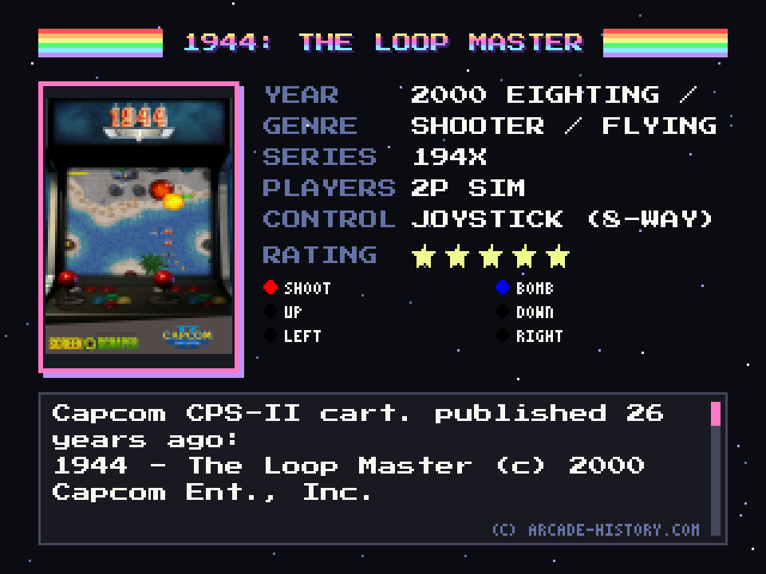

The art of your games: covers, screenshots, logos, marquees, videos and descriptions. Most of it arrives by itself; **Setup > Games > Scraper** fetches it all at once, or from a site of your choice.

## Three ways

| Way | Account | What it brings |
| --- | --- | --- |
| **Automatically** | None | The FliperOS frontend fetches what a game lacks when the cursor stays on it for 2 seconds, and the *Auto scrape* service keeps fetching in the background, also during a game |
| **Scrape the games** | None | The same, for every game at once |
| **Scrape with a site** | Depends on the site | Skyscraper, with the site you pick: names, descriptions and art, and the game lists of Attract-Mode Plus, ES-DE and Pegasus |

**Art packs by torrent** brings the logos and videos of the arcade games you have, in the background.

The art goes to `~/media` ([ROMs, BIOS and artwork](ROMs.md#media)), where every frontend reads it.

## Scrape the games

FliperOS's own scraper, the same one the frontend runs by itself. For every game in the folders (or one folder) it fetches only what the game still lacks, with no account:

- **arcade:** the information, screenshot, flyer, marquee and logo from the [Arcade Database](https://adb.arcadeitalia.net);
- **consoles:** the cover and screenshot from [libretro-thumbnails](https://github.com/libretro-thumbnails);
- **logos and videos:** from the art packs below, only the files of your games.

It runs in the background: any key returns to the menu while it goes on, and opening it again shows the progress. At the end it says how many games still lack something no source has. A game tried once isn't tried again for 30 days.

Logos, videos and descriptions of console games only come from a site: ScreenScraper covers every system.

## Scrape with a site

**Skyscraper** (the same GroovyArcade packages) with the site chosen in **Scraper provider**.

### Scraper provider

| Provider | Has | Account |
| --- | --- | --- |
| ScreenScraper | Every system | User and password, optional (a free account raises the daily limits) |
| TheGamesDB | Consoles and computers | None |
| ArcadeDB | Arcade games | None |
| progetto-SNAPS | Arcade screenshots only | None |
| MobyGames | Every system | Your API key, required |
| IGDB | Consoles and computers | A Twitch client ID and secret, required |
| OpenRetro | Amiga and old computers | None |

A provider that only works with an account doesn't scrape until it has one. The account is easier to type in the web panel's **Library > Art** than with a joystick.

### Scraping

1. **What to fetch:** a checklist of screenshots, logos, covers, marquees, descriptions and videos. Videos start unchecked: they take much more space.
2. **Clones:** in the MAME folder, it asks whether to also fetch the clones of the games you have, which in a merged romset live inside the parent's zip.
3. It goes folder by folder: the folders with games FliperOS knows how to open (`~/roms/mame`, `dreamcast`, `ps2`, `dolphin` and the RetroArch core folders).

**Resuming:** if the cabinet was switched off or the Setup closed midway, **Setup > Games > Scraper** (or the web panel) offers to resume from where it stopped, with the same choices.

The game lists go to the frontend that opens at boot: Attract-Mode Plus romlists, ES-DE gamelists, Pegasus metadata. A system that fails doesn't stop the others.

### progetto-SNAPS

The in-game screenshots of [progetto-SNAPS](https://www.progettosnaps.net/snapshots/) by AntoPISA, the set GroovyArcade users know, for the arcade folders only (MAME, Naomi, Atomiswave…). Only the screenshots of your games are copied, to `~/media/snap/<games folder>`. The site has no logos, covers or descriptions, so those still come from the other sources.

## Art packs by torrent

Logos and videos from torrents, without an account and without the daily limits of the sites. The screen comes filled with packs from the Internet Archive: logos and videos for MAME (also used by the RetroArch arcade cores), Naomi and Naomi 2, Atomiswave, Model 2 and Model 3.

- A pack **only downloads when its folders have ROMs**, and only the files of the games in them. A game that already has that art is skipped.
- The download runs in the background, even with a game open, and an interrupted one can be resumed.
- **Add a torrent** takes a pack of your own: a magnet link or a `.torrent` address, the kind of art and the folder it is for. The link of a pack that comes filled in can be changed too.

## How it works

- **Scrape the games** is `gui/fliperos-scrape`, run as the player (`--daemon` is the *Auto scrape* service, at the lowest CPU and disk priority). The games it tried are in `~/.local/share/fliperos/scrape-state.json`; while it runs, the frontend's own scrape waits.
- **The art packs** are `config/fliperos-media-torrents`, run by `/opt/fliperos/bin/fliperos-mediapacks` (`fliperos-setup --mediapacks auto`, checked every 6 hours by the frontend). The torrent's file list is compared with your ROM names, and the rest is never downloaded. A pack that keeps its files in one `.zip` per letter (the MAME videos) would bring gigabytes for a few videos, so those files come one at a time from inside the zip over HTTP. The download is the same Transmission as the [Downloader](Downloader.md); each file goes to `~/media/logo/<games folder>` or `~/media/preview/<games folder>`, and the torrent is removed.
- **Skyscraper:** the provider is `scraper_source` in `fliperos.conf` and the accounts are in `/etc/fliperos/scraper-accounts`, readable by root only (Skyscraper's `-u`). Only the checked types are downloaded and exported (`--flags noscreenshots,nocovers,nowheels,nomarquees`, `videos`); a type the folder didn't have yet makes it fetch the cached games again (`--refresh`). The images come out each as it came (the Setup's `artwork.xml`), not composited as in Skyscraper's default.
- Skyscraper writes each type into a fixed folder name (`screenshots`, `covers`, `wheels`, `marquees`, `videos`), so `~/media/.skyscraper/<system>` has links with those names into `~/media`; the descriptions come out of the generated list into `~/media/texto`. The RetroArch core folders are scraped as the platform of the `systemid` in the core's `.info`.
- **Clones:** `groovymame -listclones`; the scraped folder becomes one of references in `~/.cache/fliperos-scraper` (links to the ROMs and a small file per clone).
- **Resuming:** Skyscraper only writes its cache at the end of each run, so the games go in batches of 20 (`--includefrom`), and the work is recorded in `/var/lib/fliperos/scraper`, readable by root only.
- **The lists:** ES-DE's go to `~/ES-DE/gamelists/<system>` (Skyscraper's `esde` format); Attract-Mode Plus's to `~/.attract/romlists`, with the descriptions in `~/.attract/scraper/<emulator>/overview` (a link into `~/media/texto`), and any missing emulator and display is created, like GroovyArcade's `efc.sh`; Pegasus's `metadata.pegasus.txt` lives in the ROM folder. With GroovyMAME as the launcher, the MAME folder only gets the art, which `mame.ini` and `ui.ini` already read from `~/media`.
- **progetto-SNAPS:** `/opt/fliperos/bin/fliperos-snaps` follows the site's guidelines: the pack names come from its Snapshots page, each pack through its download link, one at a time; the monthly update wins over the full set (about 520 MB). The packs stay in `/var/cache/fliperos/snaps` (about 1 GB unpacked), so another folder later downloads nothing again.
- The commands: `fliperos-setup --scraper status|sources|systems|source|account|media|scrape|site|resume` (`lib/scraper.sh`).

See also: [ROMs, BIOS and artwork](ROMs.md), [FliperOS frontend](FliperOS-frontend.md), [Web panel: Library](Web-panel-Library.md#art).
