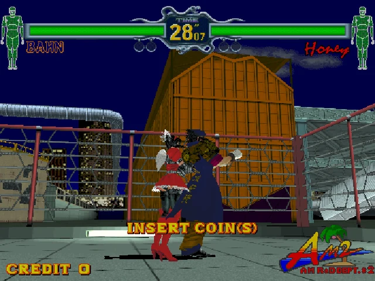

Sega's 3D arcade boards of the 1990s: **Model 2** (Daytona USA, Virtua Fighter 2, The House of the Dead, Sega Rally) in [Keisho](https://github.com/Keisho-Emu/Keisho) (called SM2-Emu until November 2026), and **Model 3** (Scud Race, Virtua Fighter 3, Daytona USA 2) in [Supermodel](https://github.com/trzy/Supermodel).

| Board | Emulator | Folder | Sets |
| --- | --- | --- | --- |
| Model 2 (2, 2A, 2B, 2C) | Keisho | `~/roms/model2` | MAME sets |
| Model 3 | Supermodel | `~/roms/model3` | MAME sets |

Both open in their own Xorg at **640x240 at 57.524 Hz** on a 15 kHz tube (the boards' refresh), stretched to fill it, or 496x384 interlaced with **Interlaced hacks** ([Interlaced, colour and scanlines](Picture-filters.md)). Both have link play between cabinets: Daytona USA, Scud Race and more ([Linked cabinets](Linked-cabinets.md)).

## Model 2 (Keisho)

Keisho is **not compiled into the image**. The first time, it is downloaded and built on the cabinet, a few minutes with the network:

- from **Setup > Games > Emulators & Games > Model 2**;
- from the desktop's **Games > Model 2**, which opens a terminal and asks;
- or by opening a Model 2 game from a frontend, which builds it first with a progress bar.

From the desktop menu, the same screen then lists the `.zip` files in `~/roms/model2` by their names, with **Update Model 2** at the bottom (it pulls the newest source and rebuilds). A set that can't be loaded stays on that screen, with the missing chip named.

**Sets:** chips are matched by CRC32, so a zip has to be a MAME Model 2 set; one made only for the old Model 2 Emulator can miss a chip. Daytona USA, Desert Tank and Virtua Cop also need MAME's I/O boards (`model1io.zip`, `model1io2.zip`) next to them, which the [ROM Cleaner](ROM-Cleaner.md) brings.

**Controls:** a gamepad is read by button position, with the keyboard live beside it (5 and 6 insert coins, 1 and 2 start, the arrows and Z X C V are player 1). **F9** quits; **F10** is the emulator's own settings menu, readable at 640x240. **coin + button 1** opens it too.

**Game outputs:** it publishes the recoil, ammunition and life of the gun games, the round wins of the fighting games (for the [versus score](Versus-score.md)) and the credits, on TCP port 8000 ([DIY hardware](DIY-hardware.md#model-2-game-outputs)).

**Speed:** it uses one CPU core. FliperOS's speed work on the geometry coprocessors is part of the emulator itself since 0.9.41: on the cabinet's i3-540 the speed went from 0.93× to 2.34× on The House of the Dead, 0.71× to 1.65× on Last Bronx, 0.85× to 2.84× on Fighting Vipers. OpenGL 4.3 is needed.

## Model 3 (Supermodel)

Supermodel comes in the image, as a FliperOS package updated with FliperOS (and **Build the newest** in Emulators & Games).

- **Opened from the desktop menu** without a game, it shows a terminal with the games in `~/roms/model3` by their names; Enter opens one, Esc exits.
- **Speed:** its limit is the emulated PowerPC, not the video. Games on the Step 1.5 and 2.x boards were slow on an i3 (Virtua Fighter 3tb at 35 fps), so FliperOS emulates the CPU at 75 MHz for them (59 fps); Step 1.0 games stay as they are. `FLIPEROS_SUPERMODEL_PPC=100` changes the value and `0` turns it off; if a game shows slowdown or wrong parts, raise it.
- It has no menu of its own, so **coin + button 1** opens the FliperOS [on-screen menu](On-screen-menu.md).

## How it works

- **Keisho** is cloned to `~/.local/src/keisho` and built as the user (`config/fliperos-sm2emu --deps` installs what the compiler lacks: `glslc`, ninja, the X, ALSA, HarfBuzz and fontconfig headers; `--build` builds with link-time optimization). Patches in `config/sm2-emu-patches` (installed in `/usr/local/share/fliperos/sm2-emu-patches`) are applied before compiling; a patch that no longer applies is skipped. When an update brings other patches, it rebuilds by itself (`fliperos-sm2emu --outdated`, log in `/opt/fliperos/logs/keisho-build.log`; if the build fails the previous one stays).
- `fliperos-model2` opens a game for the frontends with `exec`, so the wrapper waits for it. Each launch sets `aspect_mode = stretch` when the mode is wider than 4:3, and the first one `vsync = true`. The quick check of a set uses a throwaway NVRAM. The log is `/opt/fliperos/logs/fliperos-model2.log` (`keisho.log` from the desktop menu); its settings are `~/.config/keisho/keisho.ini`; the game's memory and save states are in `~/nvram/model2`.
- **Supermodel** gets `-fullscreen -res=640,240 -stretch` (`-res=2560,240` with super resolutions), `-no-quad-rendering`, and `-ppc-frequency=75` for the Step 1.5/2.x games. Its memory is in `~/nvram/model3`.

See also: [Emulators](Emulators.md), [Linked cabinets](Linked-cabinets.md).
