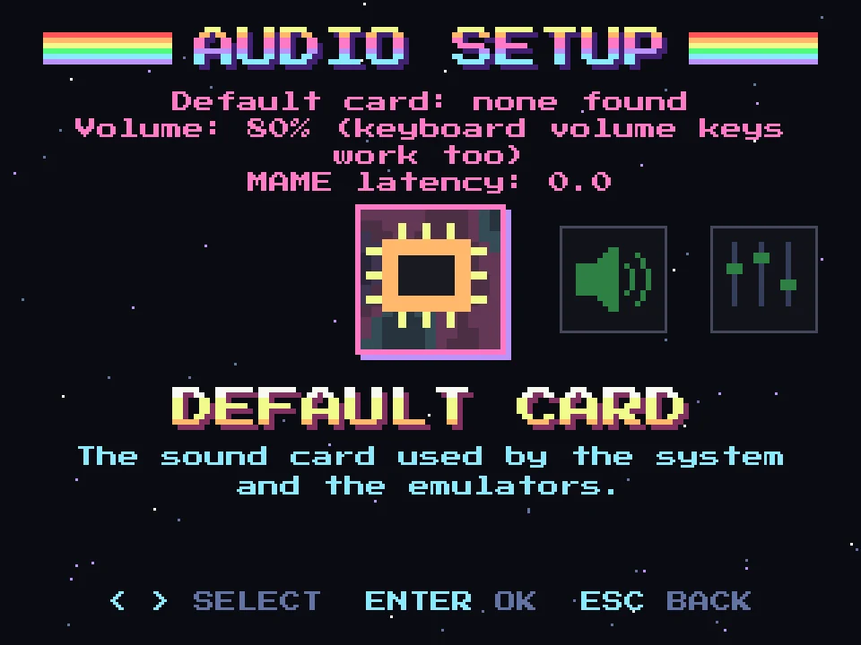
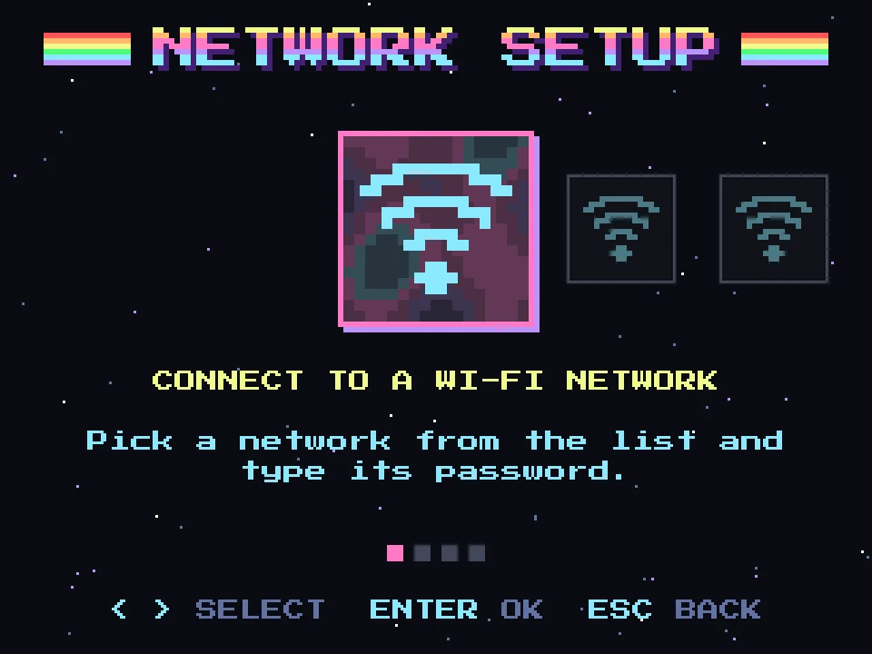

The sound and the network of the cabinet: **Setup > Audio Setup** and **Setup > Network Setup**.

## Audio Setup

 Audio Setup">

| Item | What it does |
| --- | --- |
| **Default card** | The sound card used by the system and every emulator |
| **Volume** | From 0 to 100. The volume keys of a keyboard or a panel work too ([Power and volume buttons](Power-and-volume-buttons.md#volume-keys)) |
| **Stereo or mono** | *Stereo* keeps left and right apart; *Mono* mixes both channels (half of each) and plays the same sound on both outputs, for a cabinet with a single speaker. It is `mono` in `fliperos.conf`; the installer asks it right after the video step. Games opened after the change use it |
| **AlsaMixer** | Every control of the sound card, one by one |
| **MAME audio latency** | GroovyMAME's sound buffer, 0.0 to 50.0 (0 is MAME's default). Lower responds faster; raise it if the sound crackles |
| **Test sound** | Plays a sound to check the speakers |
| **Menu sounds** | The sound and the volume of each menu event: browsing, Enter, Back, a game opening and closing, and alerts |

There is no sound server: every emulator plays straight into ALSA, in KMS or in X, so this volume and this card count for all of them.

### Menu sounds

Like the select screen of a game. **Menu sounds** lists six events, each with its own sound file and its own volume:

| Event | Plays when |
| --- | --- |
| **Browse** | The cursor moves through a list |
| **Enter** | You go into something: Enter, a menu, a choice |
| **Back** | You go back: Esc, Return, a menu that closes |
| **Open game** | The menu opens the frontend, the desktop or a game |
| **Close game** | It closes and you are back in the menu |
| **Alert dialog** | A message or a question opens |

FliperOS comes with a set for all six, so the menu has sound from the start: retrowave sounds made of soft sine waves and a warm echo (a short tick for the cursor, two rising or falling notes for Enter and Back, an arpeggio that opens or closes for the games, a bell for the alert). To change an event, open it:

- **Sound file** opens the file picker (the same one as the rest of the Setup), starting in `~/media/fliperos-sounds`. Pick a WAV, OGG, MP3 or FLAC; it plays at once.
- **Volume** is from 0 to 100, for this event only.
- **Play** plays it with that volume. **Use the default** brings the FliperOS sound back, and **No sound** keeps the event quiet.

The first item, **Sounds**, turns every menu sound off and on, and **Sounds folder** shows where the files are. The sounds FliperOS comes with are copied there the first time, so you can see them and replace them; a file you replace stays as you left it. Short sounds (under a second) work best: a longer file is cut after 10 seconds. A new sound cuts the one still playing.

The six sounds are shared with the [FliperOS frontend](FliperOS-frontend.md#sounds-and-music): its **Frontend sounds** (Tab > FRONTEND SOUNDS) is this same list, so a file or a volume changed in one place is changed in the other. Only the music and the preview video's volume are the frontend's alone. The `move.wav` and `select.wav` that older versions read from `/opt/fliperos/sounds/menu` still stand in for **Browse** and **Enter** until you pick others.

### How it works

- The default card is written to `/etc/asound.conf`. The volume moves `Master`, `Front`, `Speaker` and `Headphone` and leaves `PCM` at its maximum, as on GroovyArcade; a card with only `PCM` uses `PCM`. It is saved at every change, because cabinets are usually switched off at the wall.
- RetroArch uses `audio_driver = alsa`, GroovyMAME `sound sdl` on the ALSA `default` (through `libfliperos-sdl-audio.so`), and the SDL emulators `SDL_AUDIODRIVER=alsa`.
- MAME audio latency is `audio_latency` in `mame.ini` (GroovyArcade's "Audio Latency MAME").
- The HDA codec stays always on (`options snd_hda_intel power_save=0`). With the Ubuntu kernel's 1 s power saving it went silent and popped in the speakers each time it turned back on.
- Menu sounds are `fliperos-setup/gui/fesound.py` (the frontend uses it too). The six events, each with a file (`off`, or empty for the default) and a volume, are `~/.config/fliperos/sounds.json` of the cabinet's user, written by the Setup (as root, handing the file back to the user) and by the frontend, so they are one set; `menu_sounds=off` in `fliperos.conf` silences all of them. What older versions kept as `menu_sound_EVENT` in `fliperos.conf` (and in `frontend.json`) is moved into that file the first time. The graphical menu (`fliperos-gui`) plays the six itself, through pygame's mixer, each at its volume. The text menu has only Gum's own two, through FliperOS's patch `patches/gum/0002-sons-do-menu.patch` (`GUM_SOUND_MOVE` and `GUM_SOUND_SELECT`, played with `aplay`): the Setup hands it a copy of the file already at the event's volume, kept in `~/.cache/fliperos/sounds`. Open and close game are played by `fliperos-tty1` around what the menu opens. The default sounds are `fliperos-setup/gui/sounds/*.wav`, made by `tools/make-default-sounds.py`.

## Network Setup

 Network Setup">

| Item | What it does |
| --- | --- |
| **Connect to a Wi-Fi network** | The networks in range, with their signal. Pick one and type its password |
| **Connect to a hidden network** | For a network that hides its name: type the SSID, then the password |
| **Network status** | The connections and the IP address of the cabinet |

Once connected, the IP shows in the FliperOS menu's title. Connecting to Wi-Fi also checks for a FliperOS update right away, without waiting for the next boot ([Updates and versions](Updates-and-versions.md)).

The network cable needs nothing: it connects by itself.

### Typing with the controller

The Wi-Fi password, a hidden network's name and every other password in the Setup have an **on-screen keyboard**:

- the arrows pick a key and button 1 types it;
- **SHIFT** gives capitals and symbols;
- **SHOW** shows the password as you type it.

### The internet check

Everything in the Setup that downloads checks the internet first: the Downloader, the Scraper, System Update, installing an emulator, a frontend or an extra. Without internet:

- with a Wi-Fi adapter, it offers to connect to a Wi-Fi network, then carries on with what you asked;
- without one, it asks for the network cable.

### How it works

- NetworkManager runs both the cable and the Wi-Fi (`nmcli`). The Wi-Fi radio itself is a service you can turn off in **Setup > System > Services** ([System Setup](Setup-System.md#services)).
- The first boot offers Wi-Fi only when the cable brings no internet ([Installed system](Installed-system.md#first-boot)).

See also: [Remote access](Remote-access.md), [Web panel](Web-panel.md).
