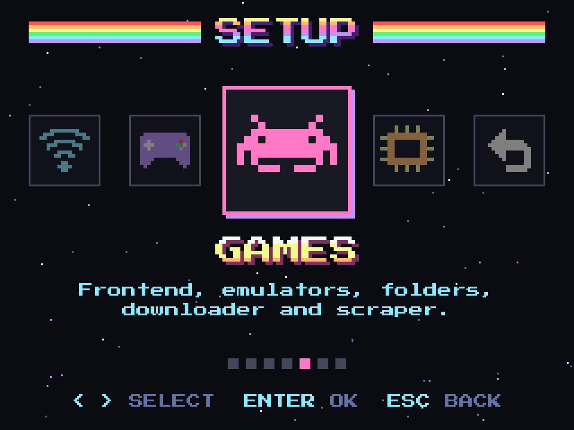
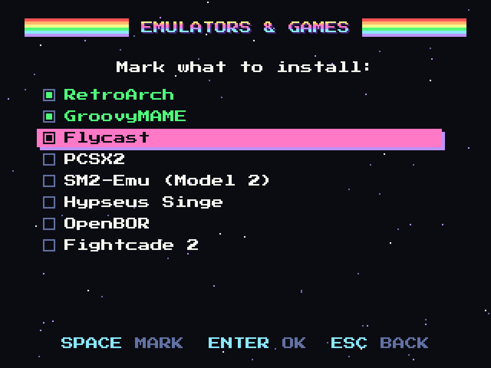
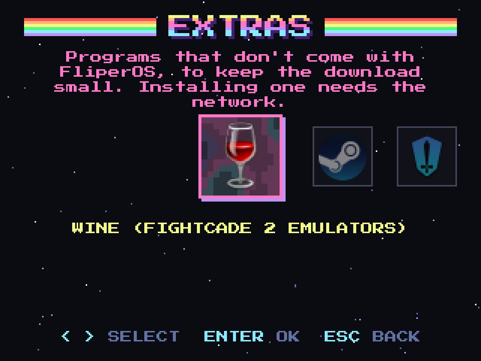

**Setup > Games** is everything that puts games in the cabinet, in the order you use it: emulators, the frontend, extras, your own games, folders, downloads, the cleaner and the art.

 Games">

| Item | What it does | Details |
| --- | --- | --- |
| **Emulators & Games** | What is installed, and installing or updating what isn't in the image | Below |
| **Frontend** | What starts when the computer turns on | Below |
| **Extras** | Wine, PortProton, Steam, Heroic, Pixelcade, ZeDMD, game output tools, the live screen | Below |
| **Custom games** | PC games, scripts and your own emulators, as frontend systems | [Custom games](Custom-games.md) |
| **Folders** | **Folder shortcuts** (send a folder to another disk) and **External storage** (a whole disk: the FliperOS folders, or a Batocera filesystem with a core for each console; format a disk) | [External storage](External-storage.md) |
| **Downloader** | MAME ROM/CHD sets by torrent, free homebrew games, the BIOS your games lack | [ROMs, BIOS and artwork](Downloader.md) |
| **Cleaner** | Filter a MAME romset: only the games you want, for each emulator | [ROMs, BIOS and artwork](ROM-Cleaner.md) |
| **Scraper** | Covers, screenshots, logos and videos of the games | [Scraper](Scraper.md) |
| **AttractPlus ROM List** | Attract-Mode Plus lists with each game's real name | [Adding games](Adding-games.md) |

## Emulators & Games

 Games > Emulators & Games">

The emulators of the desktop menu, each marked installed or not, with its version and the one the latest update brings.

**In the image:** RetroArch, GroovyMAME, Flycast, PCSX2, PCSX2x6, Dolphin, Keisho (Model 2 and 3) and OpenBOR. FliperOS updates bring their new versions.

**Installed from here**, the first time you choose them:

| Emulator | How it gets in |
| --- | --- |
| **Fightcade 2** | Downloaded from its site ([Fightcade 2](Fightcade-2.md)) |
| **DuckStation** | Downloaded from its site |
| **KOF Final Attack** (Ikemen GO, 4:3) | **Download from itch.io** (the free game, 1.4 GB, patched by itself; needs 7 GB free) or **Use a folder I have** (the folder with `Final Attack.exe`, on a USB disk, the network or home) |

You don't have to install one before playing: a game whose emulator isn't installed yet installs or builds it first, with a progress bar, and then opens.

An installed one has **Update**, which downloads the newest version over it. Model 2 downloads the newest source and builds it again; KOF Final Attack downloads the newest game, 4:3 patch and Ikemen GO and converts it again.

### The newest version of a packaged emulator

RetroArch, GroovyMAME, Flycast, PCSX2, Dolphin, Keisho and OpenBOR come as FliperOS packages, tested on the cabinet. Each one also has **Build the newest**:

1. It downloads the project's latest code (PCSX2: its latest stable release), puts in the FliperOS patches and builds it on the cabinet.
2. It needs the network and takes several minutes. **GroovyMAME takes many hours**, often a whole night, with 20 GB free and the cabinet left on: the whole MAME is compiled, and each MAME version changes the romset.
3. The FliperOS package stays saved. **Back to the FliperOS package** on the same screen puts the tested version back, and the updates keep it from then on.

A build of the newest is untested by FliperOS: use it when you need a game or a fix that isn't in the package yet.

## Frontend

What opens when the computer turns on. The list:

| Choice | What opens |
| --- | --- |
| **Setup menu** | The FliperOS menu |
| **A game at boot** | One game, straight from the boot (below) |
| **FliperOS frontend** | The default ([FliperOS frontend](FliperOS-frontend.md)) |
| **Boot from media** | The FliperOS frontend on the disc in a drive, or the cartridge in the cartridge reader ([Physical media](Physical-media.md#boot-from-media)) |
| **Attract-Mode Plus**, **EmulationStation**, **Pegasus** | Other frontends, installed from the FliperOS repository if missing ([Frontends](Frontends.md)) |
| **RetroArch**, **GroovyMAME** | The emulator's own menu |
| **Fightcade 2** | The online lobby ([Fightcade 2](Fightcade-2.md)) |
| **LXDE** | The desktop |

Choosing a frontend also puts every game folder into it, so choose it again whenever a folder gets its first games. One that doesn't have a package yet shows as *not available yet*, and one your video card can't open asks first.

**Add a custom frontend** adds another program by its name and command. **Edit or delete a custom frontend** changes or removes it.

### A game at boot

Opens a single game instead of a game list:

1. Pick the system, among the folders with games.
2. Pick the file.

The game opens straight when the computer turns on, with the command the frontends use for that folder. Leaving it (Esc) opens the FliperOS menu, whose first item becomes **Start** and the game's name.

To get the game on screen sooner, this choice:

- moves every service that starts at boot to *After boot*, and turns *Wait for network* off ([System Setup](Setup-System.md#services));
- skips what only serves the frontends or needs the network: the update check (it runs when the game closes), the creation of missing `~/roms` folders and the frontends' preparation.

## Extras

Programs left out of the ISO, so it fits in a single GitHub file, installed over the internet. Choosing one that is already installed offers to download it again, which updates it.

 Games > Extras">

| Extra | What it is for |
| --- | --- |
| **Wine** | The Windows emulators of Fightcade 2, and Windows games ([Emulators](Windows-games.md)) |
| **Wine Staging** | The newest Wine, with game fixes not in Wine yet |
| **PortProton** | Wine and Proton builds made for games, for the Windows games in Custom games and on the desktop (menu Games > PortProton, plus an icon); about 3 GB ([Custom games](Custom-games.md#windows-games-portproton)) |
| **Steam** | Steam games, inside the desktop |
| **Heroic** | GOG, Epic and Amazon games, inside the desktop |
| **Pixelcade** | The LED/LCD marquee software (closed source) ([Pixelcade](Pixelcade.md)) |
| **ZeDMD** | The open-source LED display, firmware 5.1 or newer ([ZeDMD](ZeDMD.md)) |
| **DOFLinx** | Effects on the Pixelcade marquee during a game |
| **Hook Of The Reaper** | Game outputs (lamps, recoil) to light guns and boards; a Windows program, run through Wine ([DIY hardware](DIY-hardware.md#hook-of-the-reaper)) |
| **QMamehook** | Game outputs to serial light guns; native, built on the cabinet |
| **LEDSpicer** | Button LEDs: Ultimarc, LED-Wiz and others |
| **Live screen** | ffmpeg and go2rtc, for the cabinet's screen live in the web panel and in OBS ([Web panel](Web-panel.md)) |

## How it works

- The emulator list is `config/fliperos-emulators` (`list`, `installed`, `versions`, `latest`, `install`, `edge`, `edge-off`, `edge-status`). The packages that can build the newest are the ones whose recipe in `packaging/packages/` names its upstream (`PKG_UPSTREAM`).
- A build of the newest installs over the package and lists its files, so `edge-off` can remove them and put the package's back.
- The frontends are listed in `config/fliperos-sessions.conf`; custom ones are saved next to them. The game at boot is saved in `/etc/fliperos/bootgame` and run by `fliperos-bootgame`.
- Extras are `config/fliperos-extras`; the repository of FliperOS packages ships inside the image, in `/opt/fliperos/repo`.
- The screens are in `screens/setup-menu.sh` (`screen_setup_games`, `screen_emulators`, `screen_frontend`).

See also: [Emulators](Emulators.md), [Frontends](Frontends.md), [Adding games](Adding-games.md).
