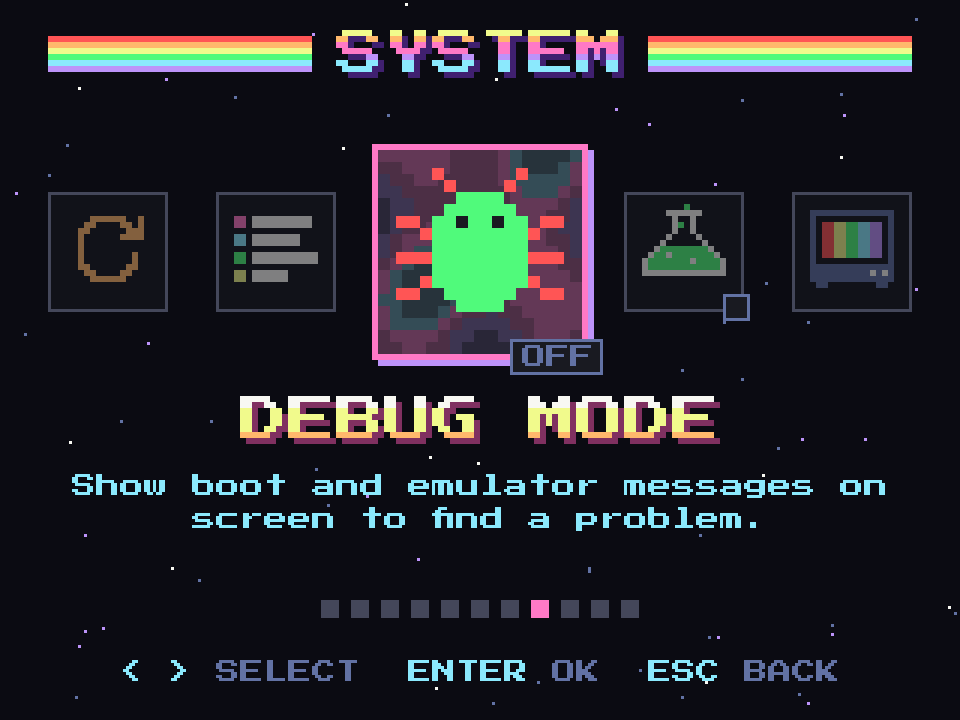

**Setup > System** has the rest of the cabinet: latency, services, USB fixes, the password, the cabinet's name, updates, debug mode, lab mode, the cartridge reader's firmware and the boot splash.

 System">

| Item | What it does | Details |
| --- | --- | --- |
| **Latency** | Standard or low latency mode, and a check of this computer | [Latency](Latency.md) |
| **Services** | SSH, network share, Wi-Fi and the others: at boot, after boot or off | Below |
| **Quirks (USB device fixes)** | Kernel fixes for a USB device read wrong: encoders, guns, disks | [Controls](Controls.md#setup--system--quirks) |
| **Password** | The password of the `fliperos` user | Below |
| **Cabinet name** | The name other cabinets see in party and link play | Below |
| **System Update** | Download and install the updates of all Ubuntu packages | [Updates and versions](Updates-and-versions.md#system-update-ubuntu-packages) |
| **FliperOS version** | Choose the update to use: an earlier one or the newest | [Updates and versions](Updates-and-versions.md#choosing-the-version) |
| **What's new** | The changelog of each version and the updates installed | [Updates and versions](Updates-and-versions.md#whats-new) |
| **Debug mode** | Boot and emulator messages on screen, to find a problem | Below |
| **Lab mode** | Remote help: a temporary internet address to this cabinet | [Remote access](Remote-access.md#lab-mode) |
| **Cartridge reader (OSCR)** | The firmware that lets the frontend read cartridges over USB | Below |
| **Splash screen** | The boot screen theme, with a preview | Below |

## Services

A table with one mark per service, in one of three columns:

- **Boot**: starts with the computer.
- **After boot**: starts about 15 seconds after the first screen opens (the menu, the frontend or the game), so that screen loads first. If nothing opens on the screen, 3 minutes after the boot.
- **Off**: doesn't start.

| Service | What it is | Default |
| --- | --- | --- |
| **SSH** | The terminal of the cabinet from another computer ([Remote access](Remote-access.md)) | Boot |
| **Network share** | The FliperOS folders on the network, for Windows and other computers (Samba) | After boot |
| **fliperos.local** | Find the cabinet on the network by that name (Avahi) | Boot |
| **Wi-Fi** | The Wi-Fi radio only: the network cable works either way | Boot |
| **Wait for network** | The boot waits for the network to come up | Off |
| **Web panel** | The cabinet in a browser: http://fliperos.local ([Web panel](Web-panel.md)) | After boot |
| **Auto scrape** | Fetches the art, videos and information your games lack, in the background, also during a game ([Scraper](Scraper.md)) | After boot |
| **Live screen** | The cabinet's screen live in the web panel; shows only once installed | — |

Choosing [a game at boot](Setup-Games.md#a-game-at-boot) moves every Boot service to After boot and turns Wait for network off.

Not in the table:

- the Downloader's Transmission, which only starts when a download is asked for;
- the Pixelcade and the ZeDMD, which start when the device is plugged in.

## Password

The password of the `fliperos` user, which is also the login of SSH, `sudo`, the network share and the web panel. Samba keeps a password of its own, and both change together. The user stays `fliperos`.

The default is `fliperos`. On a network you don't control, change it.

## Cabinet name

Optional: the name the other cabinets on the local network see in party and link play ("APPLE IS PLAYING"), and the name of this cabinet in the web panel's list. Up to 12 letters, numbers, spaces and hyphens.

Empty, the cabinet uses a fruit or an animal of its own. See [Linked cabinets](Linked-cabinets.md).

## Debug mode

| Debug mode | The boot | Frontends and emulators |
| --- | --- | --- |
| **Off** (default) | Straight to the splash, without text | Their output goes to `/opt/fliperos/logs/<program>.log`, rewritten at each launch: only the picture is on screen |
| **On** | The Limine menu, the kernel and systemd messages | Their output shows on the console |

Programs follow the change at once; the boot, after a reboot. In debug mode the RetroAchievements bar doesn't show for RetroArch, Dolphin and DuckStation, because it reads their log.

When something goes wrong, the logs are also in the web panel, in **System > Processes and logs**, and [Black screen](Black-screen.md) has what to try.

## Cartridge reader (OSCR)

The [Open Source Cartridge Reader](https://github.com/sanni/cartreader) reads cartridges over USB once it has the FliperOS firmware:

- **Install the FliperOS firmware**: pick **HW5 with the voltage switch** or **HW5 with the VSELECT module**. It first saves the firmware the reader has, then writes the FliperOS one.
- **Restore the backup**: writes back the firmware saved before the install.

Using the cartridges in the frontend: [Physical media](Frontends.md#physical-media-the-cartridge-reader-oscr).

## Splash screen

The boot screen (Plymouth). The themes are the folders in `~/splashscreen` (`\\fliperos\splashscreen` over the network). Picking one:

- **Preview** shows it on the screen for 10 seconds (from the FliperOS menu, not from the desktop);
- **Use at boot** makes it the boot theme. It takes about a minute.

| Theme | What it looks like |
| --- | --- |
| `fliperos-text` (default) | Animated like a modern terminal: the name typing itself in, a gradient bar and the services starting |
| `fliperos` | In the style of the 2000s boot screens |
| **Cogwheel**, **Into It**, **Windoze 95** | Installed too |

**More themes:** [Plymouth themes on Gnome-look](https://www.gnome-look.org/browse?cat=108&ord=latest). Unpack each one into its own folder in `~/splashscreen`.

## How it works

- Services: `/etc/fliperos/services.conf` keeps `key=state` (`lib/services.sh`). *After boot* is `config/fliperos-services-screen.timer`, started by `fliperos-tty1` when the first screen opens, or `fliperos-services-late.timer` 3 minutes after the boot. The Wi-Fi row is NetworkManager's radio only; NetworkManager itself always runs, since it runs the cable. `nmbd` alone took about 13 s at boot, hence the network share after boot.
- What Ubuntu starts at boot and a cabinet doesn't use is masked in the image: Samba as a domain controller, `gpu-manager`, Ubuntu Pro and the MOTD news.
- Cabinet name: `cabinet_name=` in `fliperos.conf`.
- Debug mode: `FLIPEROS_QUIET="no"` in `/etc/default/fliperos-boot` shows the Limine menu, and the kernel line loses `quiet splash` and the silencing parameters.
- Splash: a theme is copied to `/usr/share/plymouth/themes`, becomes the default and the initramfs is rebuilt.
- Cartridge reader: `lib/oscr.sh` and `tools/oscr-firmware.sh`; the firmware patch is in `patches/oscr`.

See also: [Installed system](Installed-system.md), [Remote access](Remote-access.md).
