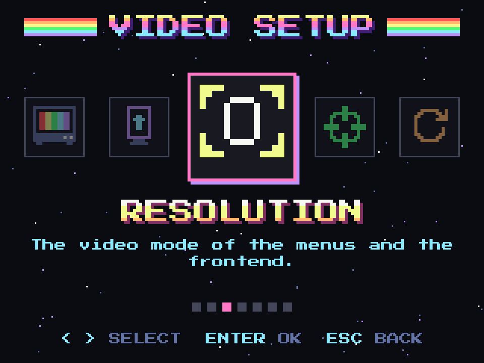

**Setup > Video Setup** sets up the picture: which monitor you have, how it stands, the boot resolution, the geometry, extra monitors and the video driver. It has the same screens as the installation media.

 Video Setup">

The top of the screen sums up what is set now: the monitor, the output, the resolution and the geometry. **Return** saves and leaves. New video settings need a reboot, and the Setup offers one.

## Monitor Type

The monitor model, or its frequencies: 15, 25 or 31 kHz. The list opens on the suggestion for the boot entry you chose on the installation media.

Which preset suits your tube, and why a 31 kHz preset can damage a 15 kHz monitor, is on its own page: [Monitors](Monitors.md).

**Custom** is a monitor of your own. It can come from the Geometry grid (below), or you can type a `crt_range` line from GroovyArcade or Switchres. Choosing a preset again asks before throwing away a custom `crt_range`.

## Monitor Orientation

**Horizontal**, **Vertical (clockwise)** or **Vertical (counter-clockwise)**, for a monitor turned on its side.

With a vertical monitor the Setup, the splash screen and the FliperOS frontend turn their picture, and the frontend changes its layout for a tall screen. See [FliperOS frontend](Frontends.md).

## Resolution

The boot resolution: the mode of the menus and the frontend. The list is the modes made for your monitor on the output the output test chose.

- A card or output that can't make low dotclocks only lists **super resolutions**: the same lines and refresh, many times wider. On a CRT the picture is the same.
- An LCD or a VESA PC monitor lists the modes from its own EDID.
- **Custom resolution** asks for the width, the height and the refresh rate, shows a grid in that mode and, when you say you saw it right, makes an EDID for it.

## Geometry

**Geometry** opens Switchres's test grid on the tube, at the boot resolution. The arrows stretch, shrink and move the picture; the result is saved as the **Custom** monitor, so every game and RetroArch use it.

Go in small steps: too large a change makes the monitor lose sync. Then finish on the monitor's own controls: no software changes the vertical size. Step by step: [Monitors](Monitors.md#centring-the-picture).

**Reset Geometry** throws the saved geometry away and goes back to the monitor preset.

A single resolution can also get a geometry of its own from the game itself, in the [on-screen menu](On-screen-menu.md#geometry).

## Multiple Monitors

A second and a third arcade monitor on the same card, for the multi-screen games (Darius, Punch-Out!!, F355 Challenge). Each item and how it works: [Multiple monitors](Multiple-Monitors.md).

## Interlaced hacks, Colour calibration and Scanlines

- **Interlaced hacks**: for each program, whether games with more than 240 lines run at 640x240 or interlaced, with or without the flicker filter.
- **Colour calibration**: brightness, contrast, gamma, each gun, saturation and hue, with test patterns on the tube.
- **Scanlines**: dark gaps between the game lines, only with a 31 kHz monitor.

All three are on [Interlaced, colour and scanlines](Picture-filters.md). A card without OpenGL 3 shows Interlaced hacks greyed, with the reason.

## Test the video outputs

Runs the output test again at the next boot, as on the installation media: the spoken test of each output and *Testing Results*. Use it after changing the video card. See [Install](Install.md#output-test-and-testing-results).

## Video driver

Only with a card that has a choice:

- An **AMD** card that works with both drivers (GCN 1.0 and 1.1: HD 7000, R7/R9 200 and 300, like the R7 240) picks **radeon** or **amdgpu**.
- An **NVIDIA** card picks **nouveau** or NVIDIA's own driver, or compares them. See [NVIDIA cards](Video-cards.md#nvidia).

### radeon or amdgpu

| Driver | What you get |
| --- | --- |
| **radeon** | The driver 15 kHz was validated on, as on GroovyArcade. OpenGL only |
| **amdgpu** | Adds Vulkan: PCSX2, Dolphin, Flycast and DuckStation, and RetroArch, which also switches the CRT's mode for each game in Vulkan. Seen working at 15 kHz on the R7 240 |

On the installation media, a card that does Vulkan with amdgpu comes with **amdgpu** suggested, and the installer asks before the disk. In the installed system the default is radeon. Once, the first time the menu opens, a popup offers to switch a card that runs on the driver nobody chose.

**Every switch is on trial**, like a resolution change on Windows. The next boot asks you to confirm the picture with Enter or button 1 within 15 seconds. With no answer it goes back to the driver the card was running and restarts.

With amdgpu set, the boot menu (a key while the system boots) gets a **FliperOS - radeon driver** entry: the way back if there is no picture.

## Low resolutions

Only with an NVIDIA card on an analog output, or a DisplayPort output with a converter, and a 15 kHz monitor. It shows the grid test again and finds the lowest dotclock that card or converter really shows.

If it passes, games get native low resolutions; if not, super resolutions. The result counts for the boot mode, Switchres, GroovyMAME and RetroArch. See [Video cards](Video-cards.md#nvidia) and [Converters](Video-cards.md#converters).

## Card firmware

Only with an AMD card: writes ATOM-15 into the card's BIOS, so it gives 15 kHz from power on, before Linux even starts. It rewrites the card's BIOS, at your own risk. See [ATOM-15](Video-cards.md#atom-15-15-khz-from-power-on).

## How it works

- The choices are saved in `/etc/fliperos/fliperos.conf`: `monitor=`, `orientation=`, `boot_resolution=`, `connector=`, `geometry=` (a custom `crt_range`), `amd_driver=`. The Setup writes the kernel line (`lib/bootloader.sh`), the Xorg modeline, `/etc/switchres.ini`, GroovyMAME's `mame.ini` and RetroArch's Switchres settings from them.
- The geometry is Switchres's `geometry` tool; the grid opens only on the cabinet's screen, from the FliperOS menu (not over SSH nor from the desktop).
- The driver is chosen only on the kernel line: on amdgpu, `radeon.si_support=0 radeon.cik_support=0 amdgpu.si_support=1 amdgpu.cik_support=1 amdgpu.dc=0`. `amdgpu.dc=0` is there because the 6.18 kernel has no analog output (VGA, DVI-I) in amdgpu's new display code for these cards (it came in 6.19).
- Whether a card takes both drivers comes from the modules' own PCI ID tables (`modprobe -R` on the card's modalias). The trial state is `amd_driver_trial=` and `amd_driver_previous=`. The `fliperos-driver-trial` service covers a confirmation screen that never opens (it goes back after 2 minutes) and a trial boot that hung and was powered off (the next boot goes back at once).
- RetroArch's Vulkan without X uses the `khr_display` context, which FliperOS patches so it switches the CRT's mode for each game (`config/retroarch-patches`).
- The screens are `screens/video-setup.sh` and `screens/amd-driver.sh`.

See also: [Monitors](Monitors.md), [Video cards](Video-cards.md), [Black screen](Black-screen.md).
