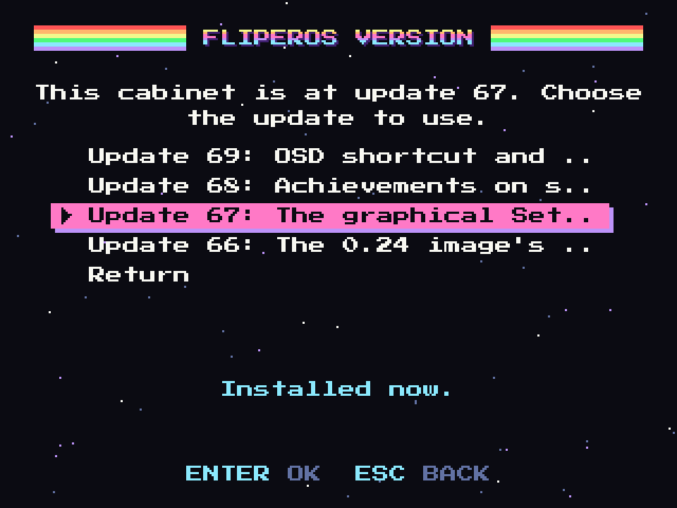

FliperOS gets new features and fixes without a new ISO: numbered **updates**, applied in order over the network. You can also go back to an earlier update if one broke something.

 System > FliperOS version">

## How an update arrives

1. **The cabinet looks for one by itself**, in the background, after the first screen opens. The boot doesn't wait for the network to do it.
2. **At the next boot**, a known update shows first what it changes (the changelog of each part, with scrolling), then the files of this machine it replaces, and asks.
3. **Apply now** installs it there, with a progress bar. If it needs a restart, it asks.
4. **Not now** leaves it for later: it **installs when you power the cabinet off** (not on a reboot).

Without a network at boot, nothing is asked: the update goes in at the next power off.

Other moments it is checked or applied:

- **First boot:** the updates published after the ISO go in as soon as there is internet ([Installed system](Installed-system.md#first-boot)).
- **Connecting to Wi-Fi** in **Setup > Network Setup** checks right away.
- **A game at boot:** the question comes after the game, on the way to the menu.

The screen before the question has **Read what changes** (the changelog again) and **View the files** (every file it replaces, when they don't fit).

### What an update keeps

An update never touches your personal files: `fliperos.conf`, button maps, ROMs, saves, frontend lists.

Before asking, it lists the **files changed on this machine** that it would replace. Each one is copied first to `/var/lib/fliperos/update/backup/<N>-<date>/`, and `sudo fliperos-update restore N` puts them back.

After it is applied, the Setup choices (video, latency, buttons) are applied again, so the cabinet stays set up as it was.

If one part fails, nothing after it goes in, and it is offered again at the next boot. The log is `/var/log/fliperos-update.log`.

## Choosing the version

**Setup > System > FliperOS version**, and **System > Settings > Version** in the web panel, list the updates from the one the cabinet's image came with up to the newest.

| You pick | What happens |
| --- | --- |
| **An earlier update** | It undoes the ones after it. The files it replaces are copied first, as above |
| **A newer update** | It installs the ones up to it |
| **Follow the updates** | Back to the newest, and to following new ones |

On an earlier update **the cabinet stays there**: the boot no longer asks, and nothing is installed at power off, until a newer update than the ones it had seen comes out.

Use it to go back when an update broke something on your cabinet, and tell the [Telegram group](https://t.me/fliperos15khz) what broke.

## What's new

After a new version or a new update, the FliperOS menu opens once on **What's new in FliperOS**, with scrolling (up and down a line, left and right a page):

- the updates installed since the last time, each with its changelog;
- the [CHANGELOG](https://github.com/juniorterin/fliperOS/blob/main/CHANGELOG.md) sections of the versions since then.

**Setup > System > What's new** shows it again, with every update and every version. A new install starts with its own version marked as seen, and the installation media doesn't show it.

## System Update (Ubuntu packages)

**Setup > System > System Update** is Ubuntu's own update: `apt-get update` and `upgrade`, with apt's real progress. It is separate from the FliperOS updates and needs the internet.

Before it, and before installing an Extra, FliperOS fixes the error *"Conflicting values set for option Signed-By"*: when the same repository is in two apt sources with different keys (WineHQ added by hand next to the Setup's Wine Staging), the FliperOS one stays and the other is turned off.

## An old installation

A cabinet installed from an image older than the update system, or stuck on an update, gets going with:

```bash
curl -fsSL https://raw.githubusercontent.com/juniorterin/fliperOS/main/updates/bootstrap.sh | sudo bash
```

## How it works

- Updates are numbered and **always applied in order**: update N only goes on a machine at N−1 (`/etc/fliperos/patch-level`), and a list with a gap is refused.
- Each one is a repository commit listed in `updates/index` with the sha256 of its files, downloaded over HTTPS from GitHub and checked before anything is written, plus an optional `updates/NNNN.sh` for what isn't a file copy, and its changelog in `updates/notes/NNNN.md`. Updates also carry the FliperOS packages of the newest ISO (`updates/packages.list`).
- The background check is `fliperos-update-check.service` (`fliperos-update check --save`, waiting up to 2 minutes for the network). Power off applies it in `fliperos-update-shutdown.service`, which stops before the network, so it can still download; it has 20 minutes.
- Before asking, the update is rehearsed in an overlay over `/`, and each file it would write is compared with what FliperOS itself installed: `/var/lib/fliperos/update/manifest` has the sha256 of each file, recorded by the ISO and by each update.
- The version chooser is `fliperos-update versions` and `goto N|latest`. An earlier choice leaves `/etc/fliperos/update-hold`; `goto latest`, or a newer update, ends it.
- What's new reads `/usr/local/share/fliperos/update-notes` and `/usr/local/share/fliperos/CHANGELOG.md`; what was already seen is `whatsnew_version` and `whatsnew_level` in `fliperos.conf`.
- The apt fix is `fliperos-update apt-heal`: the duplicate `.list` line becomes a comment, a `.sources` block gets `Enabled: no`.
- How an update is made and published: [Build and tests](Build-and-tests.md).

See also: [System Setup](Setup-System.md), [Installed system](Installed-system.md).
