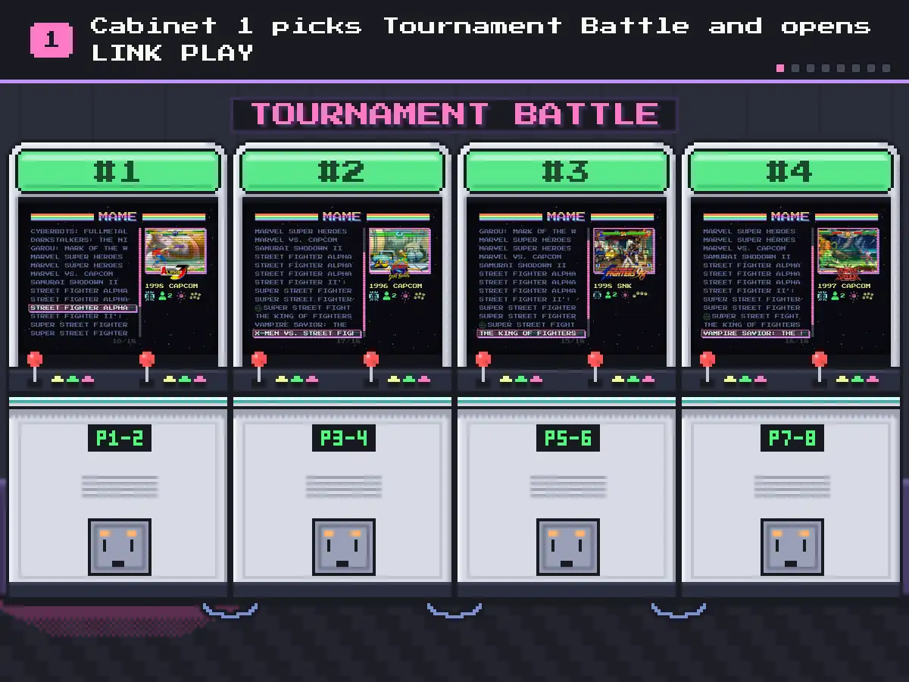

During a two-player fight, the LED display shows the score: the matches each side has won since the game opened. It works with a [Pixelcade](Pixelcade.md) or a [ZeDMD](ZeDMD.md), and in the web panel's marquee preview and OBS page.

| Display | What you see |
| --- | --- |
| **ZeDMD** | The score stays on the display: `GUILE 3 x 1 KEN`, with each side's character when the game tells it, or `P1` and `P2` |
| **Pixelcade** | A text scrolls each time someone wins a match, then the game's marquee comes back |

The score appears with the first win: until then (the demo, the character select, the first match) the display keeps the game's picture. The count starts again when the game closes.

## Which games

| Emulator | Games |
| --- | --- |
| **GroovyMAME** | About 200 arcade sets: CPS1, CPS2 (Street Fighter II, Alpha 3, Marvel vs. Capcom…), Neo Geo (The King of Fighters, Garou, Samurai Shodown…), CPS3 (Street Fighter III, JoJo, Red Earth) and the ones whose detector uses the CPU's own addresses (Mortal Kombat II and many others) |
| **RetroArch with FBNeo** | About 100: the CPS1, CPS2, Neo Geo and CPS3 ones |
| **Keisho** (Model 2) | Virtua Fighter 2, Fighting Vipers, Sonic the Fighters, Last Bronx and Dead or Alive: the rounds, no characters |

A clone uses its parent's detector. The full list: [Scoreboard games](Scoreboard-games.md). The MAME cores of RetroArch (`mame2010`, `mame`) don't let the memory be read: use GroovyMAME or FBNeo for those games.

### FBNeo in RetroArch

Its games go in `~/roms/retroarch/fbneo`, in FBNeo's own ROM sets. The Fightcade ROMs (`~/roms/fightcade`) are Fightcade's alone; to play one in the core, copy it there. A set that changed between Fightcade's FBNeo 0.2.97.44 and the current core may not open.

**Console sets in the FBNeo folder.** Fightcade ROM packs often come with every system in one folder. FliperOS finds each set's system (Mega Drive, Master System, NES, PC Engine, MSX, ColecoVision, Spectrum…) and opens it the right way, so nothing has to be moved. A set loaded by hand in RetroArch's own menu still has to be in a folder named after its system.

## Settings

- `versus_side=2` in `/etc/fliperos/fliperos.conf` puts player 2 first, for the cabinet on that side.
- **Checking a game:** open it and run `fliperos-versus watch mame <game>` over SSH (`model2` for Keisho): it prints the wins and the characters as they change, to compare with the screen.

## What was checked

With Fightcade's own detectors and no picture on the tube:

- **GroovyMAME:** Street Fighter II' Champion Edition, The King of Fighters '98, Mortal Kombat II and Street Fighter III 3rd Strike, one of each kind of detector, played by a script. The wins and the characters came out right, and so did the 128x32 picture sent to the display.
- **RetroArch (FBNeo):** the memory the detectors describe was read right in the demos (the match start and the characters). No match was played there, so a win has not been seen counted in RetroArch.
- **Keisho:** the real emulator up to the rounds arriving, and a scripted feed for the count; not seen in a match on a cabinet.
- A real LED display showing the score has not been seen yet.

## How it works

- **Where the score comes from:** the game only draws it on the screen, so it is read from the game's memory. The map is [Fightcade's detectors](https://github.com/fightcadeorg/fightcade-detectors): one file per game saying where a match starts, where each side wins and which character each side chose, the map Fightcade uses to know who won each online match. Its repository has no license, so the files aren't in the image: **Extras > Pixelcade** and **Extras > ZeDMD** download them (a pinned version) into `~/.local/share/fliperos/versus-detectors`, and `fliperos-versus fetch` downloads them again. A reference copy is in [`third-party/fightcade-detectors`](https://github.com/juniorterin/fliperOS/tree/main/third-party/fightcade-detectors).
- **GroovyMAME:** for a game with a detector, the `groovymame` command turns on the `fliperos-versus` plugin. It evaluates the detector every frame, as Fightcade's emulator does (a condition counts after 30 frames in a row), and writes `fliperos_wins1`, `fliperos_wins2`, `fliperos_char1` and `fliperos_char2` to a file in the session's runtime folder, which `fliperos-versus` follows. These are not MAME outputs: in today's MAME a script can't create new outputs.
- **RetroArch:** `fliperos-kms-run` turns on RetroArch's Network Command Interface for a game with a detector (`/etc/fliperos/retroarch/versus.cfg`), and `fliperos-versus` reads the game's memory ten times a second (`READ_CORE_RAM`) and evaluates the detector itself. A detector that uses the CPU's own addresses can't be read there.
- **FBNeo console sets:** the system of each set comes from FBNeo's own lists (`/opt/fliperos/bin/fliperos-fbneo`; a name in more than one system is settled by the CRCs inside the `.zip`), and the game opens through a link in `~/.cache/fliperos-fbneo/<system>/`, with its parent set and the system BIOS linked next to it. The core only looks for a console `.zip` in a folder named after a system (`megadrive`, `sms`, `nes`, `pce`, `tg16`, `sgx`, `msx`, `coleco`, `sg1000`, `gamegear`, `spectrum`, `fds`, `snes`, `ngp`, `channelf`).
- **Model 2:** Keisho publishes the rounds each side has taken among the game's outputs (`P1_Wins`, `P2_Wins` on TCP port 8000, see [DIY hardware](DIY-hardware.md#model-2-game-outputs)). With a display installed, `fliperos-x11-run` turns that port on for these games, and a match counts for the side with more rounds when they go back to zero.
- **Points:** the detectors don't have each player's points. `/etc/fliperos/versus-games.conf` is a table of addresses read directly (the format is at its top; your own lines go in `~/config/versus-games.conf`). It is empty for now.
- Nothing is turned on without a Pixelcade or a ZeDMD installed, or the web panel's marquee preview.

See also: [LED displays](LED-displays.md), [Scoreboard games](Scoreboard-games.md).
