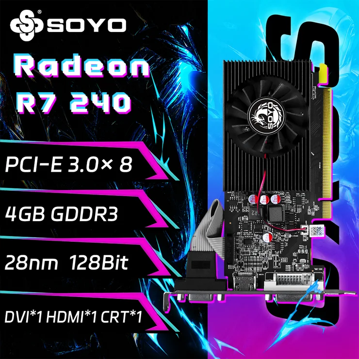

The AMD and ATI Radeon cards: the best fit for a 15 kHz CRT, with native resolutions on their VGA or DVI-I outputs.

The cards CRT_EmuDriver 2.0 covers on Windows are [listed below](#cards-in-crt_emudriver-20), from the HD 2000 series to the RX 500 and Vega. The ones with VGA or DVI-I, from the HD 2000 series to the R7/R9 200 and 300 with GCN 1.0, are the ones FliperOS counts on for native 15 kHz. The 15 kHz kernel patches cover `radeon` and `amdgpu` (DCE and DCN 1 to 3): native boot at `640x480iS` and every game at its own resolution, in GroovyMAME, RetroArch and the frontends.

Good, cheap choices: **HD 5450, HD 6450, HD 7750, R7 240, R7 250**.

SI and CIK cards (HD 7000, R7/R9) work on both drivers; the Setup picks `radeon` by default and offers `amdgpu` (with Vulkan) in *Video Setup > Video driver*.

The emulators follow the driver the card runs on, checked at every session start: on `amdgpu`, Flycast goes to the Vulkan renderer that matches its OpenGL one (per-pixel or per-triangle) and Dolphin to Vulkan; PCSX2 and DuckStation stay on Automatic, which already picks Vulkan there. Back on `radeon` (no Vulkan), each goes back to its factory renderer: Flycast to OpenGL with per-pixel transparency, Dolphin to OpenGL. A choice made in an emulator is kept until the driver changes again.

RetroArch is decided at every launch, with nothing saved: on `amdgpu` it opens in Vulkan, on any other driver or card in `glcore` (`fliperos-kms-run` looks at the driver of the card whose connector is plugged in). Its Vulkan output switches the CRT's mode for each game like `glcore` does, through a FliperOS patch to its `khr_display` context; a RetroArch built without that patch stays on `glcore` on amdgpu too.

Cards with no analog output (RX 400 and newer) and the Ryzen APUs need an **active converter**: see [Converters](Converters.md).

## Cards in CRT_EmuDriver 2.0

FliperOS's hardware scope is the list of [CRT_EmuDriver 2.0](http://geedorah.com/eiusdemmodi/forum/viewtopic.php?id=295), the Windows driver for 15 kHz CRTs by Calamity, the author of GroovyMAME (beta 15, January 2019; the forum answers only on `http`). Its download thread splits the cards into four packages, by the AMD driver each one is based on. This is what that Windows driver supports: the `radeon` and `amdgpu` patches of FliperOS are other code, and what each card gives on a CRT here is in the tables further down and on [Video cards](Video-cards.md). Being on this list doesn't mean the card has an analog output; check its connectors.

For a card that several packages cover, the thread recommends the most recent one.

**Catalyst 12.6, legacy cards**

- Desktop: Radeon HD 2000, HD 3000 and HD 4000 series.

**Crimson 16.2.1, cards that are not GCN** (TeraScale)

- Desktop: Radeon HD 5000 and HD 6000 series, HD 7000 to HD 7600, HD 8000 to HD 8400; R5 235X, R5 235, R5 230 and R5 220.
- All-in-One: Radeon HD 6350A, HD 6600A, HD 7450A and HD 7600A.
- APU: Radeon HD 6000D, HD 7000D, HD 8000D, HD 6000G, HD 7000G and HD 8000G.
- Mobility: Radeon HD 5000M and HD 6000M.

**Crimson 16.2.1, GCN cards** (GCN is Graphics Core Next)

- Desktop: Radeon HD 7700 to HD 7900 and HD 8500 to HD 8900; R7 200, R7 300, R9 200 and R9 300; R9 Nano and R9 Fury.
- APU: A-Series with Radeon R4, R5, R6 or R7 graphics; Pro A-Series with R5 or R7; Athlon with R3; Sempron with R3; A-Series with R3, R4, R5, R6, R7 or R8; Pro A-Series with R5, R6 or R7; FX-Series with R7; E-Series with R2; Radeon HD 8180 to HD 8400.
- Mobility: Radeon R9 M300, R7 M300, R9 M200, R7 M200 and R5 M200; HD 7700M to HD 7900M and HD 8500M to HD 8900M.

**Adrenalin 18.5.1, GCN cards** (a package for Windows 7 and 8, another for Windows 10)

- Desktop: Radeon RX Vega, RX 500 and RX 400 series; Radeon Pro Duo; R9 Fury, R9 Nano, R9 300 and R9 200; R7 300 and R7 200; R5 300 and R5 200; HD 8500 to HD 8900 and HD 7700 to HD 7900.
- Ryzen: Ryzen 5 2400G and Ryzen 3 2200G.
- APU: the same APUs as the Crimson GCN package above.
- Mobility: Radeon R9 M300, R7 M300, R5 M300, R9 M200, R7 M200 and R5 M200; HD 8500M to HD 8900M and HD 7700M to HD 7900M.

What the thread says about the newer cards: they have no analog output. 15 kHz comes out of their HDMI through an active HDMI to VGA adapter, but video modes with a low dotclock probably won't work there, and super resolutions are the recommended answer. The beta 14 driver removed the low pixel clock limit on HDMI, which is a change in the Windows driver, not in Linux's. See [Converters](Converters.md) and [Video cards](Video-cards.md) for the same limit on FliperOS.

## GCN 2 and 3 cards with DVI-I

 Not every card after GCN 1.0 lost its analog output: GroovyArcade reports the R7 260X on DVI-I and the R9 380 on DVI-I. None of them has been tried on FliperOS.

- **R9 380 and 380X (GCN 3)** only run on `amdgpu`, and on kernel 6.18 its new display code has no analog output (that came in 6.19). They need `amdgpu.dc=0` on the kernel line (the R9 285 too, same chip). FliperOS loads `amdgpu` with it by itself when it finds one of these cards, from the installation media on, and the installed system also writes it on the kernel line.

ISOs up to 0.19 don't do that on the installation media. With one of them, add it by hand to see the install on the DVI-I (see [Black screen](Black-screen.md#changing-the-kernel-line-by-hand)), or install through the HDMI.
- **GCN 2, also called 1.1, on `amdgpu`:** GroovyArcade's table says these cards (HD 7790, R7 260, R7 360) don't do interlaced modes on that driver. It wasn't checked with the `amdgpu.dc=0` FliperOS uses. If the picture is lost after switching to `amdgpu`, the [trial](Installed-system.md) goes back to `radeon` by itself.

## APUs

 GroovyArcade reports Wrestler, Kabini, Kaveri and Mullins working out of the box, and Wani with `amdgpu.dc=0` or an EDID. On any APU the Setup sets `interlace_force_even` in Switchres, which AMD APUs need.

**A VGA connector isn't always analog.** On some APUs and motherboards the VGA port is a DisplayPort to VGA bridge chip. It may not switch modes quickly, make low clocks or do interlaced modes, so results vary by motherboard. GroovyArcade found the ASRock DeskMini A300's to be the best so far.

## ArcadeVGA cards

 GroovyArcade's wiki says they "are not supported and won't work", without saying why, and other reports disagree. One forum thread has an ArcadeVGA 5000 running GroovyArcade at half speed; the documentation of another 15 kHz package says they seem to be supported.

On Windows, forum posts say CRT_EmuDriver doesn't support the 3000 and the 5000, even though the 5000 is an HD 5450 with Ultimarc's own BIOS. The cause on Linux isn't documented, and none has been tried on FliperOS. If you are buying a card, a plain HD 5450 is the safer choice.

## ATOM-15 isn't needed

 Flashing a supported Radeon with [ATOM-15](ATOM-15.md) makes it start at 15 kHz from the BIOS, which [GroovyArcade's FAQ](https://gitlab.com/groovyarcade/support/-/wikis/1-About-GroovyArcade/1.3-General-FAQ) describes as protection against out-of-range signals at boot. Once the kernel has loaded, 15 kHz is there either way.

Choosing radeon or amdgpu: [Video Setup](Setup-Video.md#radeon-or-amdgpu).

## Reported by GroovyArcade

Cards in the [GroovyArcade wiki's list of tested GPUs](https://gitlab.com/groovyarcade/support/-/wikis/2-Pre-Requisites-and-Installation/2.1-Hardware-Suggestions-General#tested-gpus). They ran on its kernel, not on FliperOS, but it is the same family of 15 kHz patches. Older cards than these should work but aren't recommended.

| Card | Driver | Output | Notes |
| --- | --- | --- | --- |
| HD 5450, HD 5570, HD 5750, HD 6450, R7 250 | `radeon` | VGA, DVI-I | Out of the box |
| HD 6320 (Wrestler) | `radeon` | VGA, DVI-I | Out of the box |
| HD 8400E (Kabini) | `radeon` | VGA, DVI-I | Out of the box; `dotclock_min 6` for perfect sync in every game |
| HD 7520G (Trinity) | `radeon` | VGA, DisplayPort | `video=VGA-1:640x240S`, no interlaced modes, `dotclock_min 12` |
| A8 APU | `radeon` | DisplayPort | With a converter and an EDID; its VGA is a bridge that works badly |
| R5 (Mullins, GX-242CC) | `radeon` | VGA, DVI-I | With an EDID |
| R7 260X | `radeon` | DVI-I | With an EDID |
| R7 350X | `radeon` | DisplayPort | With an EDID |
| Ryzen 2200G, 2400G | `amdgpu` | VGA, DisplayPort | The bridged VGA may lack low clocks or interlace, depending on the motherboard |
| Ryzen 2200GE | `amdgpu` | VGA, DisplayPort | Same; disable legacy BIOS boot if the screen goes black at random |
| Ryzen 3400G | `amdgpu` | VGA | A 1280x240 EDID and `video=DP-1:e` |
| R7 (Wani, A10-8800E) | `amdgpu` | DisplayPort | EDID `generic_15_super_resp.bin` and `dotclock_min 25` |
| RX 5700 XT (Navi 10) | `amdgpu` | DisplayPort | With an EDID |
| R9 285, 380, 380X | `amdgpu` | DVI-I | Needs `amdgpu.dc=0` (FliperOS adds it; on the installation media only in ISOs newer than 0.19); to be confirmed since Linux 6.19 |

"With an EDID" means booting the EDID entries of the boot menu, or a monitor's file from `edid/` ([Install](Install.md#boot-menu)).

If yours works on FliperOS, open an [issue](https://github.com/juniorterin/fliperOS/issues) with the card, the driver, the output and what you saw: that is what turns a line here into "seen on FliperOS".

See also: [Video cards](Video-cards.md), [Converters](Converters.md), [ATOM-15](ATOM-15.md).
