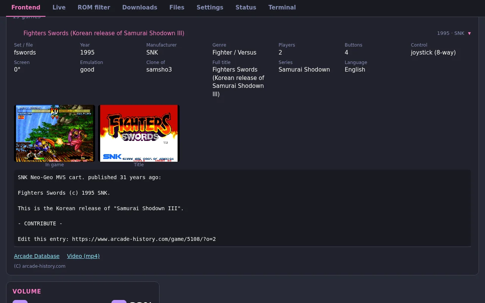
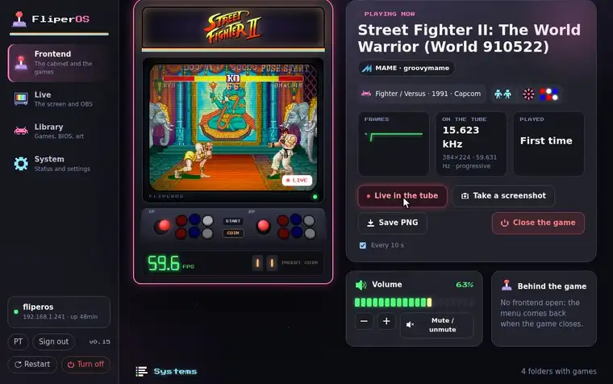

The **Frontend** area of the [web panel](Web-panel.md) is the cabinet itself, drawn in the browser, and its games: see what is playing, pick a game and play it on the tube.

## The cabinet drawing

The top of the page is a drawn arcade cabinet that shows what the real one is doing:

- **The marquee:** the art of the game on screen, or the LED marquee preview (below).
- **The screen:** a capture of the tube every 10 seconds, the live view on a button, or the game's video or snapshot.
- **The control panel:** its buttons light up as they are pressed on the cabinet.
- **The FPS**, on a seven-segment display.

## Now playing

Beside the drawing:

- the game's title, its folder and controls, the video mode and how many times it was played;
- the **volume**, with mute;
- **Close the game**, which closes it the normal way (like the power button, so RetroArch still writes its saves).

## Marquee preview

The **Marquee preview** card draws an LED marquee (128x32 dots) with what a **Pixelcade** or a **ZeDMD** would show for the game that is open, with no hardware. Pick the device in the card.

It shows the game's art (the ZeDMD looks for `~/media/dmd`, then `marquee`, then `logo`; the Pixelcade for `marquee`, then `logo`) or, without art, the game's name. It also shows:

- the **versus score** of fighting games that have a score detector ([Scoreboard games](Scoreboard-games.md));
- the opening text with the game's **high scores**, scrolling once, and the first three in the card (a *HI 19,130 DAA* tag on the LED panel);
- **achievements**, as they are unlocked.

*When both exist, the marquee shows* picks **Art** or **Scoreboard** for a game that has both.

Turning the preview on, or changing the device, checks whether that device's software is installed on the cabinet and offers to install it. The preview works without it; the real display needs it. Idle, the preview plays the ZeDMD's logo animation, and with nothing open it shows the animated FliperOS logo.

The same preview shows under the screen in **Live** and in **Live > OBS**. The marquee hardware itself: [LED displays](LED-displays.md).

## Games

Rows of **Systems**, **Favourites** and **Most played**, then the games of the chosen system as a grid or a list, with an A–Z ruler to jump.

- Arcade games show their real names, year and manufacturer. Files the list doesn't know show by file name.
- The **filter** at the end of the search box has FliperOS's game filters (All Games, Most Played, the genres, manufacturers and years) and *Favourites*.
- **Clones** off (the default) shows only the original games; on, every version. The choice stays in the browser.

### The game sheet

Each game opens a sheet with what the list knows (file, year, manufacturer, genre, players, buttons, control, screen, emulation status, parent, play count and time) and what the internet knows:

- **Arcade games:** the [Arcade Database](https://adb.arcadeitalia.net): the full title, series and rating, the player 1 buttons drawn on the panel where **Setup > Joysticks > Buttons layout** puts them, the description and each section of the arcade-history.com text, the in-game, title, marquee, flyer and cabinet pictures, and links to the video and the game's page.
- **Consoles:** the box, screen and title pictures of [libretro-thumbnails](https://github.com/libretro-thumbnails), by the file name, the way RetroArch looks for them.

At the bottom:

| Button | What it does |
| --- | --- |
| **Play** | Closes what is on the cabinet's screen and opens the game. When the game closes, what was there comes back |
| **Favourite** | Adds or removes it from FliperOS's favourites, the same as the frontend's |
| **Open at power on** | Makes it the game at boot ([Games Setup](Setup-Games.md#a-game-at-boot)) |

## How it works

- The list is the frontends' (`fliperos-setup --systems`), with Attract-Mode Plus's romlist fields (`~/.attract/romlists/EMULATOR.txt`) for names, years and manufacturers. Clones without their own file in a merged MAME set are listed too, since MAME opens them by name.
- The filters are applied the way Attract-Mode applies them (rules in order, exceptions, regular expressions, sorting and the limit); the panel copies FliperOS's filters, it doesn't read the frontend's displays (`fliperos-setup --filters`).
- The Arcade Database sends no CORS header, so the panel asks for it, and saves the answer on the cabinet next to the other media: `~/media/info/<games folder>/<set>.<language>.json`. A game fetched once opens without internet; one the database doesn't know is asked again after 30 days. The browser also keeps each answer for 30 days (`localStorage`).
- Favourites are FliperOS's own, `~/.config/fliperos/favourites` (one `folder<TAB>name` line per game). The first time, the panel copies Attract-Mode's favourites; after that it never writes to the frontend's files.
- **Play** writes the request to `$XDG_RUNTIME_DIR/fliperos-web-launch` (the first line is what comes back afterwards, the rest is the command), then closes the game, the frontend, the desktop or the Setup menu; `fliperos-tty1` opens the request before the menu and after each session. A newer request comes first, so switching from one game to another works. Only commands that start with `fliperos-kms-run` or `fliperos-x11-run` are opened, and only files of that folder.
- The screen capture: the OpenGL layer of the flicker filter reads the next finished frame, before the filter, when the panel asks (`$XDG_RUNTIME_DIR/fliperos-shot-request`), and the panel turns it into a PNG (`/api/screenshot`). The desktop is read from X (`XGetImage`). The text console has no capture.
- The FPS comes from the same OpenGL layer, and for Vulkan games from `config/fliperos-vkfps.c`.
- The marquee preview reads the marquee state that `fliperos-pixelcade` writes to `$XDG_RUNTIME_DIR/fliperos-marquee` (turning the preview on also turns on *Marquee overlay for OBS*, which makes it write the state, and downloads the score detectors). High scores are read with hi2txt from the `.hi` files of GroovyMAME's `hiscore` plugin (`~/.mame/hiscore/`).

See also: [Web panel](Web-panel.md), [Frontends](Frontends.md).
