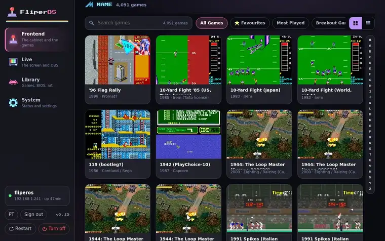
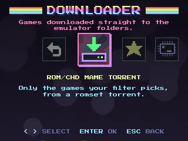

The **Library** area of the [web panel](Web-panel.md) is everything that puts games in the cabinet, typed on a real keyboard: emulators to install, downloads, the ROM filter, the art and the files.

| Tab | The same as on the cabinet |
| --- | --- |
| **Overview** | — |
| **Install** | **Setup > Games > Emulators & Games** and **Extras** |
| **Downloads** | **Setup > Games > Downloader**, with Download BIOS |
| **ROM filter** | **Setup > Games > Cleaner > MAME ROM Cleaner** |
| **Art** | **Setup > Games > Scraper** |
| **Files** | The network share, in the browser |

Long jobs run as tasks, in the tasks drawer ([Web panel](Web-panel.md#tasks)).

## Overview

**How to add games** in four steps (copy or download, BIOS, art, play), and a card for each tool below.

## Install

Each emulator and extra shows whether it is installed, and its version.

- **Check for an update** asks GitHub for the newest version. The emulators that come in the image update with FliperOS, so they have no button.
- **Install** or **Update** runs as a task. Only one installation runs at a time, the live screen's included.
- KOF Final Attack is downloaded from itch.io; installing it from a copy of the game you have stays a Setup step.
- An installed Pixelcade also takes the code of the paid art pack.

What each emulator and extra is: [Games Setup](Setup-Games.md).

## Downloads

**The Downloader** takes from the MAME ROM and CHD torrents only what the ROM filter picks.

- It shows the progress and the filter that is chosen.
- It adds a torrent's link (the one that comes with FliperOS, or one you paste), applies the filter and starts.
- **Pause** and **Resume**, and removing a torrent, optionally with what it already downloaded.
- Starting from the panel deletes nothing. Deleting what a changed filter leaves out stays a Setup step.

**Download BIOS** shows the last check (downloaded, already there, not in the pack, failed) and the list by state; the ones that failed or are not in the pack open first, since they ask for something from you. **Check now** runs the check as a task, and a box turns the check at each menu opening off or on.

How both work: [ROMs, BIOS and artwork](ROMs.md#downloader).

## ROM filter

The filter of the MAME ROM Cleaner, with the same parameters, options and presets as the Setup's. It has two uses:

- **Downloader filter:** what the Downloader takes from the torrents. It opens with the saved filter, and **Save** records it.
- **Clean a romset folder:** a folder with a romset (a disk, a USB drive, the network folder mounted by the Setup), picked in a folder list.

1. Pick the emulator (the MAME version of the romset: GroovyMAME, Flycast, SM2-Emu, Supermodel, MAME 2010) and a preset. A folder's emulator is guessed from its name.
2. Change the tiles: which games, players and controls, screen, categories and years, hardware. A yes/no tile switches with a click; the others open their options, with a search box on long lists. A pink dot marks a value changed from the preset.
3. The scoreboard (**GAMES** and **SIZE**) counts what passes after every change, and stays in view while you scroll.
4. For a folder, **Preview** shows what goes where (sets, size, parents, BIOS and devices, free space), then **Copy them** or **Move them** runs as a task.

What each parameter means: [ROMs, BIOS and artwork](ROMs.md#mame-rom-cleaner).

## Art

The same as **Setup > Games > Scraper**, with the folders in two groups, **Arcade** and **Consoles**. Pick the folders (none means all), then:

- **Scrape the games**: FliperOS's own scraper, with no account. Arcade folders get the description, screenshot, flyer, marquee and logo from the Arcade Database; console folders the screenshot and box art from libretro-thumbnails.
- **Scrape with a site**: Skyscraper. Pick the provider, type its account (much easier here than with a joystick), mark what to fetch and, for a MAME folder, the clones. An interrupted scrape can be resumed here or in the Setup.
- **Art packs by torrent**: logos and videos for the arcade games you have, with their progress.

The auto scrape's state shows at the top. Details: [Scraper](Scraper.md).

## Files

The folders `roms`, `bios`, `media`, `nvram`, `save`, `splashscreen` and your home:

- open folders (`..` at the top goes back up);
- download a file;
- upload several files, with their progress, also by dropping them on the list;
- create a folder, delete a file or an empty folder.

A file that already exists is only replaced after you confirm, and what you send belongs to the `fliperos` user.

## How it works

- Every tab goes through the Setup's own functions, so the panel and the cabinet always agree: `fliperos-setup --downloader status|add|start|remove`, `--bios status|list|check [--refresh]|auto on|off` (`lib/downloader.sh`), `--romfilter` (`lib/romclean.sh`), `--scraper status|sources|systems|source|account|media|scrape|site|resume` (`lib/scraper.sh`) and `--mediapacks auto|status`, and `fliperos-emulators`, `fliperos-extras` and `fliperos-pixelcade` for Install.
- A site account goes to the Setup through standard input, never on a command line or in a log, and the saved password never comes back to the page.
- The ROM filter keeps only the latest count: a new one stops the one before it.
- An upload is written to a hidden `.part` file in the same folder and renamed at the end, so a cut upload doesn't leave a broken game under the right name. Nothing outside those folders is reachable (no `..`, no absolute paths), but links inside them work (a games folder on an external disk). The top folder is never deleted.

See also: [Web panel](Web-panel.md), [ROMs, BIOS and artwork](ROMs.md), [Scraper](Scraper.md).
