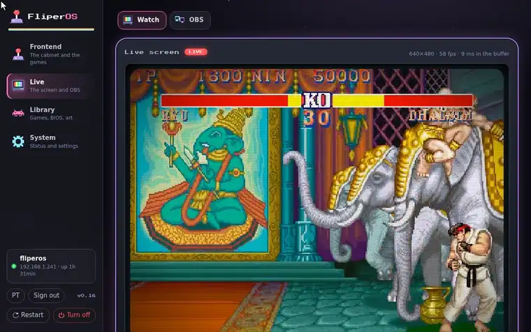
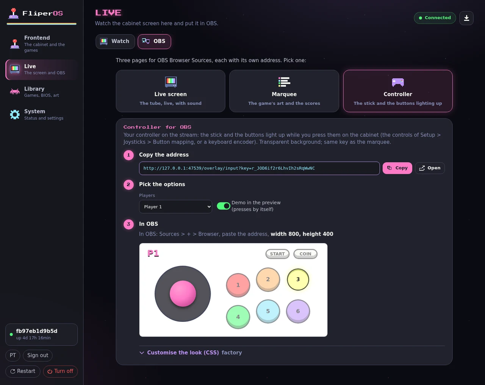

The **Live** area of the [web panel](Web-panel.md) shows the cabinet's screen live in the browser, with sound, and gives three pages for OBS: the live screen, the game's marquee and the controller.

## Watch

What is on the tube, live: the game, the frontend, the menu, the desktop and the text console.

| Control | What it does |
| --- | --- |
| **15, 30 or 60 fps** | Frames per second |
| **Quality** | **Light** (weak Wi-Fi), **Normal**, **High** or **Maximum** (network cable) |
| **Sound** | The stream starts muted when the browser asks for it; this turns the sound on |
| **Full screen** | The picture alone |

The card shows the size, the frame rate and the delay in the browser's buffer. A new quality counts once nobody is watching the old one: refresh the OBS source too.

The page shows the cabinet's network, and recommends a **network cable** when the cabinet is on Wi-Fi: a USB Wi-Fi adapter loses packets, and each loss freezes the picture for a moment.

### Installing it

The first boot installs and turns on the live screen. If it couldn't download (no internet), install it with **Install** on the **Streaming** card, or in **Setup > Games > Extras > Live screen**. Then it is a service in **Setup > System > Services** (*Live screen*).

The **Streaming** card has the service state, the encoder (the graphics card, or software), the sound, and **Turn off**.

### Sound

The live screen carries the cabinet's sound, on by default. A game opened after the sound was turned on goes to the stream with sound; one already open keeps playing only on the cabinet until it is reopened. It is in **System > Setup > Network > Live screen**.

## OBS

Three pages for an OBS **Browser Source**, each with its own address. In OBS: **Sources > + > Browser**, paste the address, set the width and height the card gives.

### Live screen in OBS

The screen in 4:3, as on the tube (or stretched to the whole source), with the sound: tick *Control audio via OBS*. It reconnects by itself.

**Delay for OBS:** while the stream plays on the page, a balloon under the OBS steps says how many milliseconds to delay your camera (its source: *Filters > + > Render Delay*) and your microphone (*Edit > Advanced Audio Properties > Sync Offset*), so they line up with the game. On the cabinet over Wi-Fi it is about 300 ms.

### Marquee for OBS

The marquee of the game on screen, as a page with a transparent background. It needs no Pixelcade or ZeDMD.

- It shows the game's art, the same as the ZeDMD uses (`~/media/dmd`, `marquee` or `logo`), or the name without art.
- The opening text (the high scores, or "Now Playing") scrolls once, achievements pop up, and the versus score shows each side's name and wins ([Scoreboard games](Scoreboard-games.md)).
- When the frontend is idle, it plays the ZeDMD's logo animation.
- In OBS: width 1280, height 320. `&led=1` draws it as LED dots, `&text=0` leaves the texts out.

Turn it on with *Turn on the marquee page* on the card, or *Marquee overlay for OBS* in Settings.

### Controller for OBS

The player's stick and buttons lighting up on the stream, restyled in the panel with a live CSS editor. It has its own page: [Controller on the stream](Controller-overlay.md).

### The address key

The OBS pages can't sign in, so their address carries a key. **New address** makes another key, and the old address stops working, for all three pages. The key only opens these pages: the marquee, the current game's picture, the live screen and the controller.

## How it works

- [go2rtc](https://github.com/AlexxIT/go2rtc) (`fliperos-stream.service`, MIT, a pinned version checked by sha256) opens ffmpeg only while someone watches. ffmpeg reads the screen from DRM (`kmsgrab`) and encodes H.264.
- **Reading the screen:** on AMD cards (radeon and amdgpu) the driver doesn't let the screen's buffer be mapped into memory, so the frame goes through VA-API's video processing, which copies and scales it on the card. Cards that allow the mapping read it directly (`hwdownload`). ffmpeg runs with `libfliperos-dropmaster.so` (`config/fliperos-dropmaster.c`): opening `/dev/dri/cardN` when nobody owns the screen made ffmpeg the DRM master, and X and the graphical Setup could no longer open the video.
- **Encoding:** on the graphics card (VA-API) when it has an encoder; otherwise in software with x264 (no B-frames, a keyframe every second). The R7 240 has no encoder (its Oland chip has no VCE); the cabinet's i7 870 keeps 60 fps with x264.
- **Mode changes:** kmsgrab stops when the framebuffer changes size, which happens every time a game opens or closes on a 15 kHz screen. So the capture is two processes: the grabber (`fliperos-stream grab`) runs kmsgrab in a loop, reopening it at the new size, and always outputs raw 640x480 RGB; the encoder reads that pipe and never stops. A mode change costs about a second of frozen picture, with the sound still in sync.
- **Size:** never larger than 640x480. The frame is scaled with nearest-neighbour to 640x480 (4:3) before it is encoded: 640x240 doubles each line, 480i stays, RetroArch's 2560x240 drops to a quarter across. The panel and the OBS page draw each frame on a canvas that the browser enlarges without smoothing (`image-rendering: pixelated`), since browsers always smooth a `<video>`.
- **Bitrate:** at Normal, 1.5 Mbit/s at 15 fps, 2 at 30 and 3 at 60, with half a second of buffer; Light is 0.6 times that, High twice (x264 preset `superfast`), Maximum 3.5 times (`veryfast`). The choice is `stream_quality=` in `fliperos.conf`.
- **Network:** WebRTC goes over TCP only (`listen: ":8555/tcp"`): over UDP the cabinet's USB Wi-Fi lost packets, and go2rtc can't ask ffmpeg for a new keyframe, so each loss froze the picture until the next one. The browser sends its offer to the panel (`/api/stream/offer`), so the panel login applies; go2rtc's own API only listens on `127.0.0.1`. The video then goes straight to the browser on the local network, on port 8555, with no outside server.
- **Sound:** `snd-aloop` loads as the card `FliperOSLoop`; `asound.conf` gets a route that feeds the real card and the loopback with the same format, and ffmpeg records the loopback in Opus. Turning it on tests the `default` device first, and the copy only goes into `asound.conf` with the loopback really there, so the game sound never breaks.
- **Delay for OBS** is measured from the browser's last second of WebRTC stats (buffer and decode time, half the round trip) plus the cabinet side (about two frames of capture and encoding; for the sound, the loopback period and the Opus frame).
- **Marquee:** `fliperos-pixelcade`, which gets every event (kms-run, x11-run, GroovyMAME, the Attract-Mode Plus plugin, the ES-DE scripts), writes the current marquee to `$XDG_RUNTIME_DIR/fliperos-marquee`; the page asks for it every second, and the art comes from `fliperos-dmd art`.
- **The key** is created on first use in `/etc/fliperos/overlay.key` (root only). The pages are `/overlay/live?key=…&fps=…` (`&fit=fill` stretches it, `&muted=1` drops the sound), `/overlay/marquee?key=…` and `/overlay/input?key=…`.

See also: [Web panel](Web-panel.md), [Controller on the stream](Controller-overlay.md), [Frontends](Frontends.md).
