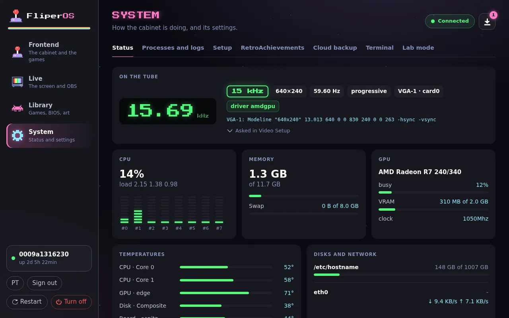
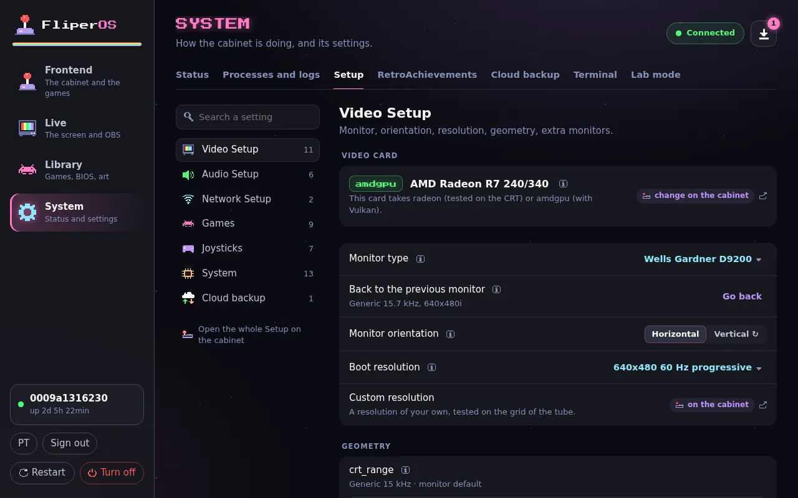

The **System** area of the [web panel](Web-panel.md): the cabinet's status and logs, the whole Setup while you play, custom games, accounts, a terminal and lab mode.

| Tab | What it has |
| --- | --- |
| **Status** | The video mode, CPU, GPU, temperatures, memory, disks, network |
| **Processes and logs** | What uses the CPU, and every FliperOS log |
| **Setup** | The whole Setup of the cabinet, in the same order, and custom games |
| **RetroAchievements** | The account, achievements on/off, hardcore, the Web API Key |
| **Cloud backup** | The cloud account and syncing |
| **Terminal** | The cabinet's shell in the browser |
| **Lab mode** | A temporary internet address for remote help |

## Status

Refreshed every second:

- **On the tube:** the horizontal kHz on a display, then the band (15, 25 or 31 kHz), the mode, the vertical Hz, interlaced or progressive, the output and card, the **driver** in use, and the full **modeline** of each active output. **Asked in Video Setup** opens what Video Setup asks (monitor, frequency, resolution, connector, orientation).
- **CPU:** the total, the load and each core as a column of segments, like a VU meter.
- **Memory** and the swap; the **GPU**: its name and what the card reports (use, VRAM, clock, temperature, power).
- **Temperatures:** each sensor as a bar up to the part's limit (yellow near it, red at it).
- **Disks and network:** each mounted disk, each interface with its IPs, the traffic and the Wi-Fi signal.

## Processes and logs

The processes using the most CPU, and the logs: those of `/opt/fliperos/logs` (each emulator and frontend, the cloud backup, OpenBOR, DuckStation…), the Setup's and the updates'. The first place to look when a game doesn't open.

## Setup

The same Setup as on the cabinet, as a list of settings like a phone's Settings: the seven groups in a column on the left (**Video**, **Audio**, **Network**, **Games**, **Joysticks**, **System**, **Cloud backup**, each with how many items it has here) and the open group on the right, with the same items in the same order. Each item is a section, one row per setting: the name on the left, the control on the right (a switch for on/off, side-by-side buttons for two or three short choices, a list for the rest, a slider for a number), and the explanation behind the **ⓘ**. Each change is saved and applied at once.

**Search a setting**, above the groups, looks in every group: a setting found can be changed right there, and an item without settings leads to its group. On a phone the groups are the first screen; a group opens in its place, with **‹ Setup** to go back.

What can't be done from a phone (a test grid, the colour patterns, mapping the buttons, the gun targets) is a row marked **on the cabinet**: it asks first, then the screen opens on the tube in place of what is there, and when you leave it what was on screen comes back. **Watch it live**, in the same question, opens the [live screen](Web-panel-Live.md). **Open the whole Setup on the cabinet**, under the groups, does the same with the whole menu.

**Video** starts with the **video card** in use and its driver; with a card that takes two drivers (radeon or amdgpu, nouveau or NVIDIA's), **change on the cabinet** opens the choice on the tube, which goes back by itself if no picture comes. In **Interlaced hacks**, picking **Filter** for a program shows the filter level on the same row.

| Group | Here | On the cabinet |
| --- | --- | --- |
| **Video** | Monitor type, **Back to the previous monitor**, orientation, boot resolution, geometry (typed) and its reset, multi-screen games, interlaced hacks, colour values, scanlines values, the on-screen menu | A custom resolution, the geometry grid, the monitors, the colour patterns, the scanlines picture, the output test, the video driver, low resolutions, the card firmware |
| **Audio** | The sound card, the volume, MAME audio latency, a test sound, menu sounds | AlsaMixer |
| **Network** | Wi-Fi (also a hidden network) and the connections; the live screen's sound and quality, the marquee for OBS | |
| **Games** | What starts at power on and **custom frontends**; [custom games](#custom-games); **Folders**; **AttractPlus ROM List**; links to Emulators, Extras, Downloader, Cleaner and Scraper | |
| **Joysticks** | **Bluetooth** (pair, connect, forget), GunCon 2 values, **Controller light** | Button mapping, Buttons layout, the gun targets, wheel and pedals, LPT joysticks |
| **System** | Latency mode, services, **Quirks**, password, cabinet name, **System Update**, FliperOS version, what's new, debug mode, boot splash, restart and turn off | The latency check of the computer, the cartridge reader firmware |

Items that only some cabinets have show only there, as on the cabinet: scanlines at 31 kHz, the video driver with a card that has a choice, Bluetooth with an adapter.

A colour slider saves while it moves, so the game on screen changes with it; the **−** and **+** at its sides move it one step per tap. A new monitor or resolution counts after a restart, and the page offers to restart when it is saved.

### On-screen menu profiles and menu sounds

- **Video > On-screen menu:** the switch, and the profiles saved in the [on-screen menu](On-screen-menu.md) with **Save profile as**: each one with its kind (game, core, emulator, resolution, default) and what it changes. The arrow opens its settings; the **✕** deletes it, and what it changed goes back to the profile below it from the next game. The default profile stays.
- **Audio > Menu sounds:** the switch and the two sounds of the Setup's menu, **When the cursor moves** (`move.wav`) and **On Enter** (`select.wav`): **Send** a `.wav` (or drop it on the row), play it in the browser, **Replace** or remove it. They are the files of the `sounds/menu` folder of the network share.

### Folders, quirks and the rest

- **Folders:** each folder of `~` (and the folders inside them) can be a folder of another disk: **Change** opens the cabinet's folders and disks; **Undo** brings back the one used before. See [ROMs](ROMs.md).
- **Custom frontends:** a name and the command that opens it, like the other frontends; edit or delete each one.
- **Quirks:** pick a USB device connected now and the fix (one device per player, no GET requests, always poll, UAS off for a disk), or type the code. They count after a restart. See [Wheels and quirks](Wheels-and-quirks.md).
- **Bluetooth:** turn it on, **Look for controllers** (15 seconds, with the controller in pairing mode), **Pair**. See [Bluetooth](Bluetooth.md).
- **System Update** and **AttractPlus ROM List** run as tasks, with the progress in the drawer.

### No picture after a monitor change?

The panel doesn't need the tube. From a phone, open **Setup > Video** and pick the right monitor or resolution, or press **Back to the previous monitor**: it brings back the monitor and resolution from before the last change, made here or in **Setup > Video Setup**. Pressed again, it goes back to the new one.

## Custom games

**Setup > Games > Custom games**: the games that are not a ROM (PC games for Windows or Linux, scripts, your own emulators), in groups that are systems in the frontends. The same as on the cabinet ([Custom games](Custom-games.md)), with a table to add many at once.

- **The games:** each group with its games, each with its picture: **Open** on the cabinet, **Edit** (video mode, category, players, buttons, controls, picture, video, text; the name, group and command too for a command), **Make a package**, **Delete**.
- **Add a game:** a group, a name, the type (**Windows**, **Linux** or **Command**), the folder, the `.exe` or the command, the mode and the rest, in one window.
- **New packages** and **Install a package (.zip)**: the zip goes to `~/roms/custom/GROUP` and installs.
- **Packed game folders:** pack a game folder into squashfs, or unpack it.

Windows and Linux games are **copied** to `~/games/GROUP/NAME` and packed in squashfs, like an installed package: the folder can be on a USB disk, in `~/games` after sending it in **Files**, or on the network share. The first Windows game offers to download PortProton (about 3 GB).

### Adding many games

**Add many games** is a table, one game per row:

| Column | How |
| --- | --- |
| Group | A list of the groups, and **+ New group…** |
| Name | Typed |
| Type | Windows, Linux or Command |
| Folder | Typed, or picked in the cabinet's folders |
| Executable / command | The `.exe` files found in the folder (installers left out), or the Linux programs; a command is typed |
| Video mode | 240p, 480i, or another (`WIDTHxHEIGHT@HZ`) |
| Category | MAME's categories (`catver.ini`) |
| Players, Buttons | A list |
| Controls | The 13 kinds, picked in a window |
| Art | A picture and a video, sent at once |

- **+ Row** adds a row in the group chosen at the top; the copy button on a row duplicates it (without the name and the art).
- **Import from a folder**: pick a folder with one subfolder per game (`~/games`, a USB disk); each subfolder becomes a row, with its name, its type and its `.exe`.
- **Paste from a spreadsheet**: copy rows in Excel, Google Sheets or LibreOffice and paste them in the window, or straight into the table. The columns are Name, Group, Type, Folder, Executable or command, Mode, Category, Players, Buttons, Controls; a first row with the column names can put them in any order.
- **Check** asks the Setup what is wrong: the cells in red say why, and the page says how much will be copied and how much is free. **Save all** checks again and adds them one by one: each row turns green or keeps its error, and the ones added leave the table.

The table stays in the browser until it is saved.

## RetroAchievements

Sign in to your retroachievements.org account (or open the sign-up page in a new tab), turn the achievements and hardcore mode on or off, and paste the **Web API Key** for the badge in the game list; the tab links to the page where you copy it. See [RetroAchievements](RetroAchievements.md).

## Cloud backup

Install rclone, sign in (Google Drive with a code, Dropbox at its site, WebDAV, SFTP or MEGA with a user and password), **Sync now**, **Send** or **Get**, sync by itself after each game, and choose what to sync. See [Cloud backup](Cloud-backup.md).

## Terminal

The cabinet's shell in the browser, as the `fliperos` user, with its own zsh and the window's size: the same as SSH, without a program on the computer. In a lab session it is root.

## Lab mode

Starts and stops a temporary internet address to the panel, for someone helping you from far away: **Copy** puts it on the clipboard, and the tab shows when it expires (after 4 hours). Read what it gives the other person before you send it: [Remote access](Remote-access.md#lab-mode).

## How it works

- The video status comes from DRM, through `fliperos-video-check`. The volume goes through `fliperos-setup --volume up|down|mute|get|set N`.
- The Setup tree (`config/web/setup.js`) has the ids of the Setup's menus; a test checks the two match. Settings go through the same functions as the Setup's screens: `fliperos-setup --settings` lists them and `--setting KEY VALUE` changes one (`settings_list` in `lib/system.sh`). `--setup-items` says which items this cabinet has; `--quirks`, `--folders`, `--frontends`, `--bluetooth`, `--system-update` and `--attract-romlist` do the rest without a screen.
- The on-screen menu profiles are the lines of `/etc/fliperos/osd-profiles.conf` (`scope<TAB>key<TAB>value`, the file `fliperos-osd` writes); deleting one rewrites the file without its lines. The menu sounds are `move.wav` and `select.wav` in `/opt/fliperos/sounds/menu`: a file sent is checked (a RIFF/WAVE file, 2 MB at most) and belongs to the player, like the ones sent over the network.
- **Open on the cabinet** writes the request to `fliperos-web-launch`, like a game: `fliperos-tty1` runs `fliperos-setup --screen NAME` (only the names in `screens/panel.sh`), and the video screens end like Video Setup (Xorg and the kernel line again).
- Custom games go through `fliperos-setup --customgames` (`lib/customgames.sh`): `describe`, `check`, `bulk` (one row per game, with an `@row N ok|fail` line each), `edit`, `delete`, `media`, `install`, `pack`, `squash`. A folder is copied by `fliperos-customgame add`, and `fliperos-customgame scan` finds the games of a folder. The art of a row waits in `/var/cache/fliperos-web/stage` until the game is saved (a day at most).
- The terminal is a login shell in a pseudo-terminal (`setsid -c`, so Ctrl+C and job control work), at normal priority. The page talks to it over a WebSocket (`/api/terminal`) that only the panel's own page can open, after the login. The screen is drawn by [xterm.js](https://xtermjs.org) 5.5.0 with its fit addon (MIT), shipped inside the panel.
- RetroAchievements and Cloud backup call the same programs as the Setup: `lib/cheevos.sh` and `config/fliperos-cloud`.

See also: [Web panel](Web-panel.md), [System Setup](Setup-System.md), [Custom games](Custom-games.md).
