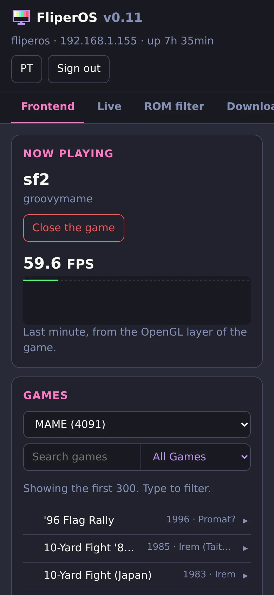

**The cabinet from your phone or PC.** Open **http://fliperos.local** in a browser on the same network (or the cabinet's IP) and sign in with the `fliperos` user. There is nothing to install on the phone or the computer.

What you can do from the couch:

- **Pick a game and play it** on the tube, with the pictures, the history and the buttons of each arcade game, your favourites and the game filters.
- **See what is playing**, with the FPS, the volume and a capture of the tube.
- **Watch the cabinet live** in the browser, and put the live screen, the game's marquee and your controller in OBS.
- **Change settings while you play**: colour, interlaced hacks, services, latency mode, the monitor.
- **Copy games, BIOS and artwork** through the browser.
- **Filter a MAME romset** and **download** only the games that suit your cabinet, plus the **BIOS** your games lack.
- **Scrape the art** of your games, typing the site's login on a real keyboard.
- **Install or update emulators and extras** that don't come in the image.
- **Sign in** to RetroAchievements and to a cloud backup.
- **Check the system**: the video mode with its modeline, CPU, GPU, temperatures, network and logs.
- **Open a terminal** on the cabinet, without an SSH program.

## The four areas

The menu on the left (at the bottom on a phone) has four areas, each with its tabs:

| Area | Tabs | Page |
| --- | --- | --- |
| **Frontend** | The cabinet drawing, now playing, the marquee preview, the games | [Frontend area](Web-panel-Frontend.md) |
| **Live** | Watch, OBS | [Live area](Web-panel-Live.md) |
| **Library** | Overview, Install, Downloads, ROM filter, Art, Files | [Library area](Web-panel-Library.md) |
| **System** | Status, Processes and logs, Settings, RetroAchievements, Cloud backup, Terminal, Lab mode | [System area](Web-panel-System.md) |

Each area and tab has its own address (`#live`, `#library`…), and the browser remembers the last one. The top bar has **EN/PT** (the page follows the browser's language), the cabinet picker, and **Reboot** and **Power off**.

## Signing in

The user is `fliperos` and the password is the same as SSH and the network share: `fliperos`, until you change it in **Setup > System > Password**. Five wrong passwords in a minute lock that address for a minute.

The panel is a service in **Setup > System > Services** (*Web panel*), on **After boot** by default: it starts about 15 seconds after the menu, frontend or game opens at boot.

### More than one cabinet

Every FliperOS is called `fliperos`, so only one answers to `fliperos.local` (the others become `fliperos-2.local` and so on). With two or more on the network, `http://fliperos.local` first lists the cabinets, by their names, and the panel has a **Cabinet** picker on the sign-in screen, in the sidebar and in the phone menu. Each cabinet has its own sign-in. Give each one a name in **Setup > System > Cabinet name**.

## Tasks

What takes minutes (reading a torrent, applying a filter, scraping, checking the BIOS, installing, the auto scrape, a download) runs in the background. The **Tasks** drawer lists them with their step and progress, a log and **Cancel**.

The auto scrape and the ROM/CHD download also have **Pause** and **Resume**. A download stopped by a power off goes on by itself at the next boot. Only one task of each kind runs at a time, and the last 20 stay listed.

## Marquee and controller for OBS

**Marquee for OBS:** the marquee of the game on screen as a page for an OBS Browser Source, with the high scores, achievements and the versus score. It needs no Pixelcade or ZeDMD. It is in the Live area: [Marquee for OBS](Web-panel-Live.md#marquee-for-obs).

**Controller for OBS:** the player's stick and buttons lighting up on the stream: [Controller on the stream](Controller-overlay.md).

## Lab mode

A temporary internet address to the panel, for someone helping you from far away, in **System > Lab mode** or **Setup > System > Lab mode**. What it gives and how it ends: [Remote access](Remote-access.md#lab-mode).

## No picture after a monitor change?

The panel doesn't need the tube: from a phone, **System > Settings > Video > Back to the previous monitor** brings back the monitor and resolution from before the last change. See [System area](Web-panel-System.md#no-picture-after-a-monitor-change).

## Security

The page is plain HTTP, so the password crosses the network unencrypted: use it on a network you trust. On one you don't control, change the password, or turn the panel off in Services.

## How it works

- `config/fliperos-web` (installed as `/opt/fliperos/bin/fliperos-web`, the `fliperos-web.service` unit) uses only Python's standard library, on port 8081 (`--port` changes it; 8080 is Pixelcade's own settings page). Port 80 forwards to it, so `http://fliperos.local:8081` works too.
- It runs as root to read DRM and to check the password in `/etc/shadow` through libcrypt, the same way the login does. Only the `fliperos` user signs in. The session is an `HttpOnly`, `SameSite=Strict` cookie that lasts 12 hours. Every `POST` asks for the `X-FliperOS: 1` header, which a form on another site can't send.
- Each panel announces itself over mDNS as `_fliperos-web._tcp`, with the cabinet's name (`/etc/avahi/services/fliperos-web.service`, written by the panel and removed when it stops; it needs the *fliperos.local* service). Picking a cabinet opens its panel by IP.
- The browser never keeps the panel: its pages, code, icons and fonts go with `Cache-Control: no-store`, so every visit gets the version on the cabinet right after an update. The games' pictures and videos are checked each time (`no-cache` with an ETag), so new art shows at once.
- Tasks run the Setup's commands with its progress events (`lib/progress.sh`); the drawer reads `/api/tasks`.
- The phone's trackball page exists but is off: it shows only with `FLIPEROS_WEB_TRACKBALL=1` in the service.

### The JSON API

The page's own API also serves scripts. Sign in with `POST /api/login {"user","password"}`, then:

| Calls | What they do |
| --- | --- |
| `GET /api/status`, `/api/logs`, `/api/log?name=NAME&lines=N` | The status and the logs |
| `POST /api/volume {"action":"up"\|"down"\|"mute"}` or `{"set":0..100}` | The volume |
| `GET /api/systems`, `/api/games?system=KEY`, `/api/gameinfo?system=&game=` | The game lists, with `Favourite`, `PlayedCount`, `PlayedTime` and the filters |
| `POST /api/favourite {"system","game","on"}`, `/api/launch {"system","game"}`, `/api/close` | Favourite, play, close the game |
| `GET /api/files?root=roms&path=`, `/api/download?root=&path=`; `POST /api/upload?root=&path=&name=` (`&overwrite=1`), `/api/mkdir`, `/api/delete` | Files |
| `GET`/`POST /api/settings {"key","value"}` | Settings |
| `GET`/`POST /api/downloader` (`add`, `start`, `remove`), `GET /api/romfilter`, `POST /api/romfilter/count`, `/save`, `/scan`, `/run` | Downloader and ROM filter |
| `GET /api/stream`, `POST /api/stream/offer {"fps","sdp"}`, `/api/stream/install` | The live screen |
| `GET`/`POST /api/overlay {"action":"newkey"}`; by key, without login: `/overlay/marquee`, `/overlay/live`, `/overlay/input`, `/api/overlay/state`, `/api/overlay/art`, `POST /api/overlay/offer` | The OBS pages |
| `GET /api/tasks`, `/api/task?id=N`, `POST /api/task/cancel {"id":N}` | Tasks |
| `GET /api/screenshot` | A PNG of the screen |
| `GET /api/terminal` | The terminal's WebSocket: binary frames are the keys and the screen, a text frame `{"resize":[columns,rows]}` sets the size |

See also: [Remote access](Remote-access.md), [Installed system](Installed-system.md).
