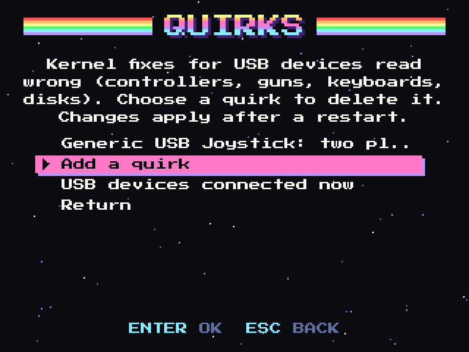

The rest of the controls: calibrating a wheel, pedals or an analog stick, joysticks on the parallel port, fixes for USB devices that arrive wrong, and how the emulators see a controller through SDL.

## Calibrate wheel, pedals or analog stick

**Setup > Joysticks > Calibrate wheel, pedals or analog stick.** Pick the device; its axes show live.

1. Turn the wheel from end to end, and press each pedal all the way.
2. Leave everything at rest.

An axis that rests in the middle (a wheel, an analog stick) gets a range centred on its rest position, so the centre gives 0 and both sides reach the end, with a 1% dead zone. A pedal keeps the range it showed. The calibration is reapplied every time the device is plugged in.

## LPT joysticks

**Setup > Joysticks > LPT joysticks**: joysticks and pads on the **parallel port**, through the kernel's own drivers.

| Adapter | Driver | Controllers |
| --- | --- | --- |
| **Gamepad adapter** | `gamecon` | NES, SNES, N64, PlayStation, DDR mat, Multisystem; up to 5 per port (pins 10, 11, 12, 13 and 15) |
| **DB9 adapter** | `db9` | Atari, Amiga, Master System, 3/5/6-button Genesis, Saturn, CD32; the port must be in EPP or ECP mode in the BIOS |
| **TurboGraFX interface** | `turbografx` | Up to 7 Multisystem joysticks |

The adapter can't be detected: say which one it is and what is connected to each input. The Setup loads the driver right away, shows the joysticks it created (**Found now**), and loads it at every boot; **Turn off** removes it.

The port is often **disabled in the BIOS** (Super I/O > Parallel Port); without one on the motherboard, use a PCI or PCIe parallel card. Parallel port joysticks also move the menus.

## Quirks (USB device fixes)

 System > Quirks">

**Setup > System > Quirks**: kernel fixes for USB devices that arrive wrong, like a dual encoder that shows up as one player, or a SATA adapter that drops off. It is in System, because it is about any USB device.

- **Add a quirk** asks for a name and a code.
- **USB devices connected now** shows the `vendor:product` of each connected device.
- Choosing a quirk in the list deletes it.

It applies after a reboot. Done on the installation media, it goes along to the disk.

| Device | Code | Example |
| --- | --- | --- |
| Controllers, guns, keyboards | `0xVENDOR:0xPRODUCT:0xFLAGS` | `0x16c0:0x05e1:0x40`: a dual Xin-Mo encoder as two players |
| Disks and pen drives | `VENDOR:PRODUCT:LETTERS`, without `0x` | `152d:0578:u`: UAS off for a SATA adapter that hangs |

Useful flags for controllers: `0x40` one device per player (MULTI_INPUT, dual encoders), `0x8` no GET requests (NOGET, an encoder that hangs), `0x400` always poll (ALWAYS_POLL).

The kernel reads at most **4 controller quirks** (disk quirks have no such limit).

## Controllers in SDL

AntiMicroX, PCSX2, DuckStation, Dolphin, Flycast and RetroArch read controllers through SDL2. For a controller outside its database, SDL makes a mapping by itself, often incomplete:

- buttons without a counterpart on a modern pad (`BTN_C`, `BTN_Z`, extra buttons) are left out;
- a digital D-pad sent as axes from −1 to +1 (common in arcade encoders and V-USB projects) goes on the **analog stick**, so a game that moves with the D-pad doesn't move.

FliperOS fixes that by itself, at boot and whenever a controller is connected: leftover buttons go to triggers and extra buttons, and digital axes become the **D-pad**. Controllers in SDL's database (Xbox, DualShock…) and real analog ones (a wheel, a flight stick) stay as they are.

SDL reads the mappings when a program opens: a controller connected for the first time with RetroArch open works correctly after reopening it.

### RetroArch's joypad driver

RetroArch can use `udev` (the default, showing each button's real number in its menu) or `sdl2` (**Drivers > Input**), where the same mappings as the other emulators apply. Its menu always names the buttons after the RetroPad's (A, B, X, Y…); with an arcade core open, **Quick Menu > Controls** shows the game's names.

## How it works

- **Calibration:** `config/fliperos-calibrate axes`, saved to `/etc/fliperos/calibration.conf` (one line per axis) and reapplied by udev on every connection.
- **LPT:** `/etc/modprobe.d/fliperos-lpt.conf` has the module options and `blacklist lp` (the printer driver would claim the port), and `/etc/modules-load.d/fliperos-lpt.conf` loads it at boot. The kernel finds the port itself (`parport_pc`). The screen is `screens/lpt.sh`.
- **Quirks:** controller quirks are the `usbhid.quirks` parameter, disk quirks `usb-storage.quirks`. The list lives in `/etc/fliperos/quirks.conf` and goes into the kernel line (`/etc/default/fliperos-boot`), since the kernel only reads them at boot.
- **SDL:** `fliperos-controllers` (through udev) asks SDL itself how it sees each controller and completes the mapping of those with an automatic mapping, or no mapping and a digital D-pad. The result goes to `/var/lib/fliperos/gamecontrollerdb.txt` (cumulative), pointed to by `SDL_GAMECONTROLLERCONFIG_FILE` in `/etc/environment` and in the launchers.
- **RetroArch with `udev`:** arcade panels had no factory profile, so `fliperos-controllers` writes one in `/opt/fliperos/retroarch/autoconfig/udev` for every controller with a digital D-pad and no analog stick that no profile covers, with the buttons in panel order in the arcade cores' layout: **1 2 3 = Y X L** (top row), **4 5 6 = B A R** (bottom row). The MAME cores read the RetroPad in another order, so a core remap (`config/retroarch-remaps`, in `~/.config/retroarch/config/remaps/<core>`) takes the panel's button N to the game's button N. On a panel with up to 9 buttons the 7th is Start and the 8th Select (coin); with 10 or more, 7 and 8 are L2/R2 and Select/Start move to 9 and 10. A profile saved from RetroArch's menu stays.

See also: [Controls](Controls.md), [Button mapping](Button-mapping.md).
