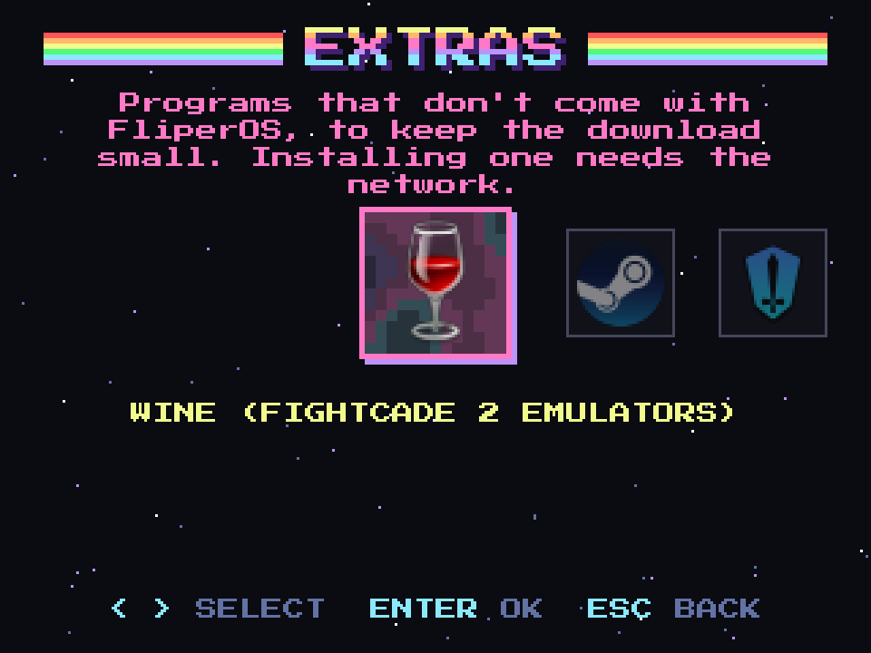

PC games for Windows on the cabinet: through Wine, PortProton, Steam or Heroic (GOG, Epic, Amazon). None of them is in the image: they come from **Setup > Games > Extras** ([Games Setup](Setup-Games.md#extras)), or by themselves with the first Windows game you add.

 Games > Extras">

| Way | For | Opens |
| --- | --- | --- |
| **Custom games** with PortProton | A Windows game you have as a folder or a package | On the tube, from the frontends, in its own video mode ([Custom games](Custom-games.md)) |
| **Wine**, **Wine Staging** | Fightcade 2's emulators, Hook Of The Reaper, custom games by command | On the tube |
| **Steam** | Your Steam library | Inside the LXDE desktop |
| **Heroic** | GOG, Epic and Amazon | Inside the LXDE desktop |

## Wine and Wine Staging

**Wine** is Ubuntu's (9.0 on noble), the stable one, and what Fightcade installs by itself. **Wine Staging** is the newest Wine from WineHQ: it has patches that aren't in Wine yet, so more Windows games run, and some run better. It is the development line, a new version every two weeks, so a game can also break with it.

Wine Staging takes the place of Ubuntu's Wine, so Fightcade, Hook Of The Reaper and the custom games use it without any change. A Wine prefix opened by a newer Wine is upgraded once and doesn't go back to the older one. Not yet tested on a cabinet.

**On the tube:** installing Wine also builds FliperOS's picture layers for 32 bits, so Windows games get the flicker filter and the [on-screen menu](On-screen-menu.md), and DXVK (Vulkan) games too ([Interlaced, colour and scanlines](Picture-filters.md#the-filter)).

## Steam and GOG

- **Steam:** Ubuntu's `steam-installer`; on first launch Valve downloads the client (hundreds of MB).
- **GOG:** there is no official Linux client, so the Setup installs the **Heroic Games Launcher** (GOG, Epic and Amazon, the same as on the Steam Deck), which runs Windows games with the Wine/Proton it downloads itself.

Both open **inside the desktop**, from its **Games** menu. Their screens were made for larger monitors: on a 15 kHz tube at 640x480 they are cramped; on a 31 kHz monitor or an LCD they are much better.

## How it works

- Wine Staging is `winehq-staging` from WineHQ's repository, with its key pinned in `config/winehq-archive.asc`. Its package replaces `wine` and provides `/usr/bin/wine`; with it installed, choosing Wine or Hook Of The Reaper in the Extras doesn't bring Ubuntu's Wine back. The apt fix of [Updates and versions](Updates-and-versions.md#system-update-ubuntu-packages) keeps a hand-added WineHQ source from blocking the updates.
- The 32-bit layers are `/usr/local/lib/fliperos/i386/libfliperos-deflicker.so` and `libfliperos-vkfps.so` (built with `gcc-multilib` and `libdrm-dev:i386`); `fliperos-x11-client` loads them for a `wine` or `.exe` command, or a custom game marked `--wine`. Fightcade's prefix is `~/.local/share/fliperos/wine-fightcade`.
- PortProton is `config/fliperos-portproton` (`check`, `install`, `versions`, `edit-db`, `run`).
- Heroic is its official `.deb`, with a pinned hash. Neither Steam nor Heroic is in the image, which would grow by over 500 MB.

See also: [Custom games](Custom-games.md), [Fightcade 2](Fightcade-2.md), [Emulators](Emulators.md).
